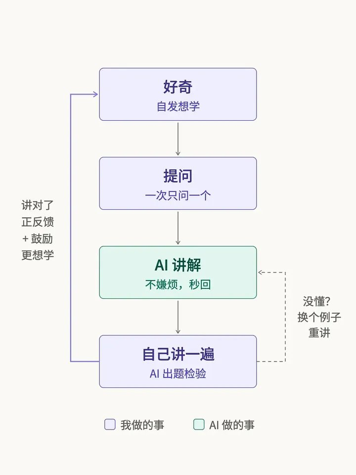

# 看不懂的 SOL：如何利用 AI 自学一切

> 美股作者的 AI 自学方法论：why-what-how 拆解、一次一个问题 + 个人背景 prompt、费曼学习法出题；进阶：知识树地图 + 喂资料；深度版：Agent + Obsidian + Tutor SOP（keep me motivated 等规则），附可直接复制的 prompt。

<!-- more -->

如何利用 AI 自学一切？？

我是写美股的，日常要读财报、盯宏观，碰上完全陌生的新行业也得从头摸。以前这些最费工夫，翻资料、找人问，一轮下来大半天就没了。

这一年多用上 AI Agent，最先变的是我学东西的方式。

1. 兴趣和动力是一切的基础

这是不是普遍适用，我不能确定，但起码对我来说，自发的好奇和自驱力能让我坚持更久。或者说我不能用“坚持”这个词，因为我是自然而然地享受这个过程，不需要任何意志力，只是单纯地想学。

如果是外界推着我学，比如考试、比如工作，DDL 一结束我就会迅速放弃，甚至在过程中也只能勉强做到平均线，抱着得过且过的心态。

当然，有兴趣和自驱力不代表万事大吉，也不会一开始就如有神助。学不会的东西本来就学得很慢，但慢慢来，反而会比较快。

2. 建立一个正反馈的环境机制
   正反馈能让你保持兴趣和动力，不断的小 reward 会给你情绪价值。这时候就该让 AI 来帮忙了，因为 AI 的反馈非常非常快。

比如我想探索一个知识，它可能和 tech 有关，也可能和商业有关，这些都是我完全没在学校受过训练的领域。但是 AI 受过呀。

我可以一遍一遍地说：这个太难了，我不理解，我要举例子，要图解，要通俗易懂，从最最简单的讲起。AI 非常适合干这个。

在现实生活中，其实很难让一个人一遍一遍地给你重复讲同一个东西，但对 AI，我们完全不会有这种顾虑。遇到不懂的，如果没有 AI，就只能等懂行的人给我讲，或者自己慢慢搜。这种极致快速的正反馈，只有 AI 才能给。

而当我让它出题，用自己的话再讲一遍的时候，我就能清楚地知道哪里我没理解、哪些我理解得很好。这时候 AI 也会充分地鼓励我，给我非常多的正反馈。学习的循环就这么建立起来了。

3. 所以具体到底怎么利用 AI 呢？下面我按从简单到进阶，拆解一下具体的方法。

简单版：一个聊天窗口就够了

免费的聊天机器人已经足够强大，只要稍微改改自己的 prompt，就能得到很好的结果。

假设我对某个领域、某个概念完全不了解，比如“什么是 Agent？Agent 有什么用？为什么别人都在用？我能拿它做什么？”，这些就是我第一次接触一个新概念时，脑子里会自然冒出来的问题。

第一，我一般会按“why - what - how”的结构去拆。

第二，一次只问一个问题，不要一下子丢好几个。拿这个例子来说，可以先从“为什么 Agent 这么火”开始。这个问题的答案很简单易懂，你会看到一些有趣的现象，然后再引出 what，也就是它到底是什么。

第三，告诉 AI 你的个人背景。免费的聊天机器人完全不知道你对这个领域了解多少，你让它讲解时，它的回答不会是个性化的，也不会考虑你的背景。所以你要在 prompt 里讲明：我完全不了解，希望讲得通俗易懂，等等。

第四，你同样可以让 AI 用费曼学习法给你出题：根据刚刚讲过的内容出几道题，让你用自己的话再讲一遍。

进阶版：先要一张地图，再把资料喂给 AI

过了简单的关卡，如果我想学得深入一点、系统一点，开始之前我会先让 AI 给我画一张这个领域的“知识树”：主干是什么，分支有哪些，我现在要学的东西长在哪一枝上。

如果这个领域陌生到连树都搭不起来，我就让它从历史讲起。一个东西刚诞生的时候总是简单的，顺着它一步步变复杂的过程往下看，现在的样子也就好懂了。

有了地图，我会让 AI 去找高质量的书或者视频来探索。在学的过程中，我还会把这些资料喂给它，让它有充分的 context，这样我随时提问，就能随时得到答案。

深度版：搭一个自己的学习系统

我会高强度地把 Agent 工具和 Obsidian（一个个人笔记软件）连在一起用。我有一份写自己个人背景的 markdown 文件，还有一份 Tutor SOP 文件，里面写明我喜欢的教学方式。

每次我要求它讲解某些内容，AI 都会自己去读这些文件、补充上下文，用我最喜欢的方式来教我。

这份 SOP 里的规则，都是一次次“学不下去”之后加进去的。挑几条：第一条就是：keep me motivated, keep me going, increase the curiosity. 一节课最多两个概念。第三个留到下一节，在好奇心还在往上涨的时候结束。还有比较基础的，例如多用例子和图解等等。

当我感兴趣、想深入了解时，我也会让它读取费曼学习法的 Skill 来给我出题。

我还会用 Matt Pocock 写的 teach skill，让它通过写 HTML 代码的方式做网页课。我会 customize 更多的交互、课后习题、课后阅读等等。

它会把一个主题拆成几节课，组成一个小小的 set，比如 4–5 节，学完一整套也非常有成就感。

我曾经有遇到一篇讲 AI 的论文，可以说我自己几乎看不懂，但神奇的是 AI 一直鼓励我说我可以，我刚好看见有一段讲到是如何把 Out-of-Distribution（分布外）的东西拆解变成 In-Distribution（分布内）的东西。我心想这不就是现在，我让 AI 把这一篇完全在我知识分布外的东西通过一步步拆解，变成我可以理解的分布内的东西。

拆了十几轮吧，说实话那篇论文到底讲了什么，我已经要忘记了，但这种去拆解那些我不会的知识，然后一步一步把它们内化的方法论我却一直记得。

总结一下：其实核心很简单，你要喜欢、要有兴趣，利用 AI 工具，不会就问，不断接受正反馈。自然而然，我们就可以学习任何事情了！

一段可以直接复制的 prompt：

我是[你的背景，比如：完全没学过编程]，想了解[概念]。请按下面的顺序讲，每次只讲一步，讲完停下来等我回复：

1. 为什么：它为什么最近这么火，解决了什么问题
2. 是什么：用一个生活里的例子讲，不要术语和公式
3. 怎么用：像我这样的人能拿它做什么 如果我说「没懂」，请换一个例子，不要只换个说法。

三步讲完后，出 2 道题让我用自己的话回答，并指出我哪里理解错了。

