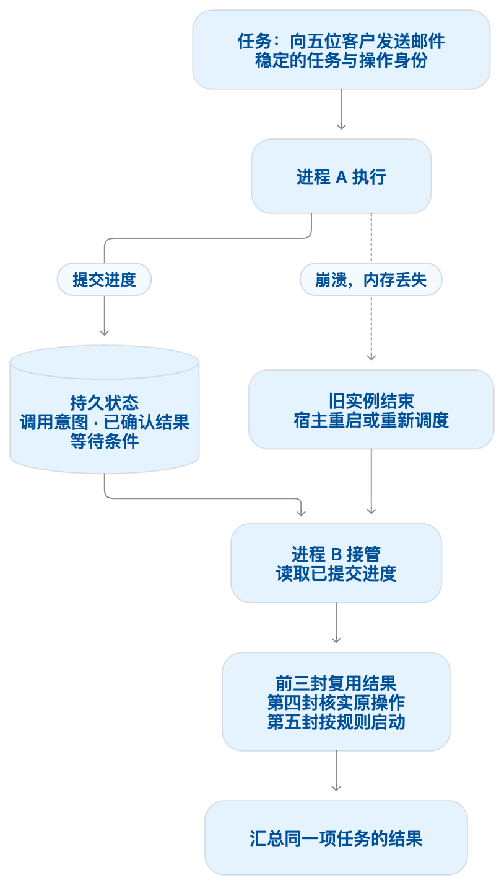
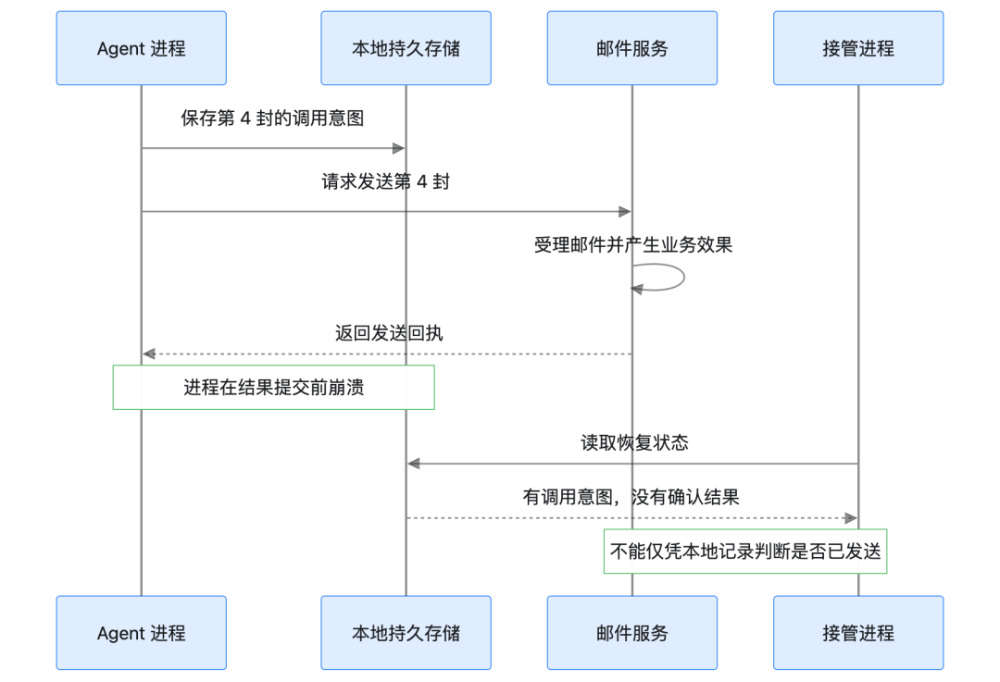
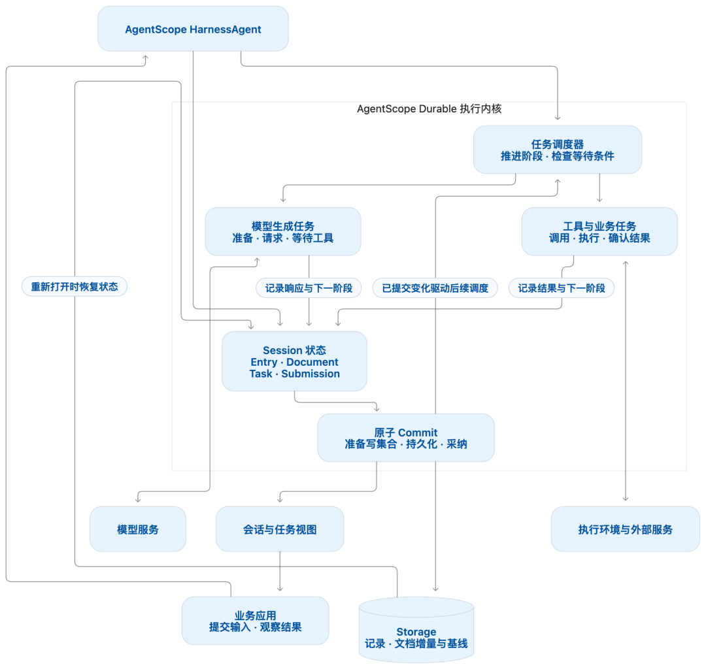
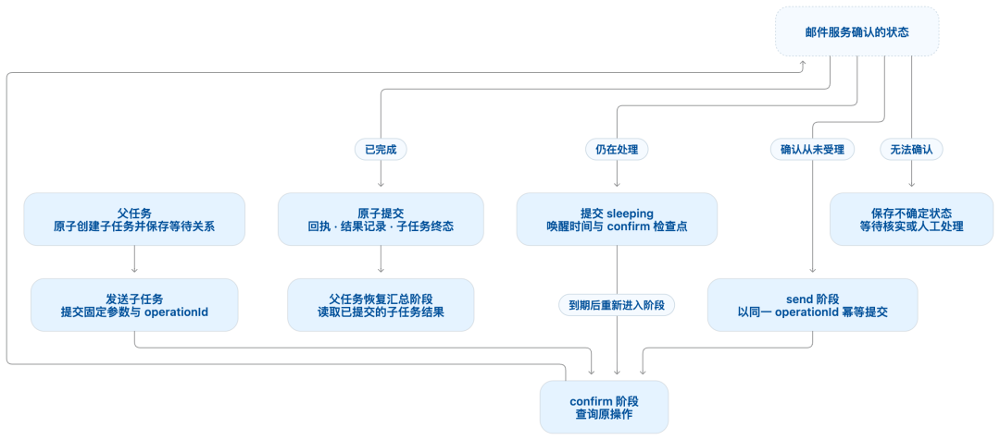
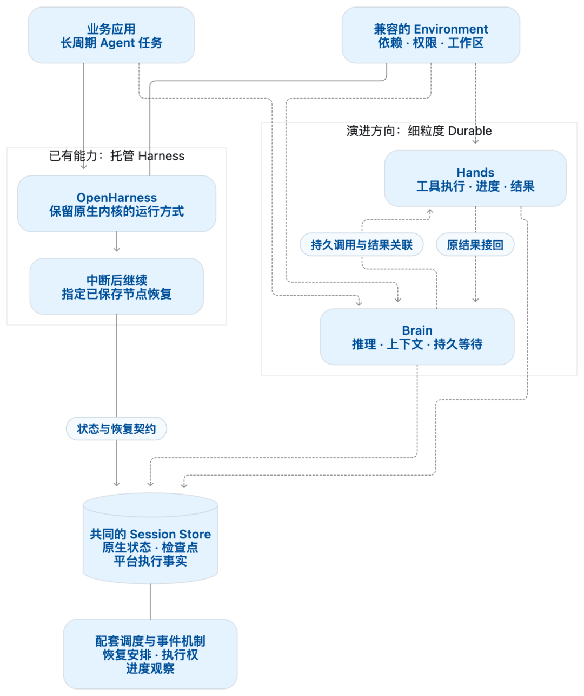
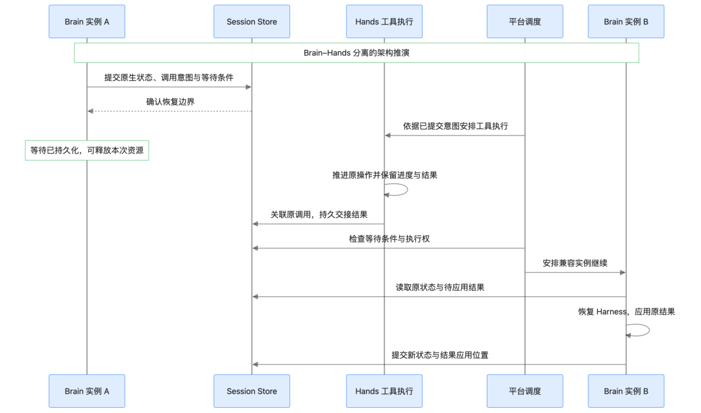

# Durable Agent 详解：如何让 Agent 在云端长期稳定运行

目前，我们可以借助 Agent 框架如 Langchain/AgentScope 等、编码工具如 Codex、Qoder 等构建自己的智能体应用，利用它们提供的 Session 保存与恢复能力保持对话的连续性。但对于需要长期稳定运行在云端的任务，仅仅恢复会话状态还不够，进程崩溃、网络中断或服务重启，都可能发生在模型调用、工具执行或结果保存的过程中。恢复之后，Agent 不仅要记得之前聊过什么，还要知道哪些工作已经完成、哪些仍在等待、哪些结果尚未确认，才能从正确的位置继续，避免错误的重复执行和不必要的资源消耗。

这正是Durable（持久可恢复执行）要解决的问题：将任务进度、调用意图和执行结果可靠地保存下来，在模型调用、工具执行等关键环节建立明确的恢复边界。即使原来的进程退出或执行实例被替换，任务也能依据已保存的状态，复用已确认的结果、核实未完成的操作，并继续推进。会话恢复让对话保持连续，Durable 则进一步让任务执行保持连续。

本文使用一个具体的用户任务示例“向五位客户发送通知邮件”，解释为什么保存聊天记录还不够，再以 AgentScope 构建的 Agent 为例，展开任务状态、持久提交和故障恢复的通用设计，最后结合 Alibaba Cloud AgentCore 已有的 Harness 托管与节点恢复能力，讨论共享状态、可靠调度及 Brain / Hands 分离如何支撑更完整的长期托管服务。

## 01 Durable 是什么：让任务跨越进程的生命周期

### 从“能运行”到“中断后仍能推进”

假设用户给助手一个任务：根据已经确认的名单和正文，向五位客户发送通知邮件，并汇总发送结果。

Agent 生成工具调用，工具开始逐封发送。前三封已经确认完成；第四封刚被邮件服务接受，本地还没保存结果，进程就崩溃了。第五封尚未开始。

新进程启动后，真正困难的问题并不是如何再次调用模型，而是如何判断第四封邮件的状态：

重新发送，可能让客户收到两封。

直接跳过，可能漏发。

把整个任务重做，会重复前三封。

让用户说一句“继续”，也不会凭空补回丢失的执行事实。

Durable 要把这些判断所依赖的事实保存在进程之外，并定义恢复规则。恢复程序先读取已提交进度，再决定复用结果、继续等待、核实原操作，还是启动尚未执行的工作。



这不要求一个进程永远在线。进程可以退出，任务可以等待，执行资源可以释放；只要状态仍可访问、兼容的执行者能够被唤醒，工作就有继续推进的依据。

### 它想保证什么

持久执行通常需要建立四项能力：

1. 输入不因进程退出而消失。已受理任务有稳定身份，客户端重试可以关联原任务。

2. 已确认工作可以复用。保存完整的模型结果、工具结果和必要状态，恢复时不必重做已经确认的步骤。

3. 未完成工作有明确去向。正在执行、等待子任务、等待时间和结果不确定，分别采用对应的恢复方式。

4. 执行过程可以被重新观察。用户断线后能重新查看进度和结果，观察连接不必一直陪着任务运行。

这里的恢复位置是已提交的逻辑边界。它可能是一次模型响应、一个工具调用、一个任务阶段，也可能是开发者明确保存的一段业务进度。它不是旧进程的某条机器指令，也不是模型推理过程中尚未完成的内部计算。

因此，Durable 不等于“永不失败”，也不自动意味着外部动作恰好执行一次。服务持续不可用、凭据失效、工具结果无法确认时，任务仍可能进入失败或需要处理的状态。它要让失败留下可解释、可恢复的事实。

### 哪些场景最需要它

当任务持续时间长于一次连接、一次请求或一个实例的寿命时，Durable 的价值会变得明显：

| 场景 | 典型等待或中断 | 需要保留的事实 |
| --- | --- | --- |
| 常驻个人助手 | 用户离线、服务重启、定时唤醒 | 已受理输入、待办和唤醒时间 |
| 编码与研发助手 | 构建、测试、CI、代码审查耗时较长 | 已完成修改、原构建身份和结果 |
| 业务自动化 | 邮件通知、订单操作、外部系统调用 | 操作身份、确认结果与不确定状态 |
| 多阶段分析任务 | 多个数据源、子任务并行、人工确认 | 子任务进度、依赖关系和继续条件 |

本地交互通常把用户、终端、工作目录和 Agent 进程放在一起，用户可以观察异常并决定如何继续。云上后台服务则会遇到实例替换、滚动发布、连接中断和资源回收，接管任务的实例也未必是原来的实例。任务越长，越不能假设同一个进程和同一条连接会陪它走到结束。

在本地，持久执行可以帮助任务跨越应用重启；在云上，它还需要配合可访问的持久存储、执行调度和环境重建。把本地程序搬进一台有磁盘的 VM，只解决了运行位置和部分文件保留问题，任务恢复仍需单独设计。

## 02 为什么很多 Agent 有会话历史，却没有解决任务恢复

### 普通 Agent 循环把进度留在了调用栈里

常见 Agent 的执行流程很直观：

```text
收到输入 → 请求模型 → 得到 tool call → 执行工具 → 得到 tool result → 再请求模型 → 输出答案
```

在一次正常执行中，程序知道当前执行到哪里，因为函数调用栈、局部变量和 Promise 都还在。对于交互式 Coding Agent，这种方式也便于实时展示输出、接受用户修正和继续对话。

但进程崩溃后，这些信息消失了。剩下的会话文件可能只记录：

```text
user: 向五位客户发送这份通知
assistant: send_batch_emails(recipients, body)
tool result: 尚未写入
```

这份记录足以说明模型提出了什么，却不能证明工具内部完成了什么。send_batch_emails是一个调用，内部发送了三封、四封还是五封，对外层循环仍可能是不可见的。

一个支持会话恢复的 Agent 产品就是容易理解的例子：它可以用 JSONL 保存带身份与父子关系的会话记录，支持恢复上下文和会话分支。这种能力很有用，但会话记录本身并不自动包含任意业务工具内部的执行检查点。

这里讨论的是以交互循环和会话持久化为主的执行方式，并不意味着所有 Agent 框架都缺少 Durable 能力。部分框架已经引入持久工作流、任务状态机和检查点；关键要看实际使用的执行路径提供了哪些保证。

### 恢复对话与恢复执行，需要不同的契约

对于以交互为中心的框架，恢复会话的主要目标是让模型重新获得上下文，让用户能够继续工作。工具通常被抽象为一个接收参数、返回结果的函数；函数内部怎样访问服务、保存中间进度，属于工具实现的职责。这种接口容易扩展，却没有要求工具公开“如何从中断中恢复”。

Durable 则需要更强的契约：任务由谁持有执行权，状态在哪个时刻生效，工具是否允许重放，等待怎样跨越重启，代码升级后如何解释旧状态。它会同时影响调度、存储和工具接口，无法只靠给现有循环加一个保存 messages 的开关完成。对于仍在使用普通函数工具的应用，接入持久框架后，也需要继续设计工具内部的恢复边界。

### 最大的缺口，是外部事实与本地记录之间的空隙

即使把每封邮件拆成独立工具调用，仍然存在一个无法靠聊天记录消除的窗口：



有调用意图、没有结果，只能说明“可能执行过”。请求可能根本没有发出，也可能已被接受但响应丢失，还可能像图中一样已经收到回执，只差最后一次保存。

所以，一套可靠机制必须同时处理两件事：内部状态如何提交，外部动作如何确认。前者可以通过事务和持久任务解决；后者还需要业务系统提供幂等标识、原操作查询，或者明确的补偿与人工处理路径。

### 为什么常见补丁还不够

| 常见做法 | 能解决什么 | 仍然缺少什么 |
| --- | --- | --- |
| 保存聊天记录 | 重建模型上下文 | 工具内部进度、可靠等待与恢复策略 |
| 用数据库保存 messages | 提高历史数据的保存能力 | 写入顺序、原子提交和执行状态机 |
| 进程崩溃后自动重启 | 恢复一个运行实例 | 从哪里继续、哪些动作不能重做 |
| 失败后重试整个 Agent | 再给任务一次机会 | 对已完成步骤和外部副作用的识别 |
| 给模型补一句“上次中断了” | 帮助模型重新规划 | 缺失的业务事实与确定性的接续规则 |
| 给工具加 async/await | 让等待不阻塞线程 | 跨进程存在的等待关系和结果接回 |

问题也不在于 JSONL 天生不可靠、SQLite 天生可靠。文件和数据库都可以承载持久协议，差别在于保存了什么、何时确认生效，以及崩溃后如何解释它。

要从这些补丁走向 Durable，需要把原本藏在调用栈中的执行进度，变成能够存储、验证和重新调度的数据。

## 03 如何把 Agent 执行过程变成可恢复的状态

### 从 Agent 循环走向持久执行内核

AgentScope 的 HarnessAgent 将模型推理、上下文、工具和会话管理组织在一起，并通过 Durable 执行内核管理整个运行过程。模型生成、工具调用和业务流程都是持久任务，由任务状态驱动 Agent 循环。上下文、任务阶段和业务数据在同一套提交协议下变化，进程重启后从已保存的阶段继续。

HarnessAgent 管理模型与工具的协作，Session 管理持久状态与提交顺序，任务调度器推进可运行的阶段，Storage 保存执行数据。这几层共同保证：输入有身份，步骤有检查点，等待有条件，结束有结果。

下面以 AgentScope 展开这套机制。其核心是与具体框架无关的持久执行协议，同样适用于其他 Agent 框架。



图中的模型和工具调用发生在提交事务之外。调度器根据已提交状态选择可执行任务，任务处理器运行一个阶段，再提交结果和下一状态。存储、调度与观察因此围绕同一条状态变化序列协作。

### Session 保存的不只是消息，还有任务与业务状态

AgentScope 使用 Session 作为统一的状态与提交范围，一个 Session 可以包含多个 Conversation。Conversation 描述一段对话，Session 则同时管理这段对话背后的输入、任务、业务文档和执行关系。

| 对象 | 负责表达什么 | 在邮件任务中的例子 |
| --- | --- | --- |
| Conversation | 对话记录及其上下文范围 | 用户与邮件助手的持续对话 |
| Entry | 不可变的会话记录 | 用户要求、模型响应、工具结果 |
| Document | 可在事务中更新的结构化状态 | 收件人计划、发送回执、当前运行进度 |
| Task | 带阶段、检查点和终态的持久状态机 | 模型生成、工具调用、逐封发送 |
| Submission | 应用提交及其处理结果 | 发送请求是否排队、是否被处理、是否获得回答 |
| Commit | 一组关联变化的原子提交 | 保存回执，同时完成子任务并更新发送进度 |

Entry 保留已经发生的记录，Document 保存后续阶段需要读取的数据，Task 决定下一步可以做什么。例如，“第四封邮件已收到回执”是一项业务事实；“回执已经写入对话”和“父任务可以继续汇总”则是需要一起推进的执行状态。

AgentScope 从持久记录中重新构建上下文：按有效的会话范围读取消息、模型响应及对应工具结果，再应用已保存的压缩或上下文调整。内存中的 messages 列表是这些状态的运行时表示；它消失后，恢复程序仍能重建继续推理所需的信息。

AgentScope 的 Document 是带类型和版本的结构化状态，除了业务数据，也保存 Agent 配置、待处理输入、运行中的模型与工具，以及使用量等信息。文档修改通过提交产生增量操作，并在需要时保存完整基线；恢复时使用基线与后续增量重建有效状态。

应用可以注册自己的 Document 和 Task，例如邮件计划、审批阶段或数据处理进度。这些扩展状态与内置任务使用同一套提交机制，无须把所有中间数据都塞进提示词或工具输出。

### 原子提交，让记录、文档与任务一起生效

如果先写“工具完成”，再保存工具结果，中间崩溃就会留下一个没有结果的完成记录。反过来，先保存结果、再推进任务，也可能让接管者误以为还需要执行。

AgentScope 的一次 Commit 同时支持追加 Entry、修改 Document、创建或推进 Task，以及更新 Submission。以第四封邮件为例，同一批写入可以包含：

- 追加工具结果 Entry
- 更新邮件计划 Document 中的发送回执
- 将发送 Task 置为完成
- 更新会话中的工具运行状态

提交按以下顺序进行：

```text
取得 Session 的提交顺序
  → 在事务草稿中准备关联变化
  → 校验并冻结写集合
  → Storage 原子保存
  → 采纳已持久化的新状态
  → 更新视图、通知等待者、调度后续任务
```

AgentScope 串行化同一 Session 内的状态提交，模型请求和工具执行则在提交事务之外推进。调度器可以运行多个已就绪任务，但这些任务的状态变化仍然按序生效。一次外部调用持续十分钟，不会因此占据十分钟的状态提交事务。

普通提交只有持久化后才被内存状态和观察视图采纳。Storage 确认写集合持久化后，Session 一次性采纳新状态，再通知调度器与观察者。准备失败时丢弃草稿；如果存储异常发生在已经持久化之后，已提交变化仍然有效，当前 Session 停止运行，重新打开时以实际保存的状态恢复。

AgentScope 同时支持受限的延迟提交，用于正在生成的文本或运行中的工具输出等可丢失进度。只有满足约束的已有进度文档修改才能延迟保存；一旦提交包含新消息、任务阶段、输入受理或其他关键变化，就按普通提交立即持久化。后续提交读取这些文档时，也会将尚未保存的变化一并纳入持久边界。这样既能控制高频写入，也不会让任务依据尚未确认的事实继续执行。

这一原子性覆盖的是 Harness 管理的数据。发邮件、访问外部数据库或执行 shell 命令仍然是外部动作，需要单独定义确认和恢复规则。

### Task 把调用栈中的进度变成显式阶段

普通函数依靠程序执行到第几行来决定下一步。AgentScope 的 Task 保存任务类型与版本、输入、所属会话或父任务，以及当前状态和 checkpoint。恢复程序用任务类型找到处理代码，用 checkpoint 确定从哪个阶段开始。

Task 的生命周期包含以下状态：

| 状态 | 含义 | 调度方式 |
| --- | --- | --- |
| pending | 已持久创建，等待运行 | 调度器启动对应阶段 |
| running | 正在执行某个阶段 | 提交下一检查点、等待或结果 |
| waiting | 等待指定任务结束 | 保存依赖任务及汇合策略，当前不运行代码 |
| sleeping | 等待一个时间点 | 保存唤醒时间与下一阶段 |
| completing | 结果已决定，所属子任务尚未全部收尾 | 等待子任务收敛，不再运行自身阶段 |
| terminal | 已结束 | 保留最终结果，供其他任务读取 |

```json
{"kind":"send-notice","version":1,"input":{"operationId":"notice-2026-10-customer-4","recipient":"customer-4","bodyRef":"approved-notice-body"},"state":{"status":"sleeping","until":1793289600000,"checkpoint":{"phase":"confirm"}}}
```

这条记录同时保存了原操作身份、下一阶段和唤醒时间。等待期间没有需要保留的函数调用或 Promise；时间到达后，AgentScope 调度器重新调用confirm阶段。下一阶段需要的数据进入输入、checkpoint 或 Document，阶段之间通过这些持久数据交接。

恢复从已保存阶段的入口重新执行，不会跳回崩溃前的某一行。一个阶段如果包含多个不可重复的外部动作，就应继续拆分阶段，或者为这些动作保存可确认的操作身份。单纯在函数内部增加更多await，不会增加持久恢复边界。

### 模型生成与工具调用，都由持久任务推进

AgentScope 的 Agent 循环由模型生成任务和工具任务组成。一次输入被受理后，先保存 Submission；输入进入当前运行时，写入用户 Entry 并创建模型生成任务。模型提出工具调用时，创建对应工具任务，并保存生成任务的等待关系。

```text
提交输入
  → 保存 Submission 与用户 Entry
  → 创建模型生成 Task
      prepare：准备上下文与模型配置
      request：保存请求阶段，再调用模型
      tools：保存模型响应，创建工具 Task 并持久等待工具 Task
      tool：保存调用意图 → 执行 → 提交结果
  → 工具结束：读取已提交结果，创建下一轮生成 Task
  → 得到最终回答，保存 Entry 并结束 Submission
```

模型返回 tool call 后，AgentScope 将模型响应、要创建的工具任务和“接下来等待这些任务”的状态一起提交。提交后即使进程退出，重启时仍然知道应该执行哪些调用，不需要让模型重新猜测上次计划。

模型生成任务自身包含prepare、request、retry、poll和tools等阶段。准备阶段固定上下文位置、模型选择和必要请求选项；请求阶段发生中断时，AgentScope 将它作为一次未完成尝试处理。已保存的部分文本保留为中断记录，不作为完整响应驱动工具执行。

重试次数、退避时间和下一阶段都进入任务状态。对提供异步响应句柄的模型，AgentScope 保存句柄与查询时间，恢复后继续查询原请求。持续在同一阶段崩溃的任务受到重启次数限制，达到上限后记录失败原因并结束，避免每次启动都再次触发同一个错误。

工具结果全部就绪后，生成任务读取原工具记录与结果，完成本轮收尾，再交接给下一轮生成。这里的“继续推理”由持久任务之间的关系决定，原来的函数调用栈已经不再是唯一依据。

### 普通工具：先记录意图，再决定中断后能否重放

AgentScope 保留工具接收参数、返回结果的使用方式，并由内置工具 Task 管理它的持久生命周期。工具 Task 区分两个阶段：

call 阶段：解析工具、校验参数、执行调用前检查，然后保存最终参数、重放策略和执行意图。提交成功后执行工具，最后提交结果。

execute 阶段：作为“意图已保存、结果未确认”的恢复入口，判断能否使用保存的参数重新执行。

正常执行在call阶段提交意图后直接调用工具；恢复进入execute阶段时，AgentScope 按外部动作可能已经发生处理。只有调用时保存的策略和恢复时的工具策略均为safe，才使用已经确认的参数重新执行，不重新运行可能改变参数的调用前处理。否则保存interrupted结果和已提交的部分输出，让后续流程处理不确定性。

完整结果提交时，将结果 Entry、工具运行文档和 Task 的结束状态一起保存。父任务据此判断该工具已经结束，并取得同一份结果。

```text
原子提交调用意图与 execute 阶段
  → 在事务外执行工具
  → 原子提交工具结果与任务结束状态
```

工具声明“可安全重放”，是工具作者对业务行为的承诺，框架不会自动让发送邮件变得幂等。工具返回明确错误与执行状态无法确认也应分别记录：前者已经取得一次调用的结果，后者还需要核实原动作。

如果只是把一个黑盒send_batch_emails()注册成普通工具，执行内核能知道这次调用中断，却不知道内部完成了哪几封邮件。更细的恢复需要把工具自身改造成多阶段任务。

### 自定义任务：把五封邮件变成可接续的业务流程

AgentScope 通过自定义任务把工具内部的业务阶段纳入同一套持久执行机制。邮件助手注册一个发送任务类型，使用 Document 保存已经确认的收件人计划，为每封邮件建立子任务，并在同一次 Commit 中保存子任务身份和父任务的等待状态。

每个子任务分别处理发送意图、原操作查询、等待与结果确认。父任务的等待不是内存中的Promise.all，而是一条持久关系：等哪些 Task、采用什么汇合策略、结束后进入哪个阶段。

AgentScope 提供allSettled和failFast两种等待策略：前者等待全部依赖任务结束后汇总，后者在子任务失败时请求其他所属子任务停止，并等待它们收尾。父任务即使已经决定自己的结果，只要仍有需要收尾的所属子任务，就先处于completing，等它们结束后才成为真正的终态。进程重启后，调度器从这棵持久任务关系中继续等待或收尾。

为了处理“已经发送但回执未保存”的窗口，本例增加一项明确前提：邮件服务支持按稳定操作标识幂等受理，并能查询原操作。每封邮件的操作标识在外部调用前保存，并绑定固定的收件人和正文。



在这项任务中，Agent 负责理解用户要求、形成计划和生成汇总，AgentScope 的任务状态机负责发送阶段的持久接续。幂等受理和原操作查询由邮件服务提供，任务处理器据此确认外部动作并提交结果。

现在恢复前面的故障：

| 邮件 | 恢复时的事实 | 继续方式 |
| --- | --- | --- |
| 第 1～3 封 | 已提交终态与回执 | 直接读取，不再发送 |
| 第 4 封 | 已保存操作身份，没有确认结果 | 进入查询阶段；确认已完成后补记回执 |
| 第 5 封 | 任务已存在，尚未开始外部动作 | 从其初始阶段执行 |

子任务创建与父任务等待一起提交，解决的是“进程退出后还记不记得这五项工作”；每封邮件的业务操作标识和查询阶段，解决的是“外部动作发生后如何核实”。两层机制配合，才能恢复到某一封邮件。

如果邮件服务既不支持幂等，也无法查询，第 4 封仍需保留不确定状态并交由业务核实。持久状态机提供明确的处理位置，不会凭空创造外部系统没有保存的事实。

### 重新打开 Session，调度原任务继续执行

应用使用 AgentScope 时，先配置模型、工具和任务定义，打开持久 Storage，再取得 Session 中原有的 Conversation。输入提交后返回 Submission 身份，应用可以等待结果，也可以稍后重新查询。

进程重启后，主要流程是：

```text
重新打开同一 Storage
  → 恢复 Conversation、Entry、Document、Task 与 Submission
  → 检查任务类型、版本和阶段处理器
  → 启动任务调度器
      pending/中断的 running：从已保存阶段重新进入
      waiting：重新检查依赖任务
      sleeping：继续等待原时间点，已到期则运行
      completing：检查所属子任务是否已经收尾
      terminal：直接提供保存的结果
  → 每次状态变化仍通过同一条原子提交序列
```

AgentScope 通过 Registry 注册任务、工具和扩展定义。存储中保存状态、身份和定义版本，处理代码由 Registry 提供。重新打开时，内核核对任务类型和版本，运行必要的状态迁移；任务定义缺失或无法迁移时，保留原状态并报告阻塞原因，兼容定义就绪后再继续调度。

同一次业务输入重试使用相同的requestId，AgentScope 返回原 Submission，避免再次创建工作。重新等待一个 Submission，只恢复观察；关闭当前 Harness 停止本次驱动并保留未完成任务。业务取消先持久记录取消意图，再通知活动阶段停止，等待所属子任务结束，最后提交任务终态。

因此，恢复既不要求重放整个 Agent 循环，也不等于再次提交原提示词。它从持久任务图中寻找尚未完成、当前可运行的阶段，复用已经确认的结果，并继续原工作。

### Storage、观察视图与宿主唤醒各自负责什么

AgentScope 通过 Storage 接口原子保存和读取执行记录，存储实现与任务语义分离。Document 使用增量操作与定期完整基线保存，任务记录保存完整的当前状态；重新打开时据此恢复有效状态，无须序列化整个进程。应用可以按部署需要选择本地持久存储，或接入平台提供的远程后端。

AgentScope 的会话视图、文档视图和任务图订阅提交后的变化，呈现输入受理、模型输出、工具进度、依赖关系和最终结果。重新连接时先取得当前视图，再接收后续变化。允许延迟保存的预览是明确的例外，不作为恢复的唯一依据。只读打开的 Session 提供查询与观察，不启动任务调度，也不获得写权限。

AgentScope 通过resume()启动任务调度器，通过唤醒信息告诉宿主“现在有工作可运行”以及“下一次应在何时继续”。常驻宿主使用本地定时器推进到期任务；云端宿主通过onWake接收变化，持久安排下一次唤醒，在进程被回收后重新打开 Session 并调用resume()。调度器负责判断任务是否可运行，宿主负责提供实际执行机会。

多实例运行还需要共享存储、执行权隔离和兼容环境。任务在sleeping或waiting中不占据一个活动阶段调用，但正在运行的真实进程和外部工具仍有自己的生命周期。接回这些外部工作，需要下一部分的平台托管与工具执行机制配合。

AgentScope 的 Durable 执行内核让Entry、Document 和 Task 共同描述一项工作的事实与未来，并通过原子 Commit 保持一致。Agent 循环由持久状态机驱动，宿主与平台则把可运行的工作交给实际执行资源。框架负责“从哪里继续、怎样继续”，平台负责“状态长期保存在哪里、由哪个实例继续”，两者通过存储与唤醒契约连接。

## 04 阿里云 AgentCore 的Durable Agent 设计理念

### 已有的托管能力，是 Durable 向平台延伸的基础

阿里云 AgentCore 是面向 AI Agent 的云端托管平台，提供 Harness 托管、会话管理、任务中断续接与节点恢复能力，帮助开发者将智能体应用稳定运行在云上。

AgentCore 已经提供托管 Harness 的能力，支持任务中断后继续执行，也支持从指定的已保存执行节点恢复。这让 Agent 的一次运行拥有可以重新接续的状态，业务任务不再只存在于一次交互或一个运行进程中。

托管 Harness（OpenHarness）保留底层内核的推理、上下文和工具使用方式，由平台衔接其状态保存与恢复能力。这里的恢复节点，是内核及其适配机制能够保存和解释的执行位置；节点恢复不会自动撤销已经发生的外部业务动作。不同内核开放的状态与控制接口，也决定了能够恢复到多细的粒度。

在这一基础上，更细粒度的 Durable 可以进一步进入模型生成、工具调用、结果应用和长时间等待等环节。前文的任务状态机回答“这个阶段如何继续”，平台则需要回答“状态保存在哪里、何时安排继续、由哪个实例执行”。

Brain–Hands 分离与更完整的 Agent as a Service，是在已有托管能力之上继续建设的方向。下面从架构设计角度讨论 Durable 如何融入这些方向，以及它们如何与现有的 Harness 托管共同使用一套持久基础。



图中分别展示已有托管能力、后续演进方向，以及两者可以共同依托的状态、调度与环境抽象。它们之间的联系是持久执行契约：既能承接原生 Harness 的恢复节点，也能承接深入内核后的任务阶段和工具交接状态。

### 共同的 Session Store，连接原生状态与平台执行事实

平台统一的是状态的保存、提交和读取契约。Agent 框架和运行时仍然管理自己的 context、messages 和 checkpoint 格式，适配层将这些原生状态与平台能够理解的任务身份、工具意图、等待条件和结果应用位置连接起来。

Session Store 为这种协作提供共同的持久基础：记录状态版本、保留检查点与结果引用、返回可查询的提交回执，并在恢复时提供一致的状态集合。它与可靠调度、事件流衔接，使任务既能被接续，也能被业务应用重新观察。

| 状态层次 | 保存什么 | 谁解释并使用 |
| --- | --- | --- |
| Harness 原生状态 | 上下文、消息、原生检查点及继续位置 | 对应框架及其适配层 |
| 平台执行事实 | 输入受理、执行权、工具授权、等待条件、结果应用和终态 | AgentCore 的执行协调与恢复机制 |
| 工具执行事实 | 原执行身份、物理进度、完整结果及交付状态 | 工具提供方；在分离架构中由 Hands 衔接 |
| 工作区与产物 | 文件、资源绑定、产物及必要版本 | Environment 与工具环境 |
| 用户可见视图 | 消息、进度、工具状态和最终结果 | 业务应用与观察接口 |

这些状态可以分别存储，通过身份与版本建立关系。较大的原生状态和结果可以保存为不可变对象，由提交记录引用；工作区文件由相应环境承载。平台不要求所有内容进入同一份聊天日志。

接入不同框架时，适配层负责声明可保存和恢复的边界。能够参与模型完成、工具授权和结果应用提交的框架，可以提供更细的恢复控制；主要开放会话恢复接口的框架，则按其原生能力确定恢复范围。共同存储可以承接不同载荷，但恢复旧 Session 仍需要匹配的内核和状态格式。

因此，共同的 Session Store 可以同时支撑托管 Harness 与更深度的 Durable 设计。统一存储契约可以减少重复建设，各条接入路径仍然保留自己的恢复语义与粒度。

### 将恢复节点延伸为执行过程中的一致性边界

从指定节点恢复，进一步走向细粒度 Durable，关键在于定义清楚：哪些事实必须一起保存，保存成功后才允许发生哪些后续动作。

以一次工具调用为例，只有保存“模型想调用工具”还不够。恢复所需的信息还包括 Harness 的继续位置、固定的工具参数、原生调用与平台任务之间的关联，以及等待结果的条件。将这些信息放入同一个一致性边界，才能让恢复者明确判断：调用是否已获准执行、结果属于哪次调用、下一步应当等待还是继续推理。

这一设计可以把第三部分的原子 Commit 延伸到平台协作中。内核提交自身可恢复的状态，平台同时保存对应的执行事实；后续派发以已确认的提交为依据。涉及独立存储与消息系统时，可以将待派发意图与状态一起持久保存，再通过可重试的投递机制完成交接，避免状态已经推进、后续工作却没有执行依据。

这里需要分别表达三个进度：调用已被受理、工具已经完成、结果已经进入 Harness 上下文。它们之间可能间隔很久，也可能在任何一次交接时发生故障。将进度分别保存，恢复才能定位缺失的一步，而不是重新执行整段流程。

对托管 Harness，这些边界需要结合内核已有的恢复接口建立；对能够深入控制执行过程的内核，则可以直接把模型完成、工具授权和结果应用设计成持久阶段。两种方式共享状态基础，但并不因此自动拥有相同的控制深度。

### Brain–Hands 分离：让推理与工具拥有各自的生命周期

Brain–Hands 分离可以看作上述持久交接机制的进一步展开：Brain 管理推理与上下文，Hands 管理工具的实际执行，两者通过已保存的调用身份、状态和结果协作。

这种分离的核心，是让“等待工具”成为可持久表达的状态。Brain 提交调用和等待条件后，理论上就可以释放本次执行资源；工具由独立的执行机制继续推进。结果具备继续条件时，再由兼容的 Brain 实例读取原状态、应用原结果。整个过程不再要求最初的推理进程始终等待。

| 逻辑职责 | 需要保留的事实 | 恢复目标 |
| --- | --- | --- |
| Brain 推进 | 上下文、检查点、待应用结果及应用位置 | 从原阶段继续推理，不重复应用结果 |
| Hands 执行 | 原操作身份、执行进度、完整结果 | 查询或接回原操作，明确其完成范围 |
| 结果交接与调度 | 结果归属、交付进度、等待条件与恢复安排 | 已有结果能够再次交付，满足条件的任务能够再次获得执行机会 |



在这一设计中，工具完成通知只是继续执行的触发器，真正决定下一步的是持久状态。调度需要能够重新发现尚未完成的恢复安排，并约束当前有效的执行者，防止旧实例与接管实例同时推进同一份状态。这样，工具等待、结果交付和推理恢复才不会分别绑定在某个进程或某条连接上。

回到五封邮件的例子，这种分离让推理实例在发送期间退出也不影响已交接的工作；逐封恢复的粒度则仍然来自第三部分的业务任务设计。前三封的回执可以复用，第四封按原操作身份核实，第五封从尚未执行的阶段继续。Brain–Hands 分离提供独立接续的条件，业务检查点与外部系统的确认能力共同决定能够恢复多细。

如果工具本身不支持查询原操作或识别重复请求，分离架构也不能自动消除“动作已经发生、结果尚未确认”的窗口。这类不确定性仍需成为任务状态的一部分，由相应业务规则处理。

### Environment 让已保存状态拥有继续执行的条件

无论使用已有的节点恢复，还是进一步采用 Brain–Hands 分离，重新读取状态都只是恢复的一部分。新的执行实例还需要兼容的内核、依赖、模型与工具配置，以及访问工作区和业务资源的权限。

从架构上看，Environment 可以承担这些执行条件的描述与绑定：状态说明任务走到了哪里，环境定义说明继续运行需要什么，调度机制决定由谁承接。对于本地 Agent 向云上迁移，这三部分共同构成可迁移的执行单元。

在分离架构中，推理与工具还可以使用不同的计算资源和生命周期。Brain 按需装配 Harness 与模型能力，Hands 按工具需要使用 Sandbox 或外部执行服务；持久工作区和产物通过稳定引用继续访问。

环境定义提供重建依据，文件与产物仍需相应的持久存储。部分写入的文件不能直接视为工具完成，恢复时还需要结合操作身份、产物版本和已确认结果判断进度。因此，Environment 与 Session Store 分别保留运行条件和执行事实，两者共同支撑任务接续。

### Agent as a Service：从任务恢复走向服务连续性

已有的 Harness 托管使任务能够中断后继续，更完整的 Agent as a Service 则希望把这种连续性扩展到整个服务生命周期：用户可以离线，连接可以断开，计算实例可以替换，任务仍然保有清晰的身份、状态和后续安排。

从这一目标出发，执行、观察和业务控制需要分别管理。任务是否继续，由已保存的执行状态与调度条件决定；进度如何展示，由可查询的消息与事件视图决定；补充输入和取消，则需要成为能够确认受理、跟踪结果的持久操作。实时输出帮助用户了解过程，已确认的状态与结果负责支撑恢复。

长周期服务还需要共同管理检查点、关联结果、工作区和产物的保留范围。只要未完成任务仍然引用某份状态或产物，压缩和归档就应保留它的恢复依赖；随着历史聊天数据的增长，也需要控制重新装载状态的成本。这些都是从“某次运行可以恢复”走向“任务能够长期托管”时需要持续完善的能力。

对 AgentCore 而言，已有的托管 Harness、中断续接和指定节点恢复提供了起点；共同的 Session Store 可以连接不同内核与执行方式；进一步的细粒度提交、Brain–Hands 分离和可靠调度，则为更完整的 Agent as a Service 提供架构基础。它们共同指向的目标是：让业务任务持续存在，让计算资源围绕任务的实际进度参与执行。

