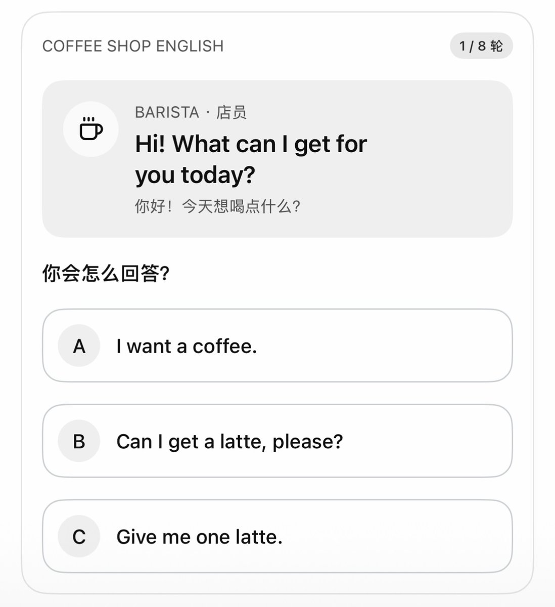
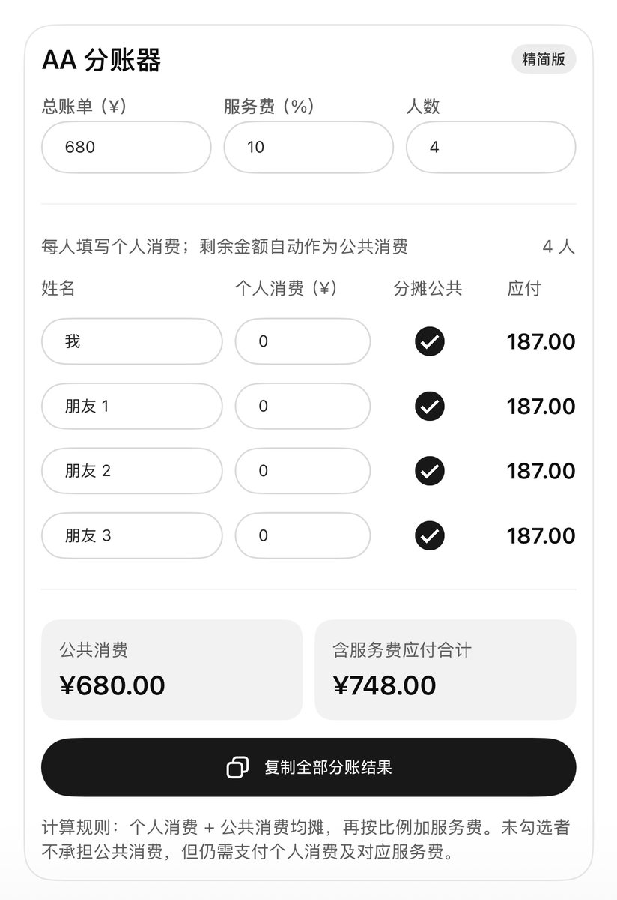
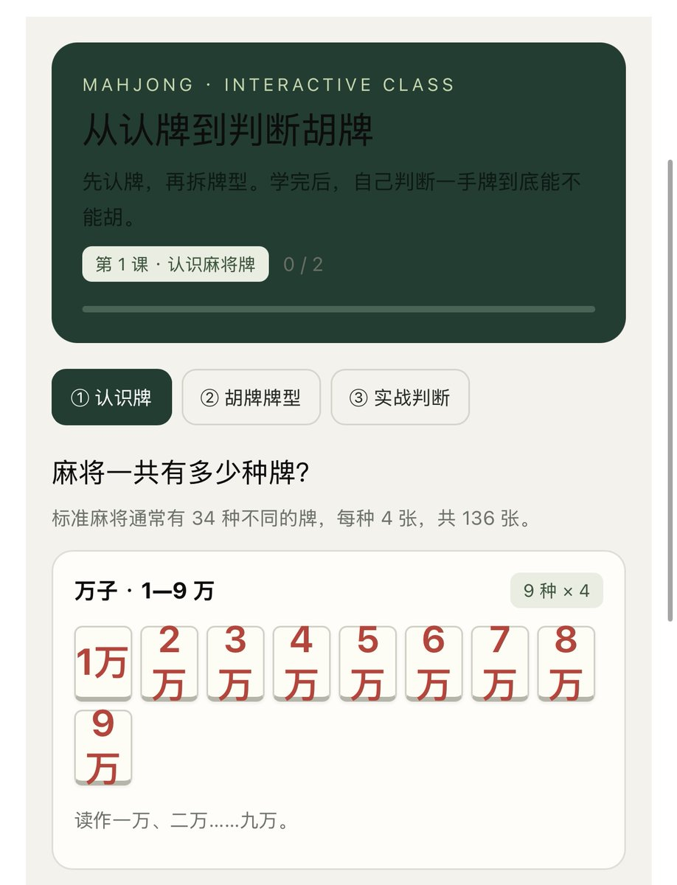

# Eian（@EianLu）：ChatGPT 这个更新被严重低估了——10 个最具代表性的 Intelligent UI 玩法（附提示词）

> 深度评测 ChatGPT 动态交互界面 Intelligent UI 核心潜力：跳出传统的纯文字输出，演示如何通过特定提示词让模型直接在会话中渲染出可交互滑块、动态甘特图、计算器表单、多选过滤组件与可视化白板，系统梳理 10 个颠覆传统网页交互的产品级应用玩法。

<!-- more -->

昨天我发了一条帖子说：为什么没人分享 ChatGPT 的 Intelligent UI？

因为这本身是一个可玩性非常高的功能，我甚至觉得是颠覆性的，彻底颠覆了传统交互媒介。

以前 AI 回复，大多数是文字类回复，但现在是直接给你现场生成一个可以直接调节，直接点击，并且完全自适应的动态交互界面。

一句话就是：内容即交互

虽然说 Claude 今年 3 月也上线了类似功能，

但更多是在对话里直接出交互图表和示意图的功能，

远没有 chatgpt 做的这么完善和成熟

Chat GPT 这次是直接长在回答里，最关键的一点是：免费用户也可以用。

这两天我把官方说明、很多媒体的实测、网友的玩法全翻了一遍，

发现这个更新真的被严重低估了。

以前问 ChatGPT，拿到的是一堆字。

现在拿到的，是一个专为这一个问题做出来的小程序。

这篇文章，我按官方说的 4 种用法，整理了 10 个非常有代表性玩法，每个附上了一段能直接复制的提示词。

## 一、官方给的 4 种用法

在使用上面，如果是简单问题，大部分还是文字回复。

但只要它觉得画个图、给个滑块撒的，能让回答更加直观清楚，AI 就会启用 Intelligent UI，直接在回答里做出来。

OpenAI 把这项功能分成了 4 种用法：

1. 探索想法（Explore ideas）：规划旅行、对比商品这类问题，回复时会直接出现地图、对比卡片或者图表之类的组件。

2. 创建工具（Create tools）：可以直接要求它做一个工具，比如计算器、AA 分账器、小游戏什么的，做完就在对话里用，对话关闭就消失，以后无聊和 AI 下下象棋、五字棋什么的用这个就很方便。

3. 学习概念（Learn concepts）：如果我们遇到一个概念想不明白，AI 会给你一张能点、能拖的图解，改一个输入，马上看到结果怎么变，妥妥的学习神器。

4. 调整回答（Adjust the answer）：回答里带着按钮和控件，点击就能换风格、换格式、换配色，让回答更贴合你要求，不用像之前那样重新打字。

使用方面，没有功能开关，模型选到 GPT-6 就行。

[video](https://video.twimg.com/amplify_video/2109188152175079424/vid/avc1/1020x664/8jyzlgJL0gkAvacc.mp4?tag=29)

需要注意的是这个功能只在普通聊天也就是 Chat 模式里有，Work、Codex、语音模式里都没有；个人实际感受下来，网页端体验是最好的。

## 二、10 个代表性玩法（附提示词）

1. 背单词：打造一套只属于你的单词卡

```
我在准备雅思，帮我做一套单词卡：
一次 10 个词，正面是英文，点一下翻到背面的中文和例句。
背完出一个拼写小测验，答错的词自动放进错题本，最后再考一遍错题。
```

可以根据自己的情况把雅思换成四六级、考研、日语、或者其它都行，

[video](https://video.twimg.com/amplify_video/2109182034333876225/vid/avc1/1260x1578/zuVdLRMdK5wh-XRI.mp4?tag=29)

也可以把自己的生词表直接粘进去。让 GPT 根据词表生成单词卡。

用这种方法，每天玩 30 分钟，背单词轻轻松松。

2. 口语陪练：随时可以开始的情景对话

```
帮我做一个英语口语情景练习：
场景是在咖啡店点单。
每一轮你先说一句店员的话，给我 3 个回答选项让我点，
点完告诉我哪个最地道、为什么？
再给一个更自然的说法。一共 8 轮。
```

咖啡店可以换成面试、机场值机、酒店入住、去医院看病，



想练哪个场景就写哪个。

或者让它在选项里故意放一个中式英语的说法，看能不能挑出来。

3. 折纸教程：直观图解一步一步来。

```
教我折一只纸狐狸，
做成分步教程：每一步配一张示意图，
有“上一步”“下一步”按钮，可以随时回看，
最后告诉我哪一步最容易折错。

```

[video](https://video.twimg.com/amplify_video/2109182474547068928/vid/avc1/1258x2122/E8e6CJRGNOdU0HSd.mp4?tag=29)

像折纸、拼乐高、装书架，组装工具这类场景，都属于文字说半天不如看一眼的事，最适合交给它。

我实际测下来，甚至可以把不想看或者看不明白的工具说明书交给 GPT，让他阅读后生成教程类图卡。

4. AA 分账：一句话搞定账单

```
做一个 AA 分账器：总账单 860 元，4 个人，服务费 10%。
能改金额、人数和服务费比例，只喝了饮料要能单独算。

```



出去旅游一起花的钱也能这么算：谁付了机票、谁付了酒店、谁请了一顿饭，最后谁该给谁转多少，让它做成一张能改的表，一眼看清。

室友合租分水电、团建分车费、同事凑份子，都是同一个思路：把规则说清楚，剩下的交给它算。

5. 学规则：这下朋友叫打麻将，不能说不会了。

用图解教我打麻将：把所有牌按种类摆出来，每种胡牌牌型可以点开看例子。最后出 5 道“这手牌能不能胡”的判断题，我点完告诉我对错和原因。

```
用图解教我打麻将：
把所有牌按种类摆出来，每种胡牌牌型可以点开看例子。
最后出 5 道“这手牌能不能胡”的判断题，
我点完告诉我对错和原因。
```



看球总搞不懂越位的，可以让它画一张能拖动球员位置的越位图，拖一下就知道算不算越位。

德州扑克、桥牌、狼人杀的规则，都能这么学。

6. 小游戏：一句话做一个马上能玩的小游戏

```
做一个可以直接玩的五字棋：方向键控制，显示得分，有重新开始按钮。

```

[video](https://video.twimg.com/amplify_video/2109183774886088704/vid/avc1/1260x1684/epewVYAR97ewameO.mp4?tag=29)

还可以让它做一台电子鼓、一个打砖块。有人拆过它的底层，发现它能在对话里塞进一个完整的小网页。

7. 旅行：路线规划，预算花销一句话搞定。

```
帮我规划一个 3 天北京行程，
预算 2 万人民币（不含机票），想看寺庙，11 月底出发。
做成可以拖动预算的版本，预算变了行程跟着变。

```

这个功能旅游党必备，回答里会直接显示地图和行程卡片。北京可以换成任何你想去的地方，

[video](https://video.twimg.com/amplify_video/2109184092004884480/vid/avc1/1258x2054/LXyGkUE40xGAccSb.mp4?tag=29)

天数、预算、想看什么都可以写进去。

带爸妈出门的，加一句“每天步行别超过 1 万步，中午要回酒店休息”，还可以让它把行程排松一点。

出发前还可以让它做一张行李清单，按目的地天气和天数分好类，收拾一样勾一样，漏了什么一眼看到。

8. 选择困难症：先搞清楚自己在意什么，在推荐最合适的。

```
帮我对比 iPhone 18 Pro、小米 17 Ultra、华为 Mate 80 的价格、屏幕、影像、续航。
再给我三个滑块，
分别调价格、续航、重量对我有多重要，推荐结果要跟着变。
```

[video](https://video.twimg.com/amplify_video/2109184511926046720/vid/avc1/1260x1736/J--5afVoJmJImNqk.mp4?tag=29)

不只是手机，买电脑、挑耳机、选扫地机器人、比几家健身房的月卡，都能这么问。

甚至可以拿来做人生选择：两个 offer 怎么选，把薪资、通勤、成长空间各占多少分拖一拖，推荐跟着变。很多时候拖完滑块你会发现，自己心里早就有答案了。

9. 请客做饭：专治笨笨的脑袋。

```
周末请朋友来家里吃烤肉，
帮我做一个菜单：
每道菜可以加减份数，人数可以调，
底下自动生成买菜清单和预算。

```

[video](https://video.twimg.com/amplify_video/2109184990793842688/vid/avc1/1260x1884/BJTDkGdC7eSVwe2G.mp4?tag=29)

烤肉可以换成火锅局、年夜饭、孩子的生日会。家里有人忌口、有人不吃辣，写进去，让它把对应的菜换掉。

想要更省事，可以让它把买菜清单按超市区域排好，把蔬菜、肉、调料、饮料分开，

10. 穿搭：点颜色、点风格，整板换

```
帮我做一个秋季通勤穿搭灵感板：
给 6 套搭配，上面有颜色圆点和风格按钮（简约/复古/街头），
点哪个就筛哪个。

```

[video](https://video.twimg.com/amplify_video/2109185189930999808/vid/avc1/1260x1836/v6Wsa46FL5U8n1qv.mp4?tag=29)

可以把衣柜里已有的几件拍照给 GPT，让它只用现有的衣服来搭。

把身高、体型、想遮哪，想漏那也写上，它会挑更适合你的版型。

约会、面试、参加婚礼，换个场合就是一块新的灵感板。

## 三、4 个 Intelligent UI 小技巧

1. 输入想法的时候直接写要“工具”，例如说“帮我做一个计算器”，这样更容易出现交互效果。

2. 写清楚需要什么控件、哪些数据要支持修改、改了之后哪些结果会变。

3. 表达需求时尽量加上“可以拖动”“按钮切换”“实时更新”这几个词。

4. 如果需求表达了但是交互没出来，就直接追问。

做成我能直接操作的版本：可以拖动、可以点按钮、改了马上更新。

```
做成我能直接操作的版本：可以拖动、可以点按钮、改了马上更新。
```

## 四、最适合的人群

1. 学生和家长：背单词、学规则、看不懂的概念，都让它画成能拖能点的图。给孩子讲题讲不清的时候，也让它画，学习效率直接翻倍。

2. 上班族：分账、比价、算个数这种小事，以前要找个网站、下个 App，现在一句话做一个。

3. 小游戏玩家：贪吃蛇、电子鼓、折纸教程，无聊的时候让它现场做一个，比刷短视频有意思，还涨知识。

4. 内容创作者：要讲清一个复杂的东西，先让它出一张交互图解，截下来就是配图。

关键是免费用户就能用，。要是觉得组件太多太花，还可以在设置的个性化里，把布局和视觉调成“简洁”，避免组件太多太花。

## 五、Intelligent UI 为什么会改变我们的生活？

1. 我觉得软件会慢慢开始变成“一次性”的，比如我会有计算房贷的需求，以前我需要一个房贷计算器，我得去搜网站、下 App、或者打开一些房贷计算的小程序。现在只需要简单描述一下需求，GPT 马上做一个，用完关闭聊天就行，省下很多中间步骤。

2. 很多靠“一个固定界面”吃饭的小工具会受到很大冲击，比如计算器工具、换算器、简单的对比页。

3. 学东西的方式会变。以前看不懂一个概念，要去搜视频、找图解；现在它当场给你画一张能拖、能点的图，改一个数，马上看到结果怎么变。看十遍，不如亲手玩一遍。

4. 我们和 AI 说话的方式也会变。以前要把需求写成一大段话，改一点就得重新打字；现在可以直接点、拖、选。这就是开头说的那句：内容即交互。

以前是我们去学怎么用软件，现在是软件当场为我们长出来。

你最想让它给你做个什么？评论区聊聊。

## 关于我

我是 Eian，一个 AI 牛马。

天天泡在 AI 里：写 Skill、用 AI 做视频、搭 AI 工作流。专注 AI 实战，做开源下载工具 UCI，1700 多个网站一个链接就能下载；

觉得这篇有用的话，欢迎点赞，欢迎关注。

## 相关页面

- [[sources/adrian-mckinsey-style-consulting-visual-prompts]]
- [[sources/libtv-agent-100-skills-article-to-video]]
- [[concepts/prompt-engineering]]
- [[concepts/ai-content-pipeline]]
