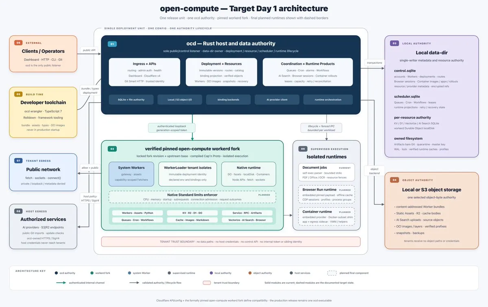
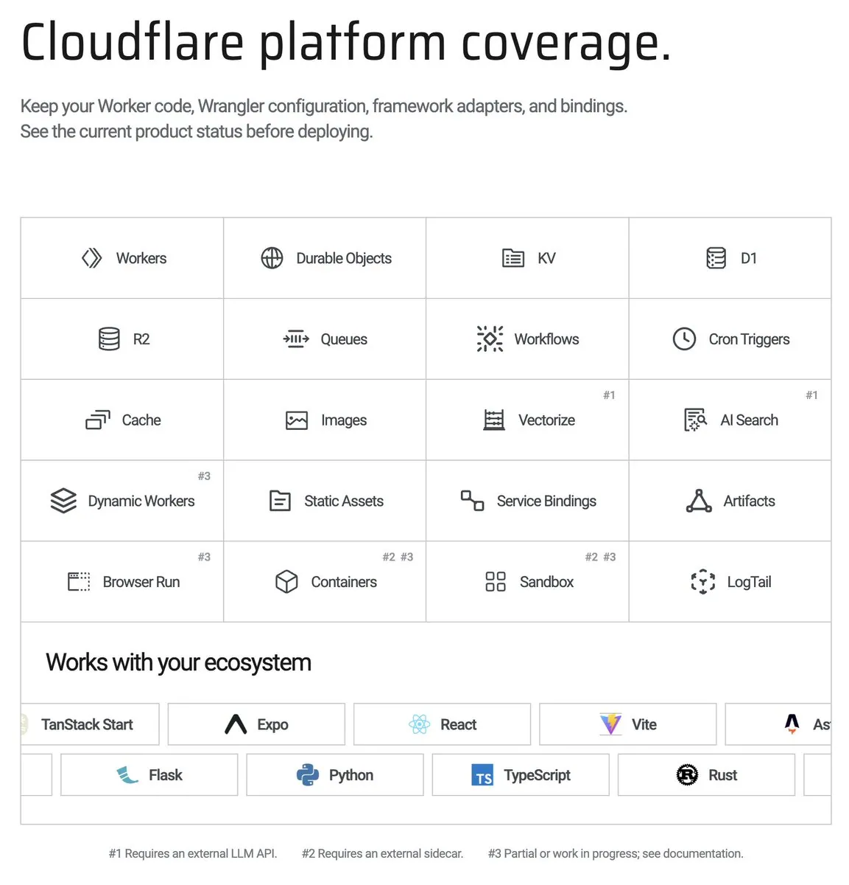

# Elliot（@elliothux）：我把 Cloudflare 开源了——边缘计算架构与极简自建方案

> 深入剖析基于 V8 Isolate 的轻量级边缘计算系统架构：拆解 Cloudflare Workers 的无容器毫秒冷启动机制，并开源轻量级自部署边缘运行时，涵盖路由分发、KV 存储与全球边缘节点同步逻辑，为出海开发者提供摆脱供应商锁定的低成本替代方案。

<!-- more -->

最近这两年，Agent 火得一塌糊涂。

看着行业里各路神仙架构师给 Agent 画的基础设施蓝图，我经常冒出一股浓烈的荒谬感：整个工业界，似乎正在把上个时代的“基建通胀综合征”，原封不动地搬进 AI 时代。

大家可以看看现在业界的“标准教科书操作”：

为了让 Coding Agent 具备“执行代码、跑个测试、调个 API 工具”的能力，大家下意识的做法是什么？

给每个 Agent、甚至每个子任务，临时起一个全功能的 Linux 容器沙箱。

然后呢？为了伺候这堆可能只活 3 秒钟的沙箱容器，团队得在背后维护一整套庞大的 Kubernetes 集群、复杂的网络命名空间隔离、镜像预热缓存池、状态回收清理 Job，再套上高可用的 Redis 和持久化存储……

Agent 的任务逻辑可能就是敲一行 jq 过滤个字段，或者跑一段 30 行的 JavaScript 脚本；而在背后给它擦屁股的基础设施，吃掉了几个 G 的内存，耗费了几十秒的镜像拉取与启动延迟。

这是何等夸张的算力与时间浪费。

Cloudflare 最近发过[一篇文章](https://link.juejin.cn/?target=https%3A%2F%2Fblog.cloudflare.com%2Fcloudflare-computer%2F)，叫作 “Your agent needs a computer, not a container”（你的 Agent 需要的是一台计算机，而不是一个容器）。文中指出：在 Agent 的实际工作流中，真正需要厚重容器的场景不到 10%，剩下的数据处理、工具链调用、代码生成和会话控制，更轻量的 V8 Isolate 才是正解。

用几十兆内存、冷启动几毫秒的轻量隔离环境作为 Agent 的原生大脑和工具执行器，遇到非得跑原生 Linux 程序时再挂载重量级原语——这本该是通向 Agent 规模化扩展的极优解。

但问题却很现实：极度的厂商锁定。想要这种体验？你只能把企业核心数据和 Agent 调用链，全都焊死在 Cloudflare 的公有云上。


为了打破这种垄断与基建通胀，我写了 [open-compute](https://github.com/elliothux/open-compute)（Apache-2.0 协议）。

用 Rust 搓了一个单一二进制文件（ocd），把整套 Cloudflare Workers 平台搬到了私有硬件上。并且在我的公司内部的生产环境被真实的 ToB 业务狠狠磨练过，才决定把它开源出来。

想象一下：一个集成了完整运行时、动态调度、持久化存储、消息队列、长事务状态机甚至 AI 搜索的 Serverless 平台，整机常驻内存只有约 60 MB——你桌面上随手打开一个 Chrome 标签页，占的内存都比它大。

没有 K8s，没有 Docker daemon，不依赖外部数据库，零外部依赖。一条命令，一分钟内在你自己的服务器上跑起来。

## 一、“赛博菩萨”的蜜糖，与无法回头的云租税

熟悉朋友大概率把 Cloudflare 奉为“赛博菩萨”。

客观地说，CF 的这套方案确实是当今工业界的天花板：

- Agent 想存个状态会话，有轻量的 KV；
- 想存结构化查询，有 D1；
- 存大文件或 Git 仓库，有 R2；
- 异步任务解耦，有 Queues；
- 最杀手级的是 Durable Objects（DO） 和 Workflows：天然为 Agent 提供了有状态的“单例大脑”和具备持久化断点恢复的长事务状态机。

不需要你拉进程、配网络，按请求即时拉起，冷启动快到毫秒级。对开发者和 Agent 架构师来说，这种开发体验是降维打击。

但天下没有免费的午餐，菩萨的“围墙花园”也是有电网的。

在公有云的世界里，商业逻辑本质上是经典的 “认知套牢”：

先用极低甚至免费的门槛，把你的工程习惯彻底惯坏，让你 Agent 的每一条神经末梢都深深扎根在它的专有 API（KV, D1, DO）上。等你业务真跑出规模、几千个 Agent 并发调度时，跨区网络税、请求调用税、存储出站税，每一笔都会在月底账单上精准收割。

更无解的是企业级交付的数据合规红线。

这几年我的团队深入 ToB 企业现场做交付（FDE）：金融、政企、医疗以及注重隐私的出海大客户，一听到“业务核心逻辑和 Agent 数据要过海外公有云边缘”，方案当场就会被合规部门一票否决。

团队被逼无奈，只能在内网吭哧吭哧自己造轮子：K8s + MinIO + Redis + Knative……一顿操作猛如虎，直接从“Serverless 的天堂”跌进了“全栈运维的地狱”。

Cloudflare 官方虽然开源了底层的 [workerd](https://github.com/cloudflare/workerd)，但老手都明白一个最基础的常识：Runtime（执行引擎）≠ Platform（平台）。

这就好比厂家开源了一台性能炸裂的跑车发动机，但底盘、变速箱、中控台和车轮（多租户路由、状态持久化、生命周期调度、API 控制面）全扣在厂里。光有一个执行 JS 的 V8 盒子，根本开不上路。

既然没人做这个底盘，那我就把它彻底做出来，并以 Apache-2.0 协议还给开源社区。

## 二、架构全景：三层解耦与单机折叠哲学

架构设计最忌讳脱离实际业务规模的“过度工程（Over-engineering）”。

在 open-compute 中，我做了一次极其激进的“逆向工程”：把动辄数十个微服务的分布式链路，垂直折叠进单进程内。

```
传统自建集群方案 (微服务膨胀)             open-compute (极致折叠)
─────────────────────────────            ───────────────────────
API Gateway / Ingress                  ┌───────────────────────┐
K8s Scheduler / Controllers            │                       │
Multi-tenant Control Plane  ══════>    │      ocd (1 bin)      │
Redis / Valkey 集群                     │   Rust Async Host     │
PostgreSQL / TiDB                      │                       │
繁重的各类 Operator                     └───────────────────────┘
                                         内嵌 SQLite + 本地存储

```

系统核心由纯 Rust 构建的 ocd（Open Compute Daemon）统揽全局，将整个平台划分为高度自洽的三层职责：

1. Ingress & APIs（入口与接入面）： ocd 是唯一的公开网络监听者。Dashboard、CLI、Cloudflare v4 API、Git Smart HTTP 全部由此进入，统一完成认证、鉴权、多租户路由与可信身份下发；
2. Deployment & Resources（版本与资源目录）： 维护所有 Worker 版本声明、环境变量和 Binding 拓扑。租户能够调用的能力范围由部署记录严格裁定；
3. Coordination & Runtime Products（协调与长周期运行时）： 负责 Queues、Cron、Alarms、Workflows 以及 AI Search 的统一调度。处理任务领取、租约续期、故障重试与宕机自愈。

## 三、深挖硬核细节：60 MB 常驻内存背后的工程真相

很多人第一反应是：把整套 Cloudflare 搬下来，常驻内存怎么可能只有约 60 MB？怕不是个简陋的 Demo 玩具吧？

工业级的优雅，往往诞生于对底层资源开销的极度苛刻。



1. 为什么只要 60 MB？——消灭所有网络中介与运行时垃圾

在传统的 Serverless 架构里，内存是怎么被吃光的？

- 一个 Node.js 网关进程：先吃 150 MB；
- 一个 Java/Go 控制平面服务：再吃 300 MB；
- 一个本地 Redis 实例与 MinIO 守护进程：吃掉大几百 MB；
- 加上各类 Sidecar 和通信代理，系统一个请求没接，几千个操作系统线程和垃圾回收器（GC）已经在后台轰鸣了。

而在 open-compute 里：

- 单体原生机器码： ocd 基于 Tokio 异步多线程与 Axum/Hyper 构建。全量开启 Full LTO（链接时优化）、codegen-units = 1、panic = “abort”，剥除全部调试符号。没有虚拟机，没有解释器，没有 GC 线程反复扫描；
- 零拷贝流式代理： 从网络 Socket 接收到的请求体，直接以纯字节流（Bytes Stream）形式转发给工作隔离区，绝不在宿主内存中做整包缓冲（Buffering），哪怕上传几个 G 的模型文件，宿主内存也毫无波澜；
- 函数级调用替代网络 RPC： 平台的权威元数据与调度状态直接收敛进内嵌的 SQLite（WAL 模式）。查询路由或抢占任务，就是一次本地内存函数调用，直接省掉了上百兆用于网络缓冲区和协议反序列化的堆内存。

2. 状态必须比进程活得更久：Workflows 与长任务的持久化哲学

在给 AI Agent 提供执行环境时，最棘手的问题就是：任务的寿命远超单次进程的寿命。

一个 Agent 规划的工作流，可能第一步先调工具查数据，然后需要等待人类确认，或者等待几个小时后的外部 Webhook 回调。如果你的状态保存在内存甚至函数调用栈里，进程一退出、机器一重启，现场瞬间灰飞烟灭。

open-compute 的协调调度层建立在坚定的哲学假设上：等待中的任务，绝对不配占着宝贵的执行进程。

Workflows 的底层被抽象为精准的状态机模型：

```

           [ 步骤 1: 外部工具执行 ]
                      │
                      ▼
         [ 事务外持久化 Step 结果 ] ────► 进程立即休眠/回收
                      │
    （数秒/数小时后: 触发后续事件或恢复）
                      │
                      ▼
   [ 验证 lease / attempt / generation ]
                      │
                      ▼
         [ 复用历史结果，重放后续步骤 ]
```

内部的核心流转严格遵守铁律：

1. 领取任务与绑定代际身份： 记录唯一的 lease、attempt 和 generation；
2. 在数据库事务之外执行业务逻辑： 绝不让耗时甚至挂起的外部调用卡死数据库连接池；
3. 带原子校验的提交： 验证当前的代际身份是否有效，若有效则持久化落库；若执行者中途卡住导致租约超时被其他节点接管，即便旧执行者晚些时候苏醒返回，其提交也会被物理拒绝，彻底杜绝脑裂覆盖。

即便服务器断电重启，scheduler.sqlite 也能在毫秒级完成状态审计，从最后一个落库的断点精确恢复执行。

3. 数据严密分层：比“用了 SQLite”更进一步

很多单体架构死于“把所有东西塞进一个大库”。在 open-compute 中，数据被解耦得泾渭分明：

- 控制面与调度面物理隔离： control.sqlite 专职负责租户元数据与资源目录；scheduler.sqlite 负责高频的任务抢占、重试与心跳租约。二者互不干扰，锁竞争直接降维；
- 拒绝无意义的 MinIO 代理： 针对 Worker Bundle、静态资产、R2 存储、持久化快照与 AI Search 源文件，默认全部采用 Local Direct（本地文件系统直写）。不做“为了兼容 S3 协议而在本地起一个 HTTP 对象存储服务”的蠢事。少了一次网络协议栈的绕行，不仅消灭了一套复杂服务的内存占用，还带来了 NVMe 级别的原始磁盘读写速度。

4. 动态 Cap’n Proto 编译与“零信任” Supervisor

ocd 与底层 workerd 的联动，不是简单的 CLI 管道通信，而是动态编译生成标准的 Cap’n Proto 二进制拓扑。

- 严格 Loopback 隔离： ocd 作为 Supervised Parent 启动 workerd 子进程，只在本地回环网络上开放通信端口；
- 凭据生命周期与代际绑定（Per-generation Token）： 用于平台内部控制注入的高权限凭据，绝不出现在 argv 启动参数、环境变量、日志或系统指标中。就算租户代码发生内存逃逸翻看 /proc，也绝不可能截获平台的特权密钥；
- 确定性全生命周期自愈： 拥有专有进程组监管、有界日志流捕获、优雅退出排空（Graceful Drain）与强制回收机制，坚决杜绝孤儿进程僵死。

5. 异构任务分级：文档解析与 AI 搜索的沙箱隔离

在 AI 场景中，除了高频的轻量代码，还有一类极度沉重的负载：PDF/Word 解析、OCR 与本地 Embedding。

如果把这类重度计算硬塞进主执行器，很容易引发内存毛刺甚至拖垮整个网关。open-compute 引入了独立的受监督 Parser 执行层：

- 文档解析任务作为独立的短生命周期子进程拉起，施加硬性超时约束和有界内存限制；
- 解析完毕后，提取出的文本片段才流向派生索引体系；
- 数据单向归属： R2 里的业务源文件永远保持唯一；AI Search 只保存派生出的索引向量。删除搜索索引绝不会误删业务底稿，源文件无变动也坚决杜绝重复解析。

## 四、真正测量出来的兼容性：2,203 个 API 成员

在 open-compute 中：兼容性是被真实测试度量出来的，而非口头宣称（Measured, not asserted）。 同一套测试用例和 fixture，同时跑在 open-compute 和真实的 Cloudflare 上直接对比测试。

| 维度 / 模块 | 兼容度 | 工程实现说明   |
| :------------------- | :------------ | :--------------------------------------------------- |
| **API 覆盖总数** | **2,203 个成员** | 在声明的核心能力范围内实现 100% 方法覆盖 |
| **核心存储与计算** | **100%** | KV、D1、R2、Durable Objects、Queues、Workflows、Cron 等原生对齐 |
| **现代全栈框架** | **100%** | Next.js 16 (基于 OpenNext) 产物零改动直接运行，与官方边缘完全一致 |
| **Wrangler CLI 工具链** | **95%** | 原生支持 ocd wrangler deploy 与 ocd wrangler tail 实时日志 |

你原有的 Workers 项目，不用改一行代码，直接搬过来就能跑。



## 五、技术变革与反思：把计算主权交还给开发者

软件行业的发展，向来是“分久必合，合久必分”。

从早期的自建机房走向了中心化公有云，享受了云端 Serverless 极致优雅的开发体验；但如今，我们也深深陷入在技术锁定、高昂的“云租税”以及不断膨胀的基建复杂度之中。

而在今天的硬件工业面前：单台物理服务器动辄几十核 CPU、上百 GB 内存与数 GB/s 的 NVMe 固态吞吐——对于绝大多数企业、业务工具链和 AI Agent 来说，单机的性能上限根本没有被压榨出来。

盲目追逐臃肿的分布式集群，往往只是在掩盖架构设计上的懒惰。

把不必要的分布式系统拆解掉，把微服务重新折叠回高性能的单机模型，配合现代轻量执行环境（Rust + V8 Isolates）：一台机器，就足以支撑起一个自洽、极速、拥有完全数据主权的边缘计算世界。

## 六. 快速开始：1 分钟在你的私有硬件上跑起来

代码已经采用 Apache-2.0 协议全量开源。找一台普通的开发机、吃灰的小主机或者本地服务器即可直接体验：

1. 启动平台中枢

安装 ocd 核心引擎：

```shell
curl -fsSL https://open-compute.dev/install.sh | sh
```

设置并启动实例：

```shell
ocd setup --yes
```

2. 开发、部署你的第一个 Worker

```typescript
export default {
    fetch(request: Request): Response {
        return Response.json({
            message: "hello from open-compute",
            path: new URL(request.url).pathname,
        });
    },
} satisfies ExportedHandler;
```

```json
{
  "$schema": "node_modules/wrangler/config-schema.json",
  "name": "hello-worker",
  "main": "src/index.ts",
  "compatibility_date": "2026-09-08",
  "workers_dev": false
}
```

开发：

```shell
wrangler dev
```

部署：

```shell
ocd wrangler deploy
```

无需在宿主机上安装复杂的编译器或额外依赖，打包、验证、发布瞬间完成。

如需进一步获取项目源码与完整技术细节，可参阅仓库与文档进行探索。

## 七. Agent 时代，会重新发明一次 Private Cloud

过去十几年，Serverless 最成功的叙事一直是：你不需要拥有基础设施。把服务器交给 AWS，把 Runtime 交给 Cloudflare，你只负责业务。在 Web 时代，这个交换非常划算。

但 Agent 不一样。Agent 是持续的，有状态的，有记忆的，有权限的。它今天修改一个文件，明天还要回来继续；它可能运行几个小时的 Workflow；它会长期接触企业的数据库、代码库、内部 API、通信系统和生产环境。它越来越不像一个 HTTP Request。它越来越像一个真正生活在企业里的数字工作者。

所以我觉得未来几年，整个行业会重新开始讨论一个过去十年听起来很落后的词：Ownership。谁拥有 Agent 所在的 environment？谁拥有它的 state？谁拥有它的 runtime？谁拥有它的 Computer？

Cloudflare 最近说：Your agent needs a computer, not a container. 他们是对的。他们在解决：这台 Computer 应该长什么样。而 open-compute 想继续问一句：这台 Computer，为什么不能真正属于企业自己？这就是我们想做的事情。

把 Serverless 的模型，还给自己的机器。

一个 binary。一个 data directory。你的代码。你的数据。你的 Agent。你的机器。这就是 open-compute。

我们把它开源，不是因为它不值钱。恰恰是因为我们觉得：Agent 时代真正重要的基础设施，应该先成为一个所有人都能检查、拥有和构建的底座。

## 八. 写在最后

GitHub 的 Star 快被刷成一门产业了，开源也越来越像另一种流量生意。但我还是有点固执地相信，开源社区应该留下一块净土。做真正难的东西，解决真正的问题，然后把它交给所有人。

谢谢你看到这里，如果能帮到你，希望你给个 Star。

Website: [https://open-compute.dev](https://open-compute.dev/)

Github: [https://github.com/elliothux/open-compute](https://github.com/elliothux/open-compute)

## 相关页面

- [[sources/chencheng-mayoi-fast-gpu-editor-for-agentic-era]]
- [[sources/xiaoer-global-payout-without-hk-company]]
- [[concepts/lake-native-architecture]]
- [[concepts/open-source-seo-tooling]]
