# Ernesto Lopez（@ErnestoSOFTWARE）：发布 6,000 条视频、App 做到 $150k/mo 的内容系统——UGC 内容机器加内容放大器

> Ernesto Lopez 公开其 Christian app 赛道团队从 0 做到 6,000 条视频/月的两套系统，最终形成 $1.7M/YR 的应用工作室、拿到 3 块 YouTube 奖牌，并与 $100M+ 融资的工作室正面竞争，月收入 $150k/mo。内容机器靠 UGC：通过 Sideshift 批量招 60+ 名创作者（平台 $299/month），3 个月花掉近 $100,000、回报基本是 5 倍，每周裁掉 5-10 人、最后留下 15 人顶尖团队，累计 100M+ 播放、3 个月内产生 150M+ 播放；预算小的可以按每人 $600/mo 先雇 1-2 人。放大器靠三类 theme pages：AI 复制人（Gemini 分析创作者肢体动作 → Arcads 用 GPT image 2 出 character sheet → Seedance 2.5 生成 → Claude 剪辑 → Postiz 自动发 Instagram/TikTok/YouTube，成本是真人 10 分之一）、Zack D Films hook repost（在已爆内容前加钩子，做出 10M+ 播放）、以及 Arcads 全自动的 AI slop stories。管理端用 Postiz 一次发全平台并配 Grok Bot / ChatGPT / Claude 官方 connector，每天早上的 agent routine 自动排期。

<!-- more -->

In this article I will expose the million dollar content systems

that took us from 0 to 6,000 videos/mo

and ultimately led to us becoming one of the biggest apps in the space

going toe to toe with $100M+ app studios.

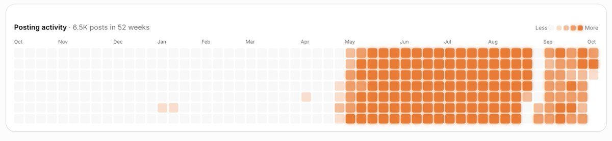

and got us 3 youtube plaques and a $1.7M/YR app studio

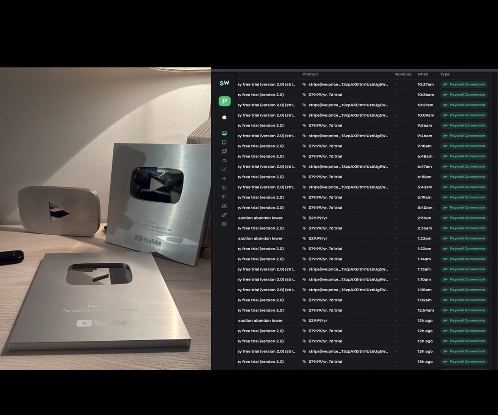

SCALING TO 6,000 VIDEOS/MO

To scale to 6,000 videos/mo you need 2 steps

1. Content machine
2. Content amplification

They both work hand and hand

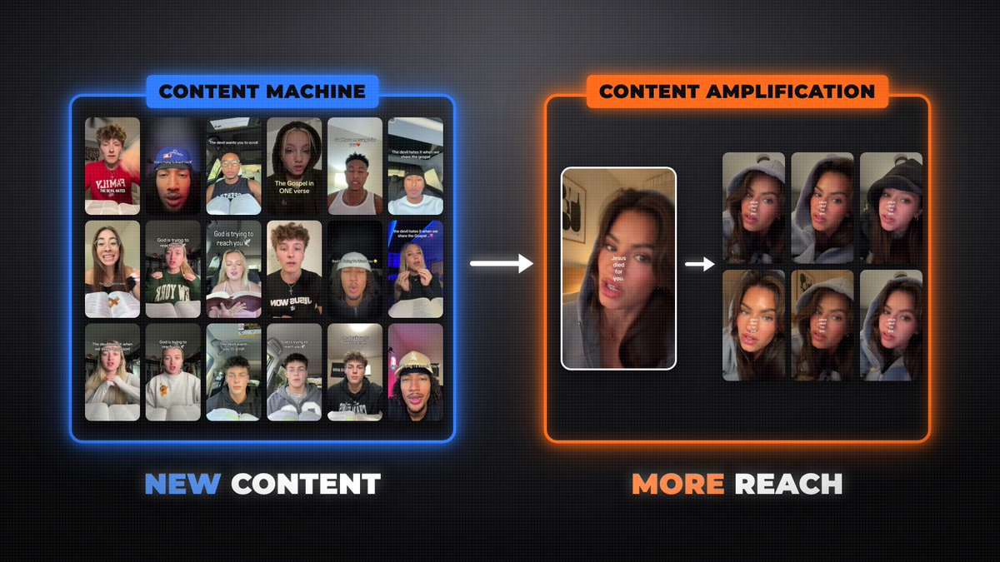

Content machine will be in charge of generating

new content

while content amplification will be in charge

of taking your content further

with a mix of Postiz and Arcads

it’s like clipping but not quite ( you’ll see )

I will explain what these 2 are more in depth

and how to do each effectively

1. THE CONTENT MACHINE

Content amplification can’t work

without a proper content machine first.

The content machine #1 goal is to consistently create

viral content and we did this through...

UGC content

UGC was our main growth channel

and here is how it worked

HIRING:

we hired a team of 60+ content creators

we did this through a platform called Sideshift

it cost $299/month but if you can get over the price

its actually goated.

in 3 months we spent close to $100,000 on this team

but the return was basically 5X that

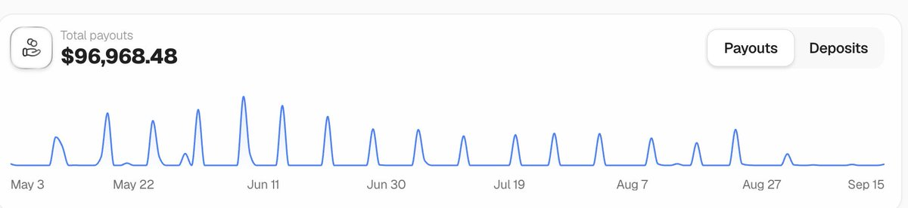

the main reason we spent so much money is because

we bulk hired 60+ creators..

way more than we needed we made this financial

sacrifice for the sake of speed.

And it paid off:

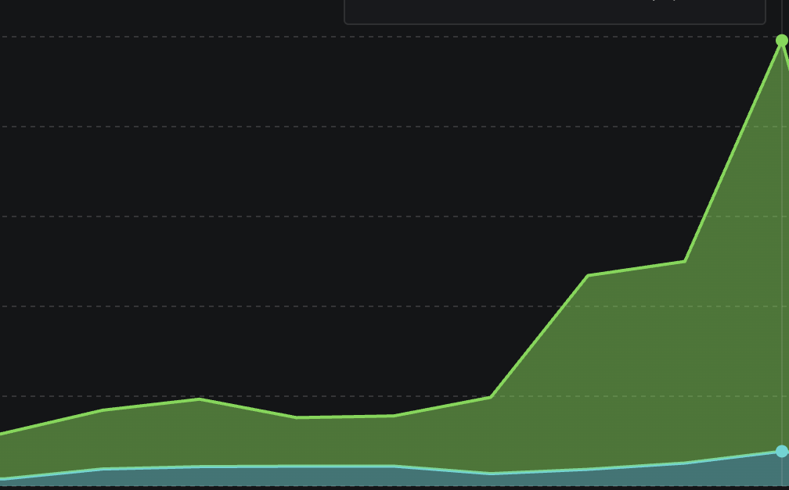

we did not jump on calls with the creators

we did not ask for a portfolio

we basically just handed them our brief

and let them cook.

then

Every week we would fire 5-10 creators

Until we were left with a team of 15 killers

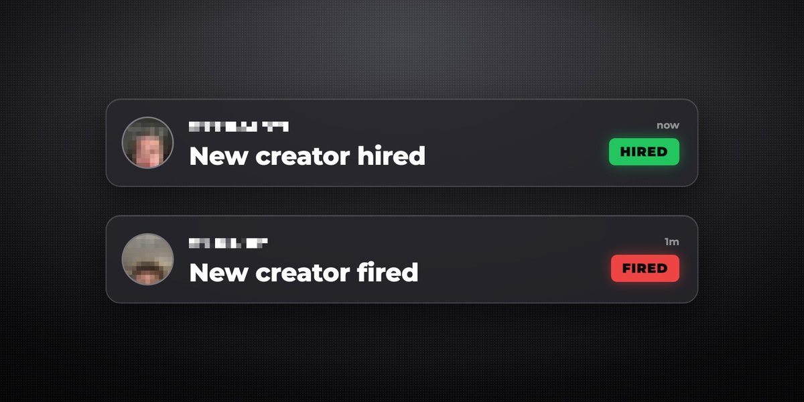

we did it this way because we had viral formats that

were proven to go viral over and over again

a format we ourselves invented

so as long as the videos were done correctly

following our instructions.

the top performers would naturally show

themselves.

This allowed us to build a world class team

Within a matter of weeks.

Which later went on to generate

over 100M views

but as a beginner and starting with a lower budget

you can go slower,

hire 1-2 creators for $600/mo each

and work your way up.

just fire quick, and have replacements ready

SYSTEMS

another reason our UGC team was the most succesful

in the Christian app space

Was because of our sheer level

of organization

our creators were not just posting

And inventing formats.

we handed them everything,

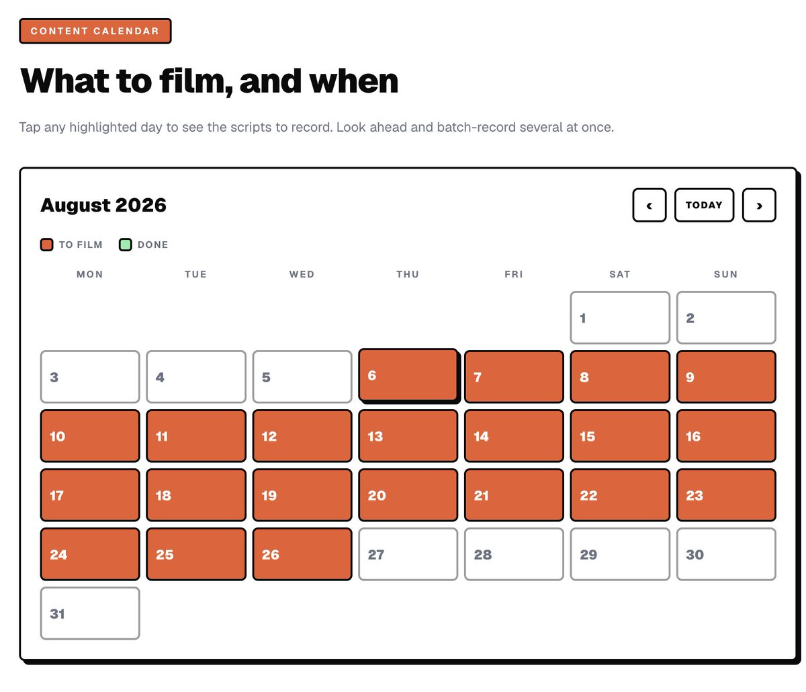

- Daily scripts,

- All the assets to include in their videos

- Examples from other creators

- Content calendar

basically if you failed in our campaign

it was 100% a skill issue

Your creators don’t owe you anything

you owe them everything.

and your job is to make their job as easy as possible

- you need to find the viral formats

- you need to show them exactly how to replicate them

so using our bulk hiring system + our airtight briefs

we were able to build an amazing team

And generate over 150M views in 3 months.

Culture

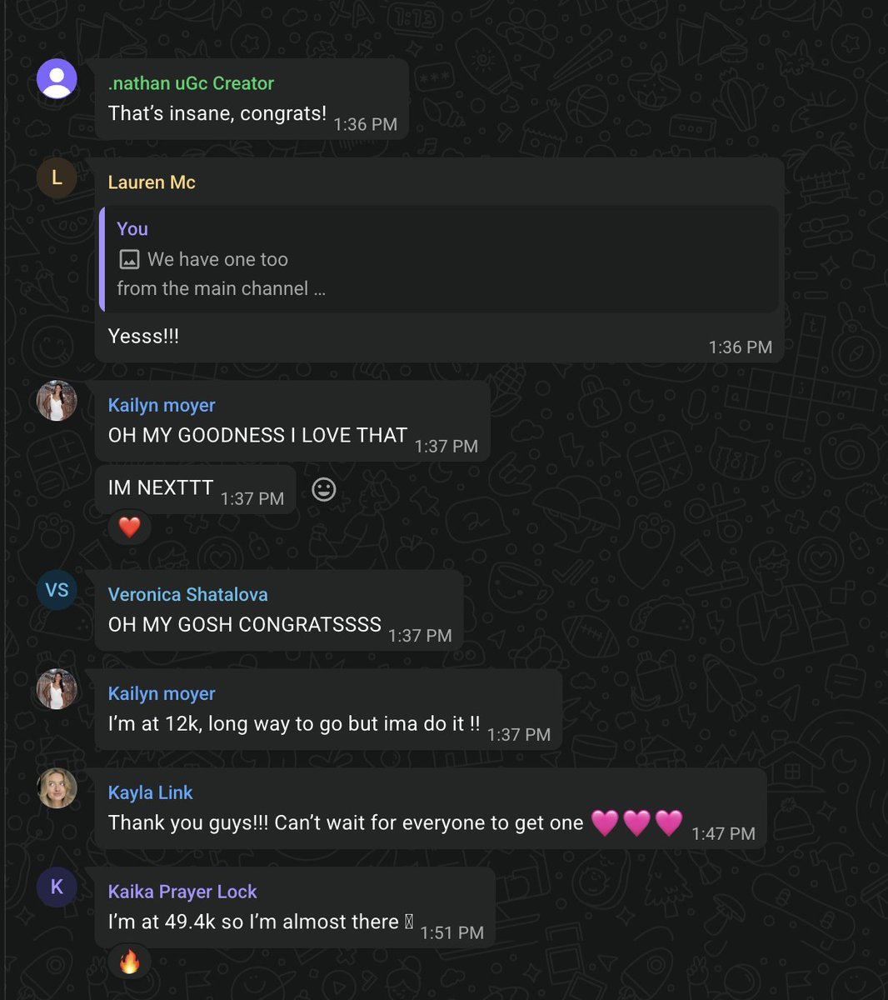

This one is not often talked about but another thing

That make our UGC program

extremely succesfull

was culture

there were studios with $100M+ in funding

Trying to steal our creators and pay them more

but because we built such a beautiful culture

our creators would not even budge

at other companies offers

here is a guide to follow for a great culture:

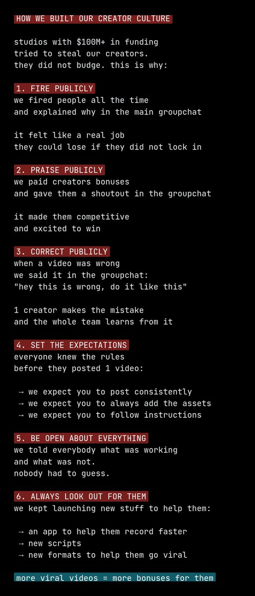

and thats it, that was our whole content machine

1. Mass hiring to find the right talent

2. Having a killer brief and viral formats for our creators

3. Having a good culture to keep them motivated
   and keep them on our team long term.

and now that we had this content machine running

it was time to amplify

## Content amplification

content amplification is basically taking

everything your content machine makes

and pushing it way further than

1 post on 1 account

your UGC team makes the content

amplification makes sure it gets seen as much as possible

we did this with theme pages

THEME PAGES

theme pages are accounts we own

that post our content in a different way

we ran 3 types of theme pages

- AI replicas of our UGC

- Zack D Films reposts

- AI slop stories

AI REPLICAS

we basically took our existing content

and trained AI on it

We had Gemini analyze all our creators

body movements

and thanks to this

we were able to crack hyper realistic AI UGC

we then had Arcads make a new character sheet

with GPT image 2

and then bring them to life with Seedance 2.5

Claude would then edit all the videos

And we would use a tool like postiz

to post to instagram tiktok and youtube

all automatically.

same hook and same structure

but with an AI character instead of a creator

which cost us 10x less

ZACK D FILMS REPOSTS

this one is literally a cheat code

we took videos that already went viral on our UGC accounts

and reposted them on our theme pages

but with a Zack D Films hook at the start

then a snap into the original video

the Zack D Films clip is bait

then we cut to our content

we generated over 10M+ views doing this

with videos that already had gone viral

again something you can replicate quite easily

with a tool like Postiz by just telling claude

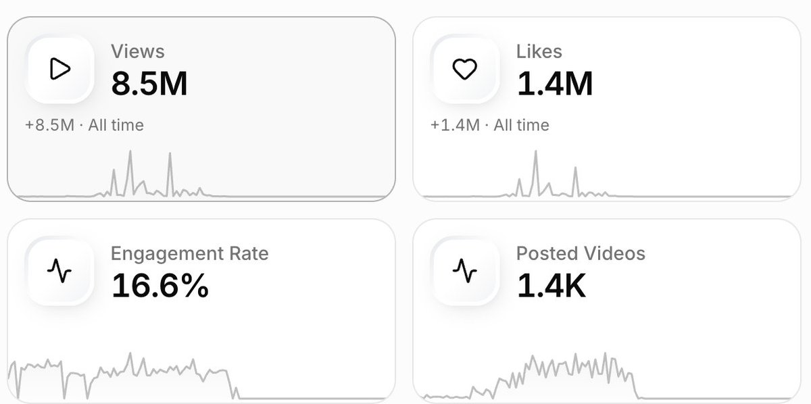

AI SLOP STORIES

we also generate AI slop stories

short stories made fully with AI

about the same problem our app solves

people call it slop

but it gets views and does convert

we also automated this fully using Arcads

1. have claude generate a story

2. using arcads api key have claude
   generate that story with seedance 2.5

here’s an example of what the result would look like

[video](https://video.twimg.com/amplify_video/2109663153512480768/vid/avc1/2348x1840/K6MGD71dotFaUShb.mp4?tag=29)

so to recap, content amplification is

theme pages

- AI replicas with arcads

- Zack D Films hooks on exiting content

- AI slop stories with arcads

HOW WE MANAGE ALL OF THIS ( POSTIZ )

running this many accounts by hand

is literally impossible

thats where Postiz comes in

- we have a system that takes our existing videos

- adds a Zack D Films start to them

- and then Postiz posts it

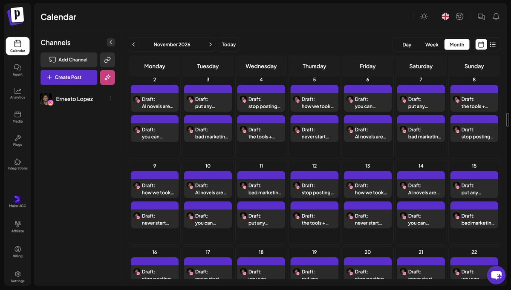

Postiz posts to every platform at once

so 1 video goes out to tiktok, instagram and youtube

and its agentic, so our agent

schedules everything for us

HOW TO AUTOMATE ALL OF THIS ( GROK BOT + POSTIZ )

you dont need to build your own system for this

Postiz has official connectors for

Grok Bot, ChatGPT and Claude

- Grok Bot: x.ai/bot/plugin/58737848

- ChatGPT: chatgpt.com/plugins/plugin_asdk_app_6aaaf1a529808191a2a15fde824bb013

- Claude: claude.ai/directory/postiz

connect it once

and then set up a routine like this one:

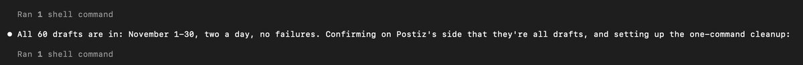

every morning your agent takes the new videos

and schedules them on every account with Postiz

you just check the calendar

And thats it.

that is the whole system we used to go from 0 to 6,000 videos/mo

theres never been a better time to build

theres never been a better time to market

## 相关页面

- [[patterns/ai-agent-content-farm]]
- [[concepts/ai-content-pipeline]]
- [[patterns/viral-content-monitoring]]
