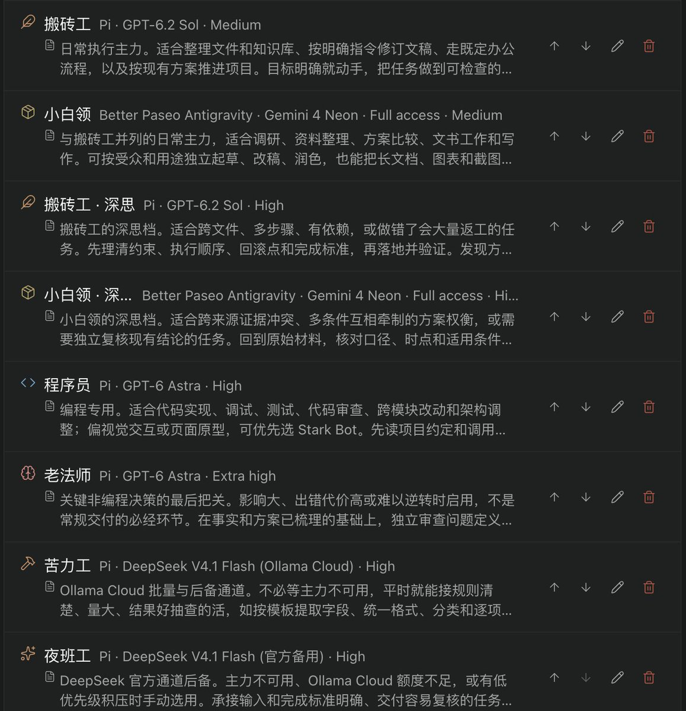

# 凡凯：Paseo 模型组合排行——Gemini 4 Neon 升第二主力，DeepSeek V4.1 Flash 退备胎

> 作者在 Paseo 的模型组合：① 一号主力 Pi + GPT-6.2 Sol；② 二号主力 Antigravity + Gemini 4 Neon；③ 编程专用 Pi + GPT-6 Astra (high)；④ 关键决策 Pi + GPT-6 Astra (xhigh)。Gemini 还做不了第一主力：**Neon/Carbon 推理服务不稳定，多次长时间挂起没响应；推理过程不透明，执行时根本不知道是挂机还是在跑任务——排查问题非常糟糕。**

<!-- more -->

在我的 Paseo 模型组合中，Gemini 4 Neon 已经成为仅次于 GPT-6.2 Sol 的第二主力了，而 DeepSeek V4.1 Flash 已经退居备胎列表。

1. 一号主力：Pi + GPT-6.2 Sol。
2. 二号主力：Antigravity + Gemini 4 Neon。
3. 编程专用：Pi + GPT-6 Astra (high)
4. 关键决策：Pi + GPT-6 Astra (xhigh)

Gemini 其实还做不了第一主力，因为我使用下来，发现 Neon/Carbon 的推理服务不够稳定，出现过很多次长时间挂起没有响应的情况。

而且推理过程不透明，在执行过程中，你根本不知道是挂机了，还是在跑任务。这个对于排查问题来说非常糟糕。

## 相关页面

- [[concepts/magpie-local-model-gateway]]
- [[sources/khazix-claude-gpt-gemini-collaboration]]
