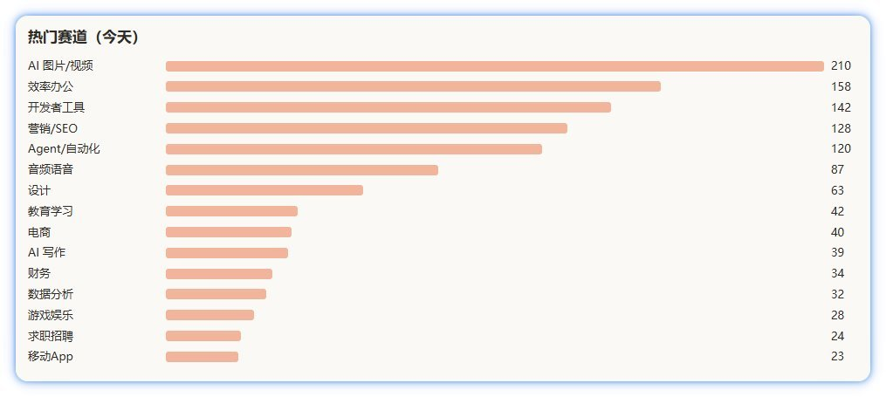
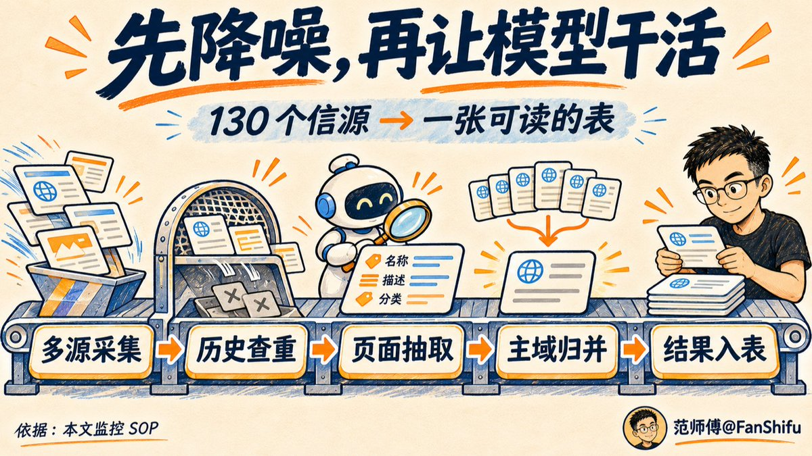
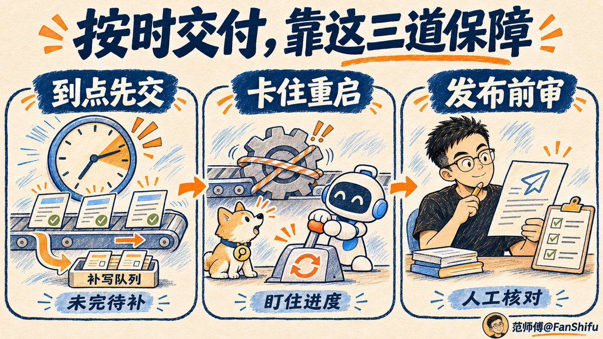

# 范师傅（@FanShifu）：Grok Bot 搭建出海新站监控——每天扒 800+ 新站吃透同行玩法（附 130 个开源信源渠道）

> 实战拆解如何把「竞品监控」升级为「需求探测器」：每天跑完 130 个信源（sitemap 差分 60 个、HTML 新品页 37 个、RSS18 个等）监控当天 800+ 上线新站；利用 Grok Bot 原生 X 搜索与 24 小时云电脑运行优势，配合两道去重清洗、看门狗防卡死、详情页穿透查验剥离推广参数锁定真正官网、切词判定 EMD 关键词域名与 RDAP 注册时间，看清真实开发者如何下注需求并沉淀变现。

<!-- more -->

早上八点，在我起床前，Grok bot 已经跑完当天新站监控工作流。

快照里 890 个产品，单日新上架 583 个。AI 图片和视频类 210 个，效率办公 158 个，开发者工具 142 个。video generator 这个词底下一天挤进来 16 个新站，coding agents 相关 13 个，名字里带 claude code 的 10 个。

很多朋友看完回复说「太卷了！」。

我盯着那 583 个新上架，想着另一件事：两周之后还能剩几个？

不出意外的话，绝大多数新站的生命在上线那一刻就结束了。如果用 ProductHunt 或是 TAAFT 榜单当竞品分析，等于在追一个明天就要转校的妹子，舔得再勤，也只能得到一句谢谢关心。

那为什么每天还要去监控新站？ 因为，我每天跑的这套东西，与其叫竞品监控，不如叫需求监控。明确这两个词的区别，决定了我们每天到底是看了一堆 AI slop，还是看懂了一波又一波的开发者在搞什么章程。



下面我主要回答这三个问题：

一、监控新站对开发者到底有什么用？

二、Grok bot 做新站监控，和 Codex、Claude Code 相比，优势在哪？

三、怎么用 Grok bot 搭建新站监控工作流？

## 新站是需求最赤裸的表达

先回答第一个问题，监控新站对开发者到底有什么用？

我答案很短。它就是需求探测器。

一个开发者愿意为一个想法注册域名、搭页面、写文案、把支付挂上去，说明他认定这里有钱可赚。你不需要同意他的判断，你只需要知道他在下注什么，用什么姿势下注，投入轻还是重。这还不够，你还要统计跟他一样的开发者有多少。

榜单只告诉你上榜的那些新站在做什么。把所有发布的新站收拢起来，你才能发现什么需求正在被下注。 而后者显然离钱更近。

具体看四个信号。

第一个，域名是否踩在需求关键词上。generator、maker、remover、ai trend、video、headshot 这类词，是搜索意图最直白的表达。域名里直接带这些词，说明他重点不是做品牌，是想抢搜索流量。

第二个，是否为新注册域名。走公开 WHOIS / RDAP 查域名注册时间，分清是刚上线的新站，还是老站换皮蹭一波。

第三个，有没有第三方佐证。一个人说自己产品好不算数，在 X 上贴后台数据，TrustMRR 上有进账记录，那才是更真实的信号。

第四个，交付轻不轻。一个人用 AI 两天能做出 MVP 版本，说明这个需求口子足够窄，窄到作为新手也能切进去。


今年八月刚开始上站的时候，我有一周多，天天在筛词。表格填的很充实，站一个没上。后来复盘才看清一件事，关键词是已有共识的聚合，它能告诉你哪里有用户需求，但光看词，告诉不了你，别人的站是怎么上首页前十的。

新手一定要相信，没有什么需求是你想到别人没想到的。新站能给你的，是比关键词更细的需求细节。同行怎么切这个词、落地页怎么设计、文案怎么写、定价怎么定、交付轻还是重。这时你看到的，不再只是一个词，是有高手已经替你把这个需求给做了一遍，还顺手把「底裤」晾在网站页面上，只要让 AI 去瞧一眼，就知道是什么颜色。

## Codex、Claude Code、Hermes、Pi...那么多 AI 工具，为什么是 Grok bot 干这个活

第二个问题，Grok bot 做新站监控，和 Codex、Claude Code 相比，优势在哪。

先说结论，他们并非替代关系，是分工不同。

Codex 和 Claude Code 是你电脑里的工程师。改代码、跑脚本、读本地文件、在一个 Github 仓库连续干几个小时，很强。要让它们干新站监控也能干，前提是你得给它们一台 24 小时在线的机子，一个随时能开的浏览器（最好是 agent 友好型），还有一套登录态和反爬日常维护。

Grok bot 更像不用你伺候、反过来主动服侍你的私人秘书。它天生能读网页，能直接搜 X，会主动跑脚本干活。这条工作流里，每天抓回来的链接交给它做结构化抽取，本地设备全程可以不参与，范师傅工作台挂载在赛博菩萨 Cloudflare 上，打开手机就能查阅结果。

提炼一下，Grok bot 和其他工具相比，胜在三个地方。

一是数据源。X 上那些晒单、吐槽、复盘，Codex 拿不全，它没有原生 X 检索，专门买一个爬虫 API 得多花钱。而获取这些信号，Grok bot 是老太太擤鼻涕，手拿把掐。

二是运行位置。这套流程跑在 bot 自己的云电脑上，24 小时运行，不占本地开发环境。每天一早人还没醒，它自己就跑完了。

三是分工。读一堆脏网页、吐结构化字段，这种活交给 bot 干得顺手，自己的 Claude code 更适合去挑重担写架构，让它在几百个页面里做语义判断，有点浪费 token。正好 Grok 4.7 拉一裤兜，用 Grok 来干这些苦力活也算专业对口。

## 回到正题，怎么用 Grok bot 把这条流水线搭起来？

第三个问题是怎么搭。我把自己的监控 SOP 整理出来了，照着丢给你自己的 bot，能少走不少弯路。

第零步，谋定而后动，先想清楚每天要看到什么

别一上来就写抓取。先定输出结果。

我每天要的是一张表：产品名、一句话介绍、主分类、来源标签、官网、域名注册时间、是不是 EMD 域名、X 上有没有讨论、TrustMRR 有无数据......早上我扫这张表，挑重点进去细看。

输出物定了，后面的抓取、去重、抽取才有验收标准。不然你会陷入一种很舒服的忙碌，脚本天天跑，数据库天天长，就是不知道该看什么，看了有什么用。

第一步，多源撒网，130 个来源怎么分级

我从 1000 多个外链站里筛出来能抓的 130 个公开来源，分四类。

你可能说就这点？当然这个只是基础库，后期完全可以自己添加。我也不建议加太多，新站通常是批量发外链，一百多个来源足够抓出当天的新站。bot 去重归并的任务也没那么重，如果每天抓太多，反倒浪费额度。

再说说分类，新品发布平台 58 个，ProductHunt 属于这类。AI 工具目录 44 个。SaaS 和通用工具目录 25 个。社区和内容平台 3 个。

抓取按协议成本从低到高排。优先读现成的 API 和 Feed，再抓结构化的 HTML 新品页，再不行用 sitemap 差分兜底。

现在代码里的协议分布是这样的：

- sitemap 差分：60 个（最稳定底座）
- html 页面：37 个
- rss 订阅：18 个
- mcp 协议：5 个
- html_cards 结构块：4 个
- json_api：3 个
- shopify_json、hn_api 和 ph_graphql：各 1 个

这里面最省事的是 sitemap 差分。每天早上拉一次 sitemap，和昨天的对比，新增的 URL 就是新页面。一个源几行代码，还不用解析 DOM。

最麻烦的是目录站，页面结构三天一变，选择器写着写着就失效。

前期你不知道哪些站能抓，哪些不能，就直接把你的信息源丢给 bot ，让它自己设定标准进行筛选。

验证也很简单，第二天早上你能看到昨天没有的新站链接，而且是不重复的。

踩坑预警，请严格遵守 robots.txt，留礼貌间隔。这条无关道德约束，是因为被封一次就少一个信源。😂

第二步，漏斗过滤，两道去重、Grok 抽取与外链库沉淀

130 个源一天抓回上千条链接，没必要全部丢给模型，咱们先用脚本去重。

第一道粗筛在抽取前，用脚本把新抓的链接和已抓取的历史域名库对比一遍，剔掉已存在的老链接。

第二道归拢在入库合并时，按标准化主域名归拢。同一个产品被五个目录收录，只留一条。

清洗完再让 Grok Bot 调用你的常用模型，从页面里抽出产品名、介绍、主分类和来源标签。这一步为了节省 bot 额度，我通常会用云电脑里的 Grok build CLI 或 DeepSeek 来执行任务。在 X 新的统一订阅中，bot 是共享总额度池，如果你是 bot 新用户，也可以直接让 bot 上手。

此外，无人值守的工作流，最怕的就是静默挂住，比报错还难受。报错你第二天一眼能看到，挂住你只会在八点看到一张空表，还以为今天没啥新站。

以下两个细节，是我吃过亏才加上的。

一个是墙上时钟截止。整批任务从开跑就定死一个收工时间，到点不管跑没跑完都截断，先把已经跑完的交出来。超时未处理的条目一律放进补写队列，目的是保证有交付。

另一个是看门狗。它盯的是进度，某条请求太久没动静，就杀掉重启，别让一条卡死的请求占着茅坑不拉屎，导致整批排队。这条保证的是推进。

一个管终点，一个管过程，两个加起来，保证每天正常输出。

验证也分两层。时间层，看八点前有没有交出结果，完成了多少。数据层，看抓回来的新站条数，比如当天是 981 条，去重归并后 890 条。这个数字是基准线，第二天 800 条、第三天掉到 80 条，明显有异常，再去查来源健康度和每一步的条数，就能分析出是哪一环漏了。



第三步，穿透查验，从目录页摸到官网

这是整套里最容易被忽略，也最值钱的一步。

目录站给你的多半是它自己的详情页或者带推广参数的跳转链接。点进去看到一个 Visit website，以为到了官网，其实还在别人的漏斗里。

我的做法是调用脚本进详情页，抓所有含 visit、website、try 或者「官网」字样的外链，剥掉 ref 和 utm 参数，再按域名和产品名的相似度打分，锁定真正的官网。

给 bot 的提示词：

```
打开详情页，遍历所有外部链接（跳过目录站自己的域名、社交媒体链接）
链接文字含 visit / website / try / open / launch / get started / 官网 / 访问 +3
链接带 ref= / utm_source / via= 这类推广参数 +2
带 nofollow / noopener 标记 +1
产品名前 5 个字母出现在域名里 +3
取最高分；最高分 ≥3 才认作官网，否则标「没找到可信官网」
然后去掉 ?ref= ?utm_xxx 这类参数，只留干净网址
```

拿到官网之后，做两件事。

第一件，识别关键词域名（EMD）。用切词算法把域名拆成英文单词（photoeditorfree → photo editor free）。只有每个词都是常见英文词，而且里面有「工具类」词（generator、maker、remover、video、headshot 等）时，才判定有效 EMD。再细分强 EMD、弱 EMD 和半匹配 PMD，二级子域名直接排除。

给 bot 的提示词：

```
子域名直接不算 去掉后缀，按连字符和常见词典把前缀拆词
条件：2–6 个词，每个都是常见英文词，至少一个是功能词
首/尾是品牌化小词（ai/app/hq/hub/pro/get/try/my…）或有效词<2 → 半匹配（PMD） 否则 → 精确匹配（EMD）
EMD 且最后一个词是工具词（generator/maker/remover/editor…）且不含 oh/so/my/the 这类填充词 → 强 EMD，否则弱 EMD
```

第二件，查注册时间。走公开 RDAP 查这个域名哪天注册的，已经查过的结果记到本地 state/rdap-cache.json ，下次不再查。注册不到 N 天（比如一年内）的是新资产；注册多年但最近才出现在导航站的，多半是老站换皮。

10 月 22 号我发推那天，大盘里筛出 88 个这类新站。Charme Dance AI、ChatGPT bulk delete、Baby passport photo 都是这种路子，卡一个搜索关键词，抢自然流。

第四步，社交发酵，看真实成交

网页最容易被包装。所以还可以看社交媒体。

范师傅工作台里有个 X 热议模块，每天调用 Grok bot 原生 X 搜索能力，翻过去 24 小时里独立开发者发新品、晒收入的帖子，按固定标准筛一遍。。

X 搜索核心逻辑：多语言关键词搜索（英文优先，另有法/西/德/日/韩/中/阿拉伯语）→ 每条保留作者、时间、互动、链接 → 按规则留下或排除 → 结构化字段（产品名、官网、收入金额与周期、证据类型）。

10 月 22 号有个典型例子，一个照片日记 App，叫 DOOD。

推文来自作者 10 月 21 号的复盘，简介里写着韓国の3 人チーム，地标是韓国 ⇄ 日本。产品上线十天，在一周免费试用结束后的三天里，营收做到了 3000 美元。获客靠 X 和 Threads 的自发转发，主攻日本市场。

三千美元，这是公开的成交金额，可以作为目录站之外的变现佐证。

这一类信号，你在 Product Hunt 的排名里永远看不到，可以作为 TrustMRR 等收入验证类工具的信源补充。

第五步，走势成文，人工把关

数据归拢完，我会让 bot 写一份走势摘要。

系统通过 Antigravity CLI 调 Gemini 3.8 Flash high，把当天新站大盘分析压成几百字，看完基本上能对当天新站情况有一个全局性认知，偶尔也会拿来 X 上分享一下。

10 月 22 号那天的基准数字是这样，快照内产品 890 个，新上架 583 个，有新内容的来源 74 个，功能词域名新站 88 个。

有一点我卡得很死。工作台不接 bot 自动发帖。

草稿放在「走势分析」页面，等我亲自过一遍，再决定要不要发推文。



## 短视频这块，我没接完

最近 AI 短视频生成赛道炒的火热，老实说，我这条工作流还没全面覆盖 TikTok、Instagram Reels 和 YouTube Shorts，因为要花钱买数据接口😂

目前主要用的是 CapCut 爆款模板监控，按 🔥（爆发）、🌱（新苗）、📈（飙升）打标预警，为自己的视频站筛选模板候选。

这块可以让 Grok bot 搭好在自己的服务器上定时抓取，如果觉得费劲，也可以接监控 API ，已经看到好几家在卖铲子了。

AI 短视频这条路子，确实能快速跑通变现，也在变得越来越卷，我们可以尝试去做，能吃到肉那就趁热乎吃。不过长期来看，重心还是得放到仍有信息差的需求挖掘上。

## 新词监控我用的哥飞新词库

我直接把哥飞的新词库让 bot 接入到我的工作台，按照 🔴/🟡/🟢 三级过滤机制进行筛词。例如 11-02 的一份数据包含 8 批共 438 个新词，遇到万圣节模板这种判定为 true 的，打标为候选观察。

- 降噪铁律：菠菜类违规词剔除不碰；品牌词+版本号词仅列入观察不建站；凡是没有 🔴 级词的批次，一律静默合并进早晚汇总报表，不单条发送打扰。

## 都说卷，同一份数据为什么能读出不同东西

其实吧，这套工作流不稀奇。sitemap 差分、榜单爬取、目录站抓取......相信不少人已经在用了，只是没把它分享出来。我们要是拿它抄新站，内卷程度不亚于打新词，因为同一批新站，很容易被所有人看见，抄哪个都会撞车。

监控新站的价值在于「我从这些新站里看见了什么功能（需求）」，而不是直接无脑抄一个。

同样是 583 条新站名单，摆在不同人面前，读出来的东西不一样。

做 SaaS 站的老手看到的是卡位，域名踩了哪个词，落地页怎么做承接的，SEO/GEO 怎么做，社媒怎么做。

做内容的博主看到的是选题，哪个需求正在被搜，哪个项目拿到结果，有哪些「新奇特」还没人讲清楚。

刚入行的新手看到的是新鲜，原来这样也能收到钱！还是美刀！

数据是同一份，大家的读法不一样。

总之就一点，没必要像素级抄站，要抄需求，抄需求，抄需求。

【历史文章】

[30 天收入飙升至 $124,521 ，SEO 之外，探秘另一条邪修流量打法](https://x.com/FanShifu/status/2105608842566594686?a=WxKOOUuqyCOQ-ePEwMM&s=20)

[2 个月跑出 $8,843 的峰值流水，Pawchi 情绪陪伴应用分析](https://x.com/FanShifu/status/2109229851542712452?a=Snop9dkMtRXNhmjQT1A&s=20)

[土耳其开发者做的太极养生网站 Taichi Coach，近 30 天营收约 $2.7K](https://x.com/FanShifu/status/2107469701605703928?a=Fpfeqj7oYRlXvc6Gbwc&s=20)

[法国独立开发者靠检查秃头的 APP MyHair AI 挣了 $19,030](https://x.com/FanShifu/status/2101649643855602045?a=XQ7eZbCvTz5S3bDaYAk&s=20)

[介绍一个开源 SEO 项目 OpenSEO，目前官网流量从 20K 涨到 138.7K](https://x.com/FanShifu/status/2096552402359124471?a=G7pqUNcMdkbqZg7eG-g&s=20)

[写手兼职信息订阅项目 Freelance Writing Club 创办半年，实现 $1,408 MRR ，累计营收$6,884](https://x.com/FanShifu/status/2113213542879134065?a=0Zh8oocRViS4kLvTvW0&s=20)

## 相关页面

- [[sources/leo-xiaolei-lauren-poteto-grok-bot-team-guide]]
- [[sources/qianshuixia-daily-review-finding-demands-core-competency]]
- [[concepts/gefei-seo-keywords]]
- [[concepts/agent-autonomous-pipeline]]
