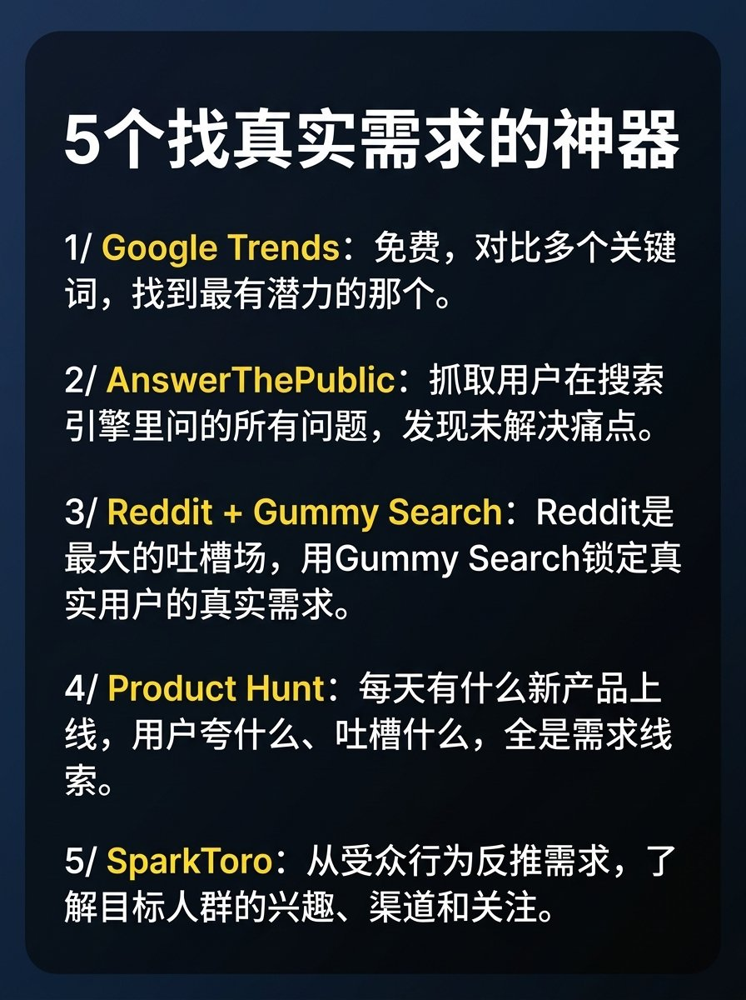

# 饭团（@fantuantalk）：找真实需求的 5 个出海利器——Google Trends/AnswerThePublic/Reddit/PH/SparkToro

> 做产品不要凭空脑补，盘点 5 个验证用户真实需求的工具：Google Trends 测搜索趋势动向、AnswerThePublic 提取真实搜索提问、Reddit+GummySearch 扫描垂直社区未被满足的痛点、Product Hunt 拆解高票产品评论反馈，以及 SparkToro 从受众注意力反推真实需求。

<!-- more -->

5 个找真实需求的神器

1/ Google Trends 免费，输入关键词就能看到搜索趋势。 需求在涨还是在跌，一眼就明白。 对比多个关键词，找到最有潜力的那个

2/ AnswerThePublic 输入一个话题，它会抓取用户在搜索引擎里问的所有问题，每一个问题背后，都是一个没被解决的痛点

3/ Reddit + Gummy SearchReddit 是最大的用户吐槽场。 自动扫描 subreddit 里的痛点，锁定 真实用户的真实需求，不是你脑补的

4/ Product Hunt 看看每天有什么新产品上线，哪些获得高票。 看评论：用户在夸什么、吐槽什么、追问什么功能，全是需求线索

5/ SparkToro 输入你的目标人群，它告诉你他们关注谁、看什么内容、聊什么话题。 从受众行为反推需求，比猜靠谱一万倍

## 相关页面

- [[concepts/app-idea-validation]]
- [[concepts/indie-product]]
- [[concepts/kgr-keyword-golden-ratio]]
