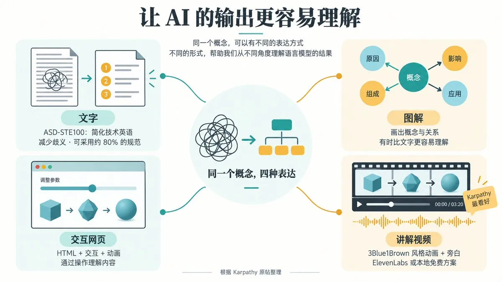
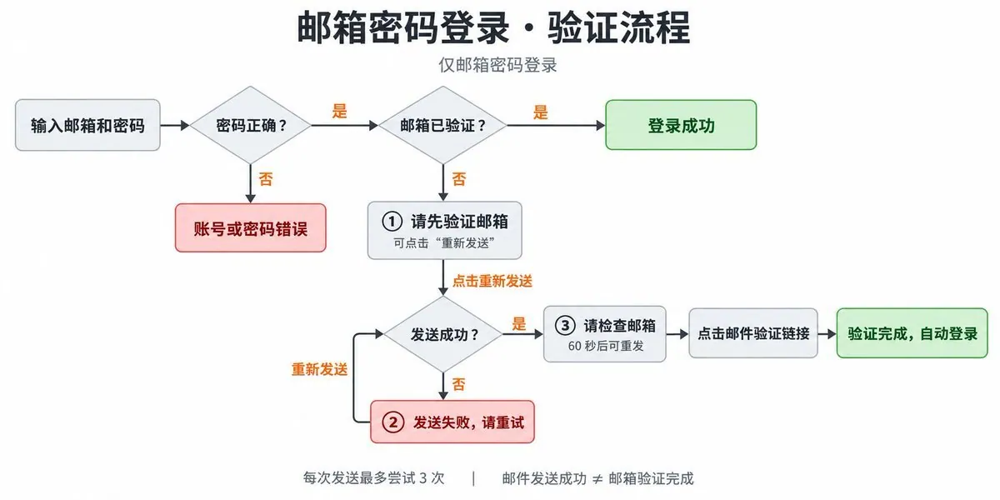
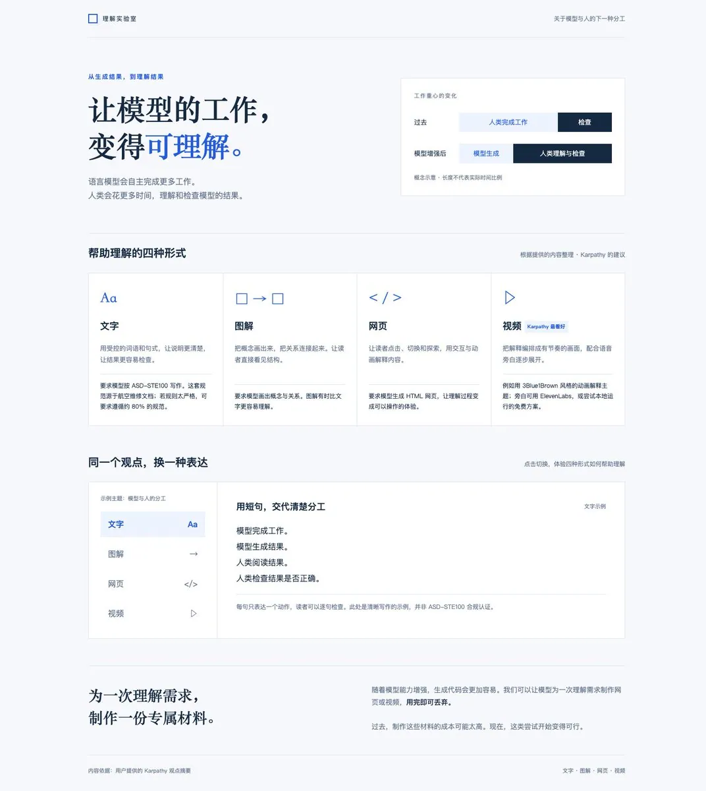
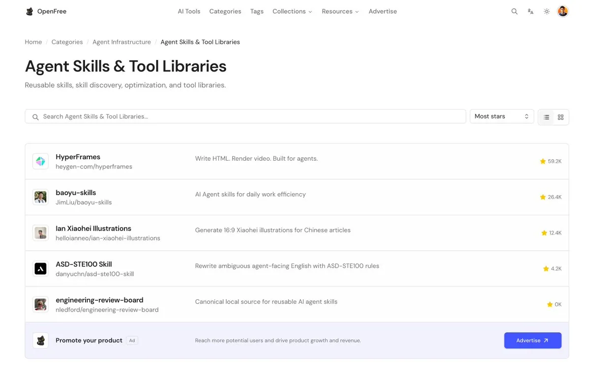

# Fox（@indie_maker_fox）：如何让 AI 帮助我们理解 AI 的输出

> 探讨大模型长上下文与高密度技术输出导致的「人类理解认知过载」难题：提出用二次 Agent 对主 Agent 生成的代码、架构方案与推理论证进行透视化解构——通过反向溯源、边界压力测试与可视化思维导图提炼，让 AI 充当自己的代码解说员与架构审计员。

<!-- more -->

Karpathy 在[这条帖子](https://x.com/karpathy/status/2105819303471976479)里分享了一个观点：AI自主完成的工作越多，人类就越需要花时间理解和审查它们的结果。而这部分工作，也可以请AI帮忙。

引用推文：Andrej Karpathy (@karpathy)

We’ll be spending a lot more time trying to understand the outputs of language models. A few thoughts, tips & tricks: Writing. Something I’ve had success with: Ask your LLM to explain something in ASD-STE100, it’s a controlled language specification originally developed for ae...

https://x.com/karpathy/status/2105819303471976479

他的建议很具体：让模型用更清楚的文字解释，画出概念和关系，生成交互网页，或者制作带旁白的讲解视频。

我平时也会用 Codex 生图做配图，用 HTML Diagram 理解复杂概念，视频则用得少一些。读完他的帖子，我想试试：就拿这条帖子当素材，用他说的四种形式解释他的观点。

## 1. Karpathy 提出了什么观点？

Karpathy 从文字谈起。可以要求模型按照 ASD-STE100 写作。这套简化技术英语规范原本用于航空维修文档，通过限制词语和句式来减少歧义。他觉得这种表达更容易读，但规范也比较严格，所以有时会要求模型遵循“约 80%”的规则。

接下来是图解。把概念和关系画出来，有时比一大段文字更容易理解。

再往后是交互网页。直接要求模型输出 HTML，让它用交互和动画解释一个主题。

他最看好的是定制讲解视频：例如用 3Blue1Brown 风格的动画解释一个主题，再配上语音旁白。

他还提到，模型能力增强、代码更容易生成之后，我们可以只为弄懂一个问题，专门做一个网页或者一段视频。看完就丢弃，也可能值得。过去，制作成本太高，这样做往往不划算。

## 2. 第一种：用文字讲清楚

我先安装了 [asd-ste100-skill](https://github.com/danyuchn/asd-ste100-skill)，目前技能仓库有4K+ stars，算是众多类似技能中质量不错的，我让 Codex 按它的规则总结原帖。

这个技能主要处理英文。它会把冗长或含糊的句子改得更清楚，适合工具描述、错误消息、系统提示词、Agent 之间的指令，也可以处理 README 和 PR 描述等说明性文字。

它强调短句、明确主语和统一术语，但也要求保留原文的条件和不确定性。不能为了简洁，把“可能发生”改成“已经发生”。

这次总结用的是中文，借鉴的是清晰表达原则，不是经过认证的 STE 文档。核心总结如下：

“语言模型会自主完成更多工作。人类会花更多时间理解和检查模型的结果。

Karpathy 建议用四种形式帮助理解：

文字：按照 ASD-STE100 写作，减少歧义。规则太严格时，可以要求遵循约 80%。

图解：画出概念和关系，有时比文字更容易理解。

网页：生成 HTML，用交互和动画解释内容。

视频：制作定制动画讲解，再添加语音旁白。这是 Karpathy 最看好的形式。

随着模型能力增强，我们可以为一次理解需求制作网页或视频。这些材料用完即可丢弃。”

这份总结方便复制和引用，也能作为后面生图、做网页和视频的共同材料。

遇到绕口的英文说明，或者工具描述、错误消息没说清楚条件和动作时，我会考虑这样调用它：

用 asd-ste100 改写这段英文说明。明确谁做什么，保留原文的条件和不确定性。

它负责把文字讲清楚，不负责验证内容是否正确，也不能直接生成图片、网页或视频。后三种形式要换工具。

## 3. 第二种：把观点画成图

### 3.1 直接生图：把模块流程画出来

最直接的方式，是用 Codex 的内置生图技能 imagegen，把内容交给它，要求生成图解。

这次也用 imagegen 直接把 Karpathy 的观点画成了图，四个区域分别介绍文字、图解、网页和视频。效果我觉得一般，放在这里和后面的配图技能生成结果对照看。

我平时也会这样做：开发时搞不清某个模块的流程，或者想 review AI 写的代码，就让它画一张图，帮助自己理解。

我在[这条介绍邮箱密码登录流程优化的帖子](https://x.com/indie_maker_fox/status/2106913108912713986)里，用过这个技能生成配图。邮件发送失败、邮箱验证超时、重试和重发这些分支，光读说明不容易串起来，画成图就方便沿着流程检查。

引用推文：Fox (@indie_maker_fox)

📢 20261005 模板更新，优化了邮箱密码登录流程 之前没有考虑邮件发送失败、邮箱验证超时等场景下的用户体验，现在 TanStarter 和 MkSaaS 模板都优化了这个流程。 - 邮件发送失败时自动重试，最多尝试 3 次。 - 新增重发入口、失败提示和 60 秒倒计时。 欢迎选购我的模板，持续打磨的 SaaS 模板。 https://t.co/ZkA6TY9LIv

https://x.com/indie_maker_fox/status/2106913108912713986

日常可以这样请求：

阅读这个模块的代码，用 imagegen 生成一张流程图，标出入口、关键判断、正常路径和异常分支。AI 刚修改的部分也标出来，方便我 review。图里的关系要以代码为准，不确定的地方注明。

图能帮助理解，但不能代替代码审查，分支和箭头还是要回到源码核对。

想让画面更贴合内容，或者保持自己的配图风格，可以用配图技能先分析正文、安排布局，再指导生图。下面两种方式都调用了 Codex 的内置生图工具，区别在于如何组织内容和画面。

### 3.2 小黑配图：用手绘场景讲清观点

我先推荐推友 [@ianneo_ai](https://x.com/ianneo_ai) 做的“小黑配图”技能：[ian-xiaohei-illustrations](https://github.com/helloianneo/ian-xiaohei-illustrations)。白底手绘、少量中文批注，再让小黑参与画面的核心动作，把文章里的观点、流程或关系画成一个场景。

这次用的是定制版 fox-illustrations：把小黑换成小狐狸，调整角色设定和配色。图里，小狐狸把同一个概念送进一台手摇机器，分别输出文字、图解、网页和视频。

这张图适合让读者先记住一个关系：同一个概念，可以换成不同的表达形式。它的文字比较少，完整说明仍然需要正文配合。

我在 [2026 年 8 月 15 日的帖子](https://x.com/indie_maker_fox/status/2088454444627464354)里分享过这个技能。当时我上传了自己的头像 IP，让 Codex 基于头像重建配图技能，并在帖子里展示了生成效果。

引用推文：Fox (@indie_maker_fox)

🧩 分享一个有意思的配图技能 https://t.co/OYSFcYnLMz 之前推特分享用的是 baoyu 老师的配图技能，今天分享的是来自 @ianneo_ai 的小黑配图技能，收藏很久了，今天抽空体验了下，很好玩。 你还可以上传你的个人头像 IP，然后定制化成自己的配图技能，下面是我上传自己的头像，让 codex 基于头像重建新技能，效果也不错。

https://x.com/indie_maker_fox/status/2088454444627464354

定制时，可以保留分析正文、选择画面结构和检查成图的流程，再改角色、配色和风格规则。

### 3.3 宝玉信息图：把核心内容放进一张图

另一个实用的技能是宝玉（@dotey）老师 [baoyu-skills](https://github.com/JimLiu/baoyu-skills) 集合里的 [baoyu-infographic](https://github.com/JimLiu/baoyu-skills/tree/main/skills/baoyu-infographic)。它可以把一段内容整理成信息图，并选择布局和视觉风格。这次我选择了分区布局和手工纸艺风格，用来呈现 Karpathy 的核心观点。

这次生成的信息图分成三层：顶部说明人的工作如何变化，中间展示四种表达，底部解释为什么可以制作“用完即弃”的定制材料。

这张图保留的信息最多，适合收藏或整体转发。不过在手机上，正文小字可能需要放大阅读。

我以前也用过宝玉老师的配图技能。[2026 年 8 月 14 日分享营销技能库的帖子](https://x.com/indie_maker_fox/status/2088206714608996395)就是一个例子：正文介绍 SEO 审计、文案编写、转化率优化等用途，配图方便读者快速浏览。

引用推文：Fox (@indie_maker_fox)

🧩 分享一组营销技能库 https://t.co/2JsthKOPHH 我试了下，效果真不错，它真的是太齐全了，SEO 审计、文案编写、转化率优化、冷启动邮件、竞品分析 等都支持。 比如，你可以说，给我的网站做个 SEO 审计，帮我优化下首页转化率，帮我设计 5 封欢迎邮件，帮我设计首页的文案 等。 Github 44K+，质量高，按需安装，组合使用。

https://x.com/indie_maker_fox/status/2088206714608996395

讲抽象观点，可以用小黑配图或 fox-illustrations 把它变成场景；想把较完整的内容放进一张图，可以用 baoyu-infographic。给整篇文章安排配图，还可以考虑 baoyu-article-illustrator。请求时可以说：

把这段内容画成图解，保留关键关系和原文的限定条件。

需要精确检查的结构图，我也会考虑 Mermaid 或 SVG。无论用哪种方式，文字和箭头都要核对。

## 4. 第三种：让读者操作一个网页

这一类需求，我推荐使用 [Effective HTML](https://github.com/plannotator/effective-html) 技能集合里的 html 技能。它适合把说明、报告或复杂概念做成独立的 HTML 页面；如果内容主要是流程、状态或系统关系，也可以使用同一集合里的 html-diagram。

这次调用 html 技能，配合 design-artifact，把 Karpathy 的观点总结做成了下面这个展示页。

展示页用了冷白和蓝色的“理解实验室”排版。上方解释人的工作如何变化，介绍四种表达；下面可以切换同一个观点的不同版本：

- 文字：阅读简化后的解释。
- 图解：查看模型执行、人类理解和检查之间的关系。
- 网页：切换“过去”和“模型增强后”，比较工作重心的变化。
- 视频：播放、暂停或重置三步讲解动画，体验信息随时间展开的节奏。

“视频”面板只是无音频的网页动画，下一节才是实际生成的视频文件。页面顶部的工作重心示意也不是测量数据。这份展示页可以离线打开，生成时检查了桌面、手机布局和键盘交互。它用于解释观点，没有复杂模拟。

我之前在 MkAgent 项目里用过这套技能，并在 [2026 年 8 月 24 日的帖子](https://x.com/indie_maker_fox/status/2091805637294555170)中分享了结果。它分析项目代码，整理出核心节点和关系，结合项目的 Logo 与主题风格，生成一个交互式架构页面：点击节点，右侧就会显示详细信息；播放动画，还能看到调用流程怎样展开。

引用推文：Fox (@indie_maker_fox)

朋友们，我发现一个超级哇塞的技能 https://t.co/xwUOpCLTLC 现在已经有不少不错的工具可以画出好看的项目架构图，但大多是静态的，不能交互。今天分享的这个不一样，它是会动的！ 视频里是我在 MkAgent 项目下执行出来的效果，一次搞定。它会根据项目的 logo、主题风格等信息，生成对应的架构图。 不仅如此，它还能分析代码，找出核心节点，生成节点信息和节点关系。每个节点都可以点击，右侧会显示该节点的详细信息。 最终产物是一个 HTML 文件：展示核心架构和工作流程，并且支持动画自动演示调用流程。这个挺有意思，以后读新项目代码可以先用它。

https://x.com/indie_maker_fox/status/2091805637294555170

读一个不熟悉的项目时，我觉得这种页面很有用：先看架构，再点开不熟悉的模块，沿着调用流程读代码。当然，图里的节点和关系还要回到源码核对。

如果看完模型的说明，还是弄不清过程怎样变化，就可以考虑 html：改一个参数看结果，逐步执行算法查看中间状态，或者切换条件观察不同路径。请求里最好写清楚能操作什么、操作后要看什么：

使用 html 技能，把这个过程做成独立 HTML 网页。我能逐步查看状态，也能修改关键参数。每一步说明发生了什么，以及为什么。保留原文的条件和限定，不编造数据。

## 5. 第四种：做成讲解视频

网页可以让读者自己点、自己试，视频则可以按顺序把内容讲一遍，再配上旁白。这次我用 [HyperFrames](https://github.com/heygen-com/hyperframes)，把 Karpathy 的观点做成了一段约 59 秒的中文讲解视频。

[video](https://video.twimg.com/amplify_video/2108396324777570304/vid/avc1/1280x720/-0FogqkmJqGTQvna.mp4?tag=16)

视频沿用网页的米白和深绿配色，分成六段：先讲人的工作变化，再介绍四种形式，最后讲“为一次理解制作定制材料”。画面包括文字、关系图、入场动画和场景切换，旁白使用 macOS 本地中文语音。

这段主要是图文讲解动画，离 3Blue1Brown 那种数学推导和连续视觉演示还很远。就这条帖子而言，文字加一张图已经能讲清不少内容；视频多了讲述节奏和旁白，但还没有充分发挥动画解释过程的优势。

我在 [2026 年 8 月 11 日的帖子](https://x.com/indie_maker_fox/status/2087034131268145633)里分享过一个实际案例：在 Codex 中调用 HyperFrames 插件，让它利用 TanStarter 模板仓库的信息和网站上的核心功能介绍，生成了一段 45 秒的产品宣传视频。

引用推文：Fox (@indie_maker_fox)

朋友们，真的是要吹爆 HyperFrames 啊 这个视频是在 Codex 中用 HyperFrames 插件一次性生成的，它利用 TanStarter 项目仓库本身的各种信息，网站对产品的核心功能的介绍，然后直出 45 秒宣传视频，比我之前用 Remotion 调整了很久的视频要好多了！ 这个视频的动效、流畅度、内容契合度太高了！ https://t.co/GU3DMSAhv8

https://x.com/indie_maker_fox/status/2087034131268145633

那次生成的动效、流畅度和内容契合度，我都挺满意，比此前用 Remotion 反复调整的那段视频更合心意。不过，这只是那个项目上的体验，不能据此说 HyperFrames 做所有视频都更好。

如果一个主题需要按顺序看过程，可以考虑 HyperFrames 这样的工具：先把脚本和分镜写好，再安排动画和旁白。例如算法执行、系统状态变化，或者随参数变化的数学关系。

先为这个过程写一份短分镜。确认每个镜头要解释什么，再用 HyperFrames 做成带中文旁白的讲解视频。

视频要经过脚本、画面时序、配音、渲染和检查。代码生成与返工消耗 Token，渲染消耗计算资源，外部配音可能另收费。这次没统计总成本，不能判断它比其他形式贵多少，我平时生成视频不多。

## 6. 让 AI 的输出更容易理解

把同一个观点做成四种形式后，我觉得选择工具之前，还是要先看自己哪里没理解。这次只是比较产物的特点，没有测试理解速度或学习效果。

- 英文说明绕，条件和动作不清楚：asd-ste100。把观点讲清楚，方便复制和引用；复杂关系和动态过程仍可能不好想象
- 概念或模块之间的关系不好想象：imagegen、ian-xiaohei-illustrations、baoyu-infographic。把关系放在一张图里，方便分享；文字和箭头要核对，信息多时手机阅读吃力
- 不知道参数或条件变化后会发生什么：HTML、HTML Diagram 类技能。自己切换条件、逐步探索；交互要帮助理解，对外分享需要托管
- 需要按时间顺序看一个过程：HyperFrames。用动画和旁白组织讲解；读者跟随播放节奏，制作和修改步骤也更多

两句话能说清，就用文字；关系不好想象，加张图；需要动手试，做网页；过程值得连续展示，再做视频。没必要每次都把四种形式做一遍。

如果要做多个版本，可以先整理文字，再拿同一份内容生图、做网页或视频。后面有修改，各种版本都能回头核对这份材料。

本文介绍到的所有技能都整理到 OpenFree 网站，欢迎访问：

https://openfree.tools/categories/agent-skills-tool-libraries

## 7. 材料来源

- [Karpathy 原帖](https://x.com/karpathy/status/2105819303471976479)
- [ASD-STE100 官方网站](https://www.asd-ste100.org/)
- [asd-ste100-skill](https://github.com/danyuchn/asd-ste100-skill)
- [小黑配图：ian-xiaohei-illustrations](https://github.com/helloianneo/ian-xiaohei-illustrations)
- [历史生图使用示例：邮箱密码登录流程优化](https://x.com/indie_maker_fox/status/2106913108912713986)
- [历史使用示例：小黑配图与头像定制](https://x.com/indie_maker_fox/status/2088454444627464354)
- [baoyu-infographic](https://github.com/JimLiu/baoyu-skills/tree/main/skills/baoyu-infographic)
- [宝玉老师的 baoyu-skills 技能集合](https://github.com/JimLiu/baoyu-skills)
- [baoyu-article-illustrator 文章配图技能](https://github.com/JimLiu/baoyu-skills/tree/main/skills/baoyu-article-illustrator)
- [历史配图使用示例：分享营销技能库](https://x.com/indie_maker_fox/status/2088206714608996395)
- [Effective HTML](https://github.com/plannotator/effective-html)
- [历史使用示例：MkAgent 交互式架构与调用流程](https://x.com/indie_maker_fox/status/2091805637294555170)
- [HyperFrames](https://github.com/heygen-com/hyperframes)
- [历史使用示例：用 HyperFrames 生成 TanStarter 宣传视频](https://x.com/indie_maker_fox/status/2087034131268145633)

## 相关页面

- [[sources/dotey-ai-native-thinking-train-yourself-like-an-llm]]
- [[sources/gkevin-adversarial-subagent-code-review-pitfalls-and-formal-verification]]
- [[concepts/cognitive-load-three-element-model]]
- [[concepts/engineering-skills]]
