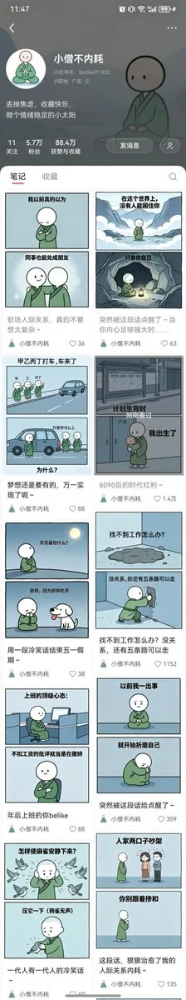

# 知识猫（@GeekCatX）：小红书治愈系漫画图文拆解——小僧不内耗 5.7 万粉变现路径

> 小红书 AI 图文治愈系漫画账号拆解：抓取打工人下班情绪需求，2 个月涨粉 5.7 万；四维变现路径（商单、公众号流量主同步分发、私域引流、高价矩阵号交易），并配合角色一致性 Skill 实现批量出图。

<!-- more -->

今天继续给大家拆解一类小红书 AI 图文账号专门做治愈系漫画， 以博主【小僧不内耗】为例，该账号起号到 5.7 万粉用了大概 2 个多月的时间，增长速度非常的快，点赞收藏也是非常的多。同类型账号涨粉也是非常的快，它抓住了现代人高压力下班后，需要治愈的强需求。

变现方式

1. 小红书接商单变现
   这类变现方式比较常见。千粉后就可以接商单了。刚开始一单 200 左右。号大了以后，报价也更高。
2. 公众号流量主变现
   同样的内容，也可以发在公众号。公众号 500 粉后开通流量主。一篇 10w+ 的文章，流量主收入少说也有几百。
3. 引流到私域变现
   比如卖教程、卖课程或其他产品。
4. 卖账号（矩阵起号）
   现在有很多人利用 AI 快速批量产出内容，把账号做起来后卖账号。之前一位在小红书做爆款图文的博主，一个万粉的账号，卖了 6k 多。
   除了上面的这些玩法，也可以利用 AI 产内容快速涨粉，然后转其他赛道。

这种账号用 GPT Image 2 或者香蕉、国产生图软件都是非常容易复刻的，提示词太长我把它做成了 skill 放在 youmind 上了 需要的兄弟可以直接 2000 积分适用，觉得好的，可以私我发你元提示词，后期你可以接入到工作流批量出图矩阵起号。

左侧为博主首页截图，右侧是由 skill 批量生产使用方法非常的简单 上传一张你的 IP 角色图，然后输入你要的内容或者主题，skill 自动帮你写文案出图。

skill：https://youmind.com/skills/qNPTEhwe4noxzh

## 相关页面

- [[sources/geekcatx-douyin-image-text-monetization-case]]
- [[patterns/wechat-image-post-account-sop]]
