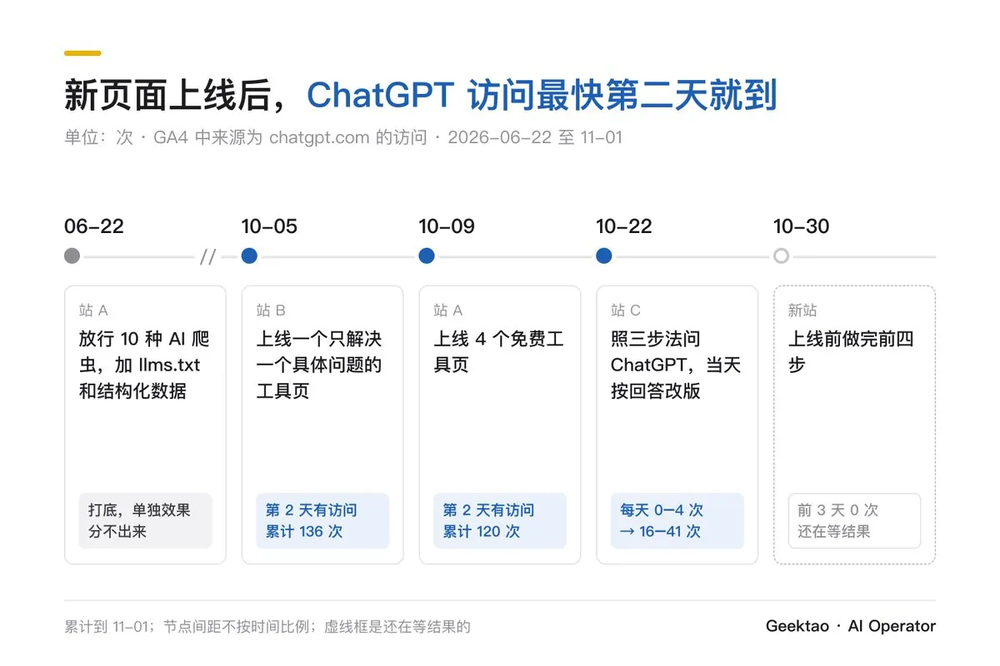
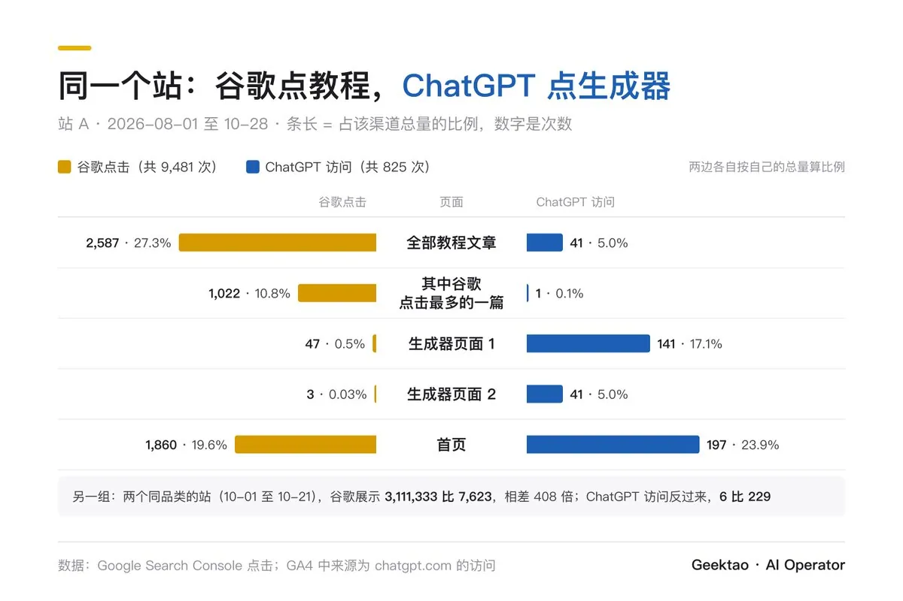
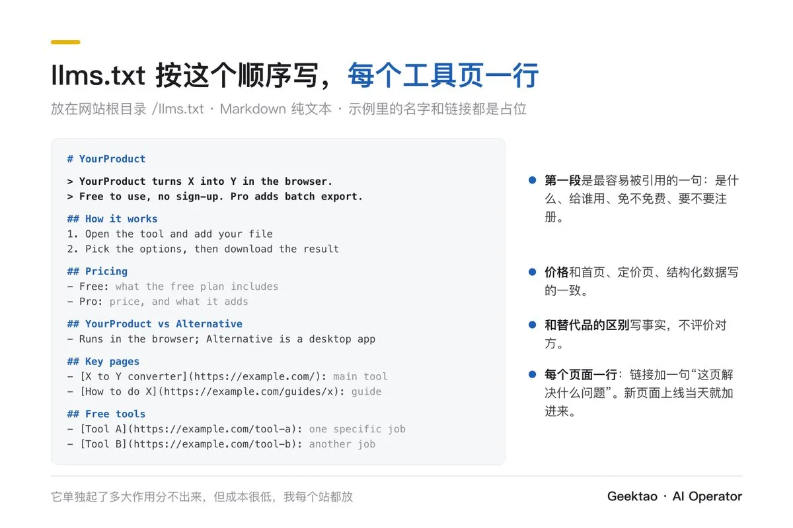
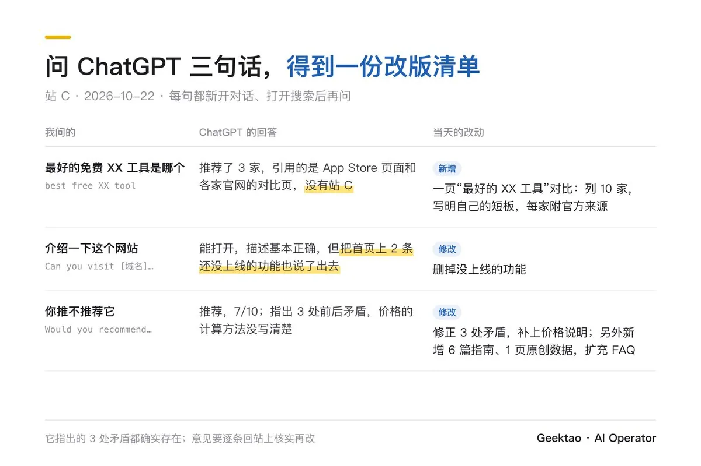
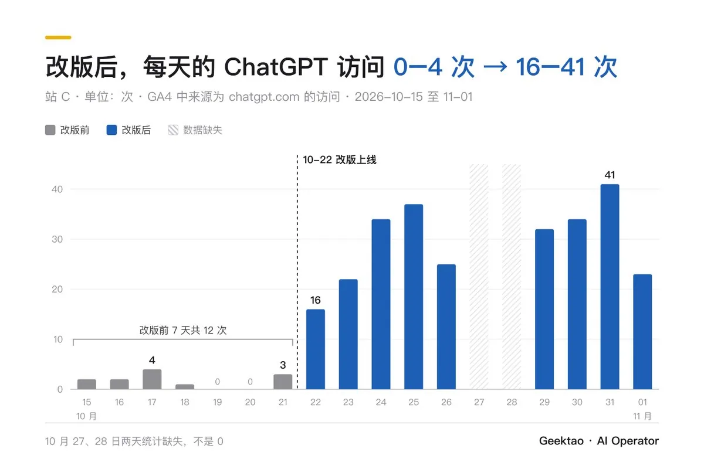
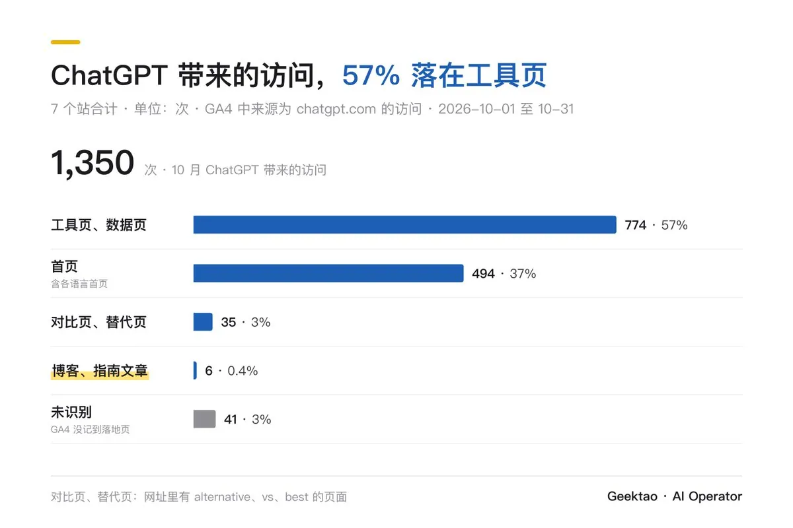
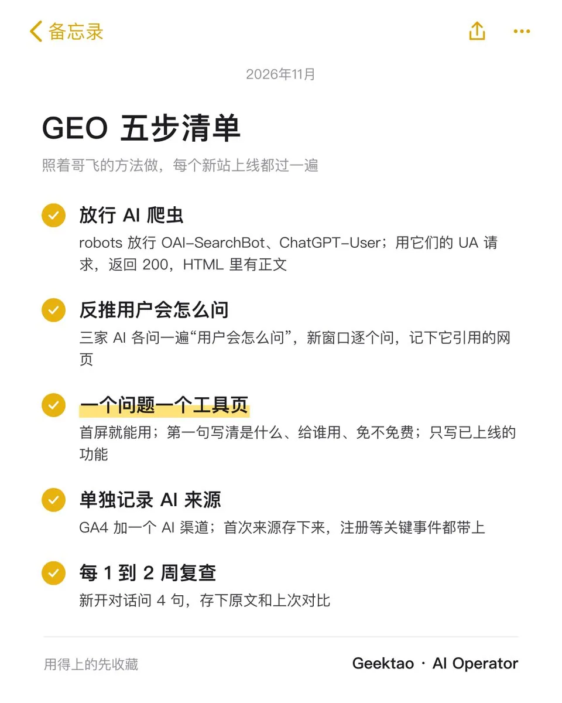

# Geektao（@geektao0319）：照着哥飞的方法做 GEO——让网站同时拿到谷歌和 ChatGPT 流量（谷歌吃教程，ChatGPT 吃工具）

> 基于哥飞公开分享方法在 7 个站实测并跑出 ChatGPT 访问月环比翻 3 倍（1,350 次）的完整实操指南：深刻指出「谷歌吃教程，ChatGPT 吃工具」——两边流量页面几乎不重合；拆解 5 大步骤：放行 AI 爬虫与 llms.txt 根目录部署、哥飞三步法反推用户自然提问意图、打造首屏即用的表单生成器工具页而非长篇资讯、GA4 自定义 AI Assistants 渠道归因监控、以及每 1-2 周对话提问复查与自检闭环。

<!-- more -->

哥飞最近在社群和 X 上反复讲一个观点：网站既要拿谷歌搜索的流量，也要拿 AI 推荐的流量。

我按哥飞公开分享过的方法整理了一套步骤，在自己的几个站上做了一遍。2026 年 10 月，ChatGPT 一共给其中 7 个站带来 1,350 次访问，是 9 月（436 次）的 3 倍。文中的站用站 A、站 B、站 C 代称。

结论先放这里：谷歌和 ChatGPT 带来流量的页面几乎不重合，要分开做；给 ChatGPT 准备的页面要做成能直接使用的工具。文章类页面在 ChatGPT 这边基本拿不到访问。下文按五个步骤展开，每一步附实测数据。

## 一、谷歌和 ChatGPT 推的是两类页面

习惯用谷歌的用户问完 AI 还会回到谷歌搜索；从 AI 时代开始上网的用户，在 AI 里得到答案后就不一定再去搜索（哥飞 10 月 29 日）。所以两边的流量都要拿。

哥飞在 9 月 10 日还提醒过一个容易忽略的地方：同一个需求，用户在谷歌里输入的是几个关键词，在 ChatGPT 里问的是一句完整的话，通常还带着用途和限制条件。问法不同，被找到和被引用的页面也不同。

站 A 是一个工具站。8 月 1 日到 10 月 28 日，它的教程文章拿到 2,587 次谷歌点击，ChatGPT 只带来 41 次访问；其中谷歌点击最多的一篇教程，两边分别是 1,022 次和 1 次。生成器页面正好相反：一个是谷歌 47 次、ChatGPT 141 次，另一个是 3 次和 41 次。

另一组对照是两个同品类的站。10 月 1 日到 21 日，前者在谷歌的展示量是 3,111,333 次，后者是 7,623 次，相差 408 倍；同期 ChatGPT 访问分别是 6 次和 229 次。

「谷歌排名好，不代表 ChatGPT 会推荐」

这一部分踩过的坑

- 不能用谷歌流量去估算 ChatGPT 流量。在我的几个站里，两者没有对应关系（样本只有几个站，只作参考）。

## 二、第 1 步：让 AI 爬虫进得来、读得懂（上线当天，约 30 分钟）

ChatGPT 推荐一个网站之前，要先能抓到页面，并读出页面在讲什么。页面如果靠前端渲染，爬虫拿到的可能只是一个没有正文的空壳。

开始前要准备

- 修改 robots.txt 和页面代码的权限；
- Cloudflare 后台（网站接入了 Cloudflare 的话）；
- Google Search Console 和 Bing Webmaster Tools 账号。

操作步骤

1. 在 robots.txt 里放行 AI 爬虫。和 ChatGPT 相关的有三个：OAI-SearchBot 用于 ChatGPT 搜索，ChatGPT-User 在用户让 ChatGPT 打开网页时使用，GPTBot 用于模型训练。想被 ChatGPT 推荐，至少要放行前两个。Claude、Perplexity 对应的是 ClaudeBot、PerplexityBot。站 A 一次放行了 10 种。
2. 用 AI 爬虫的 UA 请求首页和核心页面，确认返回 200，并且 HTML 里直接包含标题、正文和 FAQ。检查命令放在下面，返回 0 说明正文不在 HTML 里，需要改成服务端渲染。
3. 网站接入了 Cloudflare 的话，到后台确认“屏蔽 AI 爬虫”和 Bot Fight Mode 没有拦截上面这些爬虫。新接入的域名尤其要检查。
4. 加结构化数据：首页用 Organization 和 WebSite；工具页用 SoftwareApplication 或 WebApplication，写明免费和付费方案（Offer）；有问答的页面加 FAQPage；教程加 HowTo 或 Article。
5. 把 sitemap 同时提交到 Google Search Console 和 Bing Webmaster Tools。公开报道称 ChatGPT 搜索有一部分依赖 Bing 的索引，这一点我没有办法自己验证。
6. 在网站根目录放一个 llms.txt，依次写：一句话介绍、怎么用、价格、和主要替代品的区别、核心页面和工具页的链接。

curl -A “Mozilla/5.0 (compatible; OAI-SearchBot/1.0; +https://openai.com/searchbot)” https://你的域名/ | grep -c “<h1”

这一部分踩过的坑

- llms.txt 和其他改动是同一天上线的，它单独起了多大作用，我分不出来。谷歌方面公开说过搜索不使用这个文件。它的成本很低，我仍然每个站都放。
- 新页面上线后，sitemap 可能被边缘缓存住，要等缓存过期，新地址才会出现（站 C 的缓存时间是 1 小时）。
- 这一步只是门槛。一个 10 月 30 日上线的新站，上线前这一步全部做完，前 3 天 ChatGPT 访问是 0。

## 三、第 2 步：用哥飞的三步法，反推用户会怎么问

要被 ChatGPT 推荐，先要知道用户会怎么提问，以及 ChatGPT 回答这些问题时会去引用哪些网页。

哥飞 9 月 9 日公开分享的方法分三步：

1. 先反推。 问 ChatGPT：“假如你是用户，想找 XX 工具，你会怎么向 ChatGPT 提问？”Claude 和 Gemini 也各问一遍，得到一份问题列表。
2. 后提问。 另开一个新窗口，把这些问题逐个问一遍，观察它怎么拆解问题、拆成了哪些搜索关键词、抓取了哪些网页、这些网页的标题是什么。
3. 再总结。 把第 2 步的结果交给 AI 分析，让它告诉你应该写什么内容、发到哪些地方。

执行时，我另外做了两件事。

第一件，把问题按意图分成五类，每一类对应一种页面：

- 找工具（best free XX tool）：工具页、“最好的 XX 工具”对比页；
- 找替代（XX alternatives）：替代页；
- 怎么做（how to XX）：操作指南；
- 具体事实（XX 的价格、尺寸、参数是多少）：页面上的直接答案和 FAQ；
- 值不值得（is XX worth it）：带计算的指南、原创数据页。

第二件，反推完之后，直接问 ChatGPT 对自己网站的看法：

Can you visit [你的域名] and tell me what it does?

Would you recommend [你的域名]? What would it need to improve?

站 C 在 10 月 22 日按这个流程做了一遍。ChatGPT 的回答和我当天的改动如下：

改版前 7 天（10 月 15 日到 21 日），ChatGPT 每天带来 0 到 4 次访问，共 12 次；改版后（10 月 22 日到 11 月 1 日），每天 16 到 41 次。新增的对比页从 10 月 25 日开始有 ChatGPT 访问，到 11 月 1 日共 28 次。

「ChatGPT 会照搬页面上的说法，写错的也照搬」

这一部分踩过的坑

- 同一天改了好几处，无法确定是哪一项带来的变化。
- 它指出的 3 处矛盾都确实存在，这类意见要逐条回站上核实再改。
- 每次都要新开对话、打开搜索再问，前面的对话内容会影响回答。

## 四、第 3 步：做能直接使用的工具页，不做资讯页

哥飞 10 月 26 日公开过一个失败案例：新产品上线一周，2K UV 里有 700 个来自 ChatGPT，但没有成交。他的判断是产品做成了“以内容资讯为主、附带生成器”，ChatGPT 带来的是来获取信息的用户，本身没有生成需求；应该做成生成器、做成表单。

我的数据和这个判断一致。10 月 ChatGPT 带来的 1,350 次访问里，工具页和数据页占 774 次，首页 494 次，对比页和替代页 35 次，博客和指南文章只有 6 次。

新上线的工具页，很快就有 ChatGPT 带来的访问：

- 站 A 在 10 月 9 日上线 4 个免费工具页，其中一个在第二天（10 月 10 日）就有了 ChatGPT 访问，到 11 月 1 日这 4 个工具页共 120 次；
- 站 B 在 10 月 5 日上线一个只解决一个具体问题的工具页，第二天（10 月 6 日）就有了 ChatGPT 访问，到 11 月 1 日共 136 次。

操作步骤

1. 从第 2 步的问题清单里挑出“找工具”和“怎么做”两类，每个具体问题做一个工具页。
2. 首屏放可以直接操作的表单或生成器，用户不用往下翻就能开始用。
3. H1 下面第一句写清四件事：这是什么、给谁用、是否免费、是否需要注册。
4. 页面下方写 10 条以上 FAQ，每条答案的第一句就是结论。AI 引用时通常只取前一两句。
5. 只写已经上线的功能。价格和各类数字在首页、定价页、FAQ、结构化数据里保持一致。
6. 新工具页上线当天加进 sitemap 和 llms.txt，并从首页或工具汇总页加内链。

「一个具体问题，对应一个能直接用的页面」

这一部分踩过的坑

- 文章在谷歌有流量，在 ChatGPT 这边几乎没有。站 A 的教程文章 3 个月只有 41 次 ChatGPT 访问。文章照样写，它主要服务谷歌。
- 对比页的直接访问不多（10 月 35 次）。它的作用可能是被 ChatGPT 引用，再把用户带到首页（我的推论，11 月复查后验证）。

## 五、第 4 步：单独记录 AI 带来的访问

GA4 会把一部分从 AI 来的访问记成直接访问。不单独记录，就看不出哪一步起了作用。

操作步骤

1. 在 GA4 里复制默认渠道组，在 Referral 之前新增一个“AI Assistants”渠道，条件是来源匹配下面这条正则。
2. 在网站代码里记录首次来源：用户第一次访问时，按 utm_source、referrer 的顺序判断来源，存进 localStorage，之后不再覆盖。ChatGPT 给出的链接通常带有 utm_source=chatgpt.com，referrer 丢失时也能识别。
3. 把首次来源写进 GA4 的用户属性（如 first_source、first_ai），注册等关键事件都带上它。
4. 每周看一次 AI 来源的访问量和落地页，和上一周对比。

chatgpt\.com|openai\.com|perplexity|claude\.ai|gemini\.google\.com|copilot\.microsoft\.com|copilot\.com|deepseek|grok\.com

这一部分踩过的坑

- 本文的 ChatGPT 数字都来自 GA4，是下限，实际只多不少。
- 同一份流量如果同时用 GA4 和 Cloudflare 统计，汇总时只能取其中一个来源，两个相加会重复计算。我整理这篇文章时就犯过这个错，文中的数字已经改正。

## 六、第 5 步：每 1 到 2 周复查一次

用登录状态、打开搜索功能的 ChatGPT，每次新开对话，问下面 4 句，把回答原文保存下来做对比：

1. What’s the best free [品类] tool?
2. [最大的竞品] alternatives
3. Can you visit [你的域名] and tell me what it does?
4. Would you recommend [你的域名]? What would it need to improve?

每次重点看三件事：

- 它对网站的描述是否准确。不准确时，回去找是哪句文案导致的；
- 品类问题的答案里有没有你；没有的话，它引用了谁、引用的是哪一类页面；
- 它提出的改进意见，逐条核实后放进待办。

## 七、还没有验证的部分

- 站 C 的对比页能否让 ChatGPT 在“最好的 XX 工具”这类问题里提到站 C，11 月 5 日复查后补在评论区。
- 一个 10 月 30 日上线的新站，上线前做完了前四步，前 3 天 ChatGPT 访问为 0，两周后补数据。
- 投入：第 1 步约 30 分钟，第 2 步约 1 小时，工具页按功能另算。这套做法本身不需要花钱。

方法来自哥飞在 X 上公开分享的帖子，原帖链接放在评论区。感谢哥飞和社群里的朋友。

数据说明：ChatGPT 访问来自 GA4 中来源为 chatgpt.com 的会话，谷歌数据来自 Google Search Console。10 月 27 日、28 日两天的统计不完整，相关数字偏低。

## 相关页面

- [[sources/gefei55-buyi-tool-site-3000usd-pitfalls]]
- [[sources/qianshuixia-daily-review-finding-demands-core-competency]]
- [[concepts/gefei-seo-keywords]]
- [[concepts/b2c-conversion]]
