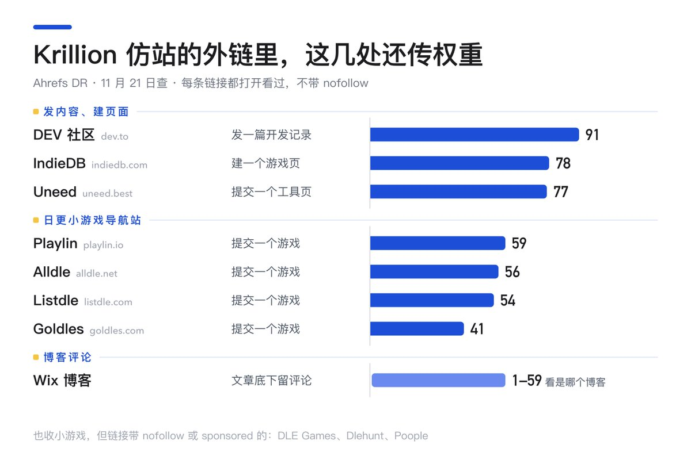

# Geektao：查热词仿站的外链——Wix 博客评论居然不传 nofollow

> 挖 Krillion 热词时发现前排仿站 DR 都不低，有个 10 月 11 号才注册的已经到 47。翻外链发现近一半来自 Wix 博客文章下的评论，而 Wix 的评论链接不带 nofollow；另一个仿站刷在 WordPress 美食博客下，基本都被加了 nofollow。作者自己发过 183 条博客评论，只有 1 条传了权重。

<!-- more -->

最近在挖 Krillion 这个热词，发现前排几个仿站 DR 都挺高，有个 10 月 11 号才注册的，已经 47 了

就去翻了下它的外链是怎么来的，原来是博客在给它传权重：快一半是 Wix 博客文章底下的评论，Wix 的评论链接不带 nofollow

另一个仿站也刷评论，刷在 WordPress 美食博客下面，基本都被加了 nofollow。我自己之前发了 183 条博客评论，也就 1 条传权重

感觉看热词的时候，顺手翻翻前排新站的外链挺值的，新站的外链都是最近才做的，哪些地方现在还管用，一翻就知道

拉了几个链接不带 nofollow 的，DR 是在 Ahrefs 上查的：

1. DEV 社区发篇开发记录，DR 91
2. IndieDB 建个游戏页，DR 78
3. Uneed，DR 77
4. Playlin，DR 59
5. Alldle，DR 56
6. Listdle，DR 54
7. Goldles，DR 41
8. Wix 博客评论，DR 从个位数到 50 多

4 到 7 都是日更小游戏的导航站，能自己提交。Wix 评论这种是刷出来的，那个站 DR 是几个仿站里最高的，流量反倒最少

清单里的网址：https://t.co/Gp5aLHDnf0、https://t.co/aAnFjaXH0y、https://t.co/N7GpPanoLN、https://t.co/as5J2bb6KW、https://t.co/s4pXeTuAzR、https://t.co/a020wFHyVx、https://t.co/hS6O2CCjC5，DR 是 11 月 21 号查的

krillion 相关词和几个同类站的数据，整理在这条里了 https://x.com/geektao0319/status/2124153923661434894

有人问 krillion 这个词是从哪来的，其实网上查新词的服务挺多的，而且这个词已经热了一阵子了

我查到的数据放在图里，需要的自取 https://x.com/geektao0319/status/2124153923661434894

## 相关页面

- [[concepts/open-source-seo-tooling]]
- [[patterns/adsense-publisher-id-site-cluster-discovery]]
