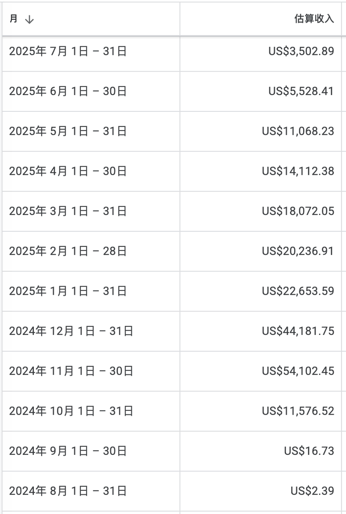
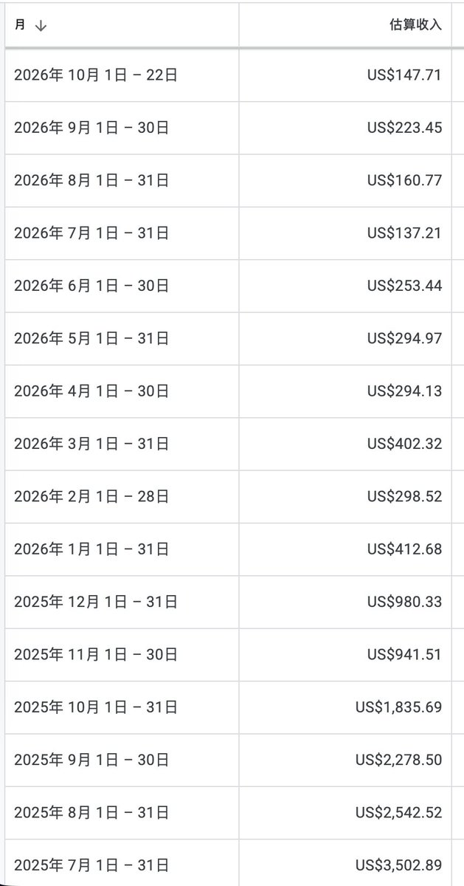

# 游戏站 vs 工具站的 ROI 对比：为什么新人还在做游戏站

> 游戏站能赚钱但需要大流量，流量一过收入就衰减——哥飞的游戏站两年没管，现在只剩月入一两百刀。搞不到大流量时，游戏站的 ROI 确实不如工具站。但新人依然做游戏站，因为游戏类关键词更多、机会更多，且开发难度更低。

<!-- more -->

> 本文合并 @gefei55 的原帖与 @ai_voyager168 在同一线程的回应。

*图 1：哥飞原帖配图。*

---

## 一、核心判断：游戏站的收入会随流量过峰而衰减

> 「游戏站能赚钱，但需要大流量，而**流量一过去，后续收入就会下降**。我的游戏站两年没管了，现在只剩一个月一两百刀收入了。」

这句话点出游戏站与工具站最本质的差别：

| 维度 | 游戏站 | 工具站 |
|---|---|---|
| 流量特征 | 依赖**大流量**（爆款词/病毒传播） | 依赖**长尾搜索需求** |
| 收入曲线 | 随热度衰减而**持续下滑** | 随内容沉淀而**相对稳定** |
| 维护状态 | 两年不管 → 月入一两百刀 | 持续更新内页 → 复利积累 |
| 适合人群 | 能搞到大流量的人 | 新手（关键词多、机会多、开发难度低） |

*图 2：哥飞原帖配图。*

---

## 二、结论：搞不到大流量，游戏站 ROI 不如工具站

> 「**如果你搞不到大流量，那么做游戏站的 ROI 的确不如工具站。**」

这是一个**条件性结论**，不是一刀切：

- 有大流量能力 → 游戏站的天花板可能更高；
- 没有大流量能力 → 工具站是更稳的选择。

---

## 三、反问：为什么很多新人还是在做游戏站？

> 「但我们很多新人依然在做游戏站，为什么呢？因为**游戏类关键词更多，也就是机会更多**，而且**游戏站的开发难度比工具站更低**，所以依然还可以做。」

### 两个真实优势

1. **关键词更多 = 机会更多**——游戏词天然长尾（`2048`、`ghibli ai`、各种攻略站、计算器类），可做的方向比工具站宽；
2. **开发难度更低**——一个简单小游戏或游戏合集即可上线，不需要复杂的后端与业务逻辑。

> **关键区分**：游戏站「ROI 低」是相对**大流量游戏站**的判断。对没有大流量能力的新人来说，游戏站的**开发成本优势**仍然可能盖过 ROI 劣势——尤其当你用的是模板 + AI 编程、几天就能上一个站的情况下。

---

## 四、同一线程的社区共识

@ai_voyager168（AI 航海家）在同一线程的回应：

> 「**感觉还是要做工具站才能赚钱。**」

这句短评与 @wavborn 的选词实践、@ErSan_23X 的 21 天出单复盘形成呼应——社区的实操共识是**新手起步优先工具站**，理由与哥飞一致：工具站的转化路径更可控，而游戏站把成败押在流量爆点上。

---

## 相关页面

- [[sources/wavborn-keyword-screening-playbook]] — wavborn：选词三板斧与 72 组词验证率
- [[sources/jiang-yunhe-first-100-usd-new-word-playbook]] — 蒋云何：副业出海小白首日破百刀，5 天破千刀
- [[sources/yaohongan-keyword-radar-workflow]] — 虹安：找词雷达工作流，2 天从买域名到出单
- [[sources/indie-hub-gefei-game-site-guide]] — 哥飞游戏站专题（基础篇）
- [[sources/indie-hub-gefei-game-site-phase2]] — 哥飞游戏站专题（进阶篇）
- [[sources/indie-hub-seo-game-site]] — 游戏站 SEO 实战
- [[sources/game-station-cost-breakdown]] — 游戏站成本拆解
- [[sources/idle-domain-game-site]] — 闲置域名做游戏站
- [[concepts/indie-product]] — 独立开发者三维度找需求
- [[patterns/ai-business-seven-layers]] — AI 商业七层金字塔
