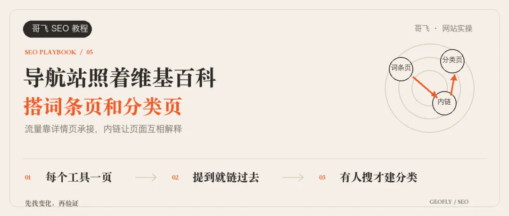

# 哥飞：导航站内页拿不到排名？学维基百科做词条页和分类页

> 很多做 AI 导航站或工具站的开发者常常面临一个困境：收录了几百上千个工具，首页和列表页非常美观，但除了首页，内页几乎在搜索引擎拿不到任何排名。维基百科是全球最大的“导航站”之一，几百万个词条页面如何组织内容、如何互相链接，都摆在明面上。本文以 DeepSeek 维基百科页面为例，深度拆解“词条页”、“语义化内链网络”、“相关推荐 See Also”、“多维度分类页”以及“单工具衍生多功能落地页”的系统性 SEO 架构设计。

<!-- more -->

做 AI 导航站的朋友，经常是这样一个状态：工具收录了几百上千个，首页和列表页做得挺漂亮，但除了首页，内页几乎拿不到排名。

导航站要学，可以学维基百科。它是全世界最大的“导航站”之一，几百万个词条，页面之间怎么组织、怎么链接，都摆在那里给我们看。

今天就拿 DeepSeek 在维基百科上的页面，一类一类地讲：维基百科做了哪些页面，页面之间怎么链接，我们的导航站和工具站可以怎么照着做。

---

## 词条页：一个词条，一个讲全的页面

在维基百科随便打开一个词条，比如 DeepSeek，看到的就是维基百科的经典页面：**词条详情页**。

维基百科网站的绝大多数流量，都靠这个词条详情页来承接。不管是站外搜索（谷歌、百度、Bing），还是站内搜索，用户想找的其实就是这个词条详情页。

换句话说，这个页面**既能够满足用户需求，又能够拿到搜索排名**。

### 为什么这个页面设计可以拿到排名？

看它的 Headings 结构就知道了。左边的目录就是这个页面的各级标题：背景、历史、公司运营、训练框架、模型发布、法律地位……围绕着当前词条，从各个角度来阐述解释跟它相关的内容。

用户只需要看这一个页面，就能够全面了解到 DeepSeek 这家公司的所有信息。其他词条同理，只要是跟词条相关的内容，都会被编辑进去，形成一个内容特别丰富、又特别相关的深度页面。

> **导航站实操建议**：
> 对应的就是**工具详情页**：每个工具一个独立 URL 页面，用 H2/H3 把它讲全（它是做什么的、核心功能、怎么用、价格与免费额度、适合谁、优缺点、有哪些同类工具）。**千万不要只放一个 Logo、一句简短介绍和一个外跳按钮**，那样根本没有文本密度支撑搜索引擎排名。

---

## 正文里提到谁，就链到谁（语义化内链网络）

维基百科还有一个极具杀伤力的特色设计，就是**密集的语义化内链**。

任意一个词条页面，只要正文里提到了别的词条，都会顺手链接过去。在维基百科介绍里，提到的幻方量化、创始人梁文锋、英伟达（NVIDIA）和它的 A100 显卡、美国，全都是蓝色锚文本链接，点进去就是另一个词条。

最终在整个站点内部形成了**语义化的复杂页面拓扑网络**：你中有我，我中有你，互相连接，互相解释。

> **导航站实操建议**：
> 工具详情页的正文里，只要提到站内已经收录的其他工具、公司或分类，就必须加内链。
> 例如：你在一个 AI 写作工具的页面里写“它和 ChatGPT 的核心区别”，那 `ChatGPT` 这几个字就必须加上链接，指向你站内的 ChatGPT 详情页。

---

## 底部两组链接：See also 与多标签分类

除了在正文中穿插内链，维基百科每个词条页面底部还有两组重要组件：

### 1. See also（相关推荐）
列出与当前词条紧密相关的外部词条。例如 DeepSeek 页面的 See also 包括：中国人工智能产业、大模型列表、推理模型、“杭州六小龙”、浙江大学等。

### 2. 所属分类标签（多维度归属）
在内容的最底部，列出当前词条的全部所属分类。**一个词条可以同时跨越多个不同分类**。例如 DeepSeek 页面同时属于：
- 人工智能公司
- 2023 年成立的中国公司
- 2023 年成立的科技公司
- 总部在杭州的公司
- 中国品牌

再举个电影的例子，《逃学威龙》可以同时打上：1991 电影、1991 香港电影、陈嘉上电影、周星驰电影、粤语电影。

> **导航站实操建议**：
> 每个工具详情页底部，必须放一组“相关替代工具”，再列出它所属的全部分类标签。一个 AI 生图工具，可以同时属于「AI 图片生成」「免费 AI 工具」「2025 年上线的 AI 产品」。

---

## 分类页：自己本身就是排名收割机

点开 DeepSeek 所属的“2023 年成立的科技公司”这个分类，可以看到：在大分类页面，先列出小分类列表，下方再列出该分类下的所有词条。最顶部还有一排年份导航，可以跳到前后几年的同类分类页。

通过词条、分类等页面之间的合理内链，维基百科庞大的站点内部**流量就彻底流动起来了**。同时，也让搜索引擎爬虫顺着分类树爬遍所有深层页面。

### 分类页满足的是“聚合列举”的搜索需求

例如：我想了解 2020 年有哪些公司合并，就会去谷歌搜索 `2020 merger companies`。谷歌搜索结果第一名和 AI 概览引用的，正是维基百科的分类聚合页。

在这些页面里，清晰列出了用户想要知道的完整公司列表。

> **导航站实操建议**：
> 用户会搜索 `2024 年成立的 AI 公司`，或者搜索 `2025 年上线的 AI 产品`。如果你做了一个按照年份、价格（免费/付费）、平台（Web/Mac/iOS）、垂直行业（电商/法律/医疗）分类的列表页面，就能完美截流这一类聚合搜索需求。

---

## 迁移到工具站：一个功能，做多个针对性页面

这套做页面的思路不仅适用于导航站，同样完全适用于单功能工具站。

很多人常问：“我同一个工具，是否可以做多个页面？”

**答案是：完全可以。** 举例来说，如果你做了一个在线图片编辑器，你可以建立以下多个独立 Landing Page：

- `Online Image Editor`
- `Online Photo Editor`
- `Online Picture Editor`

只要有真实用户搜索对应的关键词，你就可以为每个关键词定制一个页面，围绕着不同的搜索意图写差异化文案、标题和 FAQ，但底层实际使用同一个前端功能组件来满足需求。

---

## 铁律：页面不能盲目乱建

做 SEO，必须牢记最核心的原则：

> **只要有人搜索，我们就去做相关页面来满足搜索；绝不要为了凑页面数量去盲目建站。**

无论是分类页，还是同一功能的多个衍生词页面，在建站前必须先通过关键词挖掘工具查清楚：这个分类名、这种说法**到底有没有真实搜索量**。完全没有搜索量的排列组合，不要浪费算力和爬虫额度去生成。

---

## 检查清单（Action Items）

打开你的导航站或工具站，对照排查一遍：

1. **详情页丰满度**：每个工具是否有独立的详情页，页面里有没有用几个 H2 把功能、定价、测评讲全；
2. **正文语义内链**：详情页正文里提到站内其他工具或概念时，是否加上了跳转内链；
3. **底部相关推荐**：详情页底部有没有放“相关工具”和所属的全部分类标签；
4. **多维分类搜索验证**：列出年份、用途、价格、平台等分类维度，挨个查询是否有搜索量；有搜索量的才建分类页，分类页内部列出子分类与工具列表。

---

## 相关页面

- [[sources/geektao-geo-google-and-chatgpt-traffic-step-by-step-guide]]
- [[sources/taowithsaas-bing-webmaster-free-competitor-backlinks-export]]
- [[sources/sopilot-400-directories-submission-platform]]
- [[concepts/gefei-seo-keywords]]
- [[concepts/seo-basics]]
