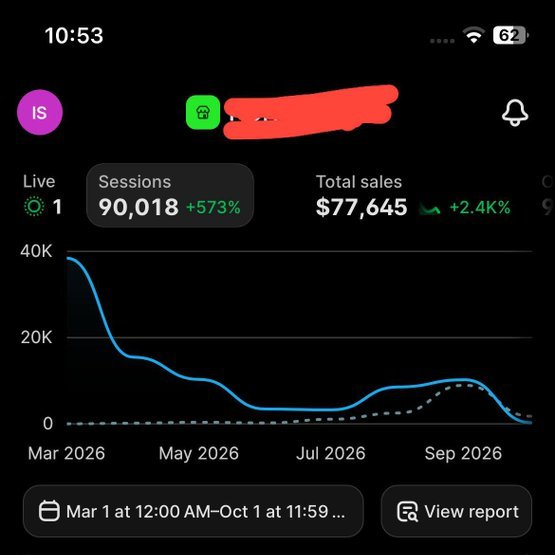
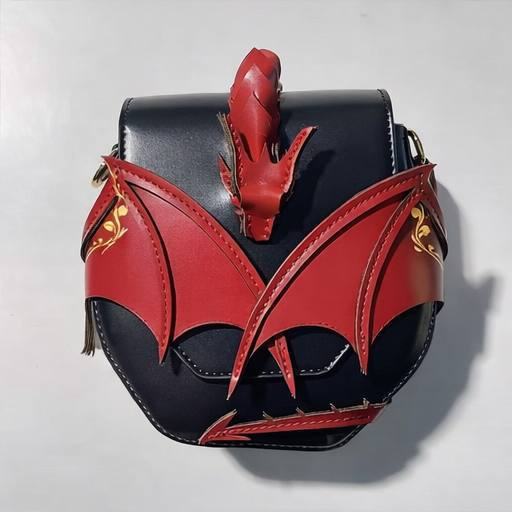

# GHOST（@ghosstty_）：我造了一个 AI UGC Creator，做出 $77,645 销售额——爱尔兰中年矮人皮具匠全流水线

> 作者把「AI UGC Creator」定义为单一具体含义：一个锁定形象、常驻账号所有内容、由 Claude Opus 5.5 编写导演、在 Higgsfield 逐场景渲染的持久角色，不是 influencer 也不是 model。他造的是一位爱尔兰中年矮人女工匠，卖手工皮革龙形手袋（$120-$180 区间，单只 $142），7 个月做出 $77,645 Shopify 销售额、90,018 sessions，零付费广告；相对前七个月流量 +573%、收入 +2,400%（截图为 October 1, 2026）。选角色遵循 character-product rhyme：从产品的世界出发找一个可信的制造者而不是主角，并且角色不能太好看——初稿接近 28 岁战士时无人收藏，改成 46 岁、加白发、显得疲惫之后一周内 save rate 翻了三倍。内容是四 archetype 轮转加锁定角色表加同一收尾：Reply-to-Hate（20-25s）、Public Reaction（15-20s）、Craft Reveal（25-35s）、Trend-Reactive（15-45s），每支视频最后 5 秒必须是真实 iPhone 产品镜头、绝不由 AI 生成。角色表是单点故障：在 Higgsfield image mode 生成 30 张候选脸，用 Soul ID 锚定一致性，并把场景锁死在三个地点，测试第四个（酒馆）时 save rate 反而下降。成本上 Higgsfield Ultra tier 年付 $99/month 含 3,000 credits/月，每支成片约烧 200 credits、7 个月约 18,000 credits、总计约 $693，即 $77,645 收入的 0.89%，而同期 Shopify 2.9% 加 $0.30/单抽走超过 $2,500。变现三条路：Higgsfield Rewards $1 per 1,000 views、affiliate（Glitchy、Impact、Levanta、Rakuten）$28-$73 per sale、自有产品 $77,645 in 7 months。

<!-- more -->



I’m using “AI UGC Creator” to mean one specific thing.

A locked AI-generated character who stars in every piece of content on an account, written and directed by Claude Opus 5.5 and rendered scene-by-scene in Higgsfield.

Not an influencer. Not a model. A persistent character. A recurring sitcom lead who happens to sell handmade dragon handbags.

I built one. Her name is private. She is a middle-aged dwarf craftswoman from Ireland. She has done $77,645 in Shopify sales in 7 months with zero paid ads.

Shopify dashboard, October 1, 2026. 90,018 sessions. $77,645 in sales. +573% traffic, +2,400% revenue versus the prior seven months. The store sells one thing. Handmade leather handbags shaped like dragons. Every video driving that traffic stars her.

She is the proof. The method is extensible. Four more AI UGC Creators are in production for four more niches. When they start posting, I’ll quote this article every time a new one hits.




Why generic AI-UGC fails for niche aesthetics

The default AI spokesperson in late 2026 is a 23-year-old in soft bathroom light holding a $12 skincare serum. That character converts for commodities the buyer feels neutral about. Every brand uses the same face because the buyer doesn’t care who sold her the serum. She wanted the serum.

Aesthetic-driven products are the inverse.

The buyer of a $142 handmade leather dragon handbag already owns the Lord of the Rings extended editions on 4K. She has a tattoo of a sigil from a book nobody in her office has read. She shopped at Hot Topic when she was fourteen and never fully left. A generic UGC girl in a kitchen reads as a brand mistake the second she opens her mouth.

For aesthetic commerce, the spokesperson has to live inside the same world the product lives in. If the product has a mythology, the spokesperson has to be of it. The best way to price yourself out of this market is to use the same AI model everyone else is using.

## Why I picked a dwarf: the character-product rhyme

My dwarf makes dragon bags. The rhyme is total: that’s the whole mechanism.

When I was deciding what my AI UGC Creator should look like, I started from the product’s world and cast a believable inhabitant of that world. Not the hero. The craftsperson. The side character people wish got more screen time.

Here are the mappings I’m using to design the next four AI UGC Creators (and some I’m not):

Fantasy leather goods → dwarf blacksmith, elf tanner, forest witch

Cottagecore ceramics → woman in her sixties pulling bowls from a kiln in her garden

Dark academia stationery → tired librarian cataloguing in a basement archive at 2am

Sci-fi minimalist tech → engineer in a shared workshop in Shenzhen three days post-launch

Goth jewelry → mortician’s assistant in a converted Victorian funeral home

Y2K-nostalgia fashion → 34-year-old reorganizing her teenage CD binder

Retrofuture decor → art director for a 1970s airline that never existed

Cyberpunk accessories → off-shift netrunner at a noodle counter in Kowloon

The character has to be plausibly the person who would make this thing. That rhyme is what sells.

Second rule, learned the hard way: she can’t be too attractive. My first draft of the dwarf was closer to a 28-year-old warrior. Nobody saved her videos. I aged her up, added grey to the hair, made her slightly tired, and the save rate tripled in a week. A model holding your handbag reads as an ad. A 46-year-old craftsperson reads as the person behind the account. People defend craftspeople in the comments.. they never defend models.

My dwarf is middle-aged, tired-looking, has red streaks through black hair, and mostly looks annoyed. The last part is critical. People scroll past serene faces. They stop on annoyed ones.

## The content pipeline. One character, many formats

The 23-second video below is one example. Not the format. The actual playbook is a content pipeline: one locked character, several short-form archetypes in rotation, and the same closing beat on every single one. Varying the archetype keeps the feed fresh. Keeping the character and the closing beat makes the account recognizable.

What stays constant across every video:

- Same character, same face, same world (locked by the character sheet in Section 05)
- A fake quoted hate overlay or a vulnerable one-line setup in the first 5 seconds
- Real iPhone product footage in the final 5 seconds. Never AI-generated
- A vulnerability close that asks a direct question. “please be nice but honest, do you like them.”

What rotates between videos:

> Archetype 1 · Reply-to-Hate

> Fake negative comment attacks the character as the character. Example overlay. “No one likes your ugly dwarf dragon bags, give up already” 🤮😂. Reveal word (LOOK) → proof-of-craft cuts in the stone workshop → product shot. 20–25 seconds. The attached clip is this archetype

> Archetype 2 · Public Reaction

> Character out in a modern setting (train station, café, street) with the bag visible. Overlay. “This is how people react to my dragon bags.” 😔💔. No reveal cut. Just her standing there as people glance. Lower energy, longer dwell. 15–20 seconds. Attached as the second clip in Section 05.

> Archetype 3 · Craft Reveal

> Opens on hands cutting leather, no character face yet. Builds through 15 seconds of workshop b-roll with location text (IRELAND.). Character face appears only in the last 5 seconds, holding the finished piece. For buyers who scroll past faces but stop on hands. 25–35 seconds.

> Archetype 4 · Trend-Reactive

Dwarf inserted into whatever audio or visual meme is viral that week (via Higgsfield Genjutsu. Take the viral clip, swap in your character). Vulnerability close still goes on the end. 15–45 seconds depending on the source. Rare, high-ceiling when it hits.

Four archetypes, one character sheet, same close. On a bad week I ship two of one archetype. On a good week I rotate all four across seven posts..

[video](https://video.twimg.com/amplify_video/2109393673100181504/vid/avc1/1080x1920/wd5BM3QFGL_RLrck.mp4?tag=29)

The twist is that the hater attacks the character AS the character, never the real seller. The phrase “your ugly dwarf dragon bags” insults a persona who makes dragon bags. Viewers rush into the comments to defend the dwarf. The product becomes the thing they defend by buying.

The ending question triples the comment count. Nothing in generative AI makes a viewer type. A pleading, slightly vulnerable question does.

## The stack. Opus 5.5 + Higgsfield + CapCut


Three tools, each doing one thing.

Claude Opus 5.5 is the director. It writes the fake hate comment to match the current grammar of hostile TikTok comments. It writes the vulnerability-close line. It calls Higgsfield through the MCP connector to generate the scenes. On September 22, 2026, Opus 5.5 shipped at 40% lower cost and 30% faster than Opus 5. For agentic pipelines like this one, that’s the entire difference between “fun to try” and “runs in the background while I eat lunch.”

Higgsfield is the camera. It renders the character from a locked sheet so her face, armor, hair, and setting are the same every single time. The character sheet is the entire game. Without it, Higgsfield re-rolls her face every generation and the audience stops recognizing her by video three. With it, she becomes a recurring character the account’s followers greet like a sitcom lead.

CapCut is the editor. Six minutes per video once the system is locked. Add text overlays, trim beats, drop in trending audio, export.

That’s the whole stack. There is no secret fourth tool.

## How I built the character sheet: the one asset that mattered most

If anything in this build was a single point of failure, it was this. The character sheet is a locked reference image + a locked prompt block. I built it once and every Higgsfield generation since has used it as the source of truth.

Step 1: I generated 30 candidate faces in Higgsfield’s image mode. This is the prompt I used.

```
A middle-aged dwarf craftswoman, around 45 years old.
Weathered face, black hair with natural red streaks grown out from old dye.
Visible pores, tired eyes, no makeup. Scar on left eyebrow.
Wearing medieval plate armor over a dark linen underlayer,
scuffed leather straps. Standing in a mossy stone courtyard in Ireland,
overcast daylight, cold color grading.
Photographic realism, no stylization, no fantasy illustration.
Shot on 35mm, shallow depth of field.
```

Shot on 35mm, shallow depth of field.

I generated 30 variants, then picked the one face a Lord-of-the-Rings-collecting 32-year-old would want to meet. That image became my reference. Everything else was built on top of it.

Step 2: I loaded the reference into every subsequent video generation. Higgsfield’s Soul ID / character consistency feature takes the reference image and anchors the face across generations. I never generate without it. The one time I forgot, the next video had a slightly different nose shape, and comments noticed within an hour.

Step 3: I locked three settings and stopped there. The dwarf lives in exactly three places:

- Mossy Irish wooded path (outdoor walking shots)
- Stone workshop with vertical window light (crafting shots)
- Grey stone courtyard (b-roll / transitions)

Three locations is the ceiling I set for myself. I tested a fourth (a tavern) and the account’s save rate dropped. Too many worlds dilute the character. For the next four AI UGC Creators I’m building, I’m keeping the same three-location rule..

[video](https://video.twimg.com/amplify_video/2109395356500865024/vid/avc1/1080x1920/a-LweUDsVpubnFqC.mp4?tag=29)

## The Claude Opus 5.5 system prompt I run

This is the actual system prompt I feed Opus 5.5 for every script. The CHARACTER block changes per AI UGC Creator; everything else stays fixed across all five builds.

```
You are a TikTok UGC script writer for an aesthetic e-commerce brand.

CHARACTER:
45-year-old dwarf craftswoman from Ireland.
Makes handmade leather handbags shaped like dragons.
Tired, slightly annoyed, deadpan sense of humor.
Speaks in short declarative sentences.

PRODUCT:
Handcrafted leather dragon handbags, $120-$180 range.
Red/black color scheme, sewn-on dragon wings, embossed scale patterns,
small horn detail on the clasp.

AUDIENCE:
Women 25-40 who grew up on Lord of the Rings and Harry Potter.
High disposable income. Shop on TikTok late at night.
Scroll for 90 minutes before buying anything.

FORMAT:
Write a short-form TikTok script in one of these archetypes
(I will tell you which — default to Reply-to-Hate):

- REPLY-TO-HATE (20-25s): fake hate comment overlay (0-5s, attacks
  character as character, 1-2 emojis, plausible grammar) →
  one-word reveal (5s, default LOOK) → proof-of-craft cuts
  (5-18s, 2-3 lines of hand action + location text) →
  vulnerability close (18-end, pleading question overlay).
- PUBLIC REACTION (15-20s): character out in modern setting with
  bag visible → overlay quoting people's imagined reactions →
  no reveal cut, just her holding the moment → vulnerability close.
- CRAFT REVEAL (25-35s): hands + materials for first 15s,
  no character face → location text halfway through → face
  appears last 5s holding finished piece → vulnerability close.
- TREND-REACTIVE (15-45s): write to a viral format I will paste in.
  Keep the character in-world. Vulnerability close still on the end.

Vulnerability close is non-negotiable across every archetype.
The character sheet is non-negotiable across every archetype.

CONSTRAINTS:
- No AI tells (no "unleash", "elevate", "crafted with love")
- No emojis in beat 2 or 3
- Vulnerability close must sound like a tired person asking
  a real question, not a brand pretending to be humble
- Hate comment must feel plausible — a real person could have typed it

OUTPUT 5 variants.
```

I run Opus 5.5 at medium effort. High effort over-plans the beats and burns tokens for no quality gain. Medium gives me 5 usable variants per call; I keep 1 or 2 and discard the rest. The rejects are usually too clean, too sincere, or they betray the character.

Why I’m on Opus 5.5 specifically: I built the first version of this pipeline on Opus 5. The vulnerability close was the problem. It kept writing “we put our hearts into these” and similar lifeless phrases, and I was manually rewriting every close by hand. When Opus 5.5 shipped on September 22, 2026 at 40% lower cost and 30% faster, I ported the system over the next day and the manual-rewrite step went away. The drier register is default. That one change saved me more time than any other upgrade I’ve made..

## How I generate scenes in Higgsfield

Once Opus 5.5 hands me the script, each beat becomes 1-2 Higgsfield generations. Here’s the exact workflow I’m running right now.

Beat 1. Static hate shot (5s).

Model. Seedance 2.0 at 1080p. Credits: ~45 per 5s clip.

```
[REFERENCE: character_sheet.png]
The dwarf craftswoman walks slowly down a mossy wooded path in Ireland.
Overcast light. Bare trees. Low stone wall covered in moss on the right.
She looks slightly annoyed, not angry. Camera held selfie-style,
slight shake, iPhone footage quality. 5 seconds. 1080p.
```

Attach the character sheet. Attach a frame from the previous video if you want pose continuity. Generate 3-4 variants, pick 1.

Beat 3. Workshop montage (3 clips, 4s each). Same model, same credit cost.

```
[REFERENCE: character_sheet.png]
Close-up of the dwarf's hands cutting a piece of red leather on a
scarred wood table. Precision knife and metal ruler. Natural window
light from the left. Stone workshop background out of focus.
Her face partially visible, concentrated. 4 seconds. 1080p.
```

Generate 3-4 variants per beat. Keep 1. Discard the rest.

Beat 4. Real iPhone footage (NO generation).

This beat is actual footage of the actual product on an actual cutting mat. Shoot 30 seconds of raw b-roll per bag and you have five future videos covered. Do not generate the product shot. The audience can tell. Real product footage is what closes the sale after the AI scenes earn the view.

## The real cost math

Higgsfield subscription at Ultra tier: $99/month annual billing. 3,000 credits included per month.

Each final video (15–45 seconds depending on the archetype) burns roughly 200 credits on average once rerolls are counted (character consistency fails sometimes and you regenerate). At ~70 posted videos over 7 months plus throwaway experiments, total credits consumed sits around 18,000.

Across 7 months the Higgsfield spend was approximately $693.


That’s 0.89% of $77,645 in revenue.

Compare that to Shopify’s cut. 2.9% + $0.30 per order on every transaction. Across the same period and order volume, Shopify pulled over $2,500 out of my pocket in transaction fees alone. The AI tool everyone online is still debating “is it worth it” costs less than a third of what the payment processor costs. I had to look up both numbers to remember which was which.

Opus 5.5 API spend was negligible. Scripting runs are measured in cents per video. The Claude subscription I’d pay anyway for other work.

The leather for one bag costs more than generating a video that sells five of them.

## What hasn’t worked yet

Two things I have not solved and keep putting off.

Close-up facial expressions. Any time I prompt the dwarf for a specific emotional read. Scoffing, winking, mock-anger, a slow blink. The generation lands uncanny and the view count drops. The videos that work keep her in medium shot or walking away from camera. I don’t know whether this is a Higgsfield limit, a prompting problem, or a character-sheet problem, and I haven’t sat down to isolate it.

Voice. Every video so far uses trending TikTok audio with text overlay. The dwarf has never spoken out loud. Giving her a voice would open twice as much narrative range, but every AI voice I tested breaks the medieval fantasy frame the second it opens its mouth. The modern cadence is wrong. The breathing patterns are wrong. I keep deferring this.. and the account grows anyway, which is probably why I keep deferring it.

If you solve either of these before I do, tell me.

## The next four AI UGC Creators I’m launching

Pre-registered so that when I post a video with any of these over the next 6 months, you’ll know it’s not a one-off and you can trace it back to this build. Each new character gets its own Shopify, its own Opus 5.5 CHARACTER block, its own three-location sheet, and the same four-archetype rotation.

1. Goth / mortuary jewelrymortician’s assistant character, Victorian funeral home setting
2. Dark academia stationerytired librarian, basement archive at 2am
3. Cottagecore ceramicsgrandmother pulling bowls from a backyard kiln
4. Y2K-nostalgia fashion34-year-old reorganizing her teenage CD binder

Pattern across all four of my planned AI UGC Creators. A niche product with strong aesthetic cohesion, a buyer who already lives in that aesthetic, and a plausible craftsperson character who fits inside it.

If you’re selling a USB charger.. an AI UGC Creator will not save you.

## Three ways to make money with this

Not everyone reading this has a product to sell. The playbook still works. Three monetization paths, lowest barrier to highest.

Path 1. Higgsfield Rewards. $1 per 1,000 views. No selling.

Higgsfield’s rewards program pays creators $1 for every 1,000 views on videos made with their AI influencer tools. The video doesn’t have to sell anything. It just has to get watched.

A single clip hitting a million views pays $1,000. If you’re producing one every 20 minutes and running ten characters across ten accounts, this is the entry-level lane. No inventory. No shipping. No customer service. Just view counts.

Pure volume play. The character still has to be distinctive. A middle-aged dwarf or a Victorian mortician or a 1970s airline art director. Because distinctive characters get watched. But you don’t need the vulnerability close or the product reveal. You just need the hook.

Path 2. Affiliate (Glitchy, Impact, Levanta, Rakuten). $28-$73 per sale.

If the character works but you don’t want to manufacture anything, run affiliate offers. Networks pay $28-$73 per sale on physical products that fit the aesthetic world you’ve built.

Your dwarf doesn’t have to sell dragon bags she made. She can review a pewter dragon pendant from a jewelry affiliate. A hand-bound leather notebook from an Etsy-adjacent affiliate network. A beeswax candle from a cottagecore brand running an affiliate program. The product rotates. The character is the asset.

Lower margin than Path 3. Zero fulfillment risk. The right lane if you have the time to post daily but not the setup to ship a product.

Path 3. Own product. $77,645 in 7 months. Highest ceiling, highest friction.

What I’m doing. Build the character, build the product, build the Shopify. The margin is yours. The customer list is yours. The brand compounds every month because every buyer who likes the bag follows the dwarf, waits for the next drop, shares the account.

Downside. You have to make the thing. For me that’s leather, hardware, thread, and shipping. For 25 unfulfilled orders sitting on my dashboard right now, that’s 25 bags I need to physically make and ship this week. The ceiling is uncapped. The floor is a lot of leatherwork.

Which to pick.

- Zero capital, want to test the format fast → Path 1 (Rewards)
- Have time, no product, want middle ground → Path 2 (Affiliate)
- Have a product or want to build one, play the long game → Path 3 (Own)

All three use the same character sheet. All three run the same four archetypes. All three sit on the same Opus 5.5 + Higgsfield stack. The character does the work in all three lanes.

## Three things to internalize

The AI UGC Creator is the brand, not the product: My dwarf’s audience follows the dwarf. They buy the bags because they follow her. If I swapped products tomorrow. Same character, same world. They would buy whatever she made next. This is why the character sheet in Section 05 was the most important thing I built, not the product line.

The pipeline is boring on purpose: Four archetypes. One character. One closing beat. Rotate the archetype, keep everything else fixed. Varying the archetype keeps the feed interesting. Keeping the character and the close trains viewers to wait for it.

The stack is intentionally minimal: Opus 5.5 writes, Higgsfield renders, CapCut edits. The Higgsfield MCP connector launched September 22, 2026 means Opus 5.5 can orchestrate the whole thing in one agentic session, but I haven’t ported to it yet. What I have works, and the next lift for me is scaling to five AI UGC Creators across five niches, not making one 30% faster to produce.

If one middle-aged dwarf did $77,645 in 7 months with zero ad spend, five AI UGC Creators across five niches is a real business. Every time I launch a new one, I’ll quote this article so you can trace it back to the original build. The dwarf is proof..

## 相关页面

- [[patterns/ai-agent-content-farm]]
- [[concepts/ai-content-pipeline]]
- [[concepts/b2c-conversion]]
