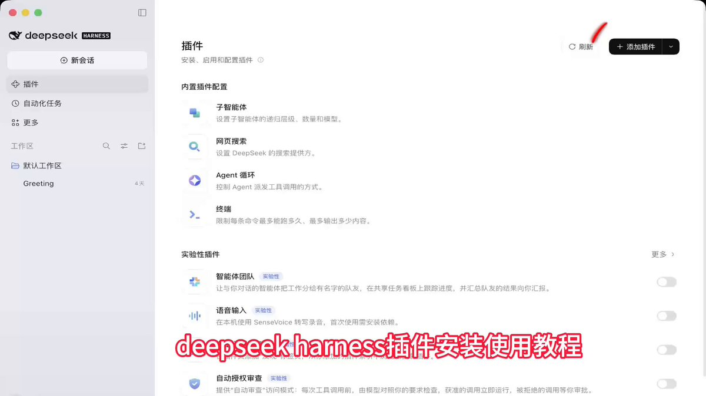

# G 哥：DeepSeek Harness 自媒体创作者工作台 dsh-media-desk

> DeepSeek Harness 开源了自媒体创作者工作台插件 dsh-media-desk：灵感收集→脚本生产→封面配图分镜→内容资产库→发布排期→数据复盘，一个人 + Agent 组成内容团队。引用其上一条：Fable 5.2 从零生成完整 CF like 游戏（4.45 亿输入 token / 550 美元）。

<!-- more -->

大肥鱼（DeepSeek Harness）真的牛逼啊！！这次直接把自媒体人的搞钱工作流做成了一个 AI 工作台！！

一个插件，把自媒体团队的活儿全给串起来了

以前做自媒体，一个人恨不得长出六只手：

找选题、追热点、写文案、做封面、找配图、剪视频、排期、数据复盘……

每天不是在创作，就是在各种软件之间反复横跳

DeepSeek Harness 里直接有了一个自媒体创作者工作台：dsh-media-desk

这几个功能真的有点东西：

1. 灵感收集：突然想到一个选题，一句话就能记录，随时沉淀创作素材

2. 脚本生产：从灵感到内容脚本，让 AI 帮你完成创作初稿

3. 视觉设计：封面、配图、视频分镜，内容包装一条龙

4. 内容资产库：历史作品统一归档，优秀内容可以持续复用

5. 发布排期：选题、创作、发布计划统一管理，不再靠脑子记

6. 数据复盘：把内容运营流程串起来，让每次创作都有积累

最让我兴奋的是它背后的思路：

不是让 AI 帮你写一篇帖子，而是让 AI 帮你搭建一套持续生产内容的流水线

以前一个人做自媒体，要同时扮演编辑、文案、设计师、视频策划和运营

现在一个人负责创意、判断和方向，Agent 辅助完成大量生产工作

一个人也能逐渐拥有一支 AI 内容团队

尤其是做 X、公众号、短视频、个人 IP 和商业内容的朋友，这种工作台值得研究

未来真正有竞争力的创作者，可能不是每天写得最多的人，而是最早建立起 AI 内容生产系统的人

Agent 时代，一个人就是一支内容团队，这才是真正的生产力升级！

GitHub 开源地址：

https://github.com/woniuniuniu/dsh-media-desk

大肥鱼这波，确实把创意玩明白了！！

安装使用教程看视频

Fable 5.2 不愧是真正的 AI！

有人只用一个提示词，花了 8 小时、550 美元，直接从零做出了一款类似《穿越火线》的完整游戏！

最疯狂的是，整个游戏的模型、声音、纹理全部由 AI 从零生成，不依赖现成素材，也不需要人类反复反馈和修改。

这次实验总共消耗了 4.45 亿输入 Token、270 万输出 Token，大量使用缓存，API 成本约 550 美元。

这已经不只是 AI 写代码了，而是让 AI 独立完成从创意到可玩产品的整个过程。

以前一个人想做游戏，需要程序、美术、音效多个岗位协作。现在 AI 正在把这些能力整合到一个提示词里。

直接上手玩：

https://claude.ai/artifact/BGY1SztrAYcJQHSsnHHGmp

一个人 + AI，距离独立游戏工作室还有多远？ https://x.com/felixrieseberg/status/2119925633564463609

