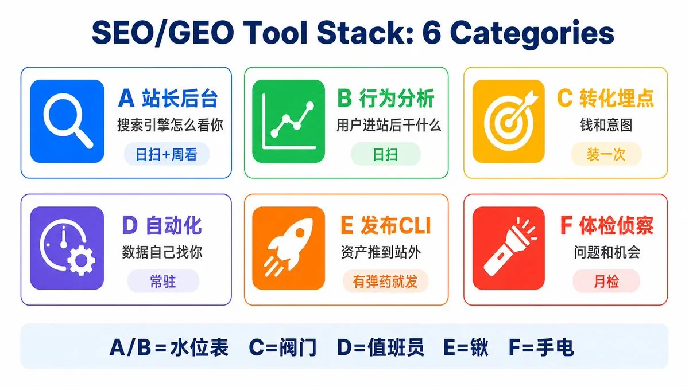
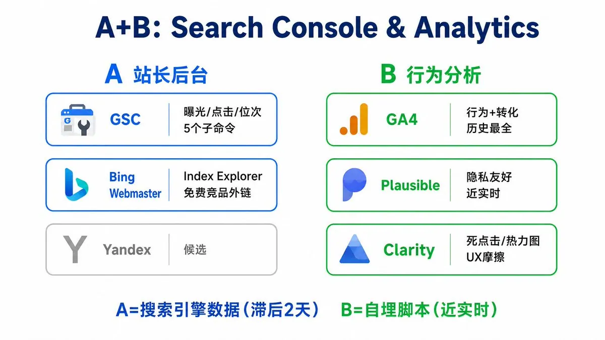
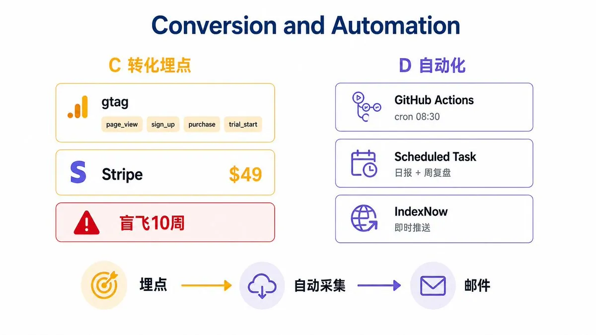
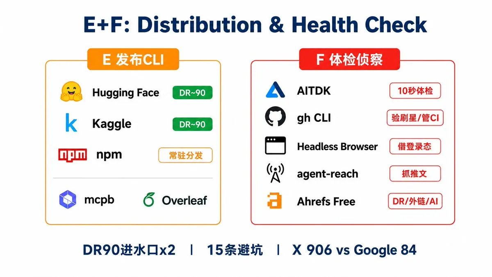

# Jason Zhu（@GoSailGlobal）：做 AI 工具站要装哪些 SEO 工具？我们踩了 15 个坑后的完整清单

> 独立团队踩坑 15 次后整理出的 AI 工具站必备 SEO 与运营工具清单：从核心指标监测（GSC / Bing Webmaster）、关键词挖掘与竞品追踪、Sitemap 差分与自动化提交、Cloudflare 安全规则防恶意刷量，到 GA4 自定义事件埋点，手把手教你花最少的钱配齐出海基建。

<!-- more -->

agentskillshub.top 上线 16 周，SEO 和 GEO 的基础设施从零搭到自动化日报，踩了 15 个坑，装了 20 多个工具。这篇把整套工具栈按功能分成六类，每个工具附安装教程和实战用法，最后是 15 条带伤疤的避坑指南

## 六类工具怎么区分

先分清六类再往下看，每类解决的问题完全不同

A 站长后台：搜索引擎怎么看你。数据来自搜索引擎自家，最权威但滞后 2-3 天。日扫(自动)+ 周看

B 行为分析：用户进站后干了什么。数据来自你自己埋的脚本，近实时。日扫(自动)

C 转化埋点：水做没做功(钱和意图)。不是“看数据的工具”，是造数据的开关，装一次永久产出

D 自动化/仪式：让数据每天自己找你。不产生新数据，解决的是“没人天天看”的问题。建一次，常驻

E 发布 CLI：把资产推到站外。六类里唯一向外写的，有弹药就发

F 体检/侦察：发现问题(自己)和机会(竞品)。按需拉出来用，不日常跑。月检或事件驱动

记忆法：A/B 是水位表，C 是水表阀门，D 是值班员，E 是挖渠的锹，F 是巡堤的手电

## A. 站长后台：搜索引擎自家数据，管收录、词、外链

A1 GSC（Google Search Console）

Google 官方搜索表现数据，每个词的曝光/点击/位次，SEO 的第一水位表

安装：search.google.com/search-console 添加域名资源（DNS 验证）。API 接入：Google Cloud 建项目，启用 Search Console API，下载 OAuth credentials.json 放 ops/gsc/，首跑弹浏览器授权生成 token.json（两个文件都已 gitignore）

用法：python ops/gsc/fetch_gsc.py 加子命令，五个子命令分别是 queries（周热词）、compare（环比，抓 rising 词 = 新词雷达）、brand（品牌词位次）、pages（页面榜）、dump（全量）。每周跑 brand + compare 是最低仪式

坑：数据滞后约 2 天。国内必须 Clash 代理 7897 + requests 传输（httplib2 不认代理，见避坑 14）

A2 Bing Webmaster

必应站长后台，给两样 Google 不给的东西：一是 Index Explorer（已收录/已提交比 = 排水水位），二是 Backlinks 免费查任意竞品外链（lobehub 490 域 vs 我们 32 就是它查的）

安装：bing.com/webmasters 微软账号登录，Add Site，下载 BingSiteAuth.xml 放站点根目录（我们放 frontend/public/），Verify

用法：无 API，月看两次 dashboard。Index Explorer 记收录比。Backlinks 选 “Any site” 输入竞品域名，导 CSV 做投放清单（Tier1 约 17 站就是这么来的）

坑：“Import from GSC” 不一定弹，XML 文件验证最稳。数据滞后几天

A3 Yandex Webmaster（候选，未实战，有俄罗斯流量再采纳）

触发条件：GSC 出现稳定俄语流量再上，现在不动

## B. 行为分析四件套：看用户在站上干什么

B1 GA4

站内行为 + 转化事件的权威数据源，历史最全

安装：analytics.google.com 建 property，gtag 片段进 index.html。API 接入：ops/ga/make_adc.py 生成 ADC 凭证 ops/ga/adc.json（gitignore）

用法：python ops/ga/fetch_ga.py，输出热门页/来源（limit 60）/转化事件。GEO 水位（AI 引荐会话）从 sources 里按 AI_SRC 元组算

坑：先确认 gtag 流向哪个 property。我们的数据在“新媒体运营”（485523739），专属 property 是空的（见避坑 4）。查询必须带 hostName 过滤

B2 Plausible

轻量隐私友好的真实 PV 统计，近实时

安装：plausible.io 建站点，script 片段进 index.html。API key 存 ops/plausible/.api_key（gitignore）

用法：python ops/plausible/fetch_plausible.py，输出热门页 + 来源。建页前查重的关键一环（靠它抓到 ppt 重复页自相竞争）。utm 归因看付费导航站回报

坑：站点 2026-07-04 才建，此前数据 0 属正常。返回格式是 {metrics,dimensions} 数组，不是扁平 JSON

B3 Clarity

微软免费的死点击/怒点/录屏/热力图，UX 摩擦水位表

安装：clarity.microsoft.com 建项目，script 进 index.html。API token 存 ops/clarity/.api_token（gitignore）

用法：python ops/clarity/fetch_clarity.py（每日 10 次限额，省着用）。死点击率是主指标（12.15% 降到 10.57% 的实验就是它验证的）

坑：API 只到页面级，元素级定位必须进 dashboard 热力图（heatmapType=3，无头浏览器+cookie 可进）。clarity.ms 必须直连不走代理

## C. 转化埋点：看钱和意图

C1 gtag 自定义事件

GA4 转化打点，漏斗可见性的全部来源

安装：frontend/src/lib/analytics.ts 类型安全封装（gtag 不存在时 no-op，无 any），组件里 trackEvent(“事件名”) 即可

用法：起步四件是 install_command_copied / audit_run / enterprise_cta_click / newsletter_subscribe，后加 deep_audit_checkout。digest 邮件标题自带当日转化数

坑：没埋点 = 盲飞（我们盲飞了 10 周）。事件在“确认成功”后触发，别在点击瞬间

C2 Stripe Payment Link

零后端收银台，本身就是最诚实的计量器

安装：Stripe Dashboard 建 Payment Links，建 $49 产品，复制 URL 填进 DeepAuditOffer.tsx 的 PAYMENT_URL

用法：client_reference_id 把 repo 名附进订单（只许字母数字/横线/下划线，/ 转成 --）。PAYMENT_URL 为空自动回退 mailto，永不出死按钮

坑：mailto 是转化杀手（见避坑 7）。文案跟着付费模式换（“先交付后付款”和预付费的话术完全不同）

## D. 自动化/仪式：让数据自己来找你

D1 GitHub Actions cron（云端日扫）

每天 08:30 前 A/B 四件套全跑一遍 + Resend 邮件进收件箱，不依赖本机开机

安装：.github/workflows/analytics-daily.yml（cron 20 0 *）。凭证进 Secrets：gh secret set GSC_TOKEN_JSON < ops/gsc/token.json（其余 GA_ADC_JSON / PLAUSIBLE_API_KEY / CLARITY_API_TOKEN 同理）。Resend 发信走 ops/send_digest_email.py

用法：收件箱扫标题（自带转化数），异常才点开。digest 汇总脚本 ops/analytics_digest.py，每个 fetcher 挂 || true 防单点断链

坑：GitHub schedule 有 0-40 分钟排队延迟，送达时刻设计在用户习惯之前（见避坑 11）。邮件 lang=“zh” 防 Gmail 误判

D2 本地 scheduled task（桌面 App 定时会话）

带完整本地环境（venv/凭证/git）的定时 Claude 会话，能干活不只是能报数

安装：会话里说“每天 8 点帮我跑 X”即建。任务定义在 ~/.claude/scheduled-tasks/，prompt 必须自包含（未来会话看不到当前上下文）

用法：日报每天 08:19（生成、去重、归档、push、X 文案）。周复盘每周一 09:09（3 胜 3 忧 + 恰好 1 个实验，只读不改）

坑：App 关着就顺延到下次启动。首次必点 Run now 预授权工具，否则每天卡权限弹窗

D3 IndexNow

向 Bing/Yandex 即时推送新 URL 的协议，收录加速

安装：根目录放 key 文件 + build 链末尾挂 submit-indexnow.mjs，一次配好零维护

## E. 发布/进水口 CLI：把资产推

E1 hf（HuggingFace CLI），数据集进水口一号（DR 约 90）

安装：brew install huggingface-cli（命令叫 hf）。huggingface.co/settings/tokens 建 WRITE 权限 token，hf auth login 粘入

用法：hf repos create / --repo-type dataset，然后 hf upload / <文件> --repo-type dataset（卡片文件上传时重命名 README.md）

坑：组织命名空间要先在网页建好，否则 403。上传的卡片数字用“地板数”（见避坑 6）

E2 kaggle CLI，数据集镜像（又一个 DR 约 90）

安装：backend/venv 里 pip install kaggle（系统 pip 有 PEP 668 拦截）。新版 token 是 KGAT_ 开头，存 ~/.kaggle/access_token（没有 kaggle.json 了）

用法：数据目录放 dataset-metadata.json（id 用真实用户名如 yansenzhu，不是带空格的显示名），kaggle datasets create -p <目录> -u

坑：必须带 -u 否则默认私有 = 零反链价值（我们踩过，删了重建）

E3 npm，CLI/MCP 包 = 常驻分发（装进 agent 不走搜索）

安装：npm login（账号绑组织 @agentskillshub）

用法：npm publish --registry https://registry.npmjs.org 显式指官源

坑：国内淘宝镜像会毒化 lockfile 和 publish（避坑教训），永远显式 --registry

E4 mcpb（Smithery/MCP 打包）

用法：npx @anthropic-ai/mcpb pack。manifest 里别带 tools 数组（会 400）

E5 Overleaf（arXiv 投稿）

arXiv 只收 LaTeX，Overleaf 是零安装的在线编译器

用法：整篇 arxiv-paper.tex 粘入，pdfLaTeX + article 文档类即编译

坑：正文裸 | 和 \~{} 是渲染陷阱。标题控制在约 62 字符

## F. 体检/侦察：发现问题和机会

F1 AITDK 类 SEO 体检插件

安装：Chrome 商店装 AITDK（或同类 SEO Meta 插件）

用法：每月扫首页+核心模板页，10 秒读出 title/desc/keywords 长度与实体。它 10 秒暴露了我们仨月没发现的 Helmet 覆盖旧 title（见避坑 5）

F2 gh CLI

安装：brew install gh，gh auth login

用法：验刷星（gh api users/X/repos 看作者履历：单仓爆星+其余全 <20 星 = 嫌疑，见避坑 9）。查真实星数/规范大小写。gh search repos 搜 awesome 列表。gh secret set 管 CI 凭证。gh run rerun --failed 救 deploy 抽风

F3 无头浏览器 + Chrome cookie 导入

把你浏览器的登录态借给自动化，进“API 不给的后台”

用法：进 Clarity 元素级热力图、抓 X 长文（note_tweet 只有这条路）。必须先 goto 目标域再 import cookies

坑：OAuth 型登录（Bing/微软账号）cookie 借不动，别硬闯验证码。纪律：用完立即 stop，登录态不留

F4 agent-reach

安装：pip install https://github.com/Panniantong/agent-reach/archive/main.zip，然后 agent-reach install --env=auto，agent-reach doctor 看通道状态

用法：xreach 抓推文/时间线。Jina Reader（r.jina.ai/）兜底任意网页转 markdown

坑：undici 系 CLI 不认环境变量代理（见避坑 14）

F5 Ahrefs Webmaster Tools 免费版

第三方权威/外链/技术健康监控，DR 是行业通用的“水库压强表”，还有 AI responses 面板（第三块 GEO 水位表）

安装：ahrefs.com/webmaster-tools 注册，验证域名（GSC 一键导入最快），进 Site Explorer

用法：月看一次。Overview 记 DR/引用域（我们基线 2026-07-10：DR 6，引用域 313）。Backlinks 验收付费外链。Site Audit 免费版上限 5,000 页，Limits 填 5000，模板站采样足够（一个模板 bug 修一次=修全站），周五自动爬，看四类：断链/301 链、孤儿页、canonical、零入链页。AI responses 面板月记（基线 0）

坑：免费版只能看自己验证的站，竞品外链还得靠 Bing（A2）。Organic keywords 显示 0 是它的词库门槛，别恐慌，以 GSC 为准

## 避坑指南：15 条，每条一个伤疤

1. GSC 曝光榜不等于品类深度。建页前三查：目录广度、grep 现有 slug、Plausible 热门页。ppt-skills 撞 ppt-presentation，自相竞争 3 天才发现

2. pos 50+ 是权威病，不是措辞病。建页、改标题都无效，归权重线

3. 小样本位次是幻觉。pos 3.1 = 28 天仅 19 次曝光、跨 9 国的平均。“我怎么搜不到”是常态，别恐慌也别吹

4. 先查 gtag 流向再信 GA。我们的数据流进错的 property，正确的那个是空的，差点全盘误读

5. SPA 的 meta 有两层。Helmet 会覆盖 index.html。改 title/desc 必须两层同改，否则改了个寂寞

6. 数字写地板不写精确。“130,000+” 可活数月。精确数会烂在页面里（我们清了三代共 18 处：62K/100K/117K）

7. mailto 是转化杀手。想收钱就上支付链接，Stripe Payment Link 半天通

8. 死点击三大惯犯：带动画的状态元素（呼吸灯）、卡片身不可点、标题点了开新标签（Clarity 判死+弹窗拦截）。修法：给动画元素目的地、整卡可点（closest(’a’) 保护内链）、标题行为全站统一

9. 刷星识别：单仓爆星 + 作者其余仓库全 <20 星 + unknown 评级，保守排除并注明。信任型站点荐错一个，人设塌方

10. 20 万+文件的 GitHub Pages 会在 syncing_files 抽风。build 绿 deploy 红 = 平台问题，gh run rerun --failed，别动代码

11. cron 要算平台排队延迟。GitHub schedule 晚 0-40 分钟。送达时刻设计在用户习惯之前（我们连续两天比邮件早 2 分钟去查）

12. 管道建好不等于水会流。/daily/ 上线后上游断流 8 天没人发现。活水必须配仪式或自动化，建完当天就定

13. X 长文抓取：syndication API 不给 note_tweet 正文。无头浏览器 + Chrome cookies 是唯一稳路（抓完停会话）

14. 代理矩阵要记死：googleapis 走 Clash（gRPC 只认小写 env），clarity.ms 必须直连，undici 系 CLI 不认 env 代理

15. 渠道打透一个。X 906 会话 vs Google organic 84。全平台铺 = 全平台死。先把已验证的打透，再开下一个

## 相关页面

- [[sources/taowithsaas-bing-webmaster-free-competitor-backlinks-export]]
- [[sources/fanshifu-grok-bot-800-new-sites-monitoring-workflow]]
- [[concepts/open-source-seo-tooling]]
- [[concepts/gefei-seo-keywords]]
