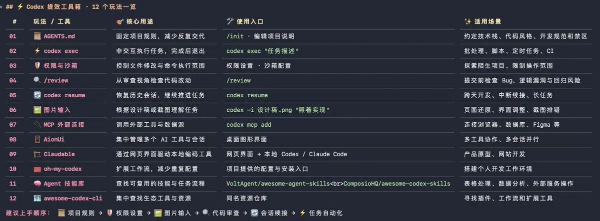

# govin（@goan999999）：Codex 12 个高阶提效玩法——从原生机制到周边生态神器全景速查

> 全面梳理 OpenAI Codex 终端编程的 12 项高阶提效技巧：AGENTS.md 项目规范化、codex exec 脚本批处理、三档 approvals 权限沙箱、/review 独立会话审计、会话持久化 resume、多模态截图传参、MCP 外部连接，以及 AionUi、Claudable、oh-my-codex、技能库生态工具和 NSA Ghidra 逆向分析拓展。

<!-- more -->

Codex 这 12 个提效玩法，用上一半，效率直接翻倍！

【原生玩法】

1. AGENTS.md：给 AI 立规矩

在项目里输入 /init，自动生成 AGENTS.md，把技术栈、代码风格、开发规范和禁区写进去。Claude Code、Gemini CLI 也认这个文件，写一次，几个 AI 通用

2. codex exec：一行命令出结果

不用进入对话，直接执行任务并退出。可以接入脚本、定时任务和 CI 流程，自动化处理各种重复工作

3. 三档权限按需切换

通过 /approvals 切换权限模式，按需选择只读、修改文件前确认或全自动执行。陌生项目先只读，熟悉之后再放开。配合系统级沙箱，减少误操作风险

4. /review：让 Codex 审 Codex

代码写完别急着提交，开启一个新会话，输入 /review，让没有参与开发的 Codex 帮你挑毛病。检查潜在 Bug、逻辑漏洞，比自己从头检查更容易发现问题。

5. codex resume：会话不丢

关闭终端也不用担心之前的工作白做。通过 codex resume 恢复之前的会话，上下文和任务进度接着用，一个功能开发几天也不用反复交代

6. 截图直接喂给 Codex

使用 codex -i 设计稿.png “照着实现”，把设计稿、报错截图直接交给它。不用费劲描述页面布局，让 AI 根据图片完成开发。

7. 接入 MCP：让 Codex 连接外部工具

通过 codex mcp add 接入浏览器、数据库、Figma 等工具，让 Codex 不只是给建议，还能调用外部能力完成实际任务。

【周边神器】

8. AionUi：一个窗口管理所有 AI

开源桌面客户端，把 Codex、Claude Code、Gemini CLI 放在一起使用，支持多会话并行，不用来回切换终端

9. Claudable：不会代码也能建站

调用本地的 Codex / Claude Code，通过网页界面就能生成、开发和部署产品，大幅降低开发门槛。

10. oh-my-codex：一键增强包

集成预配置的钩子和工作流，安装后就能给 Codex 增加一套更完善的工作环境，省去大量手动配置时间

11. 技能库：1000+ 现成能力

推荐两个值得收藏的仓库

VoltAgent/awesome-agent-skills

ComposioHQ/awesome-codex-skills

里面整理了大量现成技能，可以扩展 Codex 的能力，让它处理表格、发送消息、数据分析等任务

12. awesome-codex-cli：Codex 生态地图

把 Codex 相关工具和资源分门别类整理好，想找插件、工作流或扩展工具，直接翻这个仓库，省去几个小时的搜索时间

## 拓展：NSA 开源反编译利器 Ghidra 逆向分析

你电脑里运行的程序，可能藏着你根本看不到的东西

有一款 NSA（美国国家安全局） 亲自开源的工具，可以把这些程序拆开看个明白

名字叫 Ghidra，GitHub 狂揽 9.6 万 Star！

更值得注意的是，最近爆火的 REA，底层逆向分析也用到了它！

这玩意到底有多猛？

拿到一个没有源代码的程序，Ghidra 可以直接对它进行拆解

原本密密麻麻的机器指令，能够还原成接近 C 语言的伪代码；看不懂的函数，可以追踪调用关系；隐藏在程序里的操作，也能通过静态分析逐步挖出来

更狠的是，它还能分析程序调用了哪些系统接口、读取了哪些数据，以及内部究竟执行了什么逻辑

Ghidra 还支持 Windows、Linux、macOS，提供 Python 和 Java API，甚至可以自己写脚本批量分析大型程序

没有源码，也能研究程序内部到底发生了什么

GitHub：NationalSecurityAgency/ghidra

## 相关页面

- [[concepts/codex]]
- [[concepts/codex-app]]
- [[concepts/agent-skill]]
- [[sources/aliez-ren-claude-code-fable-opus-coding-playbook]]
