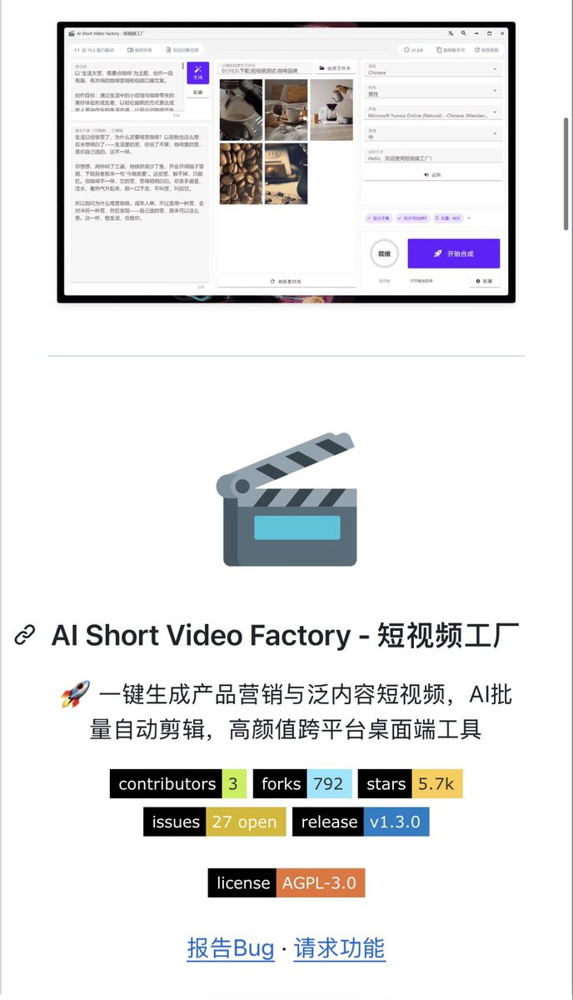

# G 哥（@goan999999）：GitHub 已经彻底疯了！这 6 个免费开源项目，搞钱、提效真的太猛了

> 精选盘点 6 款可直接用于搭建一人公司 AI 内容生产工厂的免费开源神器：包括 Mac 本地多模态自然语言搜索 DigUp、自动化短视频工作流、数据爬取与去重排版工具；配合 Claude Code 与 Codex 实现单人全流水线内容制造与商业变现闭环。

<!-- more -->

GitHub 已经彻底疯了！这 6 个免费开源项目，搞钱、提效真的太猛了！

不用花钱买一堆 AI 软件，配合 Claude Code、Codex，一个人就能搭建 AI 内容工厂，朋友跟我说用这套组合赚了 10000 块

1. DigUp｜Mac 本地 AI 搜索神器

不用再翻几百个文件夹，直接用自然语言搜索

支持图片、PDF、音频、视频等多模态搜索，连视频里的具体画面都能找出来

素材查找、视频剪辑、资料整理，效率直接拉起来

https://t.co/cQLOkANYiG

2. Local Deep Research｜AI 自动研究

做公众号、小红书、X 内容，选题、调研、资料整理一套搞定。如果被你老板看到估计你要失业

输入关键词，自动搜索全网、整理资料、生成研究报告

还能用来做行业研究、竞品分析，接商业报告类项目

https://t.co/UuVUFkvHyr

3. Kokoro｜免费 AI 配音

做短视频矩阵、英语故事、知识科普账号，省下配音软件订阅费

10 条、50 条、100 条视频，都能批量生成配音

https://t.co/F2JYFSPQ5u

4. Short Video Factory｜AI 短视频工厂

写文案、AI 配音、自动剪辑、生成字幕，4 个环节串成一条流水线

做短视频矩阵、带货视频、产品宣传片，直接拿来提高交付效率

GitHub：https://t.co/zQnoJzZ9Wu

5. AI YouTube Shorts Generator｜长视频自动切片，油管必备

30 分钟长视频，AI 自动识别精彩片段、生成字幕、裁剪成 9:16 竖屏

一条长视频拆成多条 Shorts，素材利用率直接提高

做视频二创、播客切片、短视频代剪辑，能省掉大量人工筛选时间

https://t.co/pVUNDRTRwS

6. Podcastfy｜AI 播客生成器

文章、PDF、研究报告，直接转换成双人对话式 AI 播客

一份内容做成 3 种产品：文章、音频、短视频素材，都不用你想了直接出

做知识付费内容、播客账号、企业音频宣传，都能用上

https://t.co/9LHWynnOla

最狠的是，这 6 个项目可以串起来！

AI 搜索素材 → AI 研究选题 → AI 配音 → AI 剪视频 → AI 生成播客

## 相关页面

- [[sources/fred-new-github-information-arbitrage-8-methods]]
- [[sources/xaiwind-codex-20-social-media-skills-one-man-team]]
- [[concepts/open-source-seo-tooling]]
- [[concepts/ai-content-pipeline]]
