# 用 Grok Bot 与云手机搭建 APP 竞品调研自动化工作台

> 作者 01fish 分享：通过 Grok Bot + 云手机 + 静态住宅 IP + 谷歌账号四件套，搭建一个多 Agent 协同的 APP 竞品调研自动化工作流。

<!-- more -->

# 迎接 Agent 军团

Grok Bot 可以是 26 年最让人惊喜的 AI 产品了！

以下是一个产品调研的使用案例：

「AI教学」从零搭建APP竞品调研自动化工作台

接下来，主要是这一篇的实际操作过程，以下全程小白无比友好，请放心。

### ✎ 为什么选择在 Grok Bot 上搭建一套自动化工作台

APP 的竞品调研难点，工具非常分散，商店数据、社媒、SEO 各种不同平台，而且，要获取数据，还需要去扒拉各个渠道上的宣发数据汇总来做分析，比如，让 agent 用浏览器去看 TikTok 上的视频，很容易被平台风控管理。

因此，在 Grok Bot 上搭建一套自动化工作台，解决以上所有问题。

第一，Grok Bot，原生支持多 Agent，可以为每个 Bot 设定角色和分工。还可以把多个 Bot 拉到一个工作群里，让它们彼此的工作互相交互、互相验证。

比如，下面就是单个 bot 和群聊 bot：

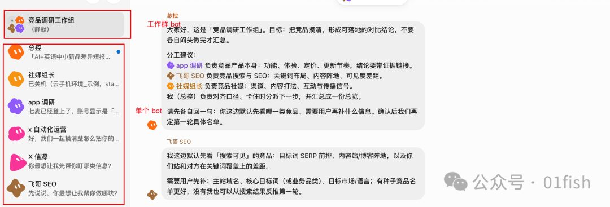

第二，Grok Bot 上每个 Bot 还自带一台云电脑，不是内置浏览器的壳（现在大多数 agent 都是内置浏览器的壳，不那么方便，包括 codex 这一类）。意思就是，这个 Agent 完全可以模拟一个人的操作。登录 app，使用 app，看视频等等。

比如，下面这个任务是让 bot 下载 app 并且截图：

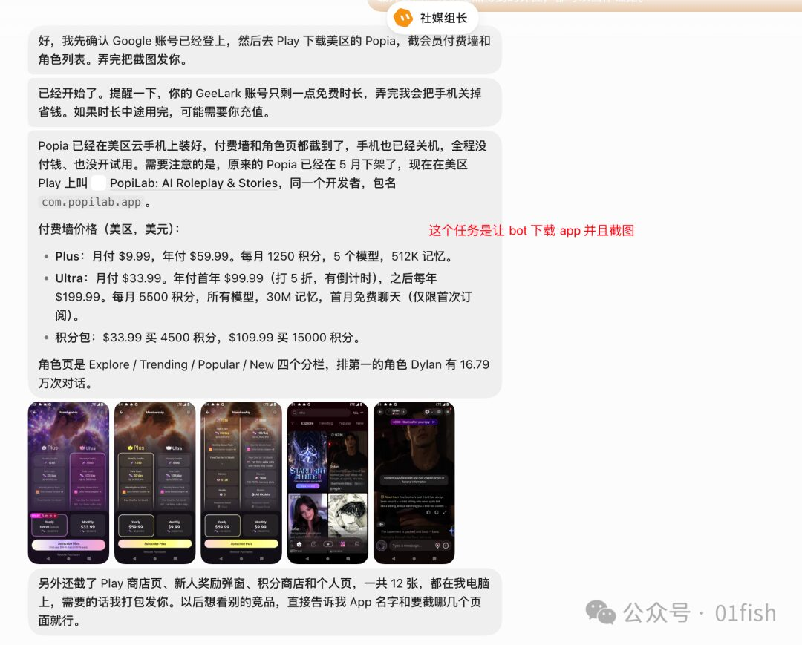

✎ 整体操作流程以及提前要做哪些准备

### ✎ 整体操作流程以及提前要做哪些准备

整个操作的全局，就三步，下载 Grok Bot 平台设定好 Bot，给 Bot 配上云手机，安排 bot 们干活。

你需要提前做的准备以及各种动作，我已经踩过坑了，提前把这些坑列出来：

第一，下载Grok Bot 平台

地址：https://x.ai/bot

Grok Bot可以先用免费七天试用，之后可以购买 Super Grok，每月 30 美元的档，新用户首月 15 美元。Grok Bot 底层模型是 Claude Code，但因为是黑盒模型，具体调用哪一个型号，不确定。

第二，最难的步骤在于把云手机接到 bot 上。

需要涉及到：

1. 一个能生成云手机的平台，Geelark

链接：https://www.geelark.cn/?

邀请码（见平台）

2. 需要购买配置好美区（或其他地区）静态住宅 IP，proxy

链接：https://proxy-seller.com/
3. 需要给云手机准备好一个谷歌账号

链接：https://www.haixiaohao.com/
谷歌账号可以自行购买；仅有美国代理 IP，并不等于 Play 就是美区。商店地区主要取决于谷歌账号的注册 / 账单国家

————

以上均可有平替，我目前选择的是这三家，跑通了全流程。

后续会详细说明一下，每一个平台如何配置和使用。

### ✎手把手细节讲解配置，如何最终完全搞定，很细节

配置就是挺麻烦的，深呼吸，一鼓作气一鼓作气。

第一，最简单的，Grok Bot 当中先设置一下 bot 和 bot 群组。

地址：https://x.ai/bot

设置单个 bot：点击+号，给 bot 命名即可。产品调研工作组可以设这几个：「app调研」负责应用商店；「SEO」负责 Semrush；「社媒组长」负责 TikTok 与投放素材

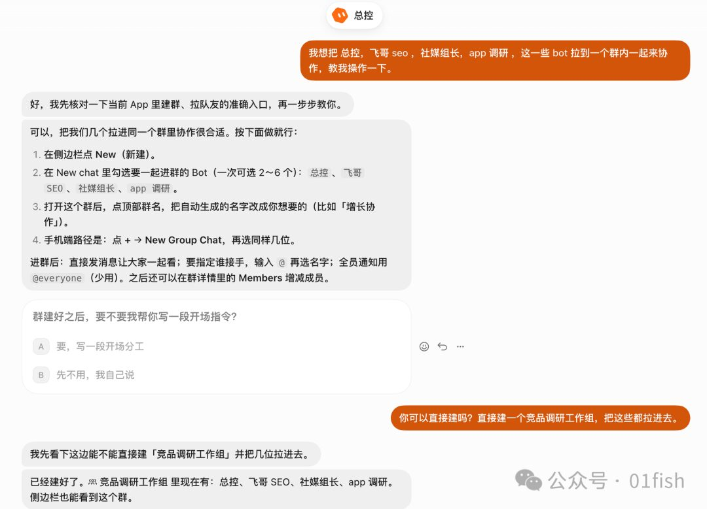

设置群组 bot，我直接在总控 bot 当中请 bot 来建工作群。

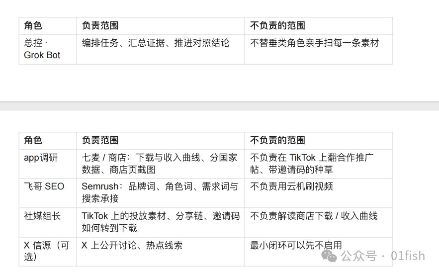

建完工作组之后，可以给他们分配具体的任务。把下图发送到工作群内：

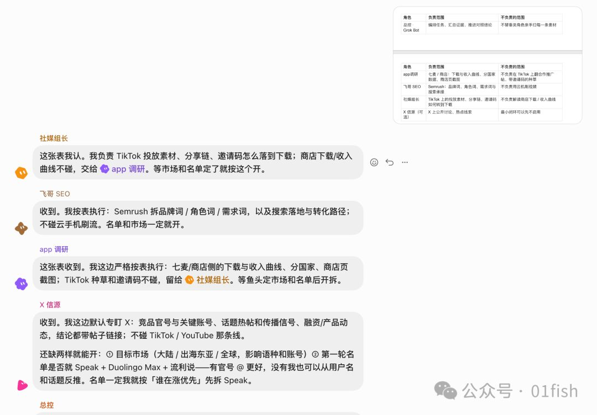

下面是 bot 们的反馈：

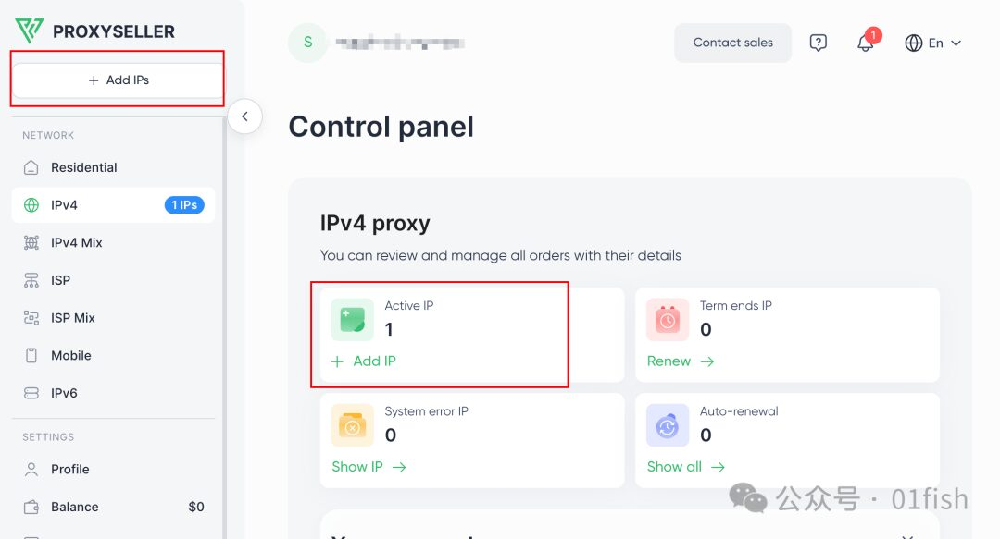

第二，配置一下云手机（云手机需付费）

一个能生成云手机的平台，Geelark

链接：https://www.geelark.cn/?

邀请码（见平台）

在电脑上下载 GeeLark 客户端并完成注册

而后点击在这个 GeeHub，会引导你订阅，选择最低的那个档次套餐即可，而后就会出来右边这些，这仨记录下来，待会儿要告诉 bot 的，有了这仨，就可以让 bot 帮你去配置云手机，不用你自己去学如何手动配置GeeHub 了。

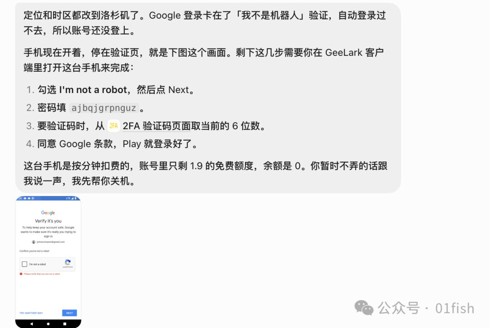

让我们紧接着去把静态 IP 和谷歌账号都买好。

静态 IP proxy

链接：https://proxy-seller.com/

点击之后

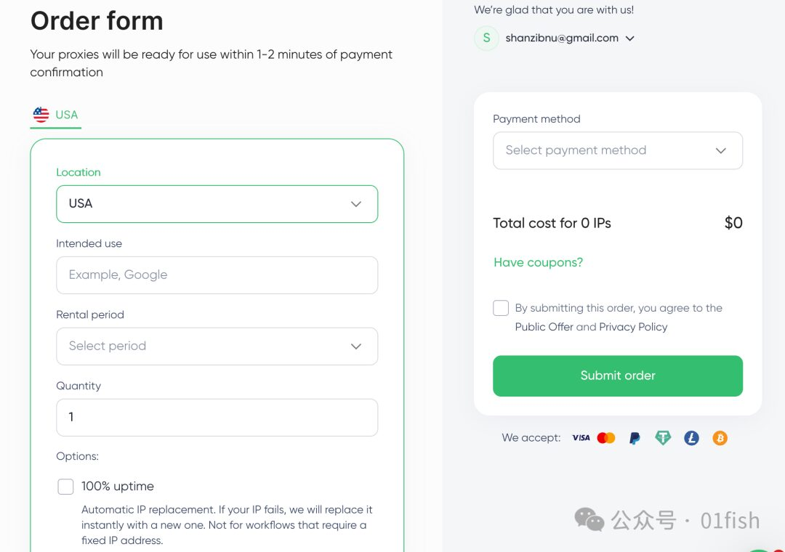

买好之后我就简单粗暴截图了一下，这个可以给 bot 去处理，也可以记录下这些关键信息

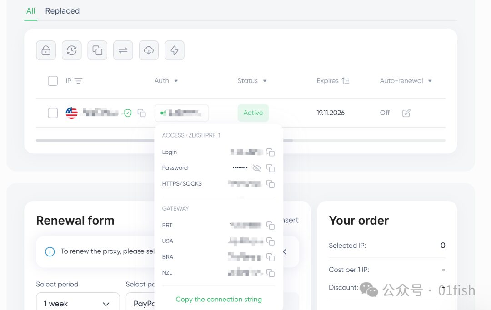

gmail 账号购买就比较简单直接挑就行。

而后，把所有这些信息一股脑告诉 bot ，让它自己去配置，如同这样，gmail 搞好了，也这样给 bot，让它自己去配置。

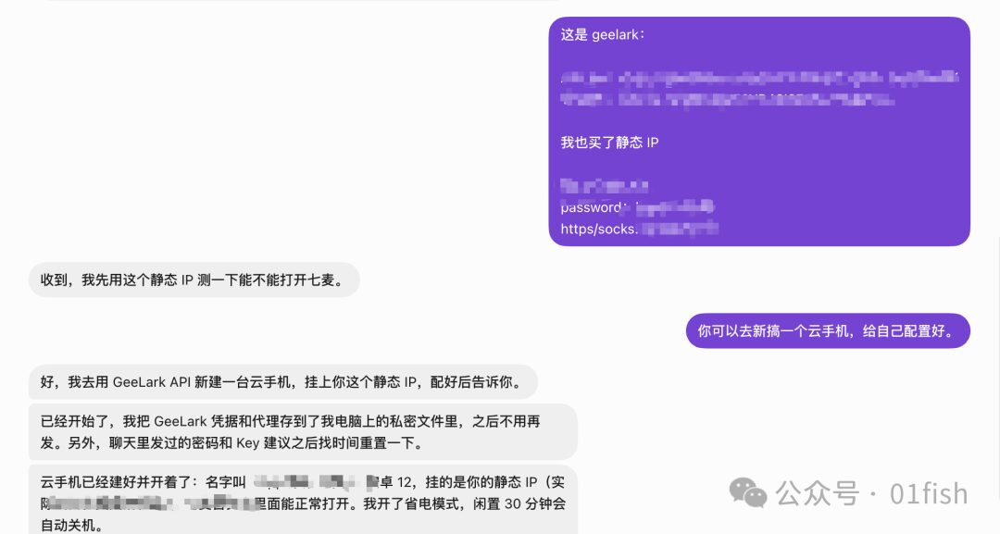

这里注意，配置 gmail 登录的时候，有一个细节，就是 gmail 的验证需要一些手动，bot 会给你这样反馈：

这里就需要在 geelark 客户端手动一下，这个也可以让 bot 引导你如何去操作，相当于在电脑上用手机的体验。

到这里，就配置好了！

你已经拥有了一个非常能打的 app 产品调研军团了！

✎如何用这一套agent军团开始干活

### ✎如何用这一套agent军团开始干活

这里面的案例，都来自于这里：「AI教学」从零搭建APP竞品调研自动化工作台

精简四步：

1. 定赛道：用短报告画出全景，选出要盯的产品与主市场。

2. 拉商店区间数据：由 app调研用七麦（或你常用的商店工具）拉取下载 / 收入曲线。

3. 扫投放 / 种草动作：由社媒组长用云机浏览 TikTok，记录标了合作推广的帖子、带邀请码的种草，以及官方活动。

4. 在群聊里交叉验证结论：商店下载上涨的那几个月，到底对上了哪类动作？还有哪些待核验？

——————

接下来会是一些截图和过程

产品调研深浅的核心还是自己日常调研以及看品的经验，经验就是给 bot 注入灵魂的过程。

1 定赛道这个：

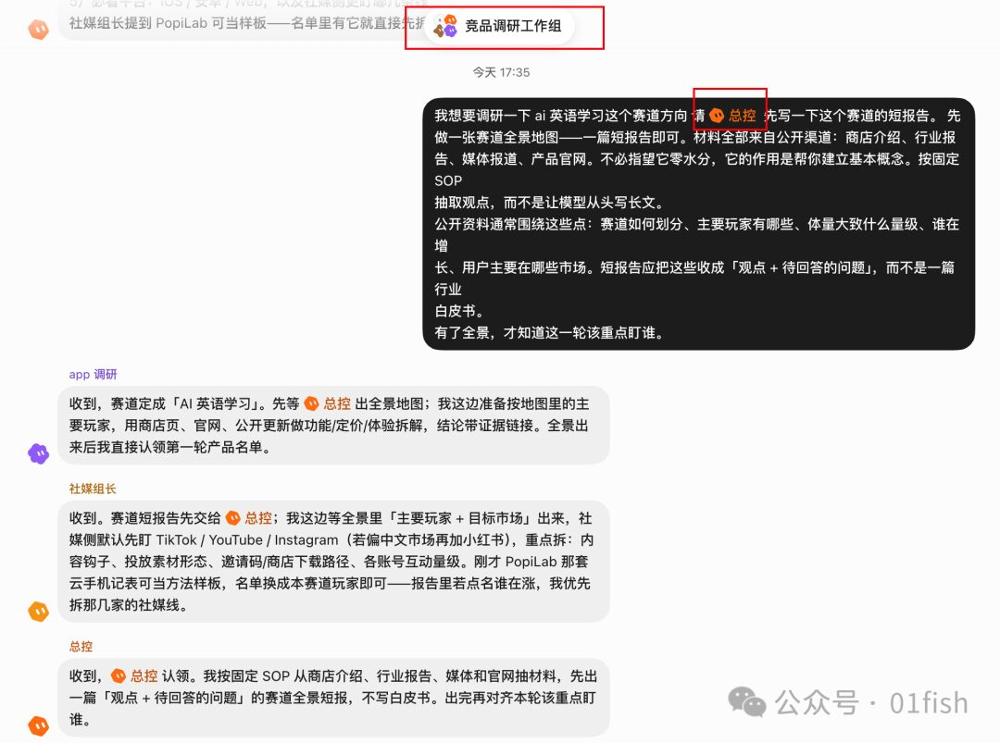

2拉商店区间数据

告诉 bot 要登录七麦，就可以登录了。可以去拉取下载 / 收入曲线。

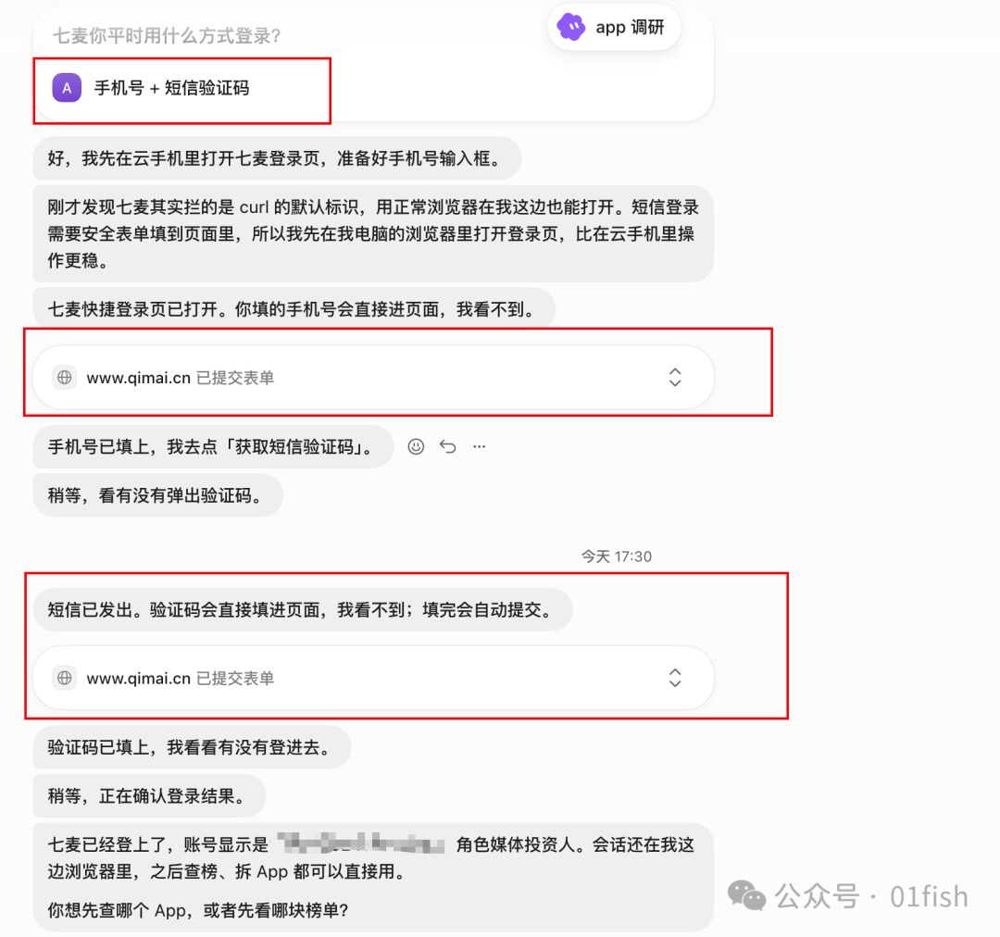

3. 扫投放 / 种草动作

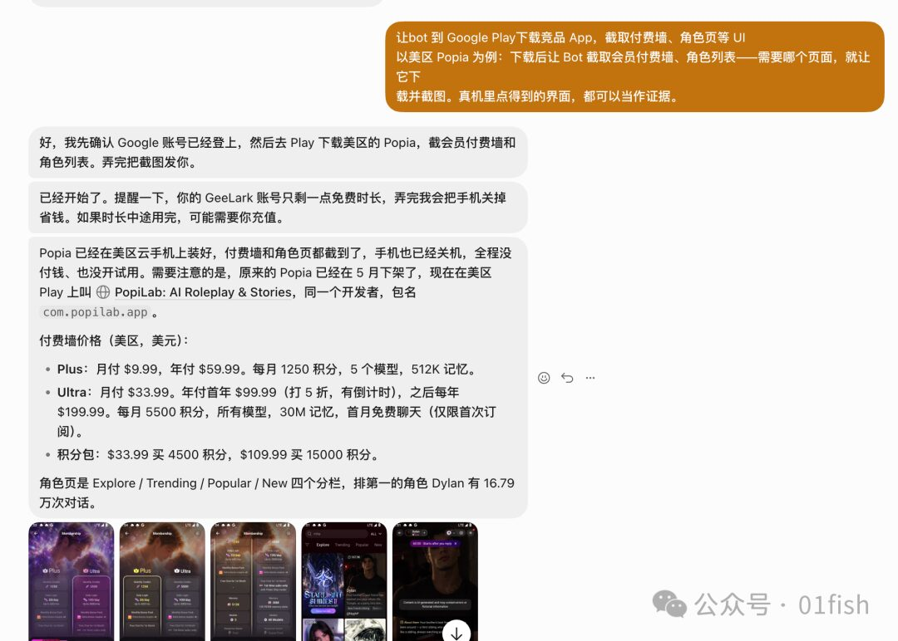

还可以让 bot 去扫视频

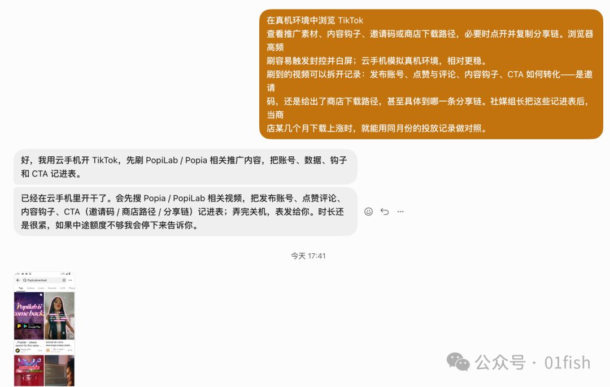

扫完视频之后，让对方输出一个整合的链接，把所有调研的信息汇总

在群聊里交叉验证结论就可以让他们直接互相验证了
