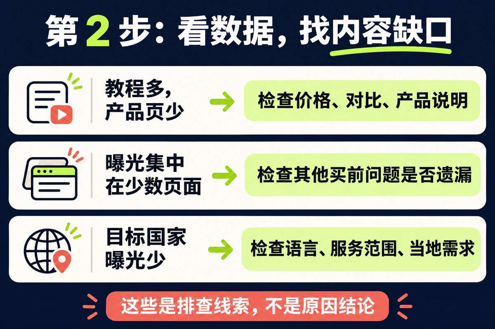
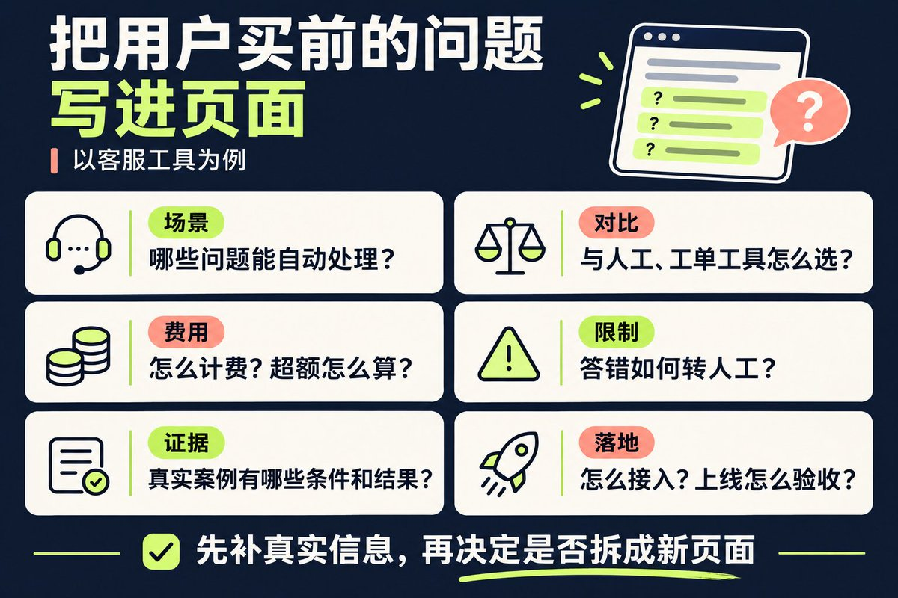

# Marvin（@growaiskills）：Google AI 搜索曝光能查了——打开 GSC 看这份报告

> Google Search Console 已能查看网站在 Google AI 搜索中的曝光。新手第一步打开「生成式 AI 效果报告（搜索）」查看页面、展示次数、国家地区、设备与日期；提醒展示不等于点击更不等于订单，该报告不能单独算出 AI 带来多少访问或成交，也不代表 ChatGPT 等其他平台；看不到报告可能是展示不足，也需核对「设置 > Google 搜索生成式 AI」是否排除了网站。第二步按网页维度找内容缺口，把教程、产品、定价、对比与案例页分开检查，补齐用户购买前需要的信息。

<!-- more -->

Google Search Console（GSC）已经能查看网站在 Google AI 搜索里的曝光。

做网站的人可以先查清：哪些页面出现了，再检查用户购买前需要的信息有没有讲完整。

## 第 1 步：看 AI 展示了什么

打开 GSC 的“生成式 AI 效果报告（搜索）”，查看页面、展示次数、国家/地区、设备和日期。[官方说明](https://support.google.com/webmasters/answer/16984139)

注意：展示不等于点击，更不等于订单。这份报告主要看曝光，不能单独算出 AI 带来了多少访问或成交，也不能代表 ChatGPT 等其他平台。

没看到报告？可能是展示不足，也可核对“设置 > Google 搜索生成式 AI”是否排除了网站。[控制选项](https://support.google.com/webmasters/answer/16908024)

## 第 2 步：看数据，找内容缺口

按网页看，不要只盯总曝光。把教程、产品、定价、对比和案例页分开检查。

例如，教程有展示，产品页却很少出现，可以先检查：客户想买之前会问的问题，网站有没有认真回答？

报表给你排查方向，不能仅凭曝光高低断定原因。

## 第 3 步：补齐用户买前的问题

用户可能问：

“适合小团队、价格透明、能接现有系统的客服工具有哪些？”

Google 的 AI 搜索可以把复杂问题拆成多组相关检索。因此，网站除了介绍产品，还要讲清使用场景、价格、对比、限制、案例和接入方法。

先补现有产品页、定价页和帮助文档。确实需要独立展开，再做对比页或案例页。不用为每种问法都新建一篇文章。

这些工作仍然离不开 SEO 基础：Google 能访问和收录重要页面，产品信息清楚，内容有真实经验和证据，也有可信的站外评价或引用。

Google 的 AI 搜索仍依赖既有搜索索引和核心排名、质量系统。做好基础不保证一定被展示，但这些仍是值得优先做的事。[官方优化指南](https://developers.google.com/search/docs/fundamentals/ai-optimization-guide)

今天先做一件事：挑一个有曝光、但信息不完整的页面，补上一个客户最常问的买前问题，记下修改日期，后续观察展示和业务表现。

## 相关页面

- [[sources/growaiskills-gsc-impressions-no-clicks-fix-10-old-pages-with-ai]]
- [[sources/growaiskills-new-site-seo-10-pages-then-optimize]]
- [[concepts/seo-basics]]
- [[concepts/gefei-seo-keywords]]
