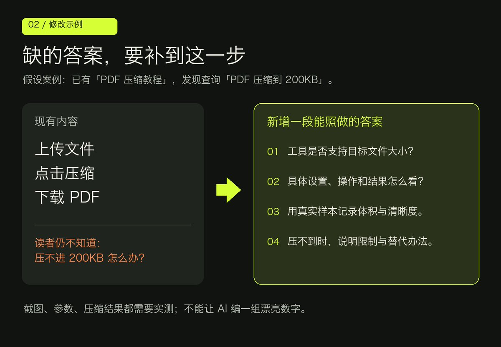

# Marvin（@growaiskills）：SEO 有曝光没点击？用 GSC + AI 修好这 10 个旧页面

> 针对「有搜索曝光却拿不到点击」的老站修复 SOP：GSC 效果报告近 3 个月按点击与展示排序挑 10 个业务相关页面（小站先挑 3 个），按「查询」页筛出有持续曝光、与正文同一任务、平均排名 10-30 的词并把品牌词单独看；先分清「排名靠前点击少→查标题与实际搜索结果」「排名 10-30→查答案/内容类型/竞争页面」「查询跑偏→判断另做页面还是跳过」；导出单页查询数据连同标题描述正文交给 AI 做意图合并与缺口定位，附一段可直接复制的完整提示词；最后强调补缺口要用实测截图与真实限制（AI 可列待测项但不能编造数据）、内链要有真实关联、以及按同一口径 28 天复查并区分「CTR 下降其实是新增了低排名曝光」。

<!-- more -->

网站有搜索曝光，却总拿不到点击，先挑 10 个旧页面检查：用户已经搜到了什么，你的文章还有什么没答清楚。

用 Google Search Console（GSC）找线索，让 Claude 等 AI 帮你定位和拟改稿。截图、实测和最后的判断，由你补。

## 1. 先选值得改的页面

进入 GSC「效果／搜索结果」，选近 3 个月，切到「网页」。分别按点击和展示排序，从中挑 10 个与业务相关的页面；小站先挑 3 个也行。

点击某个 URL，再看「查询」。优先找：有持续曝光、与正文同一任务、平均排名在 10～30 左右的词。品牌词单独看，别和非品牌需求混在一起。

10～30 只是初筛。GSC 给的是平均排名，不能直接理解成固定在第二、三页，更不能凭它断言文章缺内容。

[GSC 指标说明](https://support.google.com/webmasters/answer/7576553?hl=zh-Hans)

## 2. 先分清：用户为什么没点、没找到答案

排名靠前却点击偏少，先看标题和实际搜索结果；排名在 10～30，检查答案、内容类型和竞争页面；查询跑偏了，判断该另做页面还是直接跳过。

例如，用户想找“在线压缩工具”，你给一篇长教程，硬加几次“在线压缩”也没有解决需求。先搜一次目标词，看看当前结果主要在提供什么。

## 3. 把数据和正文一起交给 AI

在单个页面的「查询」标签导出数据，连同标题、描述和正文上传。也可用已授权、确实能读取 GSC 的连接器。只给 URL 时，先确认 AI 真读到了文章。

你是网站内容编辑。附件是某一页面近 3 个月的 GSC 查询数据，字段包括：查询、点击、展示、CTR、平均排名。

页面 URL：[填写]

当前标题、描述和完整正文：[粘贴]

请完成：

1. 按搜索意图合并查询，筛出有曝光、与主题相关、正文没答好的问题；标记平均排名 10～30 的查询。

2. 输出表格：查询组｜原始数据｜正文已有答案｜缺口｜插入位置｜优先级及原因。

3. 只为优先级最高的一组写局部修改稿，保留其他内容；再给 3 个准确、不夸大的标题。

4. 缺证据就写“待补充”，不要编造实测、截图、数据或搜索结果。你无法读取附件或正文时，先停止分析。

一次只处理这一个页面。

## 4. 把缺口补成读者能照做的答案

假设你有篇《PDF 压缩教程》，GSC 出现“PDF 压缩到 200KB”。原文只有“上传、压缩、下载”，就补一节“如何压到 200KB，以及压不到怎么办”。

写清工具是否支持目标大小、具体设置、实际样本的压缩结果和清晰度代价。配操作截图。没有测过的数字，先留空。

AI 可以列出待测项；你实际完成操作、记录限制，这部分才是文章比泛泛教程多出的价值。

## 5. 改完正文，再检查入口和内链

前两段直接回答主问题，删掉与操作无关的铺垫。标题写清任务和适用范围，主关键词自然出现；描述概括读者能得到什么。不要为了塞词重复句子。

在相关旧文里，加上能帮读者继续完成任务的链接。锚文本写清目标内容，例如“PDF 压缩后模糊的处理方法”。页面之间有真实关联再链接，不必互相全连。

[Google 的标题、摘要与链接建议](https://developers.google.com/search/docs/fundamentals/seo-starter-guide?hl=zh-cn)

## 6. 记录修改，按同一口径复查

保存修改前版本，记下日期、改动和目标查询组。更新后可在 GSC「网址检查」中请求编入索引；它不保证收录，也不保证排名提升。

[重新抓取说明](https://developers.google.com/search/docs/crawling-indexing/ask-google-to-recrawl?hl=zh-cn)

7～14 天先看抓取和初步变化；数据量足够时，再比较修改前后各 28 天，保持国家、设备和查询组一致。小站需要更长观察期。

看目标查询组的点击、展示、CTR 和平均排名，也看页面有没有带来注册、询盘或使用。CTR 下降时，先排查是否新增了大量排名较低的曝光，别急着判失败。

内容补齐后，再争取相关网站的真实引用或合作链接。外链数量没有“每月几条必涨”的公式。

今天先做一页：导出查询，找一个缺口，补一段可操作的答案，记下修改日期。

## 相关页面

- [[sources/growaiskills-new-site-seo-10-pages-then-optimize]]
- [[sources/xiaofeiyangfe-gsc-simulator-6-data-reading-lessons]]
- [[sources/kkkeric-seo-new-site-gsc-and-300-backlinks]]
- [[concepts/seo-basics]]
