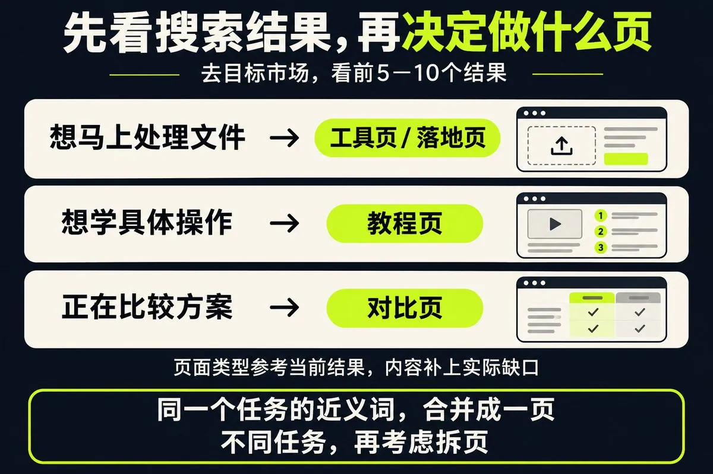
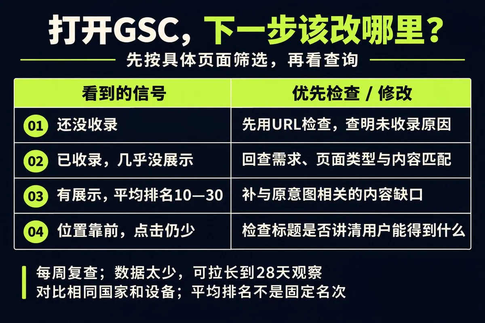

# Marvin（@growaiskills）：新站没外链，SEO 怎么起步？先做 10 页，再按数据改

> 新站 SEO 起步的克制打法：先从低竞争且与产品相关的具体需求切入做约 10 个页面，观察哪些需求开始有展示再集中改进——10 页是控制工作量的起点而非排名门槛。含五步方法论：KD 0-5 / 月量 0-50 词初筛并叠加业务价值判断、先看目标市场前 5-10 个自然结果再决定页面类型（工具页/教程页/对比页）、围绕同一产品做核心页+支持页并把内链放在读者需要继续操作的位置、每周按 GSC「网址检查 + 效果报告」四种状态诊断（未收录/已收录无展示/排名 10-30/位置靠前点击少）、以及两条可直接复制的 AI 提示词（选词建页 / 更新已有页面）。并给出每页一行更新记录模板与外链起步节奏（每月 2-5 个真实引用机会、约 3 个月阶段复盘）。

<!-- more -->

新站可以先从低竞争、与你产品相关的具体需求切入，做约 10 个页面，观察哪些需求开始有展示，再集中改进。

10 页是控制工作量的起点，不是排名门槛。AI 可以帮你整理数据、改稿，需求判断和事实核查仍要自己做。

## 1. 低难度词先入围，业务价值再把关

有关键词工具，可以先筛 KD 0-5、月搜索量 0-50，把 KD 0、月量 0-10 的词也纳入候选。

KD 是工具估算的自然搜索难度，只适合初筛。接着问：搜这个词的人会需要我的产品吗？现有结果有没有我能补上的具体缺口？[Ahrefs 的指标说明](https://ahrefs.com/keyword-difficulty)也建议继续检查实际搜索结果。

没有工具，就从客户提问、搜索联想里收集需求。缺少的词量和 KD 留空，别让 AI 编数字。工具显示月量为 0 的词，先保留验证。

## 2. 先看搜索结果，再决定做什么页

在目标市场搜索候选词，看前 5-10 个自然结果：

- 工具页占多数：优先让用户直接完成任务。
- 教程占多数：写清步骤、结果检查和失败处理。
- 对比页占多数：讲清选择条件与限制。

例：“图片压缩到 200KB”“照片缩小到 200KB”，如果搜索结果和任务高度重合，可以由同一页承接。“压缩后为什么模糊”，再考虑用教程解决。

这些词只演示选题逻辑，未核验词量和排名。

## 3. 把这一组页面连起来

围绕同一产品，做一个核心页面和若干解决不同问题的支持页，先用约 10 页测试；真实需求不足就少做。

每页开头直接回答主问题，再放具体步骤、示例或截图。有实际操作的，把失败原因和处理办法补上。

内链放在读者需要继续操作的地方。例如，教程讲完压缩方法，在“开始压缩图片”这句话上链接到工具页。数量按需要安排，不凑链接。

## 4. 上线后，每周按 GSC 数据找问题

GSC（Google Search Console）里，先用“网址检查”确认收录，再到效果报告筛选具体页面、查看查询。[操作入口与指标说明](https://support.google.com/webmasters/answer/7576553?hl=zh-Hans)

- 还没收录：先查明未收录原因。
- 已收录，几乎没展示：回查需求、页面类型与内容是否匹配。
- 有展示，平均排名 10-30：优先找与原意图相关、正文没回答好的问题。
- 位置靠前，点击仍少：检查标题是否讲清用户能得到什么，并核对搜索结果的实际呈现。

比如出现“压缩到 200KB 不模糊”的查询，可以补参数说明和实际前后对照，别只把这个词塞进标题。

数据太少，就把观察窗口拉长到 28 天，必要时继续等。比较相同国家、设备和相同长度的时段；平均排名不是固定名次。

## 5. 两条 AI 提示词，直接复制

选词与建页：

我的网站是[URL]，服务[人群]，产品是[产品]。只用已连接工具或我提供的数据，筛选 KD 0-5、月量 0-50 的相关词，未知值留空。把同一搜索意图的词合并，给出优先做的 10 组、业务价值、建议页面类型，以及数据来源和日期。没有搜索结果证据时，页面类型标为待核查。

更新已有页面：

这是[URL]的正文和 GSC 查询导出：[粘贴]。找出有展示且与原意图相关、正文尚未回答好的问题，优先检查平均排名 10-30 的查询。给出具体修改位置，只改需要的段落，标出需要我补充的截图、测试或来源。数据不足时说明缺什么。

内容实质更新后，重要页面可在 GSC 请求重新索引；重复提交不会加速，提交也不保证收录。[Google 官方说明](https://developers.google.com/search/docs/crawling-indexing/ask-google-to-recrawl)

外链可并行积累，先从每月寻找 2-5 个相关资源页、行业站的真实引用机会做起。约 3 个月做一次阶段复盘，结合展示、点击和实际产品使用，决定下一批做什么。这不是见效期限。

每次更新记一行：

URL｜原来的问题｜改了哪里｜修改日期｜后续展示、点击与转化。

## 相关页面

- [[sources/kkkeric-seo-new-site-gsc-and-300-backlinks]]
- [[sources/xiaofeiyangfe-gsc-simulator-6-data-reading-lessons]]
- [[concepts/seo-basics]]
- [[concepts/gefei-seo-keywords]]
