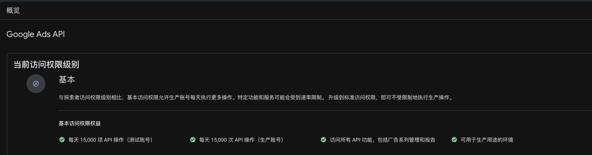

# Niko：10 分钟搞定 Google Ads API，免费查关键词精确搜索量

> 申请 Google Ads API Explorer / Basic 访问级别的完整步骤，以及用 OAuth 客户端 + AI 写代码调用关键词规划接口，免费获取关键词精确搜索量。

<!-- more -->

10 分钟搞定 Google Ads API，免费查关键词精确搜索量：

1. Google Cloud 新建项目，启用 Google Ads API

2. 申请 Explorer 访问级别（秒批）

3. Google Auth Platform 填品牌信息，发布状态改成“正式版”

4. 点“验证品牌”，通过后点“发布品牌”

5. 回 API 页申请 Basic（自动批，每天 15,000 次）

6. 建 OAuth 客户端（桌面应用），剩下的交给 AI 写代码调用

总算是搞定这个需求了，顶级最高频的接口，没有活不了啊！

以下为作者引用的自己上一条推文：

> 原来 Google Ads 的关键词规划工具一直有这个问题
>
> 停止投放之后，关键词就只显示一个区间，不显示具体的搜索量了
>
> 解决方案是开一个很小的搜索广告活动，每天几美元，跑几天
>
> 或者用别人正在投放的账户（MCC 经理账户）查；或者用第三方工具
>
> 看来还是直接用 DataForSEO 最省事 https://x.com/guishou_56/status/2120028093792555217

