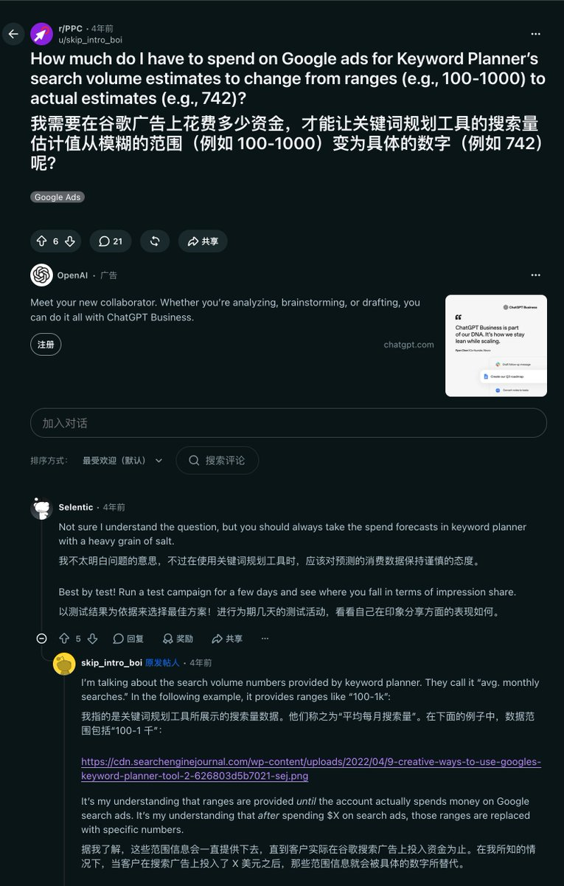

# Niko：Google Ads 关键词规划工具停投后只显示区间的问题

> 停止投放后关键词规划工具不显示精确搜索量，只显示区间；解决方案：开一个每天几美元的小搜索广告跑几天，或用正在投放的 MCC 经理账户查，或用第三方工具（作者最终选 DataForSEO）。后续已改用 Google Ads API 直接查。

<!-- more -->

原来 Google Ads 的关键词规划工具一直有这个问题

停止投放之后，关键词就只显示一个区间，不显示具体的搜索量了

解决方案是开一个很小的搜索广告活动，每天几美元，跑几天

或者用别人正在投放的账户（MCC 经理账户）查；或者用第三方工具

看来还是直接用 DataForSEO 最省事

## 相关页面

- [[sources/guishou-google-ads-api-keyword-volume]]
