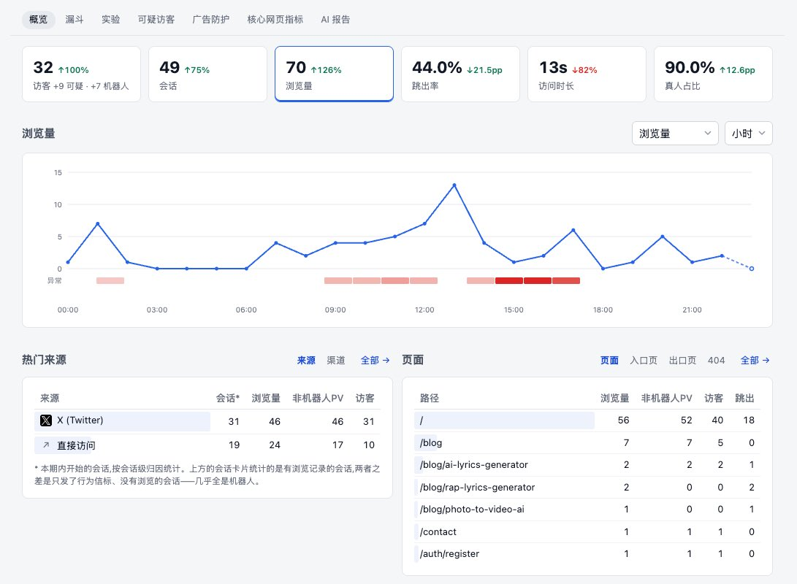
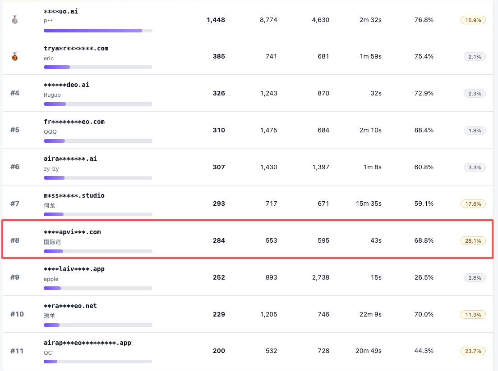
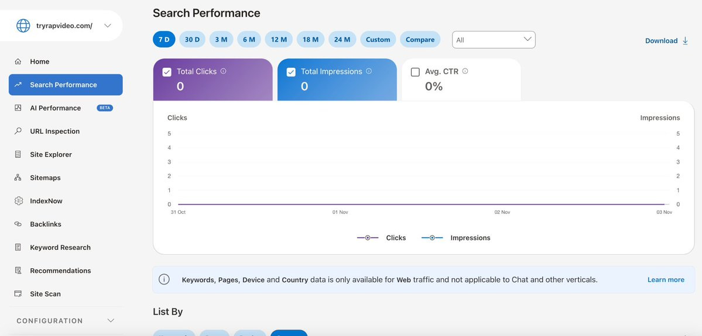
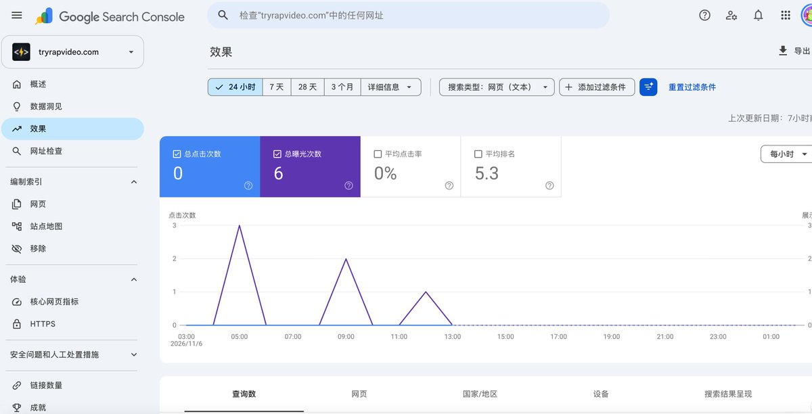

# 国际范 Bill（@guojifanbill）：哥飞上站比赛 Day 5-6——Bing 接入 IndexNow 后终于出词，新站 SEO 排查实录

> 新站上站实录（Day 5 与 Day 6 合并）：用 Agent 排查 Sitemap / Robots / 内链 / 索引状态后确认基础配置无明显问题，发现 Cloudflare 偶发拦截脚本返回 403；纠正「用 Google site: 指令查收录」的认知误区，改以 GSC 与 Bing 后台真实数据为准；按教程接入 IndexNow 主动向 Bing 提交 10 个页面，次日 Bing 开始出词（7 天累计 8 次曝光、0 点击，全为长尾）；用 Codex 批量提交外链时发现大量站点需登录或人机验证，自动化实际完成率仅 6/15。附社区回复：用 GSC「测试实际网址」与 Bing 后台同款工具验证爬虫是否被 Cloudflare 拦截。

<!-- more -->

【哥飞上站比赛 Day 5】折腾了一上午 SEO，Bing 还是 0 曝光，排名又掉了一位 🥶

继续记录 AI Rap Video（https://t.co/aLsZhrp8Yf）上站比赛。

昨天看到网站流量下滑，心里还是有点着急的。

这几天 GSC 的曝光一直只有个位数，Bing 更惨，直接是 0。虽然知道新站收录需要时间，但上线好几天了，搜索引擎还是没什么动静，难免怀疑是不是哪里出了问题。

于是今天上午主要干了一件事：让哥飞 Agent 和 Codex 帮我好好排查一下，网站的 SEO 到底出了什么问题。

1. 检查了半天，发现有些问题可能是自己想多了 😂
   让 AI 把 Sitemap、Robots、内链、页面索引状态等都检查了一遍。
   目前 Sitemap 有 10 个 URL，基本配置没发现什么明显问题。
   不过排查过程中发现，Cloudflare 有时会拦截普通脚本访问，返回 403。
   不知道会不会影响到搜索引擎爬虫，还得进一步验证一下。
   另外，之前一直用 Google 的 site: 指令查看收录，今天才知道，这玩意儿并不能准确反映实际收录数量。
   哎，看来有些问题还真不能光靠自己猜，还是得去 GSC 和 Bing 后台看真实数据。

2. 按照蓝星空大佬的教程，终于把 IndexNow 接上了
   之前收藏过蓝星空大佬的一篇公众号文章，讲的是如何通过 IndexNow 向 Bing 主动提交网站。
   今天正好派上用场。
   让 Codex 参考教程，把 IndexNow 接入网站，首次提交了 Sitemap 中的 10 个页面。以后网站更新，也能在部署成功后自动提交了。
   接口已经接收了请求，不过提交成功不代表一定会被收录，具体有没有效果，还得等 Bing 后续的数据。
   说实话，之前一直以为把 Sitemap 提交了，搜索引擎就会慢慢来抓取。现在才发现，SEO 要学的东西还真不少。
   当然，也不能指望接入一个 IndexNow，流量就能突然起飞。

3. 顺便折腾了一下 GitHub 和外链
   蓝星空大佬还分享了一个方法，可以通过 GitHub 仓库介绍自己的产品。
   于是今天又建了个 GitHub 仓库，把 README、网站链接、Topics 等信息都补充了一下。
   不知道对 SEO 能有多少帮助，先试试看吧。
   另外继续按之前的清单发外链，今天让 Codex 尝试自动提交了 15 条，但不少网站需要登录或者人机验证，最后自动完成了 6 条。
   剩下的只能自己动手，今天总共提交了 14 条外链。
   哎，看来 AI 虽然已经很强了，但发外链这件事，暂时还没法完全当甩手掌柜。🤷🏻‍♀️

4. 今天的数据，排名又掉了一位
   截至今晚 11:30：
   - 比赛真人访客榜：第 7 名 → 第 8 名
   - 今日访客：32 位
   - 页面浏览量：70 次
   - X（Twitter）：带来 31 位访客
   - 今日提交外链：14 条

今天的访问量比昨天稍微好了一点，但主要还是靠推友们捧场，自然搜索流量依旧少得可怜。

前几天靠 Build in Public 带来的流量，排名一度冲到第 6 名，现在热度慢慢退去，排名也开始往下掉了。

不过想想也正常，比赛比的是两个月的累计流量，不是一两天的热闹。

今天虽然把 IndexNow 接上了，也检查了不少 SEO 问题，但网站真正缺的还是稳定的搜索流量。

接下来准备多研究一下哥飞比赛群里分享的热门视频玩法，找找合适的长尾关键词，尝试做一些有需求的内页。

毕竟光把网站的基础配置做好，用户也不会自己找上门来。

希望过几天再打开 Bing 后台，多少能看到一点动静吧。

现在也不奢望一下子来多少流量，哪怕先来几个真正通过搜索找到网站的用户，也挺开心的。

明天继续折腾！💪🏻

【哥飞上站比赛 Day 4】流量跌了 77%，垃圾外链却冒出来 373 条 😂

继续记录 AI Rap Video（https://t.co/a5d6KpmCOR）上站比赛。

今天算是被泼了一盆冷水。

昨天比赛排名刚冲到第 6 名，今天就被群友反超了，掉到了第 7 名。网站流量也明显下滑，看来前两天靠推特带来的热度，开始慢慢退去了。

不过今天也没闲着，还是折腾了不少事情。

1. 补充网站埋点，搞清楚用户从哪里来
   昨天有位推友提醒我，可以关注注册用户的来源，方便后续有针对性地推广。
   觉得很有道理，于是今天一早就让 Codex 加上了注册来源记录。
   顺便检查了一下其他埋点，结果发现登录注册、视频生成、支付这些关键环节的数据记录都不够完整。
   之前光顾着把功能做出来了，运营需要的数据倒是漏了不少。
   赶紧补上，希望后面能知道用户从哪里来，又在哪一步流失了。

2. VPN 天天掉线，今天又折腾了半天网络 😂
   最近网络是真的不太稳定，也不知道是不是跟深圳要开 APEC 会议有关，之前用的 VPN 经常掉线。
   刷推特动不动就卡住，只能不断切换线路、换节点。
   最近几篇推文的曝光也明显下降，不知道跟网络异常有没有关系，可能有点影响，也可能只是自己找的借口。😂
   但有一点是确定的：Codex 开发真的被网络折腾惨了。
   经常写着写着就断线，代码执行到一半卡住，实在太影响效率了。
   今天实在受不了了，又找立总要了个相对稳定的机场推荐，重新买了 VPN，折腾了一个多小时，总算稳定了一些。
   以前总想着能省一点是一点，现在发现，基础设施的钱还真不能太省。
   工具再好，网络三天两头掉线，浪费的时间和 Codex 额度，可能比省下来的钱还贵。😭

3. Bing SEO 扫描终于出报告了
   之前看到赫兹大佬分享的 Bing SEO 扫描方法，就拿自己的网站试了一下。
   结果排队等了好久，今天终于出来了。
   一共扫描了 21 个页面，0 个错误、2 个警告、3 个提示。
   主要问题是：
   - 图片缺少 alt 描述：1 个页面
   - 页面 Title 过长：1 个页面
   - H1 标签缺失：3 个页面（提示项）
   整体还算不错，没有什么严重问题。
   让 Codex 补充了 8 张模板封面的 alt 描述，还把退款页的 Title 从 79 个字符缩短到 42 个字符。
   不过目前 Bing 依旧没有任何搜索曝光，Google 那边也没什么动静。

4. 新站才上线几天，居然有 373 条垃圾外链！
   下午用 AITDK 查了一下网站的外链，结果有点懵。
   网站 11 月 3 日才正式上线，居然已经检测到 373 条外链，来自 192 个不同域名，但 DR 还是 0。
   仔细看了一下，好家伙，很多都是莫名其妙的 .xyz 网站，DR 甚至有 50～60 多，内容却跟 AI Rap Video 八竿子打不着。
   也不知道是域名之前被人用过，留下的历史垃圾外链，还是被垃圾外链网络盯上了。
   查了一下，Google 通常能够识别并忽略这类垃圾链接，暂时没必要急着全部拒绝，后续再结合 GSC 观察一下。
   正经外链辛辛苦苦才发了几条，垃圾外链倒是先给我安排了几百条，属实离谱。
   有经验的朋友遇到过这种情况吗？一般会主动处理，还是直接无视？🤔

5. 整理外链清单，继续每天投 10 条
   今天还让 Codex 把之前收藏的外链，以及哥伦布网站分享的外链整理了一遍。
   筛选标准是 DR 大于 10、月访问量大于 1 万，按流量从高到低排序，优先提交免费的。
   付费外链暂时不考虑，毕竟网站还没赚到一分钱，还是省着点吧。😂
   晚上又硬着头皮提交了 10 条外链。
   说实话，发外链真的是我最讨厌的事情之一。尤其是没投过的网站，光研究怎么注册、怎么提交，就得花不少时间。
   不过既然决定每天投 10 条，那就尽量坚持吧。

6. 今天的数据，有点惨淡了 😂
   截至今晚 10:30 左右：
   - 比赛真人访客榜：第 6 名 → 第 7 名
   - 今日访客：18 位，下降 77%
   - 页面浏览量：36 次，下降 80%
   - 今日新增注册用户：0
   - 付费订单：0
   - GSC：9 次曝光，0 点击
   - Bing：0 曝光，0 点击
   - 今日提交外链：10 条
   跟昨天的 97 位访客相比，今天确实有点惨。

昨天发的第三篇 Build in Public 帖子 也扑街了，浏览量只有 300 多，远不如第一篇。

不知道是网络问题、发帖太频繁，还是大家已经看腻了我的建站日记。🤯

不过仔细想想，前两天过来的大部分是独立开发者，可能只是来围观比赛的，并不是真正需要 AI Rap Video 的用户。

流量看起来挺热闹，但没有注册，更没有付费，其实也没什么值得高兴的。

今天还翻了一下哥飞比赛群里的讨论，发现不少群友都在研究最近热门的 AI 视频玩法，围绕具体的爆款视频去设计功能。

相比之下，我之前的思路可能太简单了，只想着把通用的 AI Rap Video Generator 做出来，却没认真研究用户到底想生成什么样的视频。

后续准备多研究一些热门视频玩法和长尾关键词，尝试做些有搜索需求的内页。

首页暂时就不折腾了，不能又陷入没完没了的开发中。

今天最大的感受是，比赛排名再高，如果来的都不是目标用户，最后还是赚不到钱。

前几天光顾着看排名上涨，今天流量一跌，反而让我清醒了一些。

毕竟参加比赛只是一个过程，真正想跑通的，还是从获取流量到用户付费的整个闭环。

明天继续折腾！💪🏻

---

## 社区补充：Cloudflare 403 到底有没有拦住爬虫？

Day 5 里提到「Cloudflare 有时会拦截普通脚本访问，返回 403，不知道会不会影响到搜索引擎爬虫」。这条在评论区有了明确答案（Vokollapr @Vokollapr）：

> Cloudflare 那个 403 可以直接验证：**GSC 网址检查里点「测试实际网址」，能抓到就是 Googlebot 没被拦，Bing 后台也有一样的工具。** 新站 10 个 URL，上线几天曝光个位数，其实挺正常的。

**两条可直接复用的验证路径**：

1. **GSC → 网址检查 → 测试实际网址**：以 Googlebot 身份实测抓取，能返回正常内容即说明未被拦截；
2. **Bing Webmaster Tools → URL Inspection**：用 Bingbot 身份实测同一页面；
3. **用 Bingbot 的 User-Agent 直接请求首页**：返回 200 且内容完整即可确认。

**附带校准**：新站 10 个 URL、上线几天曝光个位数属于正常节奏，不必过早怀疑配置出问题。

---

## 相关页面

- [[sources/kkkeric-seo-new-site-gsc-and-300-backlinks]]
- [[sources/taowithsaas-bing-webmaster-free-competitor-backlinks-export]]
- [[concepts/seo-basics]]
- [[concepts/open-source-seo-tooling]]
