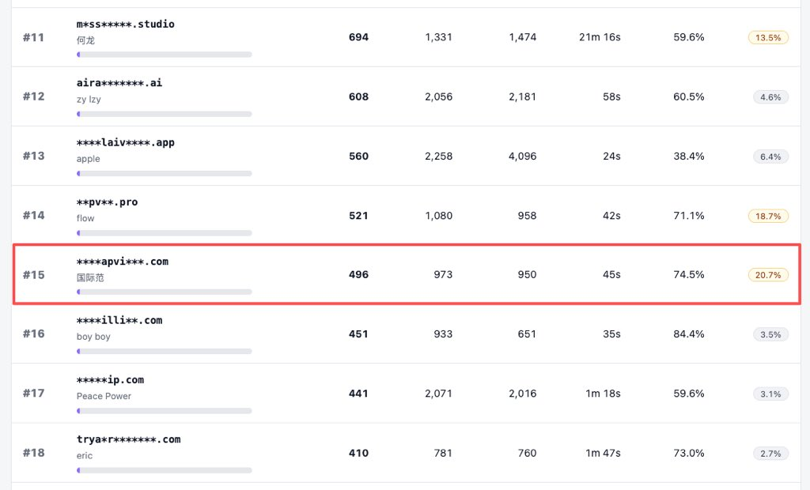
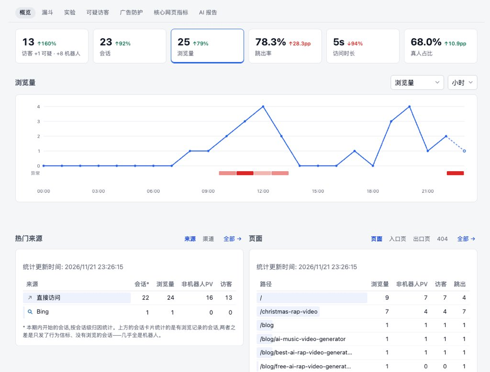

# 国际范 Bill：上站比赛 Day 19——主词搜索量有限，改用拓词加内页拿流量

> 用生财 Skill 找了一圈新词、又上了 2 个内页，流量仍未起色。查词数据发现 AI Rap Video 这个主词搜索量确实有限，靠单个主词拿大量 SEO 流量很难，于是决定换思路：不再只盯主词，改用拓词与增加内页。

<!-- more -->

【哥飞上站比赛 Day 19】用生财 Skill 找了一圈新词，又上了 2 个内页，流量还是没起色 😭

继续记录 AI Rap Video（https://tryrapvideo.com/）上站比赛。

昨天查了一下关键词数据，发现 AI Rap Video 这个词的搜索量确实有限。想靠这一个词拿到大量 SEO 流量，感觉还是有点难。

所以今天决定换个思路，不再只盯着主词，试试能不能通过拓词、增加内页来获取更多流量。

1. 用生财的 Skill 找词，发现大词也不是想做就能做 😂
   今天继续用了生财有术的 Money Keywords：找新词、新站 Skill，让它围绕 AI Rap Video 找一些有流量的英文关键词。
   结果推荐了不少词，比如：
   - AI Music Video Generator
   - AI Rap Generator
   - Hotel Lobby AI
   - Lyric Video Maker
   其中 AI Music Video Generator 的搜索量看起来挺诱人，但竞争也很激烈。
   而且仔细想想，这些词虽然跟 AI Rap Video 有关系，但用户想要的功能不一定是我的网站能提供的。
   比如用户想上传一整首歌曲，直接生成完整 MV，而我的产品主要还是生成短 Rap 视频。
   光看搜索量就上内页，可能流量没拿到，反而把用户给忽悠进来了。😂
   于是又让哥飞 Agent 和 Codex 讨论了一轮，重点筛选现有产品能真正满足的搜索需求。
   最后决定先新增两个内页：
   - AI Music Video Generator：尝试承接音乐视频相关需求，但明确现有产品的能力边界。
   - AI Roast Video Generator：用朋友的照片生成搞笑、吐槽风格的 Rap 视频。
   这两个方向一个偏大词，一个偏具体场景。
   让 Codex 参考之前生日、圣诞页面的结构，把两个内页都做出来了。
   目前还不知道有没有效果，但至少这次不是为了凑页面数量，而是先考虑用户到底想做什么。

2. 外链继续投，今天又完成了 10 条
   今天继续让 Codex 自动提交了 10 条外链。
   最近已经尽量把这类重复工作交给 AI 了，自己还是想多花点时间找词、研究竞品和流量来源。
   毕竟之前每天手动发外链，忙得够呛，网站流量却没什么变化。

3. 今天的数据，还是挺惨的 😭
   截至今晚：
   - 比赛真人访客榜：第 15 名
   - 今日访客：13 位，页面浏览量 25 次
   - GSC：近 24 小时 6 次曝光、0 点击
   - Bing：近 7 天 25 次曝光、0 点击
   - 今日提交外链：10 条
   - 今日新增内页：2 个
   说实话，看着排行榜也有点着急。
   最近不断有群友上站，别人的流量慢慢涨起来了，我这边却始终没什么起色。
   之前还想着冲进前五，现在连第 15 名都感觉快保不住了。😂
   最头疼的还是 Google 和 Bing，自然搜索流量几乎没有。网站访问量基本还是靠社媒和一些零散的直接访问。
   不过今天至少把拓词这件事往前推进了一步。

以前总想着先把网站优化好，再等搜索引擎给流量。现在越来越觉得，可能一开始就得先想清楚，用户到底在搜什么。

接下来先观察这两个新内页的收录和曝光，再继续研究生财的新词监控方法。

希望能早点找到几个真正有需求、自己又能做的关键词吧。

不然每天辛辛苦苦发外链，最后连自己都不知道流量该从哪里来。😂

明天继续折腾！💪🏻

【哥飞上站比赛 Day 18】查了半天关键词，发现月搜过千的长尾词只有 1 个，排名又掉到第 15 了 😂

继续记录 AI Rap Video（https://tryrapvideo.com/）上站比赛。

网站上线半个多月了，SEO、GEO、外链和内页都折腾了不少，但自然搜索流量一直没什么起色。

最近一直在想，是不是自己一开始就把这个词的流量想得太乐观了？

1. 用生财有术的 Skill 查了一下关键词，结果有点扎心 😂
   今天试了一下生财有术的 Money Keywords：找新词、新站 Skill，想看看 AI Rap Video 还有哪些月搜索量超过 1000 的长尾词值得做。
   先通过 Similarweb 查了一下，发现 RapDuo、Higgsfield、Freebeat 等网站，确实能从 AI Rap Video 这个关键词获得不少点击。
   但继续用 DataForSEO 查搜索量，结果有点出乎意料：
   - ai rap video：全球月搜索量约 6,259
   - ai rap video generator：全球月搜索量约 2,190
   - ai rap music video generator：约 100
   - ai rap video maker：约 51
   一共查了 12 个相关词，月搜索量超过 1000 的长尾词，居然只找到 1 个！
   当然，这些都是第三方工具的估算数据，不同平台的统计口径也不一样，不能完全当真。
   但至少让我意识到，光盯着 AI Rap Video 这个主词，即使排名做上去了，能拿到的 SEO 流量可能也比较有限。
   难怪之前加了几个内页，一直没什么起色。虽然新页面还需要时间，但选词这件事确实得更加认真了。
   后面准备继续学习生财的新词监控 Skill，多找一些真正有搜索需求、竞争又没那么激烈的热词。
   找到合适的词，再针对性地做内页，而不是 GPT 推荐什么就加什么。

2. 外链继续投，今天又完成了 10 条
   今天继续让 Codex 自动提交了 10 条外链。
   现在也越来越不想自己手动填表单了，能让 AI 完成的重复工作就交给它吧。
   另外又翻了一遍哥飞比赛群的消息，感觉大家最近也没有特别明确的新思路。
   算了，还是先把自己的事情做好吧。😂

3. 今天的数据，排名又掉了 3 位 😭
   截至今晚：
   - 比赛真人访客榜：第 12 名 → 第 15 名
   - 今日访客：6 位，页面浏览量 15 次
   - GSC：近 24 小时 2 次曝光、0 点击
   - Bing：近 7 天 29 次曝光、1 次点击
   - 今日提交外链：10 条
   最近又有一些群友接入排行榜，别人的流量涨得挺快，我却一路往下掉。
   从之前最高的第 6 名，到现在第 15 名，差距越来越明显了。
   说实话，连续半个月没什么自然搜索流量，多少还是有点泄气的。

不过今天查完关键词，至少觉得后面有了一个值得尝试的方向。

与其每天纠结为什么没流量，不如多花点时间找真正有流量的词。

当然，找到词也不代表一定能做起来，但总比自己闷头加内页强。

明天继续研究生财的 Skill，争取找到几个值得做的新词。

希望下次上站，不再只是给排行榜贡献一个数字了。😂

## 相关页面

- [[concepts/open-source-seo-tooling]]
- [[patterns/overseas-website-conversion-loop]]
