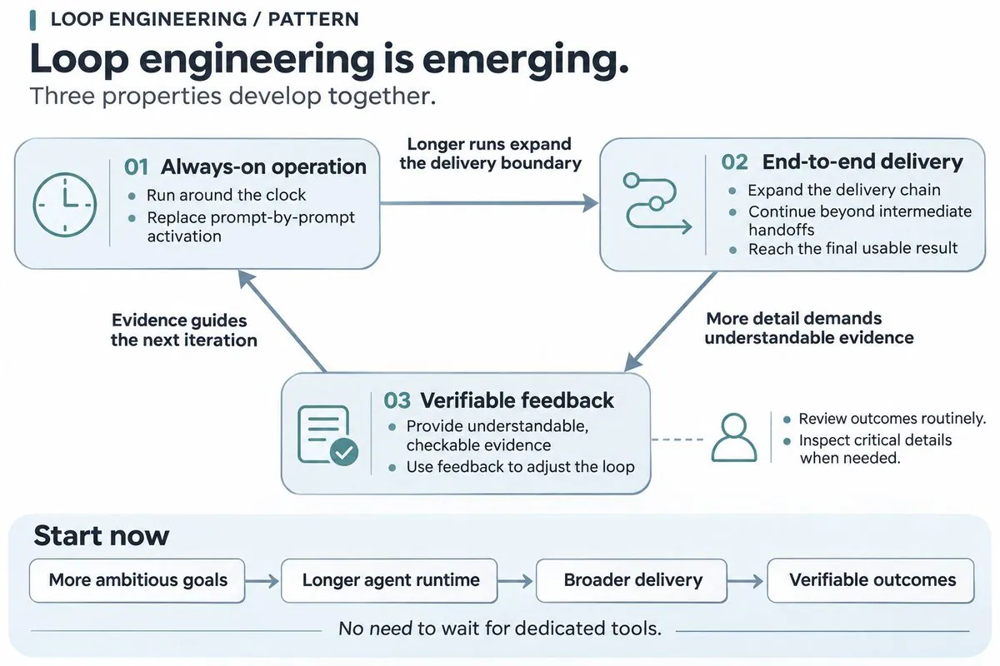
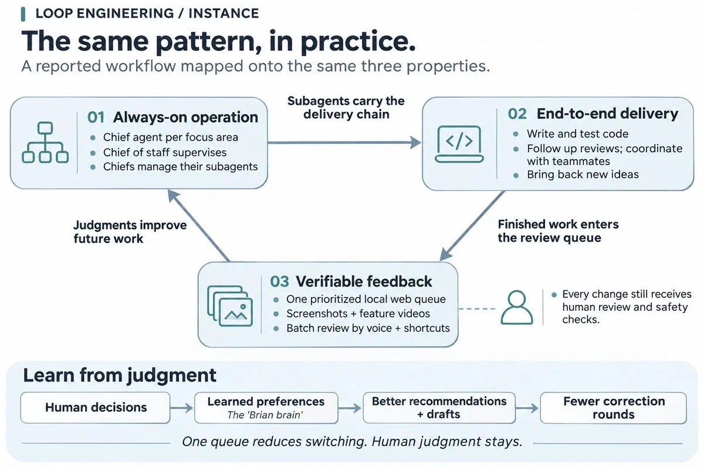

# 工业聚（@guyingjie129）：循环工程的三点特征——以及 Brian Armstrong 的 Agent 组织实践

> 指出越来越多人在自觉或不自觉地搭建「循环工程」，其三点特征是一体的：全天候运行以代替提示语输入驱动；面向最终交付、以端到端模式工作；通过提供可验证材料获取反馈并调节自身。全天候运行让 Agent 不能停滞在中间交付点而不断扩张交付链路；端到端推进中大量实现细节让人类无法全面追踪，因而只能抓大放小，要求易于理解、带可验证性的材料作为日常验收媒介，只在必要时审查关键细节。附 Brian Armstrong 的实践分享：每个关注领域一个常驻 lead agent 加一个 chief of staff agent 统筹，lead 各自管理写代码、测试、追 review 的子 Agent；所有待决策与待 review 的事项进入一个本地 Web 应用的单一优先队列（含截图与功能演示视频），用语音和快捷键批量清理，系统持续学习偏好并把判断蒸馏成「Brian brain」，目标是每次变更需要更少纠正；每个变更仍走同样的人工 review 与安全检查——它消除的是任务，而不是人的判断。

<!-- more -->

越来越多人，有意无意地、自觉或不自觉地，搭建了一套循环工程。

它们呈现相同的模式——

1. 全天候运行，代替提示语输入驱动
2. 面向最终交付，以端到端模式工作
3. 通过提供可验证材料获取反馈调节自身

这三点是一体的。

全天候运行让 Agent 越发不能停滞在中间交付点，不断扩张自己的交付链路，直到最终充分的端到端。

端到端推进过程中大量的实现细节，让人类无法全面追踪，而不得不抓大放小，要求着易于理解的、带可验证性的材料作为日常验收媒介。只在必要的时候，对关键的细节进行审查

如何自行搭建你自己的循环工程呢？等待更多支持循环工程的工具出现吗？

太迟了，其实你现在就可以尝试起来。从下达更具野心、更长程、更宏大的目标开始，一旦延长了 Agent 的工作时间，后面的端到端交付性质、可验证性验收材料，将会自然地涌现和延伸出来。

I’ve changed how I work over the last few weeks.

I now have one lead agent for each area of focus, running all the time, and a chief of staff agent that oversees them. Each lead manages its own sub-agents that write code, test it, chase reviews, and coordinate with team members.

Everything I need to decide or review comes into one prioritized queue, a simple local web app. Each product review includes screenshots and a video demo of the feature. I clear the queue in batches, mostly by voice and keyboard shortcuts. The leads also bring back ideas I hadn’t considered.

Working from one queue, instead of switching between dozens of chats, has cut a lot of mental overhead. The system keeps learning my preferences and distilling my judgment into a “Brian brain,” so its recommendations and first drafts get better before they reach me. The goal is fewer corrections per change.

Every change still goes through the same human review and security checks. It is eliminating tasks, not human judgment.

What an exciting time to push the frontier of productivity, especially as we build the economy for agents (agentic finance). We should all keep pushing in this direction.

## 相关页面

- [[sources/addyosmani-your-coding-agents-made-you-a-manager]]
- [[sources/barret-super-agent-prompt-proactive-perception-inbox-outbox-l5]]
- [[concepts/loop-engineering]]
- [[concepts/agent-autonomous-pipeline]]
