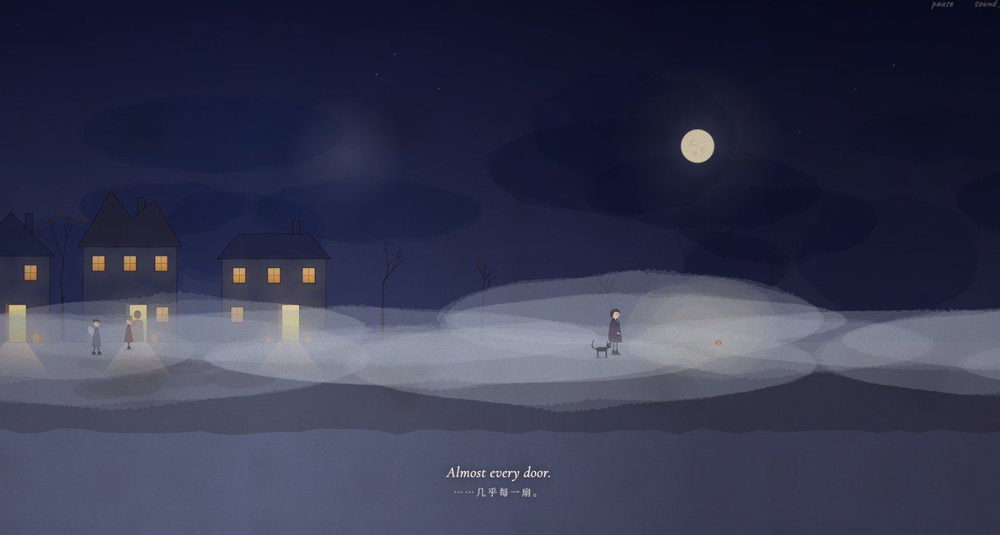
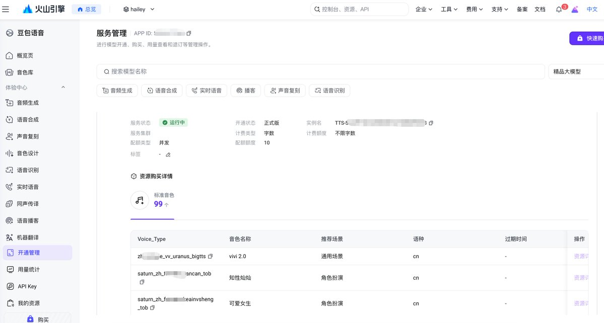
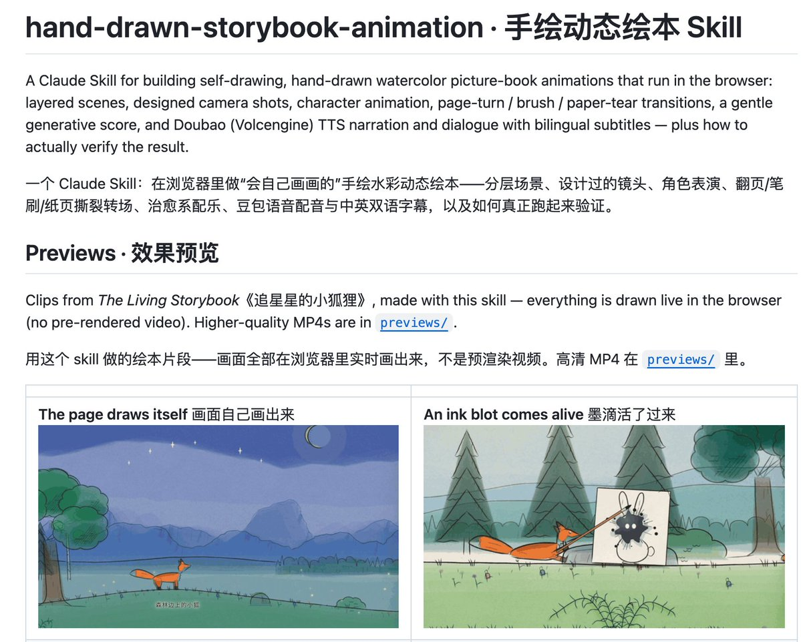

# 不会画画、不会剪辑，我用 Opus5.5 把一个故事变成了 7 分钟动画：完整制作步骤 + 豆包配音接入教程

我最近用 Opus5.5 做了一部 7 分钟的手绘水彩动画绘本，发出来后，好多人追着问我是怎么做的。

先看成片：

> 引用推文：Hailey (@HaileyAILabs)
> Omg！换上豆包的配音，整个故事书瞬间就有灵魂了，太绝了！！😭 又新增了 5-6 章内容+英文配音，效果也好惊艳！真的要哭了，Opus 5.5 也是让现在的小孩吃上细糠了。后面准备做成一个系列，把中国和世界各地的故事都做成会画画、会说话的电子绘本。制作 Skill 也会很快整理出来分享给大家。https://t.co/sYv6A5ONLs
> https://x.com/HaileyAILabs/status/2110975805899825394

说实话，做到这个效果，我自己也挺惊喜的。

它已经不只是一个 AI 视频 Demo 了。完整的故事、统一的画风、水彩动画、场景转场、角色配音和双语字幕，组合起来就是一部有专业出版质感的电子绘本。

如果继续打磨内容和制作细节，我觉得完全有机会做成真正的商用电子绘本，甚至发展成一个长期更新的故事系列。

实际上，我不会画画，也不会剪辑。

我只是用 GPT 写剧本，让 Claude 负责制作和修改，再接入豆包语音完成配音。

前后只花了 1 天。

既然这么多人问，我就把整个制作流程整理出来，包括可直接复制的提示词、Claude 的制作方法，以及豆包配音怎么接。

## 这东西还能拿来做什么？

以前想做一部这样的动态绘本，需要写剧本、画插画、做动画、剪辑、配音，整个流程成本不低。现在，很多工作都可以交给 Claude 完成，自己主要负责创意、审美把关和反复调整。

我觉得它的应用场景还挺多的：

- 知识科普：把复杂的科学原理、历史事件做成有剧情的动画，让知识更容易理解。
- 技能教学：把软件操作、编程入门、AI 工具教程做成直观的动画演示。
- 儿童内容：制作睡前故事、英语启蒙、生活习惯和安全教育等内容。
- 动态绘本：把中国神话、经典童话和原创故事做成有画面、有配音、有字幕的电子绘本。
- 产品营销：用一个小故事讲清楚产品的功能、使用场景和核心卖点，而不是单纯展示功能列表。
- 品牌 IP：设计固定角色和连续剧情，持续更新内容，慢慢积累受众，也为后续的 IP 开发留下空间。

这些内容既可以发布在短视频和社交平台上，也可以进一步探索电子绘本、系列动画、儿童内容产品等方向。当然，最终效果还是取决于故事、画面、配音和整体制作质量。

而且，不一定每次都做同一种题材。

除了《追星星的小狐狸》，我还尝试做了《清明上河图》和《万圣节之夜》，也在制作中国神话故事《女娲补天》。

从水彩绘本到古风长卷，再到节日故事，题材、画面和氛围都可以完全不同，但底层的制作思路基本相通。一套流程，可以不断尝试新的故事和视觉风格。

> 引用推文：Hailey (@HaileyAILabs)
> 这效果可以直接拿去小红书起号了 Opus 5.5 产出的这些内容，简直就是流量密码，画风、创意、视觉效果都太适合传播了。https://t.co/ZGxGtOTISb
> https://x.com/HaileyAILabs/status/2110633833607602424

## 第一步：先让 GPT 把故事想明白

剧本我用 GPT 写。

我的习惯是分三轮，不会拿到第一版就直接开做。

第一轮：先出故事。

直接给它这样的提示词：

> 我要设计一个创意手绘画，请你设计一个剧本，要求治愈，有吸引力，有传播价值。

让它把故事、场景、角色动作和台词都写出来，先有个完整的版本。

第二轮：让它自己挑刺。

> 站在挑剔的观众和动画导演的角度，批判一下这个剧本，哪里平淡、哪里不合理、哪里不够让人想转发，然后给我改好的版本。

这一步我建议别省。

有时候第一版看着挺完整，但真的做出来可能会很平，没什么让人想继续看下去的东西。

让它再审一遍，补冲突、调节奏，故事往往会好不少。

第三轮：生成分镜图，预测效果。

> 根据改好的剧本生成一张分镜图，每个镜头一格，标上远景、中景还是特写，写上画面内容和台词，铅笔线稿加淡水彩的风格。

这样就有了一张漫画格子一样的分镜图。

在正式制作之前，至少能先看清楚故事大概怎么展开，镜头之间有没有问题。

## 第二步：把剧本交给 Opus5.5

我用的是自己开源的 hand-drawn-storybook-animation skill，链接放在文末。

装好之后，把剧本和分镜图一起发给 Opus5.5，告诉它：

> 用 hand-drawn-storybook-animation 这个 skill，按这个剧本和分镜做一部手绘水彩动画。

接下来就让它先做一版。

这个 skill 里已经整理了制作流程和画面处理方式。Opus5.5 会根据剧本拆镜头、画场景，再做动画效果。

比如铅笔线慢慢出现，水彩一点点晕开，章节之间用翻页、湿笔刷这些方式转场。

但第一版一般还不是最终效果，我会继续看，然后直接提意见。

我当时说得很简单：

- 节奏有点慢。
- 颜色鲜艳一点。
- 转场不好看。
- 背景音乐太吵了，要治愈一点。

不用每次都写一大段提示词，哪里不满意就说哪里，让它继续改。

这个过程其实有点像当导演：你不一定需要亲手完成每个环节，但得知道自己想要什么，也得判断做出来的东西到底好不好。

[video](https://video.twimg.com/tweet_video/HUyEQVUaIAA0Yvq.mp4)

## 第三步：接上豆包配音

接上豆包配音，整个绘本瞬间有了灵魂

之前做出来的画面已经不错了，但加上豆包配音以后，整个故事一下子就有感觉了。

尤其是旁白和角色声音出来的时候，跟单纯看画面完全不一样，故事终于有了情绪和代入感。

我用的是火山引擎的豆包语音，选择 语音合成 2.0 就可以开始尝试了，而且有一定的免费额度，可以先体验一下效果。

配音时，可以根据不同角色设置不同的声音和语气。比如旁白用温柔的讲故事语气，小狐狸用活泼一点的少女音，其他角色则根据性格来设计。

一个小建议：不要让所有角色都用同一种语气。旁白负责营造氛围，角色声音负责表现性格，配合画面和字幕，整个绘本会生动很多。

接入是先去火山引擎控制台找到语音合成服务，开通之后创建 API Key，再按照项目要求把 Key 配置到 .env 文件里。

注意：.env 文件不要发给 AI，也不要上传到公开仓库。

然后告诉 Opus5.5：

> 用豆包语音给这部动画配音，旁白用温柔讲睡前故事的语气，小狐狸是活泼的小女孩，小墨怪只发萌萌的叫声，字幕跟声音对上。

剩下的交给它处理。

它会生成配音，并根据实际语音时长调整时间，让画面、声音和字幕尽量对齐。如果某句话比较长，后面的镜头也需要跟着调整。

当然，生成完还是要从头看一遍，尤其注意台词、字幕和画面有没有对上。

## 几个我自己踩出来的经验

1. 别急着让 Opus5.5 开始做，先把故事打磨好。

我现在基本都会让 GPT 自己批判一遍剧本。故事好不好，真的会直接影响最后的成片。

2. 音乐不用一直铺满。

我一开始也觉得音乐丰富一点会更好，后来发现不一定。留一些安静的地方，偶尔只有环境声，反而更有感觉。

3. 不要因为 AI 说做完了就直接发布。

自己从头看一遍，该改的继续改。节奏、转场、配音这些细节，往往就是最后效果的差别。

AI 能帮你省掉很多重复劳动，但审美和判断还是得自己来。

## 做出来之后，怎么变现？

说实话，动画本身不值钱。

值钱的是它带来的流量，还有你能一部接一部做出来的这个能力。

我想到的路子有这几条：

做账号：选一个方向长期更新，睡前故事、神话新编、儿童科普都行，有了粉丝，激励、广告、带货自然就来了
接定制：品牌介绍片、课件动画、新书宣传、生日表白，需求很多，传统动画又太贵
卖系列：二十四节气、成语故事，做成一整套卖给幼儿园和家长，做一次能卖很多次
做 IP：一个角色讲到 100 集，就能做周边、绘本和授权

小狐狸、女娲、万圣节，这三部其实就是我的作品集。

题材拉得越开，别人越知道你能做什么。

最后提醒一句，角色一定要原创，别人的角色再火也是别人的，自己的才能一直讲下去。

## 最后

我之前做 3D，现在又开始折腾这种会画画、会说话的故事书。

越来越觉得，AI 好玩的地方不是帮你生成一张图或者一段视频，而是以前只有一个想法、根本没能力做出来的东西，现在真的有机会做成作品了。

而且，当画面、剧情、配音和字幕都能串起来之后，它就不只是一个视频了。你完全可以继续往下做，把它变成一个有固定角色、持续更新的系列，甚至一款真正的电子绘本产品。

GPT 写故事，Claude 负责制作，豆包配音。

你来决定要讲什么故事。

我把用到的 skill 开源了，想自己试试的可以直接拿去用。

[https://github.com/lhlGitHub/hand-drawn-storybook-animation-skill](https://github.com/lhlGitHub/hand-drawn-storybook-animation-skill)

## 相关页面

- [[patterns/story-studio-video-pipeline]] — Audio-First 短视频流水线
- [[sources/story-studio-video-account-pipeline]] — Story Studio：另一条视频生产路线
- [[sources/hypit-agent-video-workflow]] — Codex + Hypit 复刻视频工作流
- [[sources/jedeeai-ai-video-top10-bookmarks]] — X 收藏量 Top 10 的 AI 视频实操神贴
- [[sources/xaiwind-jianying-skill-guide]] — 剪映 + jianying-editor-skill 使用指南

