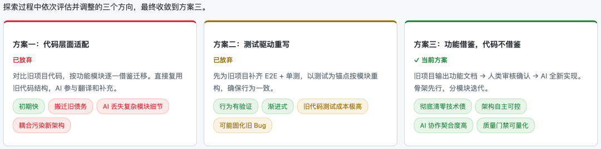
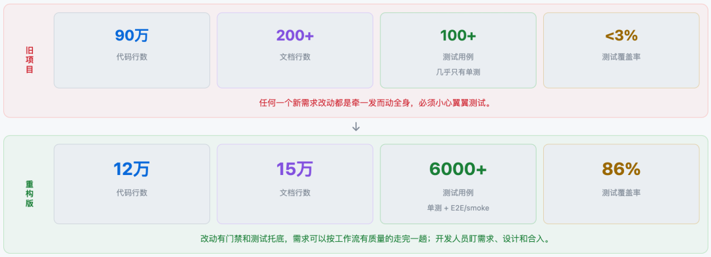
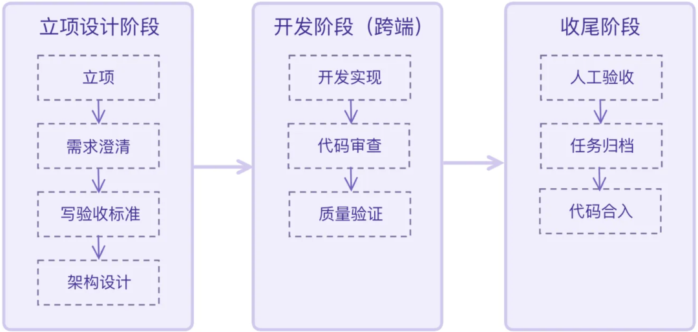
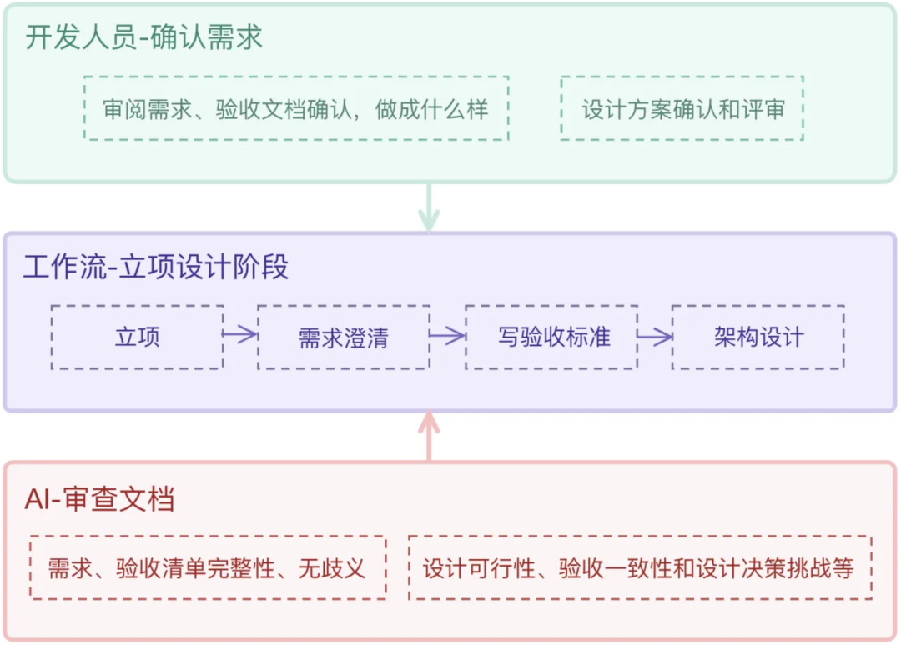
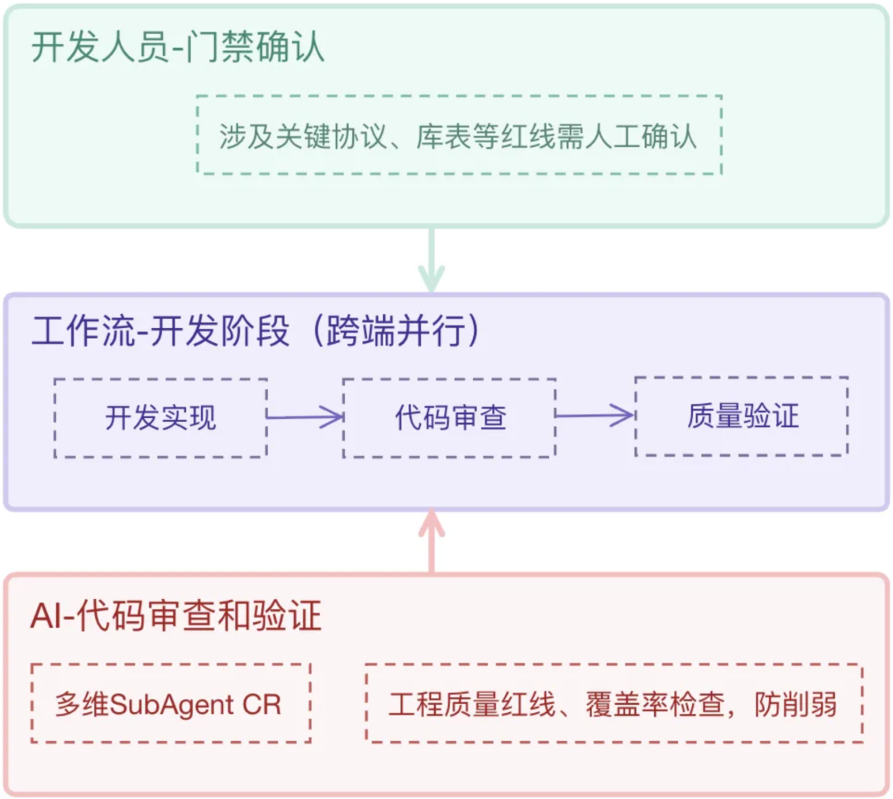
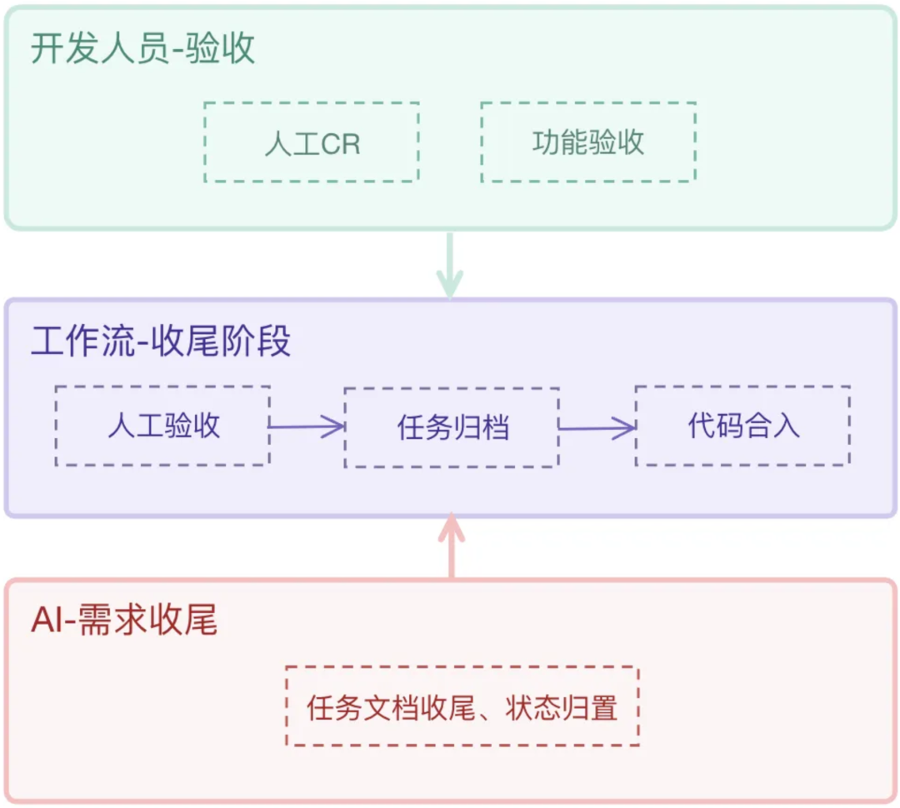
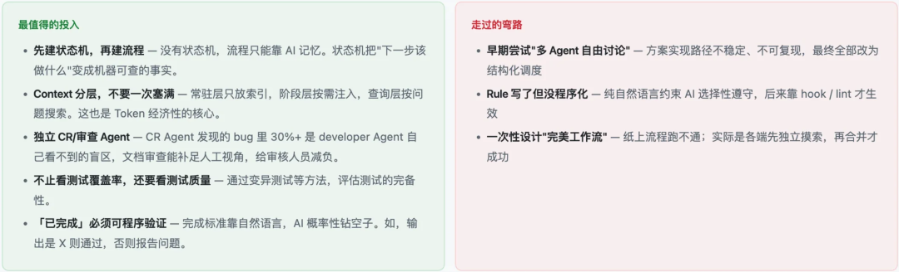

# 3 个月用 Harness 重构 90 万行旧项目：实战经验与踩坑总结

> 一个 2 到 3 人团队把 90 万行、低文档、低测试覆盖的音视频编辑系统当作需求说明书，用 Harness 驱动 AI 重新实现，并把质量控制从提示词提醒升级为工作流、门禁和可程序化验证。

<!-- more -->

作者：komahu

## 项目背景与结果

团队接手的是内部视频在线剪辑系统，覆盖多轨道剪辑、预览、字幕、合成和发布。旧系统经历多次团队交接，前后端约 90 万行代码，风格混杂、耦合严重，单个复杂组件超过 6,000 行，相关文档和单元测试接近空白，同时仍需持续交付新需求。

团队最初评估了多种重构方案，最终没有机械迁移旧代码，而是把旧系统视为产品功能和行为的需求说明书，利用 Harness 从头实现新系统。

三个月后的阶段结果是：

- 新系统约 12 万行代码。
- 约 15 万行文档。
- 6,000 多个测试用例。
- 测试覆盖率达到 86%。
- 旧系统半年只能谨慎处理不到 3 个需求或紧急 Bug；新系统在两个月内迭代了 30 多个新功能。

AI 负责需求和设计文档编写与机审、业务代码实现、代码审查、测试验证和文档更新；开发人员负责确定需求、确认边界、选择方案、判断高风险技术点、人工代码审查和最终验收。

## 三阶段 Harness 工作流

这套工作流围绕一个问题设计：当 AI 写完代码后，怎样获得足够可靠的工程证据，才能允许代码合入和上线？

作者提炼出两条原则：

1. **工程质量越往前控制，结果越可控。**
2. **把运动员和裁判员分开。**实现与验证不能依赖同一上下文中的自我评价。

### 阶段一：立项与设计

流程包括：立项、需求澄清、需求审查、验收标准编写与审查、前后端架构设计、架构设计审查，以及人工对需求和设计文档的交叉审查。

这一阶段的目标不是多写文档，而是在编码之前消除目标漂移：

- **需求审查**：AI 检查含糊词、指代不清、死链和缺失信息；人判断需求是否符合真实产品目标。
- **验收标准审查**：把“用户上传成功”拆成明确的通过和失败条件，并尽量量化指标，避免 AI 用模糊结果证明自己完成。
- **架构设计审查**：检查复用机会、前后端协议、字段一致性、错误路径、性能和扩展性，防止 AI 只优化局部代码却增加全局重复与架构熵。
- **提前提出 MR**：在写代码前让非需求负责人审查需求和设计，尽可能早地暴露问题。

作者引用 GitClear 的观察指出，AI Coding 普及后代码重复率从 8.3% 上升到 12.3%。该数据在原文中没有给出直接来源，因此应视为行业转述；但它对应的工程风险真实存在：如果 Agent 没有找到已有实现，通常会再造一份局部可用的新代码。

### 阶段二：开发与机器验证

跨端需求会分成前后端链路并行实现。团队按设计文档进行 TDD，先写契约测试，再实现功能，并通过 Rules 与项目宪章约束代码习惯。

仅靠规则文件不够。随着上下文增长，早期约束会被稀释，因此团队将代码审查拆成架构、安全、契约、性能、接口契约、运行时、代码规范和测试等多个专职 SubAgent，让每个审查者只关注一个维度，并在干净上下文中执行。

传统自动化质量检查仍然是核心，包括单元测试、冒烟测试、E2E 测试、覆盖率和质量指标。它们的优势是由程序执行，不需要模型通过自然语言自行判断。

#### 防止 AI 修改规则以通过门禁

如果工作流只要求“覆盖率通过”，AI 可能降低阈值或修改检查条件。团队把质量阈值放进独立红线配置，任何修改都会触发门禁并等待人工确认。关键不是提醒 AI 不要作弊，而是让它没有静默修改判定标准的权限。

#### 用变异测试检查测试质量

高覆盖率只能说明代码被执行，不能说明断言能识别错误。当同一模型同时写实现和测试时，容易出现定制化断言，使错误行为仍能通过。

变异测试会故意修改源码，例如反转条件或改变比较运算，再重新运行测试。若代码被破坏后测试仍然通过，说明测试用例没有真正保护行为。

作者提醒，变异测试的成本很高：一分钟的全量测试可能扩张到三十分钟以上，因此更适合只对增量代码和本次修改的测试运行，历史代码则作为技术债逐步补齐。原文引用的 AI 与人工变异测试得分范围属于搜索所得参考数据，不应当作稳定基准。

### 阶段三：人工验收与收尾

团队没有试图逐行阅读 AI 生成的全部代码，而是采用四类重点材料：

- 需求文档：确认交付目标是否正确。
- 设计文档：确认技术方案是否合理。
- 重要代码：精读关键路径和高风险实现。
- 验收报告：确认设计、实现和证据是否一致。

人工代码审查的职责上移为“验证需求和体系设计、裁决分歧、精读关键代码”。自动审查不是为了让人退出，而是把人的注意力从机械检查中释放出来，用于系统判断和责任承担。

## 多 Agent 独立验证

同一 Agent 写完代码后切换角色自审，仍容易受原上下文和结论影响。团队改为独立 SubAgent 加可程序化命令：每个审查角色都有单一职责、审查清单和干净上下文，执行完成后即退出。

这种拆分并不意味着 Agent 越多越好，而是将高风险审查维度隔离，让实现者不能同时充当唯一裁判。

## 状态机与防篡改

整个工作流由 Python CLI 管理状态，并通过 Hook 守卫写操作。进度保存在文件中，AI 只能调用命令推进，不能直接把某个步骤改成“已完成”。

这套设计同时解决三个问题：

- 防止 Agent 跳过步骤或篡改完成状态。
- 在会话重启时恢复当前任务上下文。
- 记录步骤时间、触发者和报告，形成可审计证据链。

## Token 与上下文经济性

团队将工作流资产分成三层：

| 层级 | 加载时机 | 内容 |
|------|----------|------|
| L1 会话常驻层 | 每次对话 | 任务路由、团队红线、文档索引、项目技术栈与结构约定 |
| L2 阶段触发层 | 进入对应工作流阶段 | Skill 手册、SubAgent 角色合约和阶段规则 |
| L3 按需查询层 | 遇到具体问题 | 跨服务契约、调试指南和专项资料 |

团队还按阶段分配模型：文档同步和冒烟验证可使用较弱模型，设计、开发和代码审查使用强推理模型。会话变慢或接近上下文上限时可以冷启动重开，但不能过早重启，否则会丢失已经建立的项目理解。

## 最终经验

Harness Engineering 不是一次性搭建的模板，而是随着工程问题、事故和模型能力持续演化的系统。这个案例中，开发者的角色从某一端的实现者转变为对完整需求负责的系统判断者。

代码生成速度提高后，程序员的护城河更接近四件事：把需求想清楚、守住工程判断、建立可靠质量机制、验清最终结果。

## 数据边界

本文保留作者报告的项目规模、测试和交付数据，但没有仓库、测试报告或公开流水线可供独立核验。文中 GitClear、AI 测试变异得分等行业数据也属于作者转述，引用时应注明来源层级。
