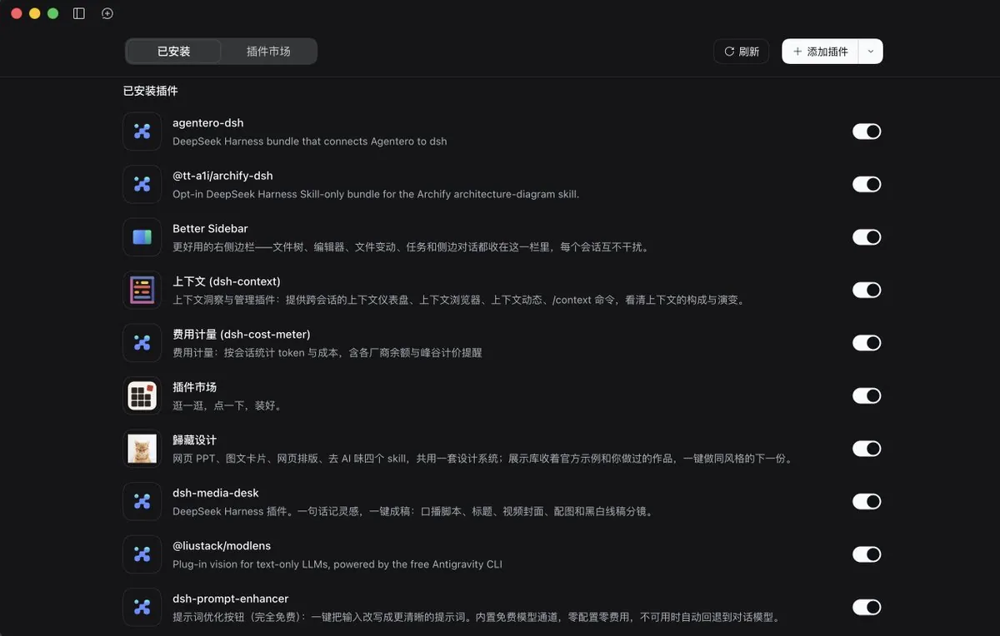

# 森叔（@harrisonitsme）：大肥鱼 DSH 必装的 11 个插件

> DeepSeek Harness 插件推荐清单：自媒体工作台（dsh-media-desk，记灵感直接出脚本标题封面分镜）、歸藏设计（网页 PPT / 图文卡片 / 去 AI 味）、论文阅读（agentero-dsh，文献入库与 PDF 精读）、侧栏工作台（文件树 / 编辑器 / Git 改动 / 子 Agent 状态）、识图（ModLens，纯文本模型也能读截图，查 UI 错位最快）、架构图（Archify，老项目扔进去画成交互图）、上下文洞察（dsh-context，看清这一轮吃了多少 token）、提示词优化（dsh-prompt-enhancer，把大白话改成能执行的活）、插件市场（dshmarket，9000+ 插件点一下就装）、花费看板（dsh-cost-meter，每轮花费与峰谷价）、手机远程（remote-web-ui，扫码用手机控电脑上的 DSH）。

<!-- more -->

大肥鱼 DSH，我来了！！！

以下是值得安装的插件，可放心食用：

1. 自媒体工作台（dsh-media-desk）——记一句灵感，直接出脚本、标题、封面和分镜

2. 歸藏设计（dsh-guizang-design）——网页 PPT、图文卡片、排版，顺手把 AI 味去掉

3. 论文阅读（agentero-dsh）——文献入库、PDF 精读，笔记跟着论文走

4. 侧栏工作台（dsh-better-sidebar）——文件树、编辑器、Git 改动、子 Agent 状态全在右边

5. 识图（ModLens）——截图丢进去，纯文本模型也能看懂，查 UI 错位最快

6. 架构图（Archify）——老项目扔进去，画成能点开的交互图

7. 上下文洞察（dsh-context）——这一轮到底吃了多少 token，看得见

8. 提示词优化（dsh-prompt-enhancer）——输入框边上一个按钮，把大白话改成能执行的活

9. 插件市场（dshmarket）——9000 多个插件，点一下就装，不用记命令

10. 花费看板（dsh-cost-meter）——每轮花了多少，峰谷价一起算

11. 手机远程（remote-web-ui）——扫个码，手机直接控电脑上的 DSH

插件市场 https://t.co/7YzMDBDE95

插件导航 https://t.co/IKlWF4uDRC

## 相关页面

- [[sources/dsh-plugin-ecosystem-10k]]
- [[sources/leaf-sanren-deepseek-harness-4-modes-8-commands-15-plugins]]
- [[concepts/harness-engineering]]
- [[concepts/agent-skill]]
