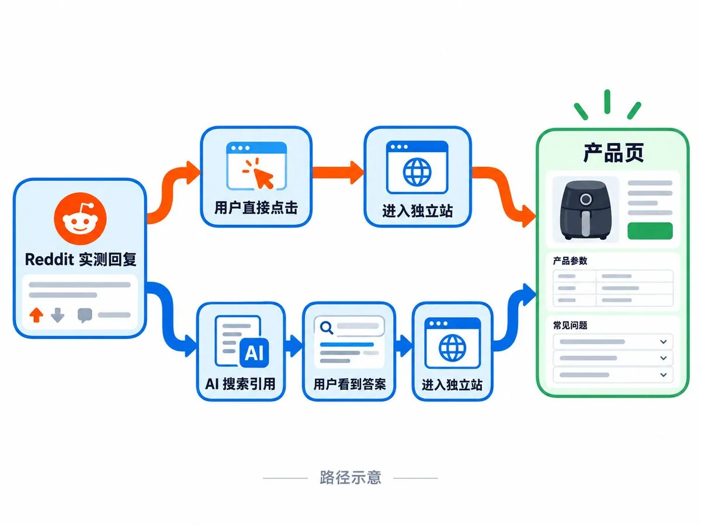
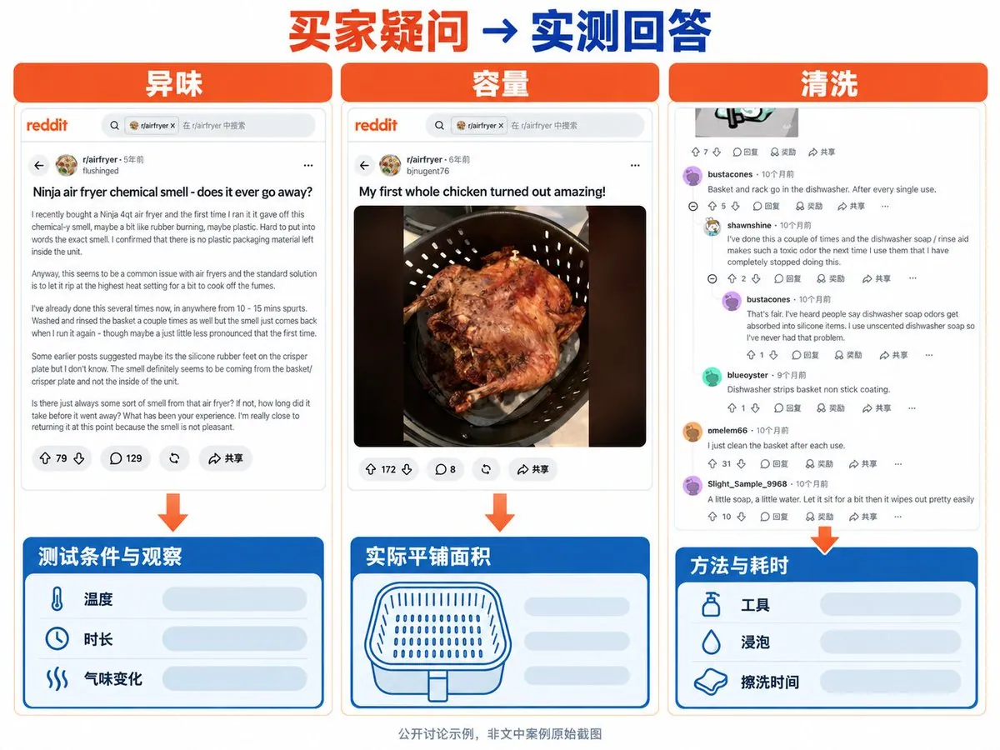
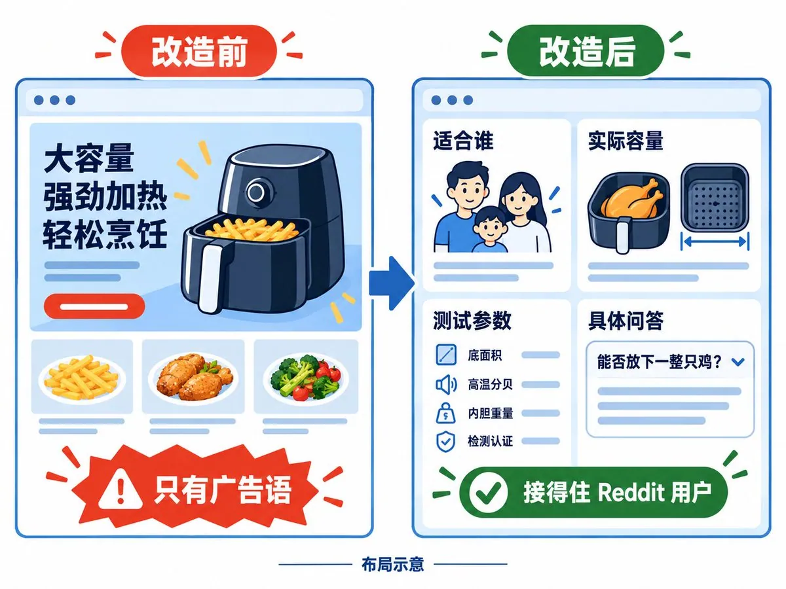
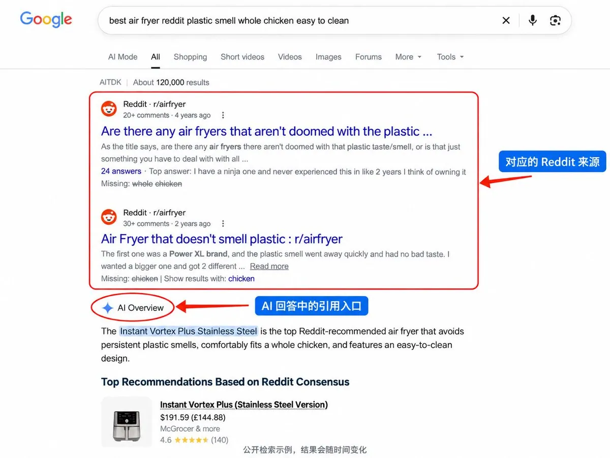

# 左海（@heizolshao）：一个空气炸锅独立站，怎么靠 Reddit 和 AI 搜索把日单从 30 做上 210

> 实战拆解空气炸锅垂直独立站通过 Reddit 社区原生内容种草与 GEO（生成式引擎优化）结合的增长闭环：通过在相关 subreddit 真实答疑、提供实用清洁与食谱指南植入软性引流，同时针对 ChatGPT / Perplexity 等 AI 搜索做结构化问答与产品对标卡位，将日常订单从 30 单飙升至 210 单。

<!-- more -->

一个主做出口空气炸锅独立站的朋友，前天跟我聊起 Reddit，他说，“以前总觉得这平台很神秘，进去不知道说什么，生怕被当成营销号封杀。后来跑顺了一条路子，发现只要找对讨论帖、把具体的实测数据放上去，订单自己就会顺着搜索找过来”。

他手头重点跟了三个 Reddit 版块，两个月里网站的自然流量翻了三倍多，日订单从早期的 30 多单冲到了将近 210 单。在平台后台查流量来源的时候，除了 Reddit 站内的直接跳转，剩下很大一部分来自 ChatGPT、Perplexity 和谷歌的 AI 概览。

据他说，这两年，海外用户的搜索习惯变了。大多数买家在挑空气炸锅之前，都会问 AI 的问题，而且问得非常专业，比如哪款高温没有塑料异味，哪款内胆能真正放下一整只烤鸡。

研究表明，AI 处理这类消费决策问题时，抓取 Reddit 帖子的比例超过四成，远高过各个品牌的官网。前段时间，Google 官方承认已经和 Reddit 合作，引入 Reddit 平台的数据。

所以论坛回帖里全是真实用户的吐槽、长期使用的涂层磨损和各种翻车记录。你在帖子里留下一条经得起推敲的实测参数，老外点赞的多了，AI 替别人做导购时也会把你的结论直接抽出来当成信息源。

被 AI 搜索引用一次，相当于机器每天都在替你做免费的精准推荐。

他摸出来的实操主要有四步。

第一步： 找准别人真正在纠结的地方。

他没有去泛娱乐的大版块碰运气，直接盯着几个垂直社区，比如三十多万人扎堆的 r/airfryer，专门讨论做饭的 r/Cooking，以及看重耐用程度的 r/BuyItForLife。

在站内用指令查过去三个月讨论最热闹的帖子，把评论数超过五十条的选购帖全过了一遍。

看多了就会发现，买空气炸锅的人争议最集中的就三件事。

1. 传统涂层高温下有没有塑料异味、会不会掉漆，陶瓷涂层到底行不行。
2. 容量虚标，有些机器标着五升，内胆却做成细长型，平铺四只鸡翅就满了，想多做一点只能叠放，中间必须不停翻面。
3. 网格炸篮到底好不好刷，洗洁精泡多久才能洗掉焦黑的油污。

第二步： 用 Claude 把回答做成“AI 爱抓”的格式。

他把手头的测试记录丢给 Claude，让模型按论坛的习惯整理成回复。

Prompt 如下：请你以一个普通用户的身份回复。第一句直接给明确结论，绝不寒暄客套。正文把气味、平铺面积和清洗耗时分成三块，每一块必须塞进具体的测试数字。顺便主动提一个机器的小缺点，比如炸篮净重稍沉。结尾留一句简短总结，把所有夸张的形容词全部剔除，只保留干巴巴的数据和感受。

比如遇到大家抱怨洗炸篮麻烦的帖子，他直接给了一组对比数据。传统网格篮用洗洁精泡过之后，拿钢丝球刷了八分钟。一体冲压的无缝陶瓷篮，用温水冲洗加海绵擦拭，实测耗时两分十秒。这种回复在论坛里很容易拿到高赞，帖子本身权重高，AI 爬虫过来抓取时也会优先识别。

第三步：独立站的产品页要接得住这批人。

从论坛摸过来的用户戒备心都很强，如果点进独立站看到的全是花哨的海报和广告词，顺手就会关掉页面， 从 SEO 上讲跳出率会很高。

他把产品页的结构彻底改了。页面最上方用六十个字以内直接讲明白这台机器适合谁，比如专为两到三人的小家庭设计，适合不想用特氟龙涂层、讨厌刷网篮的人。中间的小标题全换成买家高频搜的问句，比如能不能平放下一整只四磅的烤鸡。

页面底部加了 FAQ Schema（结构化问答），把炸篮底面积、四百度高温下的运转分贝、内胆重量和检测认证全列出来。

这样改过之后，进站用户的加购率翻了一倍，各类 AI 引擎提取产品参数也变得很容易。

第四步：每周盯着 AI 的引用来源。

他每周会在 Perplexity 和几个主流 AI 搜索里搜一些核心对比词，比如“空气炸锅 + Reddit + best/recommend”，看 AI 在推荐空气炸锅时引用了 Reddit 的哪些帖子。

在引用的热帖里如果已经有了他的回复，说明这个路子在持续起作用。要是看到 AI 引用了某个新冒出来的高讨论度帖子，自己还没在里面说过话，就立刻按照之前的标准，去楼下补一条客观的实测数据。

这种从社区和 AI 搜索导过来的用户，转化率通常比硬砸社交媒体买量广告高出两三倍。

而且这种方式的好处是，买量投放一停，进店人数立刻见底。但在社区里留下的一条客观回帖，几个月后不仅依然有自然搜索找过来，还会被各大 AI 引擎当成权威参考反复推荐。

最后，如果你也在做独立站，拿不准你的品类在 Reddit 上有没有被 AI 搜索引用的机会，可以在评论区留个品类名，我抽空帮你查一下最近的讨论热度。

另外我的个人主页还有好多运营 Reddit 平台的干货，进来看看吧：

1. 如果你需要了解，如何从 0 到 1 用 Reddit 10 分钟挖出海外真实需求与选品机会，可以查看这篇：

[https://x.com/heizolshao/status/2100578940054294911](https://x.com/heizolshao/status/2100578940054294911)

2. 如果你发帖全被秒删？或者想快速把 Reddit 账号的 CQS 提升起来。可以查看这篇：

[https://x.com/heizolshao/status/2100083029662367901](https://x.com/heizolshao/status/2100083029662367901)

3. 如果你看不懂 Reddit 标题的上的短语，可以查看这篇文章：

[https://x.com/heizolshao/status/2099470014193836210](https://x.com/heizolshao/status/2099470014193836210)

4. 如果你想看看我的近万 Karma 账号被封的经验，可以查看这篇文章：

[https://x.com/heizolshao/status/2099164807748575422](https://x.com/heizolshao/status/2099164807748575422)

5. 如果你想知道如何快速增长 Karma 值，可以查看这篇文章：

[https://x.com/heizolshao/status/2101454181685178415](https://x.com/heizolshao/status/2101454181685178415)

6. 如果你知道为什么你在 Reddit 自导自演推广产品，老外一眼就能看出来？，可以查看这篇文章：

## 相关页面

- [[sources/geektao-geo-google-and-chatgpt-traffic-step-by-step-guide]]
- [[sources/fanshifu-grok-bot-800-new-sites-monitoring-workflow]]
- [[concepts/gefei-seo-keywords]]
- [[concepts/b2c-conversion]]
