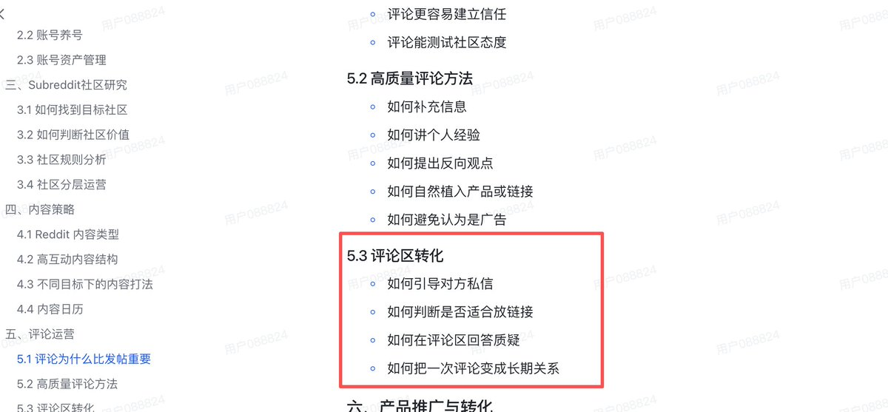

# 左海（@heizolshao）：Reddit 评论区转化实操笔记——从安全留链到沉淀种子用户

> 出海产品利用 Reddit 评论区冷启动的转化实操深度笔记：系统讲解如何在遵守 Subreddit 版规的前提下巧妙留下产品反向链接、如何把公域争鸣转化为私域 DM 沟通、以及如何将高意向讨论者筛选沉淀为第一批忠诚种子用户的落地策略。

<!-- more -->

在 r/SaaS 和 r/Entrepreneur 里逛久了，经常能看到两类很有意思的分享。一类是新手抱怨自己在评论区顺手贴了个产品链接，结果评论和主贴都被删了，账号还被版主永封；另一类是独立开发者晒数据，没有花一分钱广告费，靠每天花半小时在垂直版块深度回复别人的求助，一个月给独立站带来了上万次精准访问，甚至做出了前几十个付费用户。

最开始我也以为在 Reddit 做转化就是到处找地方发外链，后来连吃了几次被动删除才想明白，评论区真正值钱的是信任感。在 Reddit 发主贴，随时盯着版主的审核，容错率很低；但评论区只要内容写得扎实，不仅站内转化率很高，而且很多带高赞评论的热门帖子会被 Google 和 AI 搜索长期收录，一条好的回复往往能在一年后还在带来自然流量。

但要想在评论区把流量引到自己的产品上，光靠发链接是行不通的。这篇笔记是我自己平时做评论转化时摸索出来的四个环节。

## 一、 如何引导对方主动发私信

在很多社交平台上，大家习惯在评论区让别人“回复关键词领取资料”。但在 Reddit，如果搞这种机械式诱导，或者私下主动给陌生人发冷私信（Cold DM），大概率会被用户截图挂出来吐槽，甚至被系统判定为发垃圾信息直接 Shadowban。

我自己的原则是：永远不主动私信骚扰别人，只做被动吸引。

具体做法是，在公开评论区先给出大部分能直接解决问题的通用方案。如果其中某一步需要用到具体的自动化脚本、排查清单或者配置模板，我会在末尾提一句，由于不方便直接在版块里贴链接，如果对方懒得从头写，可以私信找我要。

我自己最常套用的三种情境：

说明遵守版规，不公开贴链接

如果目标版块严格禁止自我推广，而我自己手头刚好有写好的脚本或工具可以解决楼主的麻烦，我会在讲完核心思路后说明为了遵守版规不发外链，有需要可以私信我发给他。

常用英文表达：

“[先写出具体的解决思路]... For step 3, I actually built a lightweight [自动化脚本/配置模板/小工具] to automate this exact workflow so I wouldn’t have to do it manually every time. I don’t want to drop links here and violate the sub’s self-promo rules, but if you don’t feel like coding/setting it up from scratch, feel free to shoot me a DM and I’ll send the [Google Doc / repo / access link] over.”

分享未公开的内部自用排查清单

Reddit 用户对那种包装得很精致的营销电子书非常排斥，但对同行为了解决问题随手记下的实操笔记很感兴趣。比如在分享完经验后，顺口提一句自己在 Notion 里记录了一份内部排查清单，排版有点乱还没对外发布，如果有人需要可以私信发只读链接。

常用英文表达：

“Ran into this exact bottleneck about two months ago when scaling [具体业务场景]. Ended up documenting a rough troubleshooting checklist / swipe file in Notion for my own team. It’s a bit messy and not really formatted for the public yet, happy to share the view link via DM if anyone wants to copy it.”

针对复杂业务提出单独诊断

针对涉及代码排错、SEO 分析或者转化率优化的场景，把具体的错误日志或网址直接发在公开帖子里可能不太合适。我会建议对方如果有需要可以把具体细节私信发我，我帮他看一眼。

常用英文表达：

“Whether [方案 A] or [方案 B] works better here really depends on your current [具体技术栈/流量结构/数据规模]. Probably not wise to post your exact [报错日志/后台数据/网址] publicly on a thread, so if you want a second pair of eyes on it, just DM me the details and I’ll take a quick look.”

## 二、 如何判断在什么情况下可以放链接

很多人总在纠结“评论区到底能不能放链接”。我的经验是，答案不仅在版块的置顶规则里，更在当前帖子的讨论语境里。

有些版块虽然写了禁止推广，但只要楼主主动求推荐，合情合理的链接依然会被顶到前排；反之，哪怕版块没明文禁止，在别人严肃探讨问题的帖子里强塞链接，也一样会被点踩到折叠。

我平时判断发链的三种语境：

| 讨论语境 | 我的判断 | 我通常采用的做法 |
| --- | --- | --- |
| **楼主明确求推荐**，例如询问有无某类替代工具 | 适合直接放链接 | 先给免费或开源解法，再坦白声明自己的开发者身份并附上链接。 |
| **探讨通用方法论**，大家在聊具体业务流程 | 不放裸链 | 不带超链接，只提独特的产品品牌词，或者引导查看个人主页。 |
| **情绪吐槽或严肃新闻讨论**，没有具体工具诉求 | 坚决不提产品 | 只参与话题本身的讨论，不掺杂任何推广痕迹。 |

我放链接时的两个习惯：

1. 先讲免费方案，再大方声明身份

在 Reddit 装作路人推荐自己的产品是最容易翻车的。大家随手点开你的个人主页就能看到发帖历史，一旦发现你其实是开发者，所有的好感瞬间归零。

我的做法是在第一段先教对方怎么用免费工具或代码手动解决；第二段坦白说明“利益相关，我自己做了一个小工具，当初也是因为手动处理太麻烦才写的”；最后补一句“如果你目前数据量不大，直接用上面说的免费方法就够了”。把选择权留给对方，反响往往最好。

常用英文表达：

“If you just need a quick fix without paying for anything, you can actually stitch together [免费大牌工具 A] and [开源方案 B] using a simple webhook. Here is how the logic works: [简述核心逻辑]. That said, maintaining that setup gets annoying once you pass [某个痛点阈值]. Full disclosure: I’m the creator of [产品名带超链接], which I built specifically because I got tired of fixing that exact broken webhook. If your volume is still small, definitely stick to the manual method above. Hope that helps!”

2. 在严格版块只留独特品牌词
   在那些 AutoMod 逢链必删的严管版块，我坚决不发任何 http 链接，只打出自己的产品品牌词，或者说明在个人主页有详细配置。只要品牌词足够独特，在 Google 能直接搜到，真正需要的人自然会去搜索。

常用英文表达：

“We switched from [某大牌竞品] to a lightweight tool called [你的产品独特品牌词] (you can just Google it, not dropping links here so I don’t trip the spam filter)...”

## 三、 在评论区遇到质疑时，我是怎么处理的

只要在 Reddit 上多发几次评论，几乎不可避免会遇到挑刺。我最常碰到的三种质疑：

1. 技术鄙视：“这不就是个包装了一下的大模型套壳吗？我用 Python 几天就能做出来。”
2. 价格挑刺：“有免费的开源方案不用，为什么一个月要花几十刀用你的？”
3. 质疑动机：“翻了一下你的发帖历史，你这就是在打软广吧？”

刚开始我也很容易急眼，总想在评论区跟对方争个高下，结果往往吵成一团，两人都被大家点踩。后来我发现，在公开评论区较劲没有任何意义。真正有价值的，是顺着帖子看下来的那些潜在用户。

我的处理原则很简单：先承认对方的合理性，再说明我的产品到底是为了解决谁的问题。

应对技术鄙视与免费方案挑刺

遇到别人说用免费脚本就能搞定，我一般直接赞同他。如果一个人本身懂代码、需求又很简单，本来就没必要买我的工具。但我会指出，对于不写代码的人，或者在面对批量处理、容错和稳定性要求较高的商业场景时，花点小钱能省下大量调试环境的时间。

常用英文表达：

“You’re 100% spot on. If someone already knows how to configure [某技术/开源库] and only needs to process [基础场景]，they should definitely just use [对方提到的免费方案], paying for a tool like mine would be overkill. Where that usually breaks down is when [非技术人群/高频商业场景] tries to handle [你的核心差异化痛点] without spending 10 hours debugging dependencies. I built this specifically for folks who’d rather pay the price of two coffees to skip the maintenance headache. Different tools for different stages!”

应对查成分和推广质疑

有人顺着主页翻出发言记录质问我时，我通常大大方方承认，顺便说明自己在行业里干了几年，所以看到相关问题总想参与讨论。同时提醒对方，哪怕完全不考虑我的工具，我上面写出的前两条解决思路也是客观有效的。

常用英文表达：

“Haha fair callout! Yeah, I’m the solo dev behind it (should have made that clearer in my first line, my bad, just edited it in). I hang out in this sub a lot because I’ve been working in [你的行业领域] for [X] years, so whenever I see threads about [具体痛点], I jump in. Totally get the skepticism though, even if you ignore my tool completely, the first two points I mentioned above about [干货点] should still solve your immediate issue.”

如果给出诚恳回复后对方依然无理纠缠，最好的做法是直接停止回复。只要你表现得客观克制，社区里的其他路人自然会去点踩那些恶意攻击的人。

## 四、 如何把一次评论交流延伸成长期联系

Reddit 是一个按版块聚集的匿名论坛，几乎没有人会专门去关注某个具体的人。单靠一条评论很难直接留住一个人，我平时主要通过三个习惯把零散的交流延续下去。

几天后回头跟进一次（Follow-up）

在评论区给某个遇到麻烦的楼主提供了详细解决方案后，我会顺手记下帖子的链接。等过了三到五天，回到原帖下再问一句：“之前那个配置后来搞定了吗，还有没有遇到其他报错？”

在匿名社区里，有人隔了几天还专程回来关心问题有没有解决，这种体验往往超出对方预期。无论对方回答解决了还是又卡在下一步，彼此的信任感都已经建立起来了。这时候如果顺带提一句自己有个讨论这个工作流的小社群，对方通常很愿意加入。

常用英文表达：

“Hey u/[对方用户名], just circling back on this thread, did that [你之前建议的方法/配置] end up fixing the [具体问题] for you, or did you run into any other roadblocks?”

在少数几个垂直版块长期活跃

我一般不会满论坛乱跑，而是固定在两三个与自己产品高度相关的中小版块里活跃（周活跃一万到几万人左右最佳）。

一是给自己挂上版块允许的专业身份头衔（User Flair），注明自己的专业领域；

二是经常去浏览 Rising（上升期）的新帖，在讨论刚展开时给出高质量的见解。

当社区里的熟面孔多次在不同帖子里看到你的专业回复，大家对你的印象就会从陌生推销者变成一个靠谱的行业同行。

在私信交付时顺带留下后续入口

当别人通过私信向我索取脚本、文档或测试链接时，我尽量不用容易过期的临时网盘，而是放在一个干净的 Notion 页面或者独立站的专属页面上。

在页面末尾附上一句平实的说明：“平时如果看到常见问题或者更新了新的脚本，我会整理到邮件或交流群里，如果想看后续更新可以留个邮箱。”

通过把干货讲透、坦诚沟通身份、事后跟进进展，评论就不再是一次性的机械回复，而成了真正帮我结识第一批海外种子用户的渠道。

## 相关页面

- [[sources/heizolshao-why-reddit-commenting-is-more-important-than-posting]]
- [[sources/heizolshao-reddit-tiered-community-operations-playbook]]
- [[concepts/b2c-conversion]]
- [[concepts/gefei-seo-keywords]]
