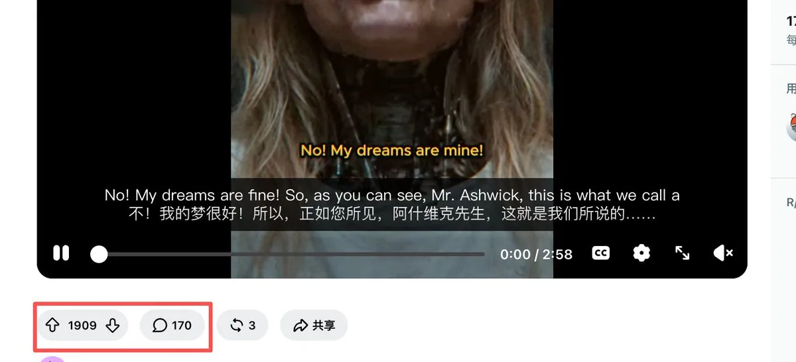
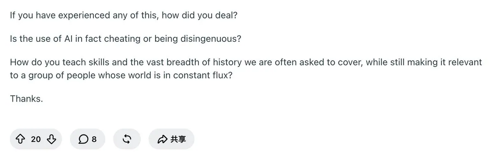
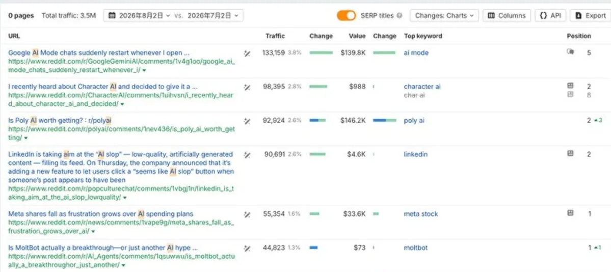

# 左海（@heizolshao）：Reddit 挖掘需求实操案例——如何找到低竞争、高搜索量的蓝海需求？

> 如何从 Reddit 挖掘真正能落地的出海产品机会？破除社区高赞等于真实需求的误区，提出「社区低互动 + Google 高 SEO 流量」的交叉蓝海标准；详解 Ahrefs 筛 Reddit Top Pages、SERP 反向挖掘、GEO 引用监控、挖掘新涨帖四条实操路径，以及商业意图打分与需求跟踪表落地流程。

<!-- more -->

很多人在 Reddit 上刷到高互动的帖子，就觉得“需求很大”，结果做成产品后发现外面几乎没人搜，流量起不来。问题出在哪？

Reddit 上的 upvote 和 comments 只是社区内部热度，不等于外部有稳定的搜索需求。真正可落地的需求，藏在那些社区讨论少、但外部搜索量已经被 Google 验证的交叉点上。

本文分享一套可复现的蓝海挖掘方法，帮你从 Reddit 中找到低竞争、高搜索量的产品机会（功能点、工具页、对比页、解决方案等）。

文末还有关于 Reddit 的挖需求实操指南可以领取。

一、什么是真正的低竞争、高搜索到 Reddit 需求帖

这里需求帖的核心定义：

- 这个帖子本身的 SEO 流量高（用 Ahrefs 看月自然流量）
- 然后 Reddit 帖子的 vote 少 + comments 少（最好 comments 在两位数以下，竞争低）

对比案例：

- 反面例子：某个 “best AI video” 帖子，vote 1900、comments 170。竞争极卷，你发进去只是 170 条评论中的一条，很难被其他用户看到。

- 正面例子：某个 history teachers 相关 AI 工具帖，仅 20 votes、8 comments，但 Ahrefs 显示美区每月约 12k SEO 流量。社区竞争小，外部需求却真实存在。

低互动说明在 Reddit 上容易参与，高 SEO 流量说明外部真实有人在搜。两者交叉，就是低竞争、高搜索量的产品机会。

二、四条实操挖掘路径

1. Ahrefs 筛 Reddit Top Pages（最高效，优先做）

这是最直接的方法。

操作步骤：

1. 打开 Ahrefs → Site Explorer
2. 输入 reddit.com
3. 进入 Top Pages
4. 筛选目标国家（建议先选美国）
5. 在标题或关键词中筛选你的品类词（如 AI、video、tool 等）
6. 按 Organic Traffic 从高到低排序
7. 人工筛选：comments 在两位数以下、但流量较高的帖子

找到候选帖后，把完整 URL 再丢进 Site Explorer，单独看它的流量、排名关键词和趋势。

可以配合 AI 批量导出后匹配你的业务场景，效率更高。

2. SERP 反向挖掘

做关键词研究时，多留意一件事：哪些关键词的 SERP 前排经常出现 Reddit 帖子。

能长期排在前面的 Reddit 帖，说明这个需求有持续的自然搜索流量，而不是短暂热度。把这些帖子记录下来，优先挑性价比高的这类帖子去验证。

什么意思呢？“借 Google 的刀，帮你挑出那些被全网验证过的真实长尾刚需，然后去白嫖 Google 送给 Reddit 的源源不断的长线流量。”

3. GEO / AI 引用监控

用 GEO 工具（市面上很多，大家自行辨别）监控竞品被 AI 引用的 Reddit 信源。引用次数高的帖子，通常说明内容价值被 AI 认可。

也可以直接搜索 site:reddit.com “品牌名”，看竞品最近在哪些帖子里出现，再判断这些帖子是否蓝海。

4. 找“正在上涨”的帖子

Ahrefs 的 Top Pages 只是当前结果，真正的新机会往往在还在增长的帖子里：

- 最近 30/60/90 天开始获得排名的 Reddit URL
- 关键词数量持续增长的页面

老帖可能排名已经锁死，新机会通常来自还在上涨中的帖子。操作难度更高，但更蓝海。

三、从帖子到可执行产品机会的判断标准

找到帖子后，不要急着做，先过一遍筛选：

1. 商业意图
   优先选择强商业意图的帖子：

- best / alternatives / vs / review
- how to solve xxx

弱商业意图（纯分享、what AI tool changed your life）价值较低，可以先放一边。

2. 与你的产品相关度
   这个讨论能不能变成你的功能、页面或解决方案？是否符合你的产品定位和边界？

3. 搜索意图匹配

- 用户想直接用工具 → 做工具页
- 想比较产品 → 做对比页 / 榜单页 / alternatives 页
- 想学方法 → 做教程页

4. 可落地程度
   能快速做成 MVP、工具页或对比页的优先。大而空的话题先放后面。

四、落地示例流程

假设你通过 Ahrefs Top Pages 找到一个蓝海帖：

1. 记录基础数据：帖子链接、votes、comments、Ahrefs 流量
2. 提取核心关键词，查搜索量和 SERP
3. 判断商业意图（是 best、how to，还是纯分享）
4. 评估与你的产品相关度
5. 决定落地形式（工具页、对比页、功能点或内容）
6. 放入需求跟踪表，标记优先级

简单需求跟踪表建议字段：

| 帖子链接 | 互动数据（votes / comments） | Ahrefs 月流量 | 核心关键词 | 商业意图 | 建议动作 | 优先级 | 状态 |
| --- | --- | --- | --- | --- | --- | --- | --- |
| | | | | | | | |
| | | | | | | | |

五、注意事项

- 不要只看流量，忽略意图和相关度。有流量但无转化的帖子价值有限。
- 优先关注还在上涨中的帖子，老帖排名可能已锁死。
- Reddit 内容可以反哺你的 SEO 和 GEO，但避免硬广。
- 没有 Ahrefs 时，可以用关键词工具 + 手动看 SERP 做替代验证，效果会打折但也能用。
- 蓝海会变化，建议每周或每两周复盘一次。

下一步行动建议

1. 选一个你关心的品类，用 Ahrefs 跑一遍 Reddit Top Pages。
2. 建一个简单的蓝海帖跟踪表（Notion、飞书或 Google Sheet 都可以）。
3. 优先从“低互动 + 高 SEO 流量 + 强商业意图”的帖子开始动手。
4. 验证通过后，快速做成页面或功能，而不是停留在记录阶段。

真正的蓝海机会，不在热门帖的热闹里，而在那些社区讨论少、但外部搜索量已经被 Google 验证的交叉点上。用这套方法系统挖掘，你就能更稳定地找到低竞争、高搜索量的可执行产品机会。

七、最后

我把这篇文章里的方法整理成了两份资料：

- 蓝海帖需求跟踪表模板（含字段说明 + 示例）
- 高 SEO + 低互动 Reddit 帖子样本清单（已脱敏）

## 相关页面

- [[sources/heizolshao-reddit-traffic-intercept-100m-site]]
- [[sources/fantuantalk-5-tools-finding-real-needs]]
- [[sources/victor-uwer-tool-site-vertical-niche-for-profession-strategy]]
- [[concepts/indie-product]]
