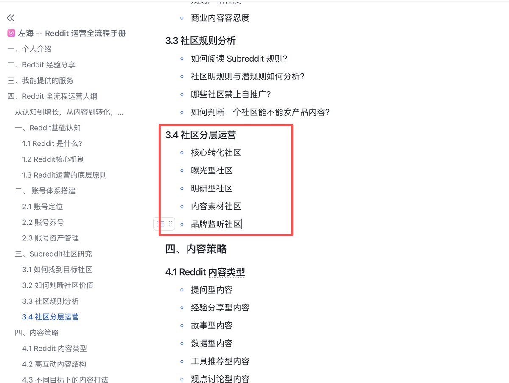

# 左海（@heizolshao）：Reddit 社区分层精细化运营实战指南

> 出海开发者玩转海外最大论坛 Reddit 的分层运营实战手册：将目标 Subreddit 划分为泛流量池、精准行业池与高转化交易池三层架构；详解各层级的内容发布规范、Karma 信用值安全积累、规避版主（Mod）秒删封号的软性植入心法与长效引流路径。

<!-- more -->

我刚开始做海外出海、推广自己的独立开发软件时，犯过一个特别典型的错误，就是抓着几个几十万人的大版块胡乱发帖。看到哪个板块人多就去哪发，结果两个星期下来，大号小号连着被封，一个付费用户都没搞到。

后来多挨了几次管理员的毒打我才想通，Reddit 上的社区根本不能混为一谈。有人大半夜逛 Reddit 是纯看乐子打发时间的，有人是跑来抱团吐槽大厂软件难用的，还有一部分人是真正遇到了工作卡点，揣着预算在帖子里到处问有没有现成的工具能解决问题。你拿着同一套推销话术到处溜达，就等于在别人看电影的影院里硬塞传单，管理员不封你封谁。

精细化分层运营的真正目的，就是根据老外当下的心理状态，把你的精力和动作切成五个不同的层次。我平时主要做独立开发和轻量软件出海，下面我用自己的真实操盘经历为主，把这五个层级怎么找、怎么搜、怎么回帖讲透。如果你是做跨境电商或者实体卖货的朋友，我也把电商对应的阵地和选版逻辑同步列了出来，大家对照着看就能直接对号入座。

## 一、核心转化社区有哪些？如何运营？

1. 这个层级的核心逻辑与真实价值

这个层级的用户是离付费和转化最近的一群人。他们不是来闲聊的，而是工作流程卡住了，或者现有的大牌软件太贵太难用，他们正急切地在帖子里发帖求推荐。这类帖子的阅读量可能只有几百，但回帖的人每一个都是高意向的潜在客户。

2. 目标阵地选择

不同业务主体的阵地差异非常大，找准自己的垂直圈子是第一步。

- 独立开发与软件工具阵地

小微软件圈：r/microsaas、r/SaaS、r/SideProject、r/smallbusiness

垂直效率圈：r/productivity、r/macapps、r/webdev

- 跨境电商与实体产品对照阵地

品质好物圈：r/BuyItForLife（寻找耐用不过时好物的重度消费人群）

消费决策圈：r/shutupandtakemymoney、r/frugal（高性价比替代品讨论区）

垂直品类圈：比如做咖啡器具去 r/Coffee，做户外装备去 r/camping，做客制化键盘去 r/MechanicalKeyboards

3. 我平时抓取高意向帖子的搜索指令

不要每天在版块列表里漫无目的地手动刷新。我习惯直接在浏览器里用 Google 高级搜索组合语法，精准抓取这几天正在求推荐的帖子。

- 搜具体工具需求

site:reddit.com inurl:r/microsaas OR inurl:r/SaaS “looking for a tool that” -inurl:comments/tags

这条指令会过滤掉标签页，直接把标题或正文带有“正在找某某工具”的讨论帖挑出来。

- 搜竞品平替诉求

site:reddit.com (inurl:r/macapps OR inurl:r/productivity) (“alternative to [竞品名]” OR “switch from [竞品名]”)

直接把对现有头部产品不满、正在寻找替代品的用户揪出来。

- 搜电商买家求推荐（电商可用）

site:reddit.com (inurl:r/BuyItForLife OR inurl:r/Coffee) “recommend a good” OR “best option under” after:2026-01-01

针对具体品类，直接定位带着明确预算找推荐的真实买家。

4. 我的原生英文回复技巧与模板

在核心转化区回帖，最忌讳的就是第一句话就甩官网链接。老外对软广非常敏感，而且大部分社区的自动审核机器人只要看到新账号发外链，基本都是秒删。

我的标准回帖分为三步走。第一步先承认这个痛点确实很恶心我也遇到过，第二步给出两点完全不需要花钱购买任何工具也能解决的手动排查步骤，第三步再顺水推舟提一句我做的小工具就是为了对付这个麻烦的，如果想试试可以私信我或者自己搜搜看。

英文原生回复模板参考：

Hit this exact bottleneck a while back. The manual workaround usually boils down to:

1. [具体排查步骤 1]
2. [具体解决细节 2]
   If you’re doing this repeatedly and don’t want to script it yourself, I actually built [产品名] to handle this specific edge case. Drop me a DM if you run into any setup hiccups or want to test it out.

这套回复在提供纯干货的同时自然带出产品，既帮提问者解决了燃眉之急，又不会被板块里的巡查员判定为垃圾广告。

5. 我用封号换来的实操边界

- 严格控制发帖频率：一个账号每天在转化帖里回复不要超过两到三次，每次回复之间至少隔开一个半小时，千万别顺着搜索结果半小时连回十几条。
- 绝不发带参短链：回帖里严禁放 bit.ly 这种短链接，也别带一长串 UTM 推广追踪参数。只留产品纯文本名字，或者告诉对方在个人主页有链接。真正有需求的人会自己去 Google 搜你的名字。
- 遇删立停：新账号如果在这些板块被自动审核删了帖子，当天立刻停手，老老实实回日常板块做正常交流，别赌气换小号重复发。

## 二、曝光型社区有哪些？如何运营？

1. 这个层级的核心逻辑与真实价值

这个层级的社区关注人数都在百万甚至几百万级别。来这里的人不是为了当场掏钱买东西的，他们想看的是真实创业故事、避坑经历、硬核技术复盘或者是惊艳的产品展示。

做曝光型社区的目的，是为你的产品建立知名度和声誉。一个高质量的高赞帖子，能帮你带来成千上万的自然浏览量，顺便为个人主页和品牌积累高权重的自然背书。

2. 目标阵地选择

- 独立开发与软件工具阵地

创投生态圈：r/entrepreneur、r/startups

技术极客圈：r/technology、r/webdev、r/SocialMediaMarketing

- 跨境电商与实体产品对照阵地

好物围观圈：r/gadgets（高科技新奇小玩样）

视觉展示圈：r/oddlysatisfying（用视觉治愈的生产过程或开箱展示产品做工细节）

奇特见闻圈：r/interestingasfuck（展示极具巧思的产品设计细节）

3. 我挖掘爆款选题的搜索指令

写复盘长帖千万别闭门造车，先去看看这些大版块里历史排名前列的高赞帖子长什么样，学习他们的话题切入角度。

- 抓取高赞复盘结构

site:reddit.com/r/entrepreneur “lessons learned” (“$0 to” OR “MRR”) (score:>100)

看看那些拿到上百个赞的创始人都是怎么聊收入和经验教训的。

- 挖掘大家爱看的踩坑教训

site:reddit.com/r/startups “mistake” OR “failed” (“after launch” OR “first 100”)

老外对成功学吹嘘很反感，但对真实的失败复盘特别买账。

4. 我的复盘帖发帖框架

在 Reddit 发曝光帖，最好用的结构是经验复盘框架。标题直接亮出你取得的具体成果和踩过的蠢坑，正文先交代起点情况，列出三条差点让项目暴毙的真实错误，最后分享到底哪两套动作真正带来了改变。

英文发帖结构参考：

Title: How I reached [具体结果/里程碑] in [时间周期] without paid ads (and 3 stupid mistakes that almost tanked it)

Body:

“Hey all, quick breakdown of what worked and what completely failed over the last [时间周期].

The Context: Started with [起点状态/资源情况].

The 3 Mistakes:

1. [具体坑点与实际损失]
2. [走了哪些弯路]
3. [当时认知上的错误]
   What Actually Moved the Needle:
   - [策略 A 细节与具体指标]
   - [策略 B 细节与具体指标]
   Happy to answer questions in the comments about the tech stack, funnel, or numbers.”

5. 我用封号换来的实操边界

- 主帖零外链法则：正文里绝对不要塞购买链接或者官网主页，连链接的影子都不要有。只有当帖子火了之后，评论区有人主动发问你的工具叫什么名字，你再以开发者的第一人称在子评论里回复纯文本。
- 严禁小号刷赞顶贴：Reddit 对刷赞行为（Vote Manipulation）的查处严厉到了极点。千万别在同一台电脑或者同个 Wi-Fi 下拿小号去给主号点赞，系统一旦抓到，整套设备指纹关联的所有账号直接全封。这种深度复盘帖两到三周发一次就足够了。

## 三、明研型社区有哪些？如何运营？

1. 这个层级的核心逻辑与真实价值

很多朋友经常提到的明研型社区，在日常运营里通常指的就是深度调研与行业深研型社区。这类社区是专业行家、老鸟架构师以及资深从业者聚集的地方，版规严格到近乎苛刻，任何推销意图哪怕藏得再深，都会被老手一眼识破并立刻举报封禁。

但这类社区对于做产品的人来说简直是金矿。如果你不知道老外在实际工作中到底被什么问题折磨、不知道落地页文案该怎么写才地道，你就必须潜伏进这些社区。

2. 目标阵地选择

- 独立开发与软件工具阵地

高阶营销圈：r/DigitalMarketing、r/GrowthHacking、r/SEO

前沿技术圈：r/nextjs、r/reactjs、r/selfhosted

- 跨境电商与实体产品对照阵地

跨境同行圈：r/ecommerce、r/FulfillmentByAmazon、r/dropship（观察同行在供应链、FBA 仓储、物流报关上遇到的深层坑点）

买家极客圈：特定品类的专业论坛，比如摄影器材的 r/photography，了解专业用户对产品细节的吹毛求疵。

3. 我挖掘深层痛点的搜索指令

- 搜竞品深层吐槽与退坑理由

site:reddit.com/r/DigitalMarketing “[竞品名]” (“hate” OR “nightmare” OR “broken” OR “cancel”)

通过负面词直接把竞品让用户抓狂的底层缺陷扒出来，这就是你做产品差异化的切入点。

- 搜行业高阶流程卡点

site:reddit.com (inurl:r/SEO OR inurl:r/GrowthHacking) “what is your biggest bottleneck” OR “most annoying part of”

看行业从业者目前最头疼的日常流程到底卡在哪个环节。

4. 我的同行求教互动模板

在这个版块里，你唯一的角色就是虚心求教的同行或者行业观察者，带着具体的工作流疑惑去发起探讨。

英文求教模板参考：

Title: Quick sanity check on [特定工作流/技术选型]: how are you currently handling [具体技术/业务卡点]?

Body:

“Running into some edge cases with [具体工作流]. Currently evaluating whether to stick with [通用做法 A] or shift towards [做法 B].

For folks managing this at scale:

- What does your daily handoff look like?
- Where is the biggest latency/friction point right now?
Appreciate any insights or real-world takeaways.”

5. 我用封号换来的实操边界

- 全程彻底去商业化：发帖和回帖里一个字的产品名都不要提，不要试图在这个板块诱导任何点击。
- 把行家黑话抄进文案库：我平时在这个板块最大的产出，是准备一个在线文档，把老外在回帖里用的生动动词、比喻短语和行业黑话随手记下来。国内很多出海团队写的英文官网看着干瘪生硬，把这些行家在帖子里骂街用的真实词汇用到落地页上，海外转化率会明显不一样。

## 四、内容素材社区有哪些？如何运营？

1. 这个层级的核心逻辑与真实价值

这类社区属于 Reddit 的大广场，充斥着全网最原汁原味的民间情绪、生活吐槽和段子流行语。这里不是你推广产品的战场，而是你做全渠道营销的内容弹药库。

在这里泡着，能帮你摸清海外普通老百姓现在普遍在为哪些事情焦虑、他们用什么样的幽默感解嘲，然后把这些素材加工成推特长帖、短视频脚本或者邮件周刊。

2. 目标阵地选择

- 独立开发与软件工具阵地

全网问答大池子：r/AskReddit、r/NoStupidQuestions

生活抓狂吐槽区：r/mildlyinfuriating

远程办公圈：r/freelance、r/remotework

- 跨境电商与实体产品对照阵地

网购翻车现场：r/ExpectationVsReality（买家实物对比图，大量电商选品避坑素材）

反人类包装与做工：r/mildlyinfuriating（包装难拆、产品反人类反直觉设计的真实咆哮）

3. 我抓取网络情绪与高频焦虑的搜索指令

- 抓自由职业群体的集体抓狂点

site:reddit.com/r/freelance “client from hell” OR “waste of time” (top:month OR top:year)

看看自由职业者最恨客户的哪些行为，用来写针对自由职业者效率工具的走心文案。

- 抓全网离不开的神器讨论

site:reddit.com/r/AskReddit “what is a tool” OR “what software” (“can’t live without” OR “worth every penny”)

看看大众心目中值得掏钱的工具都具备哪些特质。

4. 我的素材加工与反哺技巧

看到特别火的现象讨论帖，可以顺着大家的困惑，从专业视角做一段高质量拆解。但更划算的做法，是直接提取帖子里大家吵得最凶的观点，拿去 X 平台或者 LinkedIn 当作长帖讨论的选题切入点。

英文互动反哺思路参考：

“Saw this thread blow up about [痛点现象]. Most people complain about [表象问题], but having dealt with this firsthand, the real blocker is actually [底层认知偏差]. Here is how I restructured my stack to bypass it completely: [分点拆解]...”

5. 我用封号换来的实操边界

- 当好一个安静的观察者：千万级用户的泛话题大社区，自动审核规则极其灵敏。新账号千万别在这些大版块发带产品倾向的内容，被大版块永封往往会连带影响整个账号的全局信誉评级。
- 纯输入为主：不要执着于在这些板块建立影响力，把心思放在收集老外真实的生活语料上就足够了。

## 五、品牌监听社区有哪些？如何运营？

1. 这个层级的核心逻辑与真实价值

这个层级是整个运营体系里的防火墙与截流网。当有人在 Reddit 上夸你或者骂你时，你必须第一时间知道并出面处理。当竞争对手的产品宕机、大幅涨价或者搞出负面公关事件时，这也是你最顺理成章承接失望用户的窗口。

2. 目标阵地选择

品牌监听不局限在某个单一板块，它是覆盖全站的动态防御网。包括全站的实时讨论流、竞品名字命名的专属板块，以及各大科技博主发起的综合产品横向对比帖。

3. 我平时使用的全网监控指令

- 自研品牌全网声量监控

site:reddit.com “[品牌名]” -inurl:user/ -inurl:comments/tags

排除掉个人主页和杂乱页面，直接找出全站所有提到你名字的自然帖子。

- 竞品提价与故障截流监控

site:reddit.com (“[竞品 A]” OR “[竞品 B]”) (“switching to” OR “better than” OR “pricing increase” OR “down again”)

只要竞品涨价或者服务器崩了，立刻就能第一时间捕捉到大家的换迁需求。

4. 我的中立横评截流话术

面对竞品的吐槽贴，千万不要跳出来直接大骂竞品垃圾并狂推自己的产品，这种做法在 Reddit 上会被全场狂踩并被管理员直接删帖。

最聪明的姿态是以客观专家的身份做横向横评。先肯定对方的抱怨确实很合理，接着中立列出目前市面上主流的三种方案各自的优劣势，把自己的产品作为轻量解法顺带放进去，把决定权完全留给用户。

英文中立介入模板参考：

Fair points on the recent price hike. If you’re looking around for alternatives, here’s a quick breakdown of the common options right now:

- [第三方竞品 C]: Solid if you need enterprise SSO, but quite heavy.
- [第三方竞品 D]: Cheap, but API limits are pretty tight.
- [自研产品名]: Lightweight, focus is purely on [核心功能], no lock-in.
Depends on whether you actually need [特定功能] or just want something straightforward.

5. 我用封号换来的实操边界

- 客诉与截流的时间差把控：如果是自家品牌的客诉贴，尽量在半小时内迅速以官方或者开发者身份介入，态度诚恳地提供技术排查。但如果是竞品的吐槽帖，千万不要在前十分钟秒冲进去，先等帖子发酵两三个小时，其他受害者都在下面跟帖抱团之后，你再以冷静中立的横评者姿态参与。
- 严禁小号双簧：绝对不要安排两个小号在竞品吐槽帖里一问一答演双簧，这种行为一旦被其他用户识破顺手举报，不仅账号全封，还会给你的品牌贴上信誉扫地的终身标签。

## 社区五层精细化运营对照表

| 社区层级 | 核心目标 | 推荐阵地（独立开发主视角） | 电商与实体对照阵地 | 交互频次与触发动作 | 关键防封边界 |
| --- | --- | --- | --- | --- | --- |
| **核心转化** | 获取精准线索与付费转化 | `r/microsaas`、`r/SaaS`、`r/productivity` | `r/BuyItForLife`、`r/frugal`、垂直品类吧 | 每日指令检索、单日回复 2 到 3 条 | 严禁带参短链、仅留纯文本产品名、间隔需大于 90 分钟 |
| **曝光驱动** | 建立声量与个人品牌背书 | `r/entrepreneur`、`r/startups`、`r/webdev` | `r/gadgets`、`r/oddlysatisfying`、`r/interestingasfuck` | 每 2 到 3 周发布 1 篇深度实操复盘 | 主帖正文零外链、仅在评论区被动解答、严禁小号刷赞 |
| **明研调研** | 验证真伪需求与校对文案 | `r/DigitalMarketing`、`r/SEO`、`r/GrowthHacking` | `r/ecommerce`、`r/FulfillmentByAmazon`、极客买家圈 | 每周搜集竞品吐槽、虚心向同行发起探讨 | 纯行家身份交流、严禁出现商业露头、专注记录真实语料 |
| **内容素材** | 汲取民间情绪与选题灵感 | `r/AskReddit`、`r/freelance`、`r/remotework` | `r/ExpectationVsReality`、`r/mildlyinfuriating` | 每周定期翻看高赞问答、顺带参与日常交流 | 纯输入为主、不做任何产品夹带、把语料沉淀到外网选题 |
| **品牌监听** | 负面舆情防御与竞品截流 | 全站动态覆盖、竞品专属讨论区 | 全站品牌词监控、品类大牌维权帖 | 预警触发后介入、竞品帖等发酵后再进 | 客观中立横评格式、严禁恶意拉踩与小号双簧 |

## 马上能上手的三个落地动作

1. 把五组搜索指令存进浏览器书签：不需要买昂贵的海外监控软件，把我上面整理的 Google 高级搜索指令换上你自己的品类词和竞品词，存成五个书签夹，每天上班花十五分钟按顺序点开巡查一遍。
2. 账号角色专职专用：主账号只用来做核心转化里的真诚互动和曝光社区里的深度复盘，日常逛深研社区和素材大广场时用无品牌关联的日常小号浏览，避免主账号被意外牵连。
3. 建立自己的海外原生语料库：在 Notion 或者本地文档里建一张表格，把老外在深研社区骂竞品时用的地道英文短语、比喻词摘抄进去，等你下次改版产品落地页时直接拿出来用，转化率会发生肉眼可见的变化。

## 相关页面

- [[sources/heizolshao-air-fryer-site-reddit-and-ai-search-growth]]
- [[sources/xaiwind-telegram-from-beginner-to-master-developer-guide]]
- [[concepts/b2c-conversion]]
- [[concepts/selfmedia-compound-model]]
