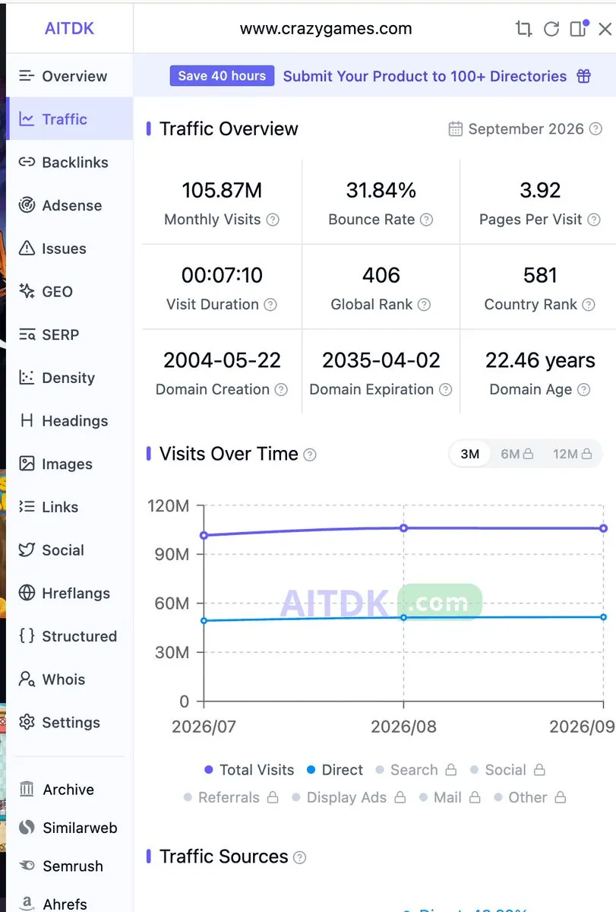

# 左海（@heizolshao）：月访 1.05 亿老牌站还在 Reddit 导流——垂直社区截流真实痛点实操

> 分析月访破 1.05 亿、全球排 406 名的 22 年老牌游戏站点仍高频通过 Reddit 导流的底层逻辑。揭示大厂看重垂直社区免费、高精准流量的现实，提炼普通独立开发者出海切入法：盯死 1 个细分 Subreddit，挖掘大厂嫌肉少、用户天天吐槽的 2-3 个真实痛点，以轻量级小工具完成精准截流与商业闭环。

<!-- more -->

卧槽，刚刚用昨天文章里讲的 Reddit 挖需求方法，顺手查了一个老牌游戏站的数据，直接看傻了：

月访问量破 1.05 亿、全球排 406 名、建站 22 年的老牌怪兽站，居然还在天天在 Reddit 上导流！（图）

很多做跨境独立站、工具开发者、打新词的兄弟总觉得：“Reddit 那点流量，做冷启动还行，大公司根本看不上。”

现在你们知道错得离谱了吧。现实是：越是年入千万的巨头，越比你懂得从社区捞免费、精准的高客单流量。

我想跟大家聊这对我们普通人有什么启发，“大佬们再做全品类，而我们只要盯死 1 个极其垂直的 Subreddit。然后找出大厂嫌肉少不愿做，用户天天吐槽的 2~3 个具体痛点，用一个小产品直接截流，闭环路线就通了。”

昨天那篇讲《如何挖掘低竞争、高搜索量需求》的实操长文还没看过的，建议大家在看看，然后配合这套逻辑看就彻底明白怎么赚钱了吧。

https://x.com/heizolshao/status/2116854372885991722

https://x.com/i/article/2116836481532628992

## 相关页面

- [[sources/fantuantalk-5-tools-finding-real-needs]]
- [[sources/victor-uwer-tool-site-vertical-niche-for-profession-strategy]]
- [[concepts/indie-product]]
- [[concepts/app-idea-validation]]
