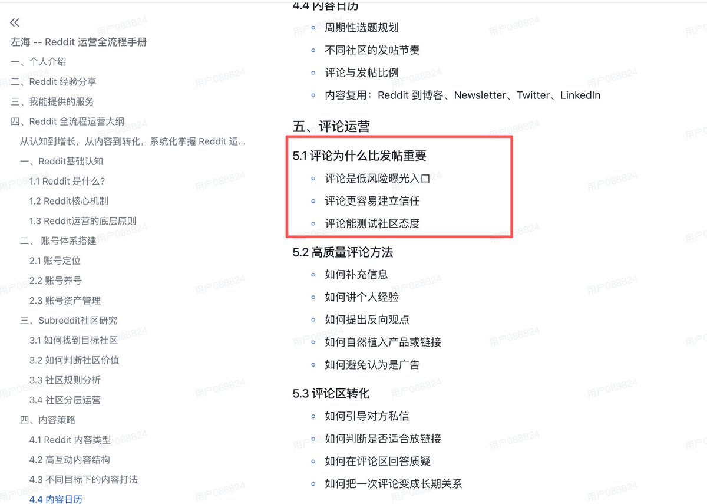

# 左海（@heizolshao）：为什么在 Reddit 上“评论”远比“发帖”更重要？深度解析与实操指南

> 逆向拆解 Reddit 社区生态与算法权重的增长逻辑：深度剖析为什么新手直接发帖极易被判定为 Spam 并遭封禁，而高质量深度评论才是获客与 SEO 的黄金杠杆；手把手演示如何寻找已有高热度讨论帖、提供高密度解决方案、顺带植入产品反向链接，实现高转化长尾自然流量引流。

<!-- more -->

在 Reddit 运营中，许多创作者或独立开发者最容易踩的坑，就是把 Reddit 当成传统的“发稿平台”或博客，一上来就频繁发帖（Submit a new post）。结果往往是被 AutoMod 秒删、被踩到负分（Downvote）、甚至账号直接触发 Shadowban。

对于任何新账号或想要融入社区的运营者而言，评论（Commenting）不仅是前期启动的核心，其战略价值更是远超发帖。以下是我结合平台原生机制与实战经验，深度拆解为什么“评论优于发帖”，并分享完整的执行策略。

本章节是在 Reddit 全运营流程中的第五章节，更多章节知识可以看我个人主页的网址。

## 一、为什么“直接发帖”在 Reddit 风险极高？

要理解评论的重要性，首先需要看清新账号发帖所面临的严苛生态：

1. AutoMod 与规则黑洞

大部分高质量 Subreddit 都有严格的过滤规则，对账号的注册时长（Account Age）、总 Karma 以及 Subreddit 内评论 Karma（Community Comment Karma） 设有硬性门槛。达不到标准直接发帖，内容会被系统静默删除。

2. 极高的用户防御心与审查机制

Reddit 用户对任何带有推广痕迹（Self-promotion）的发帖极度敏感。如果一个发帖者的主页几乎没有日常互动，仅有一两篇推介产品的帖子，用户会直接给帖子和发帖者打上“垃圾营销者（Spammer）”标签，并招致集中的 Downvote 或向版主举报。

3. 沉底成本与算法风险

如果一个主贴在发布后的前 30–60 分钟内没有获得足够的正向互动（Upvotes/Comments），就会迅速沉没在信息流中。更严重的是，一旦主贴遭遇负投票，会直接击溃账号的 Contributor Quality Score (CQS)，导致后续内容进入全站维度的审查受限。

## 二、评论的三大核心战略价值（深度拆解）

1. 低风险曝光与蹭取顶级流量（Low-Risk Exposure）

- 规则门槛极低：绝大多数社区对评论的限制远低于发帖。新账号可以直接参与讨论，极少被 AutoMod 拦截。
- 借势顶级流量池：自己发帖需要从 0 开始冷启动；而在一个已经获得上千赞的热门帖（Top / Hot）中留下高价值评论，等于直接将自己的观点展示在成千上万的高意向读者面前。
- 复利与长尾效应：Reddit 经常被 Google 索引为第一条搜索结果。一条位于高赞帖子顶部的评论，能在数月甚至数年后持续带来被动曝光与主页点击。

2. 建立真实信任与沉淀底层信用（Build Trust & CQS）

- 提升账号真实度权重：Reddit 的防作弊系统非常看重“真实互动度”。经常给出有用、深刻见解的评论，是拉升 CQS（Contributor Quality Score）最有效的手段。
- 积累核心 Comment Karma：许多垂类技术社区将“社区内评论 Karma”作为发帖的前置条件。通过持续在评论区提供价值，积累足够的信用背书，才能解锁后续发帖的最高权限。
- 塑造可信的个人人设：当潜在用户对你的项目产生兴趣并点击你的 Reddit Profile 时，他们首先看的是你的 Comment History。满屏真诚、专业、接地气的技术讨论记录，是消除防备心、建立权威感的最强凭证。

3. 摸清社区情绪与文化测水温（Gauge Community Sentiment）

- 提炼潜规则与黑话（Jargon & Cultural Norms）：每个 Subreddit 都是封闭的文化圈，有独特的幽默方式、禁忌词汇和讨论风格。盲目发帖极易“水土不服”，而评论是试错成本最低的测温计。
- 低成本验证观点痛点：在别人的帖子里抛出你的技术见解、行业假设或小工具思路。观察其他 Redditor 的反馈——是热情追问、冷淡无视，还是激烈反驳？这种第一手的情绪反馈，能直接指导你后续的核心发帖选题甚至产品迭代。
- 识别社区敏感神经：通过评论区的互动摩擦，你可以摸清目标用户对哪些痛点极度共鸣、对哪种商业模式反感抵触，从而在后续正式发帖时精准规避雷区。

## 三、高质量评论的实战策略与避坑指南

1. 黄金筛选：去哪里评？

- 抓取“Rising”标签：不要只在已经有几千条评论的爆款帖里回复（你的评论很容易被淹没在底部）。每天重点刷新目标 Subreddit 的 Rising（上升期） 列表，寻找发布 1–3 小时、互动正在快速攀升的潜力贴，抢占前排席位。
- 锁定“求助与问答帖”：在社区内搜索常见痛点关键词，寻找提问求助（Help/Question）但尚未得到完美解答的帖子，进行深度答疑。

2. 内容结构：怎么评才能上高赞？

- 增量信息原则：拒绝“Great point!”、“Totally agree”这类毫无信息量的无意义吹捧。优质评论必须提供独特视角、反直觉见解、具体的数据指标或亲身踩坑经历。
- 结构化排版：Reddit 用户习惯快速扫描长文本。使用清晰的换行、加粗重点、短段落和列表，让关键信息一眼可见。
- 开放式收尾：如果目标是激发讨论，可以在陈述完核心逻辑后抛出一个开放式问题（例如：“你们在处理并发时通常怎么平衡内存开销？”），能大幅拉长跟帖链条并提升点击率。

3. 绝对禁区：千万不要踩的坑

- 严禁在评论中直接塞冷启动链接：除非层主明确问你“有没有工具推荐”，否则绝不要在第一层评论中放自己的产品网址，极易被标记为软广引流。
- 避免无意义的撒网式打卡：不要为了刷 Karma 在几十个无关版块到处灌水复制粘贴；低质被踩的负收益远大于那 1 点初始赞。

## 四、落地执行检查清单

1. 第一阶段：潜水与观察（第 1–3 天）
   - 加入 5–8 个目标垂直领域社区。
   - 通读每个 Subreddit 的 Sidebar（板块规则）与置顶 Wiki，明确商业推广界限。

2. 第二阶段：测水温与积累（第 4–10 天）

- 每天挑选 3–5 个 Rising 状态或高关注度求助贴，撰写 150–300 字的高价值见解评论。
- 目标：将账号的 Comment Karma 稳步积累至 100+，验证账号的 CQS 处于良好状态。

3. 第三阶段：选题反哺与发帖（第 11 天起）

- 挑出前期收获高 Upvotes、激发大量讨论的评论观点。
- 将该观点扩展为一篇包含真实案例、完整背景与可执行步骤的结构化深度长帖，正式完成从“评论渗透”到“主贴沉淀”的跃迁。

## 相关页面

- [[sources/heizolshao-air-fryer-site-reddit-and-ai-search-growth]]
- [[sources/heizolshao-reddit-tiered-community-operations-playbook]]
- [[concepts/b2c-conversion]]
- [[concepts/gefei-seo-keywords]]
