# 何明璐（人月聊IT）：从本体论到本体建模——如何构建可生成可推理的业务语义规范

> **核心观点**：本体不是一张静态的数据模型，而是对象、行为、规则交织而成的动态整体。它是比代码更接近业务语义的中间语言，同时兼具「业务建模载体」、「程序生成基础」与「推理知识底座」三重角色。

---

## 核心主张与总览

过去大半年，我把本体论（Ontology）这件事，从哲学一直想到了工程。这是一次阶段性总结，梳理的是一条清晰的演进主线：

**从西方哲学的本体论出发 → 经过抽象建模 → 借鉴 Palantir 架构思想 → 琢磨对象行为规则 → 想通事件驱动的闭环 → 最终落到本体驱动的 AI 原生应用。**

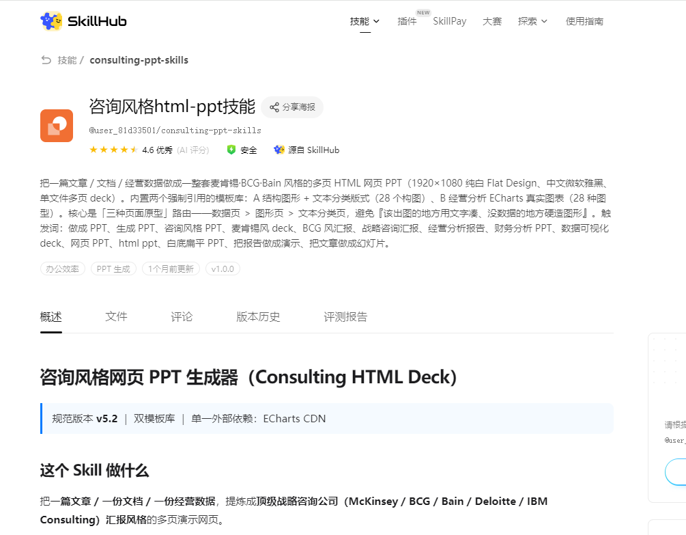

---

## 一、源起：从哲学本体论到工程建模

整个西方哲学，简单概括就是两大分支：**本体论（Ontology）** 和 **认识论（Epistemology）**。

- **本体论**：回答「是什么」（What is it）；
- **认识论**：回答「我怎么知道」（How do I know）。

本体论关心的核心有两件事：
1. 宇宙事物的本质构成能不能再抽象；
2. 事物的类型、规则、规律究竟什么样。

在古希腊早期，这两者是分离的。弗朗西斯·培根用科学归纳法完善了形式逻辑，康德的十二范畴用逻辑做纽带，才把这两支统一起来。

> **深度思考的底层公式**：深度思考的核心是 **空间 + 时间 + 逻辑**。逻辑不能单独存在，它一定依附在事物上，依附在特定的时空维度里。

---

## 二、OBR 动态建模：对象、行为与规则

一个业务对象（例如「合同」），绝不仅仅是一组数据库字段。它会被录入、被审批、被开票、被收款——它在生命周期中不断产生行为，不断和其他对象发生动态关系。

因此，必须采用 **OBR（Object-Behavior-Rule）** 三个本体来建模：

| 维度 | 核心提问 | 定义与职责 |
|:---|:---|:---|
| **对象本体（Object）** | 存在什么？ | 定义业务实体的属性与静态结构 |
| **行为本体（Behavior）** | 能做什么？ | 定义作用于对象的操作，改变对象状态 |
| **规则本体（Rule）** | 什么必须成立？ | 独立的一等公民，定义业务不变量与校验准则 |

### 四条建模军规

1. **对象是第一性的**：所有上下文均挂载于实体对象之上；
2. **行为必然改变对象状态**：没有无状态变化的行为；
3. **规则是不变量，必须独立成一等公民**：规则为什么要独立？如果把规则塞进对象方法或代码逻辑里，它既不可见也不可复用。独立抽取之后，一条税率合规规则，合同录入时能引用，开票录入时同样能直接复用；
4. **对象链本身就是流程**：上下游对象的流转与状态推进，自然构成了业务端到端流程。

---

## 三、本质区分：知识图谱 vs 本体模型

知识图谱（Knowledge Graph）和本体模型（Ontology Model）绝不是同义词：

- **知识图谱在实例层**：关注「实体 A 与实体 B 之间存在什么现实关联」，偏归纳与经验。实例层其实不存在单独建模的问题，它主要涉及图数据库怎么存储；
- **本体模型在 Schema 层**：关注抽象的类型、状态机、行为、规则、事件与业务场景，是高阶的语义契约。

**演进两阶段**：
- **第一阶段（现实世界 → 知识图谱）**：识别实体、关系、活动，得到一张「有什么、怎么连」的关系网络；
- **第二阶段（知识图谱 → 本体模型）**：补上行为、规则、事件、场景，把深藏在业务代码内部的动态语义显性化。**真正困难且具备工程壁垒的，是第二阶段。**

---

## 四、破局：打破 OLTP 与 OLAP 的割裂，实现决策动态回写

如果本体无法解决实际业务问题，前面的所有抽象就都是空中楼阁。

传统企业系统存在天然割裂的两大阵营：
- **OLTP（联机事务处理）**：如 CRM、ERP、MES，负责在线业务操作；
- **OLAP（联机分析处理）**：如数据仓库、BI、数据中台，负责事后分析报表。

两族天生割裂。举个典型案例：企业的理想库存周转是一年 12 次，当前实际只有 8 次。作为管理者，最核心的诉求是：**到底是谁的哪个行为导致了周转率下降？**

传统 BI 根本答不出来。因为底层只有静态数据模型，没有行为和规则模型，它只能告诉你冰冷的聚合结果和计算公式，完全讲不清前因后果与行为链路。

### 核心突破：决策动态回写（Write-back）

本体建模的核心突破在于 **回写**——在数据与分析侧发现的问题、做出的决策，能够动态、自动化地写回到业务系统中。

以**供应链中断**为例：
- **传统做法**：核心物料交付延误 1-2 个月，BI 产生预警，人工层层通知主管，主管再开会分析、手动线下调货或改单；
- **本体驱动做法**：物料延误作为一个「事件」进入事件管道，触发「交期承诺检查规则」；本体模型自身携带调度优化能力，自动测算延期交货或引入备选供应商的 ROI，生成最佳决策方案；随后通过「回写接口」直接回写进 ERP 采购单，业务主管仅需在线一键审核确认。

这是本体第一次真正打通了从 OLAP 洞察到 OLTP 事务闭环的路线。

### 消除企业三种看不见的隐性成本

1. **规则沉没**：数据表结构在数据库中清晰可见，但业务行为和校验规则全被打包编译进了后端代码，事后想追溯业务口径几乎无从下手；
2. **经验在系统外**：系统往往只提供决策后的录入界面（如替代物料、调货、安全库存），但「在什么场景下应该使用哪项策略」从没人显性记录；
3. **治理无锚**：数据治理必须业务驱动，脱离业务场景的标准规范往往沦为形式主义；端到端流程中的断点，根源多是底层数据语义不一致。

三者指向同一个动作：**让行为与规则重新可见、可查、可追溯**。这才是本体工程的真正价值。

---

## 五、本体架构规范：11 个模型与 7 层体系

在演进到 V6 的规范中，本体被收敛为 **11 个核心模型**：

```text
对象、行为、规则、事件、场景、主体、流程、查询统计、界面、映射、接口
```

- **对象**：定义「是什么」；
- **行为**：定义「做什么」；
- **规则**：定义「为什么」（约束与不变式）；
- **主体**：定义「谁能做」；
- **场景**：定义「怎么编排」；
- **查询**：定义「怎么看」。

### 7 层架构分层

架构划分为 7 层，从 **L0 持久化映射** 一直延伸到 **L6 交互入口**：
- 主体模型横切 L1 到 L6 层；
- 查询统计模型作为读模型旁路，与写模型彻底解耦；
- **纪律约束**：约束归对象，规则归规则，编排归场景，查询独立不污染写模型；只有一条规则被两个及以上行为引用时，才值得独立抽取。

---

## 六、本体驱动 AI 原生应用生成

当业务本体建立后，便能进一步释放 AI 的生产力：**让 AI 直接基于本体语义规范，自动派生出可运行的业务系统。**

传统软件开发最大的摩擦在于「需求 → 设计 → 代码」的多层翻译损耗。本体恰好是那套比代码更接近业务本质的**中间语言（Intermediate Representation）**。

它同时具备三重身份：
1. **业务建模载体**；
2. **程序生成基础**；
3. **推理知识底座**。

业务专家可以通过自然语言与 AI 对话生成规范的 YAML 本体文件，无需编程；AI 解析 YAML 即可自动生成数据库 DDL、接口代码骨架和权限策略，每一行生成代码都带有溯源标签。

> **推理分级原则**：高频、确定的业务逻辑，预编译为硬规则；大模型仅负责处理低频、高复杂度、需要深度语义理解的开放推理场景。

### 落地四步法：越级必埋雷

```text
需求探索 → 本体建模 → 原型设计 → 代码生成
```

1. **第一步（需求探索）**：拒绝把模糊需求直接丢给 AI 写代码。业务专家说「需要一个合同管理系统」，AI 引擎必须主动反问核心属性、付款开票比例、录入与关闭权限等关键隐性假设；
2. **第二步（本体建模）**：生成对象、行为、规则、场景等 YAML 元数据，通过树形结构与知识图谱双视图，交由业务专家逐条确认；
3. **第三步（原型设计）**：此阶段仅允许调整界面交互与排版；若此时提出「新增审批节点」，必须回退到第一步重新确认语义；
4. **第四步（代码生成）**：基于严密本体模型生成源码并持续交付。

### 三条实现路线的抉择

- **路线 A（直接生成完整源码）**：语义保真度最高，但权限体系、工作流引擎、缓存和门户底座全需自建，成本极高；
- **路线 B（转换导入传统低代码平台）**：启动最快，但转换属于有损压缩，事件、规则、异常补偿与复杂权限在传统低代码中往往缺乏承载容器；
- **路线 C（将低代码元数据升级成本体模型，构建双引擎运行时）**：**最终选择路线 C**。本体即元数据，杜绝双套系统维护，实现低代码平台从「应用开发玩具」向「企业业务语义基础设施」的范式跃迁。

---

## 七、数据分析与知识库重构

### 数据分析三层公式

```text
确定性计算 + 语义锚定 + 开放推理
```

- **SQL**：只负责基础的算术与聚合统计；
- **本体**：充当翻译官，把业务语言翻译为数据语言，提供统一实体定义、指标口径与约束规则；
- **大模型**：负责高阶的模式识别与归因建议，输出必须标注置信度且每一步推导必须可回溯检验。

> **警惕陷阱**：把算术和精确规则直接交给大模型不是智能化，而是灾难性的概率化。

### 知识库革新：超越传统向量 RAG

纯向量 RAG 的致命短板在于：擅长语义相似度匹配，但极度缺乏严密的因果逻辑推理。当询问「A 对 C 的影响」时，向量检索会召回大量同时出现 A 和 C 的段落，却极易漏掉「B 是从 A 到 C 的必要前提」这一关键节点。

**解法**：在知识底座中引入本体层：
- **前置**：充当查询规划器（Query Planner），自动拆解多跳子问题并制定检索路径；
- **后置**：充当质量校验器，严格核验回答链路是否完整符合本体因果逻辑。

---

## 八、存量系统逆向工程与落地边界

### 逆向工程业务语义

针对企业已有的存量老系统，切忌从技术代码（类、接口、实现细节）逆向，而应**只逆向业务语义**。清单收敛为 8 类：

```text
界面、对象、行为、规则、流程、场景、事件、权限
```

其中「场景」由数据依赖链条严格决定（如：采购立项 → 采购订单 → 采购接收），顺畅完成 8 类抽取即可沉淀出完整的业务本体 YAML。

### 适用场景与冷思考

本体不是包治百病的神话，脱离具体场景空谈本体毫无意义。我们可以用两条轴来界定适用边界：

| 场景象限 | 特征描述 | 推荐解法 |
|:---|:---|:---|
| **算法固定 + 精确要求** | 业务逻辑确定、计算公式固定 | **直接写死代码**，与本体无关 |
| **算法不可固定 + 需溯因推理** | 业务规则动态变化、需要多因归因和策略优化 | **本体建模的主场** |

**核心清醒认知**：
- 本体解决不了底层脏数据的质量问题；
- 专家的隐性业务经验若不显性化沉淀，奢望靠大模型自动替代专家纯属空想；
- 本体模型必须持续演进，它是一套活的、可执行的业务语义操作系统。

---

## 九、咨询风格完整 PPT 演示讲义

以下为通过文章自动化转化的完整咨询风格 PPT 讲义呈现：

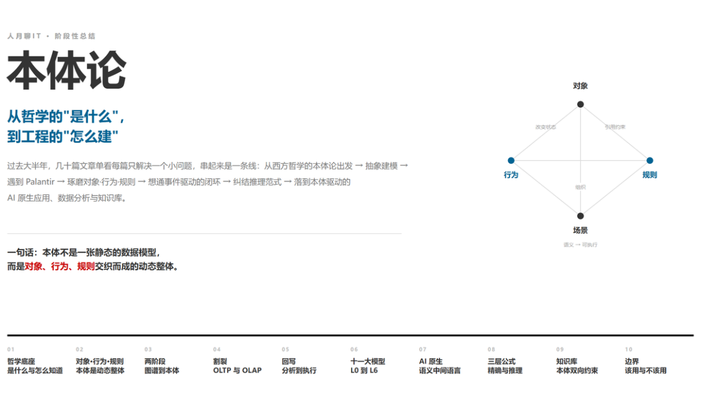

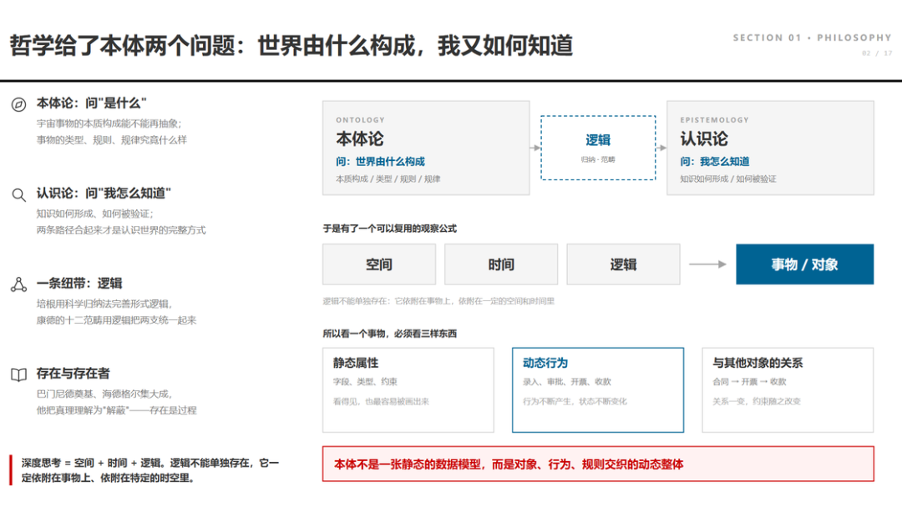

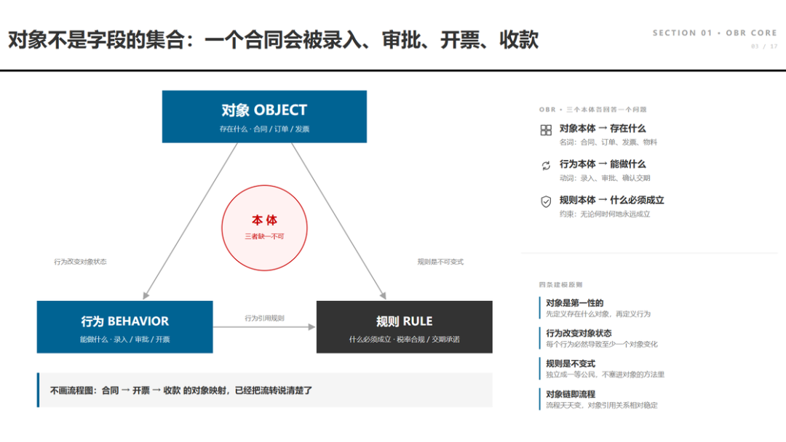

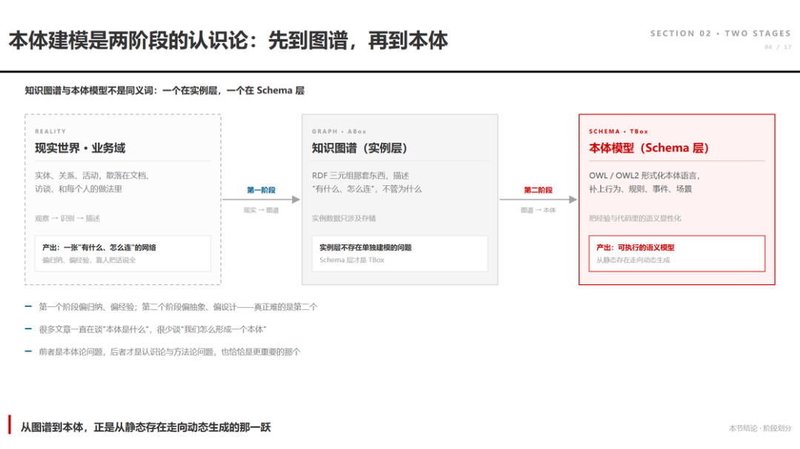

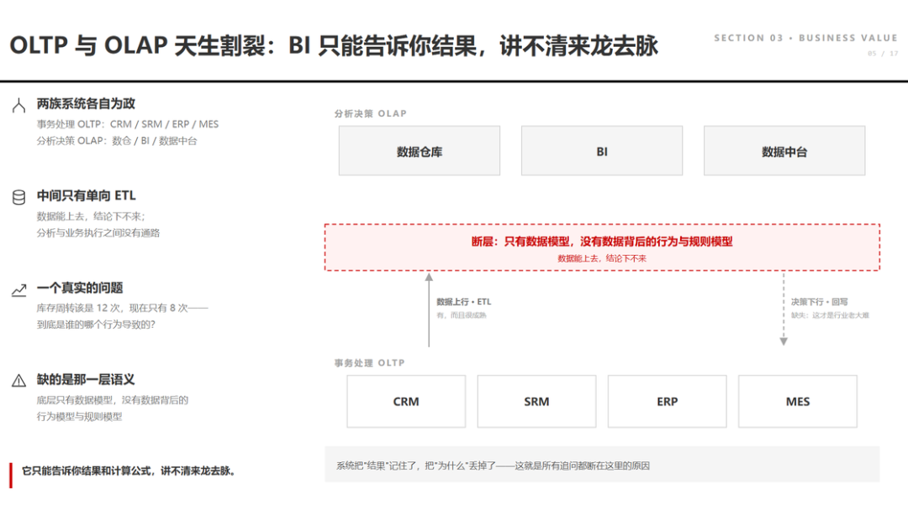

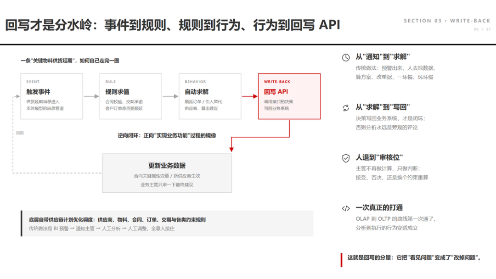

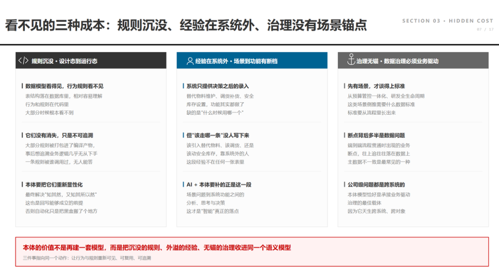

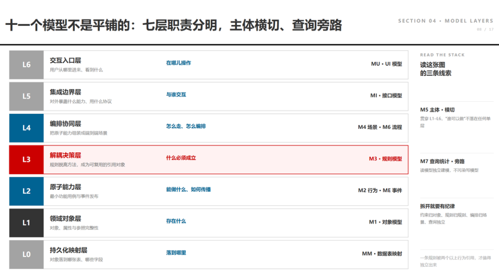

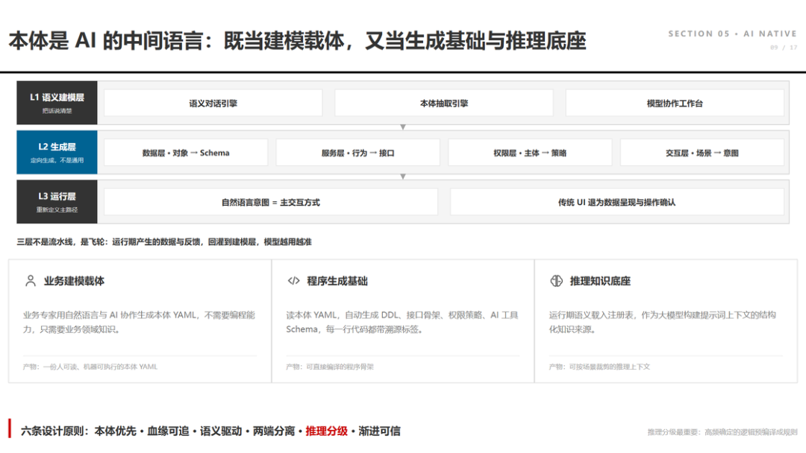

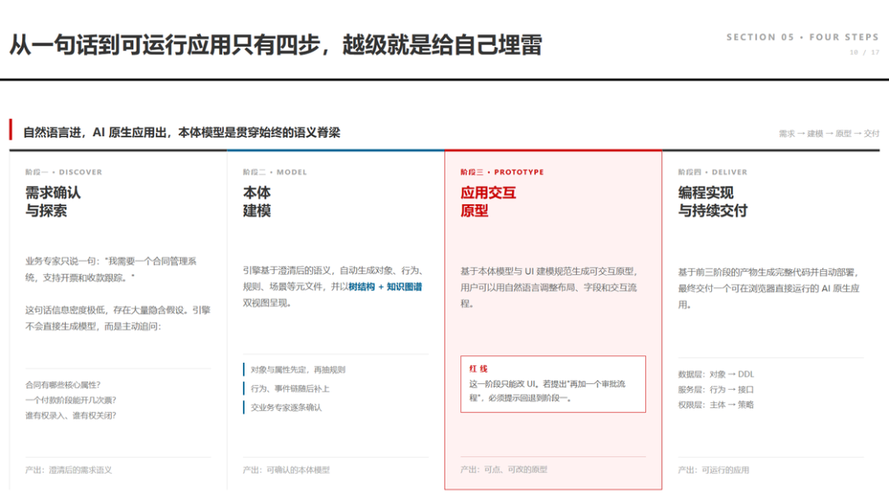

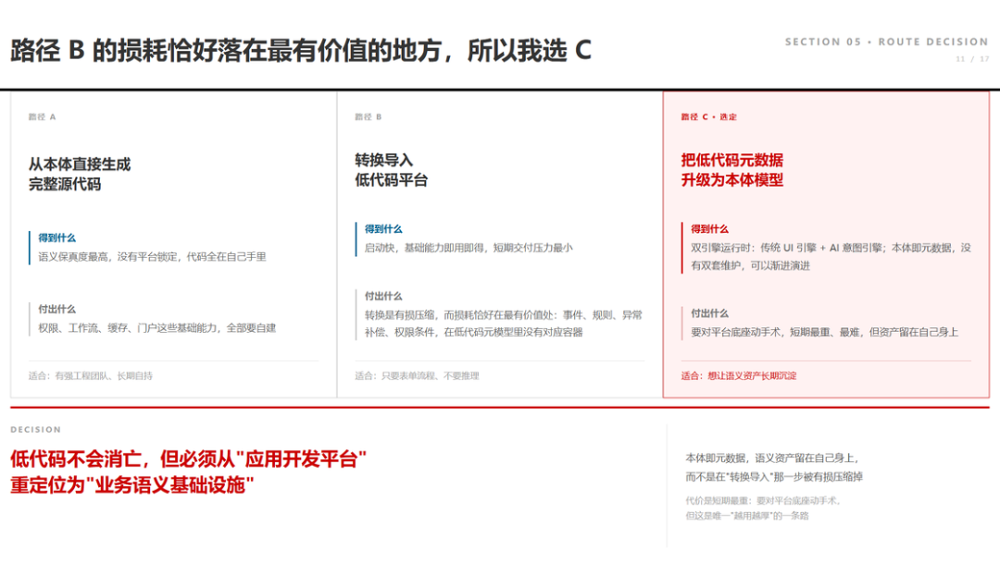

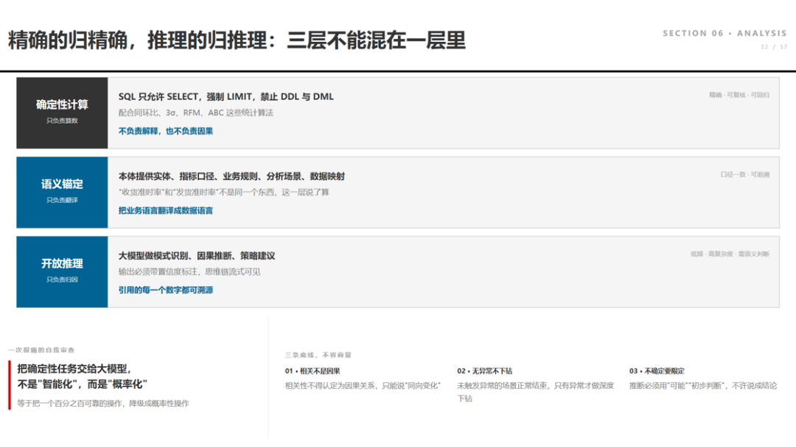

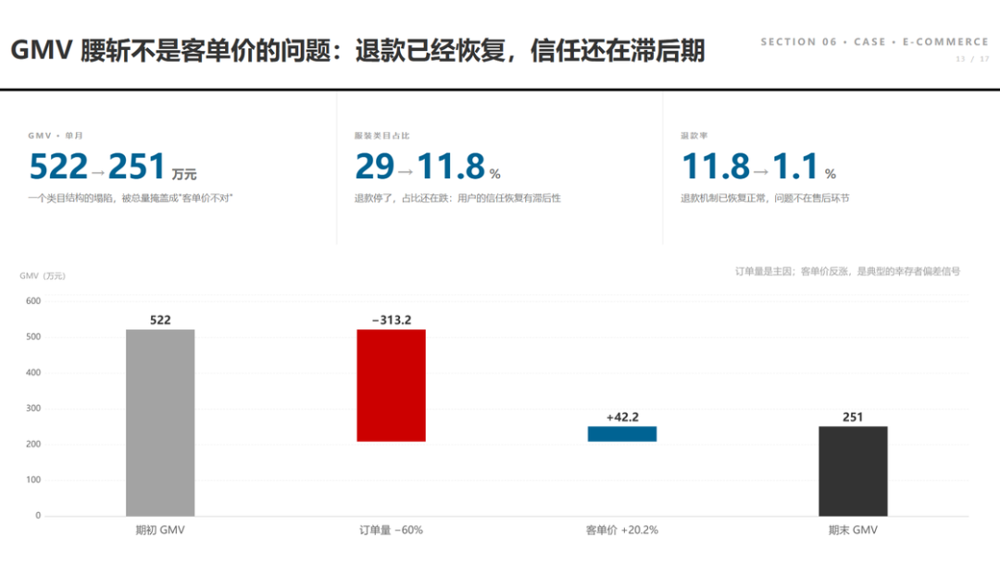

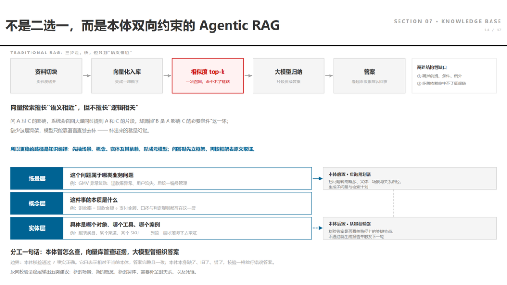

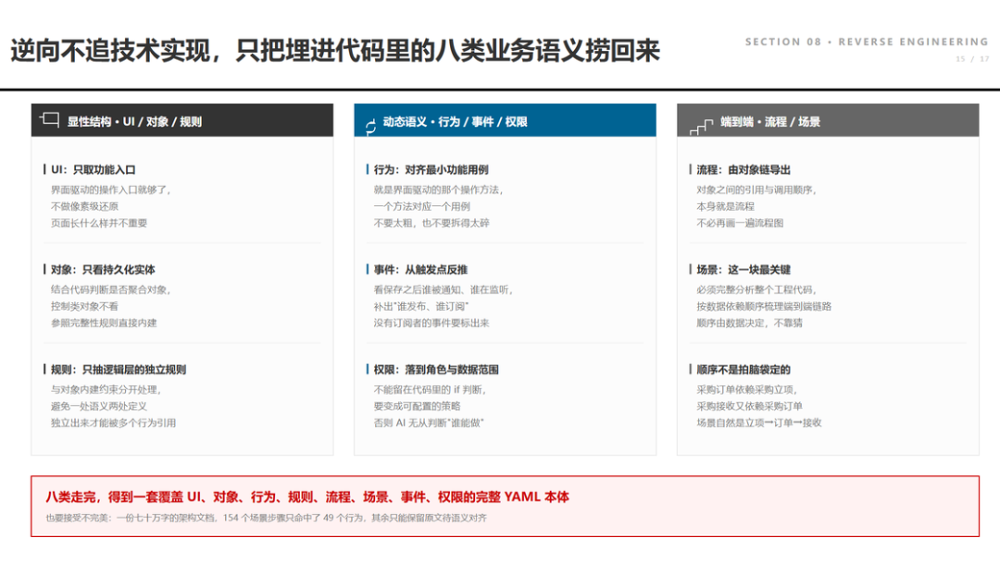

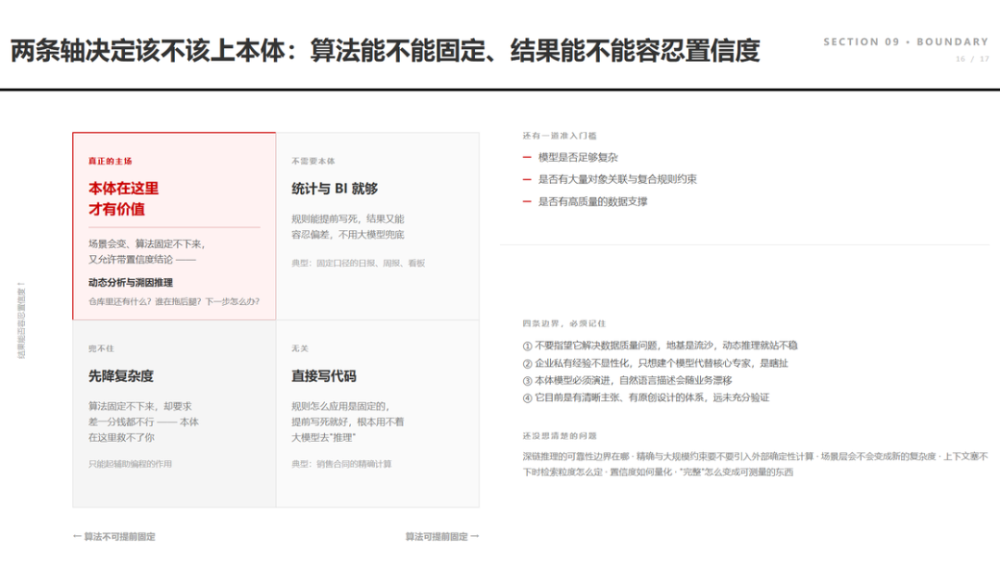

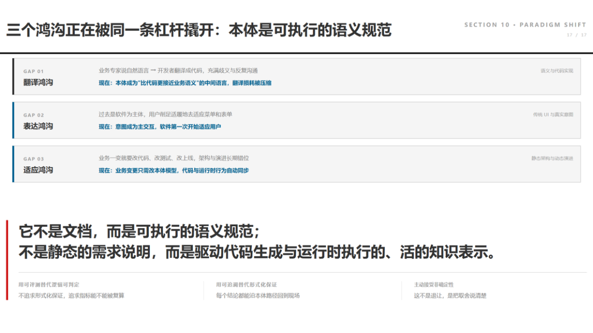
