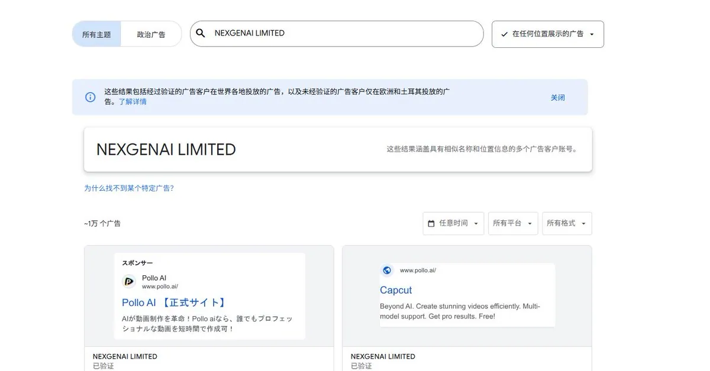
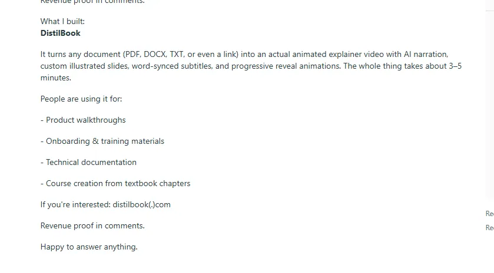

# droidHZ（@hezhiyan7）：从推广渠道找需求——反向推导爆款独立站选题

> 打破「先有产品再找推广」的思维定式，分享逆向寻需方法论：深入海外高权重推广渠道（Product Hunt、Reddit 特色板块、Facebook 分享组、Directory 导航站、YouTube 测评频道），反向扫描正在高频投放与讨论的产品特征，直接从已有稳定获客渠道中复制并微创新细分需求。

<!-- more -->

早上好，朋友们！问大家一个问题，如果你现在有一个产品，用户留存也不错，ROI 也跑正了，接下来你会怎么做？大家应该都会是：想办法去推广，把这个产品放大吧，所有我们逆向一下，推广渠道，其实也可以是你挖掘需求的地方。

举几个常见的例子：

## 通过广告去挖掘需求

可以是 tk、facebook、google ads 的广告。大家做产品，需要对广告保持一种敏感性。

比如 ads 大家可以用 sitedata 插件发现一些投广告的代理商，然后通过这些代理商在 Google 官方的

广告信息公开中心查询：adstransparency.google.com

持续在投的广告可能就是 ROI 还不错的需求。

## 通过外链找需求

我们上新站，为了获取 SEO 的流量，外链是一个很重要的渠道，可能第一时间就会买一些自己认为高价值的外链。这个时候你就可以在一些高价值的外链平台去看最近提交上来的网站。你就会发现一些新词需求（比如新词 seedance 2 刚出来的时候，toolify 一页全是 seedance 2），或者各种方向的需求。我知道有的朋友是做了一些导航站或者 producthunt 这种网站产品的监控的。还有就是哥飞老师社群去年网站流量排行榜有个网站，就是用这种方式挖到的需求。

## 通过 reddit 找需求

大家常说 reddit 是金矿，有很多朋友会在上面推广产品，有时可以去刷一刷，看看别人分享的项目，或者推广的帖子，比如我在 sideproject 看到的这个项目 DistilBook ，第一个月就破千刀了

大家还可以根据自己常用的推广渠道，去挖掘一些

## 相关页面

- [[sources/hezhiyan-outsea-3000usd-monthly-content-digest]]
- [[sources/fanshifu-grok-bot-800-new-sites-monitoring-workflow]]
- [[concepts/gefei-seo-keywords]]
- [[concepts/b2c-conversion]]
