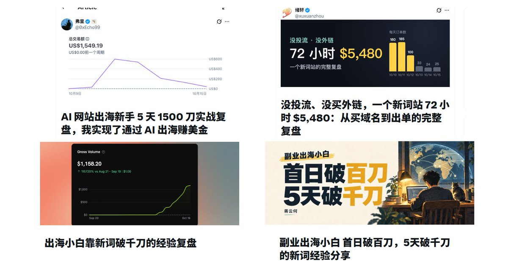
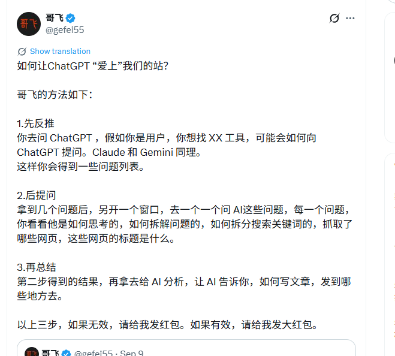

# droidHZ（@hezhiyan7）：梳理最近新词出单的几个复盘——找词、上线、ChatGPT 推荐、优化与出单

> 作者最近做了个小手术基本在休息，只是上线内页出了几单，于是把 hotel lobby、burning bridges、Bulin 47 等新词晒单串起来，梳理蒋云何（首日破百刀、5 天破千刀）、弗里（5 天 1500 刀）、绪轩（没投流、没买外链，一个新词站 72 小时 $5,480）、kristoff（出海小白靠新词破千刀）四位出单朋友的复盘。找需求有四种方法：Trends 词根法（在 Google Trends 词根的搜索量上升里找刚起量的词，蒋云何）、把 hotel lobby、ai raindance、ai zombie 一起丢给 Claude Code 去 TikTok 找同类梗（绪轩）、拆梗的来源并把需求与新词雷达交给 Grok Bot 形成专属雷达（弗里）、问 AI 源头再用 Trends 验证（kristoff）。对新词而言越快越好：绪轩下午买域名、半夜上线，kristoff 一小时搭好站，蒋云何发现当天就上首页，绪轩 85% 的收入在头 72 小时；登录、支付、积分、埋点都用 TanStarter、ShipAny 等现成模板，先内容后功能（蒋云何第一天只复刻大站页面、第二天批量铺长尾内页、第三天才上登录、第四天上功能和支付），先上线再完美（kristoff 模型换了三次，最后用 kling o3，第一版质量很差也先上线拿索引）。优化侧的硬数据：蒋云何的 GA4 只记到 11 个注册而实际有 768 个，生成过视频的用户付费率 28.1%，kristoff 加了不验证邮箱的邮箱密码登录马上出几单，绪轩删掉 AI 自加的限额与「没换人就判失败」误判，弗里把出片做稳并支持多个配角带来复购，蒋云何说最大的坑是生成完就结束、没有作品展示和分享。出单上模板需求按次卖比订阅合适：绪轩 $9.99 一条的订单占 92%，弗里 $9.99 / $19.99 / $49.99 三档、客单价约 $18、每条视频成本约占售价 29%、5 天净赚约 $1,000，蒋云何用 $99 积分包做锚点、流量下滑后补 $5.99、$7.99 低价包；另有绪轩的站 iPhone 用户付款率一半以上而安卓只有 17%、导航站带来 39 个注册 0 付费、两笔年付大单收到欺诈预警后主动退款并建议早开 Stripe Radar。四位作者都承认有运气成分，作者认为新词虽被说成一波流，但很能考验基本功。

<!-- more -->

早上好，朋友们！

最近新词晒单比较多，hotel lobby、burning bridges、Bulin 47…… 很多新词，我最近做了个小手术基本在休息，只是上线了内页出了几单，所有找了推上几个出单的朋友的总结梳理下，向他们学习一下。

蒋云何，副业出海小白 首日破百刀，5 天破千刀的新词经验分享：

 [https://x.com/JiangK82705/article/2111826068017717314](https://x.com/JiangK82705/article/2111826068017717314)

弗里，AI 网站出海新手 5 天 1500 刀实战复盘，我实现了通过 AI 出海赚美金：

 [https://x.com/0xEcho99/status/2110669876482203775](https://x.com/0xEcho99/status/2110669876482203775)

绪轩，没投流、没买外链，一个新词站 72 小时 $5,480：从买域名到出单的完整复盘：

 [https://x.com/xuxuanzhou/status/2112129349071831259](https://x.com/xuxuanzhou/status/2112129349071831259)

kristoff：出海小白靠新词破千刀的经验复盘：

 [https://x.com/kristoff_wu/article/2112216903150436383](https://x.com/kristoff_wu/article/2112216903150436383)

## 一、找需求

四种找词方法：

- Trends 词根法（蒋云何）：在 Google Trends 词根的搜索量上升里找刚起量的词，日常也有沉淀自己的词根
- 让 AI 去 TikTok 找同类梗（绪轩）：把 hotel lobby、ai raindance、ai zombie 这些词一起丢给 Claude Code，让它去 TikTok 上找有没有类似的梗：用户想复刻某个爆款视频，而且复刻出来的视频本身也在火
- 拆梗的来源，搭新词雷达（弗里）：结合[@GoSailGlobal](https://x.com/GoSailGlobal) 分享的新词雷达分享，把自己的需求和雷达作为早期的框架扔给了 Grok Bot，让 Grok Bot 去帮我寻找新词，还结合了自己的数据，形成专属雷达。
- 问 AI 源头，再用 Trends 验证（kristoff）：找到这些关键词火起来的源头，然后再从这些源头找到其他同类型的关键词。再把新词逐个放进 Trends

大家基本上都会去给予已有的关键词去进行溯源，即使之前的词错过了，但还是会找到爆火的源头，方便自己下次第一次时间发现这些爆火的需求，然后上站

## 二、上线

对于新词来说是越快越好。 绪轩下午买域名、半夜上线；kristoff 一小时搭好了站；蒋云何发现当天就上了首页；绪轩 85% 的收入在头 72 小时。

靠模板提速。 登录、支付、积分、埋点都用现成模板（TanStarter、ShipAny 等），时间只花在核心功能上。

先内容，后功能。 蒋云何第一天只复刻了大站的页面，没有登录和支付；第二天用 AI 批量铺长尾内页；第三天才上登录，第四天才上功能和支付。

先上线，再完美。 kristoff 的模型换了三次，最后用 kling o3，第一版质量很差也先上线拿索引。

## 三、ChatGPT 推荐

这里面很多人的数据来源是 chatgpt，付费率也高，他们主要是：

1. 上得早
2. 按用户会问的问题写文案和 FAQ（蒋云何）
3. 用长尾页覆盖各种问法（蒋云何）
4. 先问 ChatGPT 用户会问什么，写成博客和内页，再引导到站内（弗里）
5. 做好标题、描述、层级这些基础 SEO（弗里）

这里哥飞老师也分享了一个如何让 AI 爱上我们网站的具体做法

## 四、优化

- 埋点和支付一起上：蒋云何的 GA4 只记到 11 个注册，实际有 768 个
- 让用户先体验一次：蒋云何的站，生成过视频的用户付费率 28.1%
- 降低门槛：kristoff 加了不验证邮箱的邮箱密码登录，马上出了几单
- 别让规则挡住付费用户：绪轩的站，AI 加的限额和「没换人就判失败」误退了付费用户的成片，最后删掉
- 比同行多做一点：弗里把出片做稳，还支持多个配角，带来了复购
- 少出客服单：绪轩生成好就发邮件，用户说不像就直接退款
- 让用户帮你传播：蒋云何说最大的坑是生成完就结束，没有作品展示和分享

## 五、出单

这里模板需求，按次卖，比订阅更合适。 用户只想拿到一条成片去分享。所以日常需要根据不同的需求设置不同的定价方式。

- 绪轩：$9.99 一条的订单占 92%
- 弗里：$9.99 / $19.99 / $49.99 三档，低档限制时长和清晰度，用户先试再补买，客单价约 $18
- kristoff：参考弗里改了付费墙，$19.9 的单和复购都多了
- 蒋云何：$99 积分包做锚点，主推打折月付；流量下滑后补了 $5.99、$7.99 低价包

几个细节：

- 绪轩把价格区默认选项从订阅改成积分包，8 分钟就出单
- 绪轩的站 iPhone 用户付款率一半以上，安卓只有 17%
- 蒋云何的站，导航站带来 39 个注册，0 付费
- 蒋云何两笔年付大单收到欺诈预警后主动退款，建议早开 Stripe Radar
- 弗里每条视频成本约占售价 29%，5 天净赚约 $1,000

## 总结

四位作者也都坦诚说了有运气的成分，但能接住运气的，是平时一直在上站、积累下来的模板和手感。

大家很多人会说新词是一波流，但是我觉得这个是很能考验自己基本功的一个方式，能够快速验证自己的操作是否正确。

还有就是即使自己错过了没上站，也需要去观察一下这些做的好的网站的细节，学习他们的优点，也便于自己下次做的更好。

## 相关页面

- [[sources/echo-ai-site-5-days-1500-usd]]
- [[sources/jiang-yunhe-first-100-usd-new-word-playbook]]
- [[sources/kristoff-new-term-site-1100usd]]
- [[sources/xuxuanzhou-72h-5480usd-new-word-site]]
