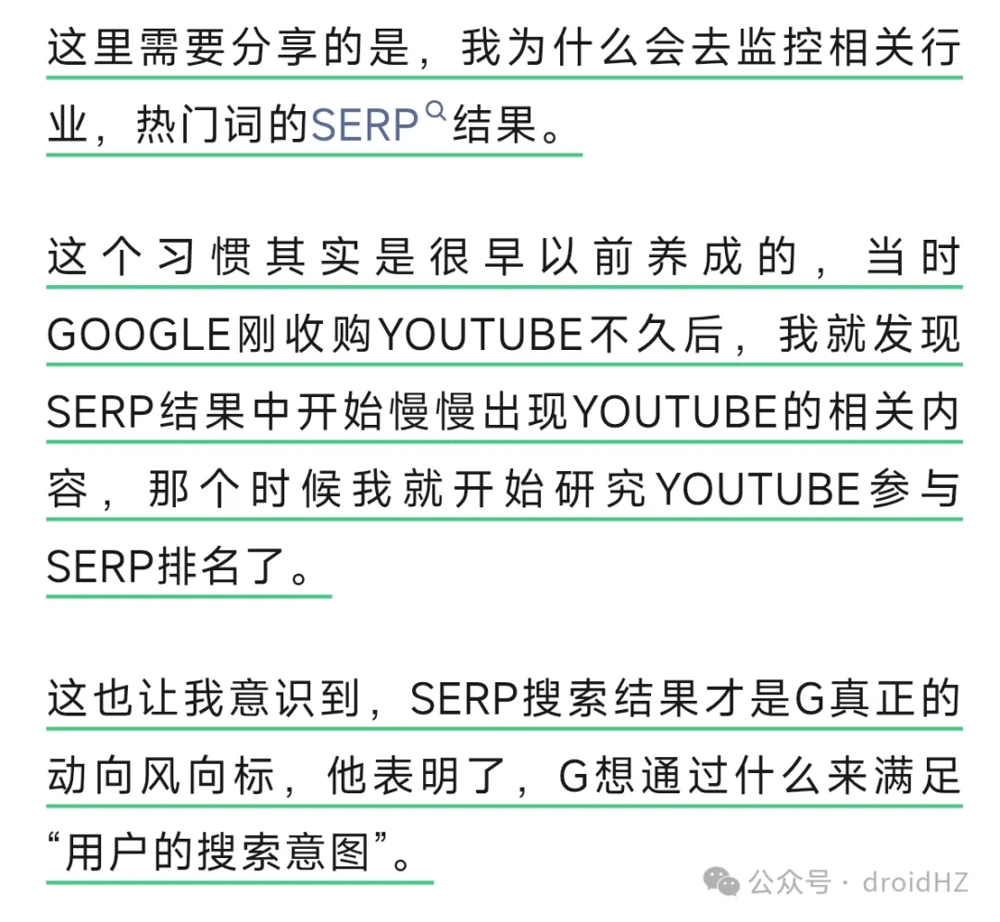
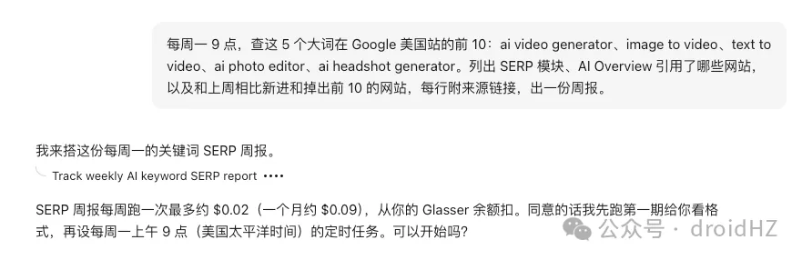
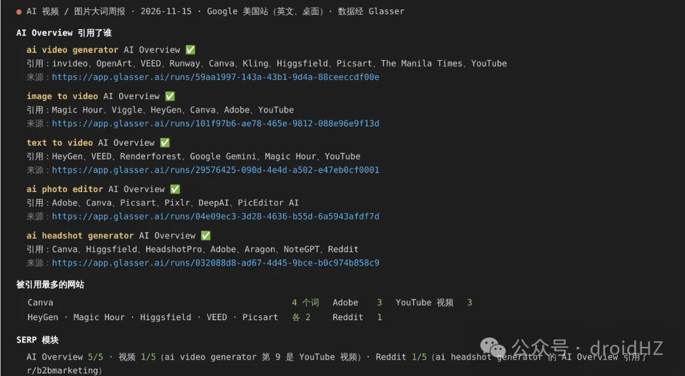

# 【精读】网站出海每日分享：让 AI 每天帮我盯 SERP，新站一冒头当天就知道

> **核心结论**：SERP 变化就是 Google 的风向标。与其人工偶尔搜一下排名，不如让 AI 定时任务把这件事自动化——**自己网站在做的词每天看**（当天就能知道新站冒头、自己掉出前 10、AI Overview 换了引用），**大词每周看一次**（看 Google 的方向 + AI Overview 偏好引用什么样的页面）。作者用第三方 SERP API（glasser）接进 Claude Code，一个 key 打通 Google 搜索结果与 Ahrefs 等付费数据，按次付费免订阅，定时也交给 Claude Code 跑，一个词约 $0.002。

<!-- more -->

## 文章概览

**原作者**：droidHZ（赫兹），公众号「网站出海每日分享」系列。

**发布时间**：2026 年 11 月 17 日 08:25。

**文章定位**：一篇**工具实操指引 + 定时任务提示词分享**，不展开 SEO 方法论，重点是「怎么把 SERP 监控这件事交给 AI 定时跑，以及提示词怎么写」。

**灵感来源**：作者看到 Joker 老师分享的 SERP 监控做法（下图），自己换了做法——用 AI 定时任务盯。

> 原文金句："排在前面的页面，就是 Google 认为最符合用户搜索意图的内容，所以 SERP 的变化，其实就是 Google 的风向标。"

## 为什么要盯 SERP

排在前面的页面，就是 Google 认为最符合用户搜索意图的内容。所以 SERP 的变化 = Google 的风向标。

除了看自己做的关键词，作者真正关心的是：

- 最近又有谁新冒出来了
- AI Overview 引用了谁
- 冒出来的对手做了什么操作，是不是个机会点，自己能不能超过他

作者的痛点是：**之前都是偶尔人工去搜一下，排名变了反应不及时**，常常过了很久才突然发现有个新站已经做上去了。

## 把要盯的词分成两类

| 类型 | 频率 | 关注什么 |
|------|------|----------|
| 自己网站在做的词 | **每天** | 有新站冒上来、自己掉了、AI Overview 变了——当天就能知道 |
| 大词（暂时排不上的） | **每周** | 看 Google 的风向，也看 AI Overview 喜欢引用什么样的页面 |

## 接入三方 SERP API

数据这块作者用的是第三方 API **glasser**，特点：

- 让 Claude Code 这类 AI 用**一个 API key** 调 Google 搜索结果、Ahrefs 这些付费数据
- **按次付费**，不用一家家去开订阅
- 支持的 SEO 相关 API 非常多
- 官网 [glasser.ai](https://glasser.ai/) 上有 Setup 说明，按步骤接到 Claude Code 后，直接用自然语言告诉 AI 要做什么即可
- **定时也交给 Claude Code 来跑**

## 盯自己做的词（每日提示词）

自己网站在做的词每天跑一次，提示词原文：

> 每天 9 点，查【你在做的词，用顿号隔开】。列出我的排名、SERP 模块（AI Overview、视频、Reddit）、AI Overview 引用了哪些网站、有没有引用我，以及和昨天相比新进前 10 的网站，每行附来源链接，出一份日报。

日报里作者会看三件事：

1. 自己有没有掉出前 10
2. 有没有新站冒上来
3. AI Overview 有没有换了引用的网站

**冷启动处理**：第一次运行没有昨天的数据，可以让 AI 先用最近一次的历史 SERP 快照来比。

## 盯大词看风向（每周提示词）

作者选了 AI 视频和图片方向的大词，提示词原文：

> 每周一 9 点，查这 5 个大词在 Google 美国站的前 10：ai video generator、image to video、text to video、ai photo editor、ai headshot generator。列出 SERP 模块、AI Overview 引用了哪些网站，以及和上周相比新进和掉出前 10 的网站，每行附来源链接，出一份周报。

## 实际输出长什么样

周报输出为一份结构化报告：按词列出 **AI Overview 引用了哪些网站**、**SERP 模块**（AI Overview / 视频 / Reddit）、以及每行附 Glasser 运行结果链接；末尾汇总「被引用最多的网站」。

作者跑的 5 个大词（2026-11-15，Google 美国站）实测结果：

从截图可见的引用格局：

| 大词 | AI Overview 引用的网站 |
|------|----------------------|
| ai video generator | invideo、OpenArt、VEED、Runway、Canva、Kling、Higgsfield、Picsart、The Manila Times、YouTube |
| image to video | Magic Hour、Viggle、HeyGen、Canva、Adobe、YouTube |
| text to video | HeyGen、VEED、Renderforest、Google Gemini、Magic Hour、YouTube |
| ai photo editor | Adobe、Canva、Picsart、Pixlr、DeepAI、PicEditor AI |
| ai headshot generator | Canva、Higgsfield、HeadshotPro、Adobe、Aragon、NoteGPT、Reddit |

**被引用最多的网站**：Canva 4 个词、Adobe 3 个词、YouTube 视频 3 个；HeyGen / Magic Hour / Higgsfield / VEED / Picsart 各 2 个，Reddit 1 个。

这组数据本身就是一条情报——**Canva + Adobe + YouTube 几乎出现在每个 AI 视频/图片词的 AI Overview 里**，说明它们是这个赛道的通用底座，新站要在这类词上出头，绕不开与大厂产品同台竞争。

## 成本

- **每个词跑出的结果有个详细链接，一个词只花 $0.002**
- 截图里 Claude Code 的实际报价：SERP 周报每周跑一次最多约 $0.02，一个月约 $0.09，从 Glasser 余额扣

## 作者的诚实局限

> "不过我发现现在风向标暂时还看不太出来，变化不大，需要接下来持续观察，可能才会有一些发现。"

大词每周变化的幅度很小，单周对比基本看不出风向——**这个方法需要长期积累才有意义**，作者自己也这么说。

## 关键洞察

1. **SERP 监控的第一价值不是自己的排名，而是"谁冒出来了"**：自己掉了会收到排名下降的通知，但"某个新站正在爬上来"这种早期信号，人工抽查几乎不可能及时发现。
2. **自己的词和大词要用不同频率、不同的读法**：自己的词是**告警**（当天知道，反应快），大词是**趋势**（每周看，攒够样本才看得出风向）。
3. **两次查询必须有可比基线**：日对比昨天的数据、周对比上周的数据——所以冷启动时要用历史 SERP 快照兜底，否则第一次运行无法产出"变化"。
4. **成本低到可以当成日常基础设施**：$0.002/词、每月 $0.09，远低于任何 SERP 订阅工具的月费；作者对比的替代方案包括 goanyapi、dataforseo、aisaone。
5. **提示词里必须点名要看的 SERP 模块**：AI Overview、视频、Reddit——只说"查排名"会丢掉 AI Overview 这个最有价值的信号源。
6. **定时任务本身由 AI 托管**：Claude Code 同时承担"取数 → 判断 → 生成报告 → 定时调度"四个角色，不需要额外的监控看板。
7. **大词风向的真实用法是看 AI Overview 引用谁**：作者实测 5 个词的引用格局直接暴露出 Canva / Adobe / YouTube 的统治地位——这是比"排名第几"更结构化的情报。

## 相关页面

- [[summaries/hezhiyan7-serp-monitor-ai-cron]] — 精读摘要：双频次方法论拆解、可复用提示词与 AI Overview 引用格局
- [[sources/joker-seo-data-metrics-confusion]] — 本文灵感的来源：Joker 讲 SERP 监控与 SEOer 容易陷入的数据指标困惑
- [[concepts/open-source-seo-tooling]] — 付费 SEO 工具的数据资产层与工具逻辑层拆分——解释为什么 SERP 数据必须付费而监控逻辑可以自建
- [[patterns/viral-content-monitoring]] — 同构的自动化监控模式：定时扫描 → 阈值判断 → 推送 → 复盘，SERP 监控是它在 SEO 侧的对应物
- [[sources/ai-traffic-geo]] — 同一作者的 GEO 主题归档：如何查看 AI 流量、被推荐的关键词
- [[sources/hezhiyan7-new-word-site-recap-roundup]] — 同作者的新词出单复盘：找到词之后的选品与上线节奏
- [[sources/guishou-google-ads-api-keyword-volume]] — 同类"用第三方 API 换掉付费订阅"的选型：DataForSEO 查精确搜索量
