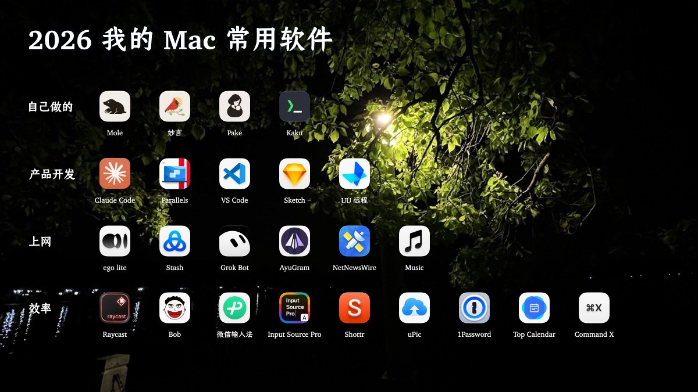
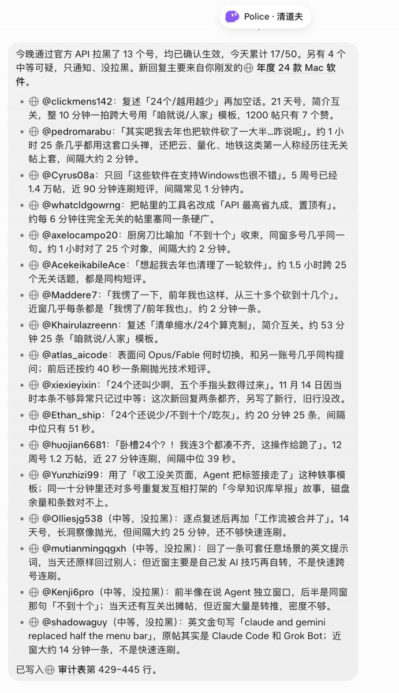

# HiTw93：2026 我每天在用的 24 个 Mac 软件

> 一年一度的固定节目：有了 AI 后常用软件反而少了，只剩 24 个。从 Mole、Claude Code、Kaku 终端，到 ego lite 浏览器、1Password、妙言笔记、Grok Bot、Pake、Shottr……想到啥说啥，不按图片顺序。

<!-- more -->

每年固定节目，给大伙分享我这一年每天都在用的不错 Mac 软件，由于有了 AI 以后反而常用软件少了很多，只有这 24 个了，看看哪些是大伙也经常在用的，也欢迎推荐你认为 2026 你最喜欢的软件给我。

打算想到啥说啥，先看到哪一个说哪个，不按照下图顺序来给大伙分享。

1. Mole：几乎每天会用来清理一遍垃圾以及看菜单栏看系统的状态，包括里面的卸载、不息屏、风扇小工具每天会使用，同时每天都会来迭代它。

2. Claude Code：我现在主要用 CLI，几乎每时每刻都在跑，默认 Opus 5.5 high，复杂 就 Fable 5.2 medium，现在没有用 Codex 了，也没有用啥多 Agent 工具，我喜欢简单可控的编码。

3. Kaku：我喜欢简单默认好看轻量的终端工具，每天在上面多 Tab 跑 Claude，我喜欢用黑色背景的 TUI 搭配 JetBrains Mono 代码字体，这个字体依然是我最近三年最喜欢的代码字体。

4. ego lite：今年最让我惊喜的一个浏览器，简单漂亮好用，之前我主要是用 Helium Browser，假如你很少用 AI 操作浏览器，那我还是推荐 Helium 这个，轻量迅速简洁，ego 这个我喜欢的点，就有给 Agent 一个单独的窗口，不会干扰我自己的使用。

5. 1Password：今年把我的密码管理逐步迁移到了这个，多平台复用，整体软件品质不错，更多是在 AI 什么都可以破解的年代求一份安全保障，价格是也可以接受，用习惯以后，感觉还挺好用的。

6. 妙言：一个轻快的原生的 Markdown 笔记应用，默认好用好看，在支持 iPhone 版本后，我几乎每天会打开记录一些东西，每周大伙看到的潮流周刊就是我用这个 Mac 端来编辑的，包括大伙看到的我的所有文字输出，都是在这个里面草稿来的。

7. Grok Bot：可能不是每一个小伙伴喜欢用这个，我感觉他帮我了我很多产品经营增长上的忙，包括各种答疑、退款处理、记录问题到 Notion，以及我每天的投资报告、推特日报、潮流日报，均来源于这个帮我在做 Personal Agent。

8. UU 远程：我感觉这个产品简单易用，在我外出的时候，非常依赖他帮我操作家里的多 Mac 和 Windows 设备，给我帮了很多忙，虽然后面也做付费了，不过我还是非常希望他家可以越做越好。

9. Apple Music：用过非常多音乐播控器，我还是最喜欢苹果自带的，包月也便宜，歌的质量也高，我听的歌也都在上面，而且我喜欢这个简洁，以及多设备使用，不太喜欢花里胡哨的东西，这个刚刚好。

10. Pake：一个可以很简单把网页打包成桌面 App 的工具，我会把微信读书、李志音乐播放器打包成 Mac 应用，然后用 raycast 快捷键唤起，很方便，而且可以按照自己喜好定制非常多的东西。

11. Shottr：假如要推荐一个最好用最简单的截图工具，还是推荐这个，貌似才 4 刀不买好像也可以用，轻量、我非常喜欢用他来截图窗口、以及滚动截图，用了好几年了。

12. 微信输入法：我的所有设备都是用这个输入法，腾讯的赎罪产品，简洁舒服、打字猜的准，特别是最近的语音输入法，我不想装同类的软件，就只用这个，非常好用。

13. Parallels：这个软件可能对大伙也褒贬不一，但是我感觉还是这个 Windows 虚拟机做得最好用，也可能是我 M5 Pro 的缘故，我在上面用，完全没有虚拟机的感觉，非常顺滑，在我开发 Windows 软件的时候帮了很大的忙。

14. Bob：一个随手用的翻译工具，好像也不贵，然后绑定了自己的 AI key，设置快捷键以后，随用随唤起，很不错。

15. Input Source Pro：默认切换输入法的工具，比如在你写东西的里面默认就是中文输入法，在你敲代码的地方默认设置英文，少掉了一次快捷键切换，润物细无声。

16. NetNewsWire：轻量默认好用的 RSS 阅读器，也有 iPhone 版本，推荐使用我自己做的妙言主题，很舒服，这是我认为在 AI 时代还需要保持阅读的一个很好工具。

17. Sketch：哈哈好吧，我承认我现在的所有的设计、做 Logo 、做稿子，还是用这个软件，可能是原生客户端的缘故，有执念，而且工具完全够我用，也比较舒服，可能是用习惯了，反而不太关注新产品。

18. Top Calendar：菜单栏最好用的日历时间插件，可以把系统的菜单栏时间替换后用这个，点击可以看到日历，以及你的日程，也是润物细无声。

19. AyuGram：开源易用简洁的电报工具，可以把原有官网的版本很多会员广告啥的干掉，然后有非常多自定义的功能，但是默认其实就够了，平时我每天打开 1-2 次看看消息。

20. Stash：我在用的 Mac 和 iPhone 的代理工具，用了 2 年左右了，胜在稳定和原生，以及满足我使用的覆写、DNS 覆盖等功能，然后家里 Apple TV 也用的这个，我认为最好的就是多设备配置同步，省去了我来回配置的麻烦。

21. Raycast：这个是唯一我感觉有点重但是也每天在用的工具，同步也在另外一台电脑上使用 Tinycast，作为对照使用，Raycast 的粘贴历史记录、软件快捷键唤起、文件快捷键查找这几个功能我几乎每天用，就是麻烦一点第一次使用，你要关掉非常多我认为多余的功能才会好用，Tinycast 等更成熟了，可能主力机就迁移过去了。

22. uPic：用了好多年的图片上传到 cdn 的工具，为啥用这个，还是原生轻量的执念，绑定好快捷键以后，我认为非常好用。

23. Command X：一个非常轻量的让你的 Mac 在访达支持剪切的工具，就这个功能，哈哈哈。

24. VS Code：前 AI 时代每天都在用的，现在也经常用，主要用来看一些 diff，以及整理一些文件内容，以及看 README，不过我感觉明年我可能就不用这个了，找一个更轻量原生的。

非常抱歉机器人账号不要评论，我的 Bot 会自动拉黑你们，假如有误删的，辛苦联系我～ https://x.com/HiTw93/status/2124870500778418260

## 相关页面

