# 启明破晓（@hiwise_aigc）：8G 显存也能跑——Qwen-Image-2.1-Turbo 本地部署 8 步出图（附 ComfyUI 工作流）

> 通义万相开源图像大模型 Qwen-Image-2.1-Turbo 低显存极速部署实战：通过 FP8 量化与内存切片优化，在 8GB 显存消费级显卡上实现数秒极速出图；手把手拆解 ComfyUI 节点搭建、模型权重加载、VAE 解码与高清放大工作流，帮助创作者搭建低成本本地私有绘图生产力节点。

<!-- more -->

这两天 HuggingFace 上 AtomicChat 连发两个 GGUF 仓库：Qwen-Image-2.1-Turbo 的去噪器量化版，和一个名字很刺激的“Uncensored（去审查）”文本编码器。

评论区已经有人开始脑补“解锁版能画什么”了。先泼盆冷水再讲干货——官方模型卡自己实测：换这个编码器，45 个敏感提示词成图 0 翻转。它画的东西，和官方版基本一模一样。

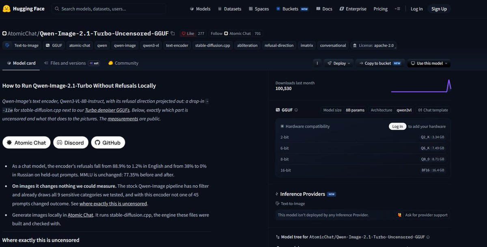

那它到底有什么用？8G 显存的 5060 到底能不能跑？**能，实测跑通了。**下面这套 ComfyUI 工作流就是在 RTX 5060（8G 显存）真机上一步步踩坑踩出来的，第三节 5 个坑、第四节 4 组提示词，全部真机验证过，不是纸上谈兵。

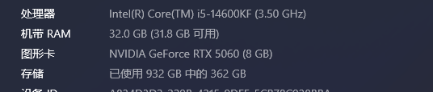

实测数据：首次出图约 2 分钟（含模型初始化加载），之后每次出图都在 1 分钟左右。

今天一次讲清：4 个模型文件怎么下、放哪、工作流拖入即用，5 个真机大坑的解法，4 组“去审查”提示词，外加官方 48 组提示词实测的量化选型表。

## 洞察：Uncensored 改的不是画面，是“拒绝”权重

Qwen-Image-2.1 画图是三个部件配合：去噪器（画画的）+ 文本编码器（理解提示词的）+ VAE（解码成图的）。

这个“去审查版”只动了文本编码器：把 Qwen3-VL-8B 里负责“拒绝”的那一个权重方向投影掉了。官方实测数据：

- 编码器当聊天模型用：有害请求拒绝率 88.9% → 1.2%，MMLU 通用能力不变（77.35%）
- 编码器拿来画图：45 个敏感提示词，换前后 0 翻转——因为原生管线本来就没有内容过滤器

一句话：**它不是“解锁版”，是“无拒绝倾向版编码器”。**对画图党来说，价值在于：一个现成的 Qwen3-VL 编码器 GGUF，Q8_0 版只让画面偏移 0.037，几乎无损；以及本地跑，没人管你画什么。

先来看看生成图片效果👇

## 一、下载清单：4 个文件，文件名 / 大小 / 直链 / 存放位

以下文件已通过 HuggingFace 官方 API 逐个核验：

Qwen-Image-2.1-Turbo-AD-Q4_K.gguf（去噪器） 4.20GB [点我下载](https://huggingface.co/AtomicChat/Qwen-Image-2.1-Turbo-GGUF/resolve/main/Qwen-Image-2.1-Turbo-AD-Q4_K.gguf) ComfyUI/models/diffusion_models/

Qwen-Image-2.1-Turbo-Abliterated-Uncensored-Q8_0.gguf（编码器） 8.71GB [点我下载](https://huggingface.co/AtomicChat/Qwen-Image-2.1-Turbo-Uncensored-GGUF/resolve/main/Qwen-Image-2.1-Turbo-Abliterated-Uncensored-Q8_0.gguf) ComfyUI/models/text_encoders/

mmproj-Qwen-Image-2.1-Turbo-Abliterated-Uncensored-F16.gguf（视觉投影器，补丁硬要求） 1.16GB [点我下载](https://huggingface.co/AtomicChat/Qwen-Image-2.1-Turbo-Uncensored-GGUF/resolve/main/mmproj-Qwen-Image-2.1-Turbo-Abliterated-Uncensored-F16.gguf) ComfyUI/models/text_encoders/（和编码器同一目录，不要改名）

qwen_image_2.1_vae_bf16.safetensors（VAE） 644MB [点我下载](https://huggingface.co/Comfy-Org/Qwen-Image-2.1/resolve/main/vae/qwen_image_2.1_vae_bf16.safetensors) ComfyUI/models/vae/

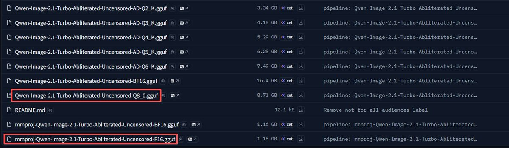

⚠️ 三个坑请注意：

1. 去噪器别下成 BF16 版（14.23GB，8G 显存直接 OOM），认准文件名里的 AD-Q4_K。
2. 编码器仓库里 6 个量化档，8G 卡路线认准 Q8_0（放内存跑）——别下成 AD-Q2_K（画面明显跑偏）。
3. 去噪器和编码器文件名长得很像：带 Abliterated-Uncensored 的是编码器（进 CLIPLoader），不带的是去噪器（进 Unet Loader）——拿错直接报错，详见第三节坑二。

下载自检：四个文件就位 + 大小对得上（4.20GB / 8.71GB / 1.16GB / 644MB）→ 才算成功。

📜 许可说明：Qwen-Image-2.1 官方权重的许可证已从 Apache 2.0 换成 Qwen Research License（HuggingFace 官方模型卡 license_name=qwen-research，2026-10-11 核验）——个人学习实测没问题，商用前先读官方 LICENSE。

## 二、ComfyUI 工作流：拖入即用（11 个节点，连线已接好）

工作流 JSON 已备好，下载后直接拖入 ComfyUI 画布即可导入：

[video](https://video.twimg.com/amplify_video/2109249540524244993/vid/avc1/1886x1080/NUXnSYAlxzF4qOnX.mp4?tag=29)

Qwen-Image-2.1-Turbo 去审查版_ComfyUI 工作流.json

第 1 步：前置条件

- ComfyUI 更新到最新（Qwen-Image-2.1 原生支持是 0.37+ 才进的）
- Manager 安装自定义节点：ComfyUI-GGUF（city96，加载 GGUF 去噪器 / 编码器）、ComfyUI-KJNodes（kijai，精确还原 Turbo 调度用）、Comfyroll Studio（图片比例控制用，Manager 里搜 Comfyroll，认准描述里带 “Aspect Ratio” 的那张卡）
- 社区补丁 ComfyUI-GGUF-Qwen3VL-TE：custom_nodes 目录里执行 git clone https://github.com/pottokao-dotcom/comfyui-gguf-qwen3vl-te，完全重启 ComfyUI，控制台看到 [GGUF-Qwen3VL-TE] ComfyUI-GGUF patched 即生效（为什么必须装，看第三节坑三）

第 2 步：模型就位

4 个文件按第一节的表格放到对应目录。Comfy Desktop 用户注意：模型目录是共享目录（如 E:\Comfy-Desktop\ComfyUI-Shared\models\ 下的 diffusion_models/、text_encoders/、vae/），别扔到安装包自带的 models 里。

第 3 步：连节点（双击画布搜节点名）

节点清单：

1. Unet Loader (GGUF) → 下拉选 Qwen-Image-2.1-Turbo-AD-Q4_K.gguf
2. CLIPLoader (GGUF)（注意没有空格）→ 下拉选 Qwen-Image-2.1-Turbo-Abliterated-Uncensored-Q8_0.gguf，type 选 qwen_image
3. Load VAE → 选 qwen_image_2.1_vae_bf16.safetensors
4. CLIP Text Encode（正向）：写提示词，clip 接节点 2
5. CLIP Text Encode（反向）：留空，clip 接节点 2（Turbo cfg=1，反向不用写）
6. KSamplerSelect：选 euler
7. CustomSigmas（KJNodes）：粘贴 Turbo 官方 9 个数 1.0, 0.978453, 0.95418, 0.926626, 0.89508, 0.845148, 0.704534, 0.414568, 0.0，interpolate_to_steps 必须设为 8（KJNodes 源码确认：个数 ≠ steps+1 时会做对数插值，毁掉官方调度；9=8+1 时原样使用），且数字之间用英文逗号+空格分隔
8. SamplerCustom：model←1，positive←4，negative←5，sampler←7，sigmas←8，latent_image←12；add_noise=true，noise_seed 随机，cfg=1.0
9. VAE Decode（vae←3，samples←9）→ Save Image
10. CR Aspect Ratio（Comfyroll，图片比例）：下拉选预设，如 SDXL - 16:9 landscape 1344x768（横屏）、SDXL - 9:16 portrait 768x1344（竖屏手机壁纸）、SDXL - 1:1 square 1024x1024（方形）；想自定义尺寸就选 custom，再手填下面的 width / height。它的 empty_latent 输出直连采样器，不用再加 Empty Latent Image 节点

连线检查顺序：模型三个 → 提示词两个 → 采样器一套 → 解码保存。点 Queue 之前按这个顺序扫一遍，缺一根线就报错。

懒人版（不想装 KJNodes）

直接用 KSampler：steps 8，cfg 1.0，sampler euler，scheduler 选 simple。能出图，但官方警告过：Turbo 不用它自己的调度，画质会漂移。要精确复现，用上面的 SamplerCustom 版。

## 三、实测踩坑记录：5 个坑，真机踩出来的

官方模型卡里明确写了，这个 uncensored 编码器“Not run yet in ComfyUI”——官方自己都没在 ComfyUI 里验证过。下面 5 个坑，就是我把“没验证过”的部分蹚平的全过程，每一个都附解法。

坑一：导入工作流就报错——CustomSigmas “无法转换为 INT”

现象：JSON 拖入画布，点 Queue 直接报 CustomSigmas 的 interpolate_to_steps 输入值 1.0, 0.978453, … 无法转换为 INT。

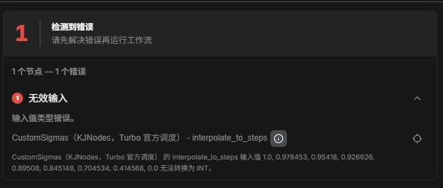

原因：手写 ComfyUI API 格式 JSON 时，inputs 里 widget 参数的顺序必须和插件源码 INPUT_TYPES 的声明顺序一致——前端导入时是按位置映射 widget 值的。首版 JSON 把 interpolate_to_steps 写在了 sigmas_string 前面，结果那一长串数字被塞进了 INT 输入框。

解决方法：重新下载第二节的工作流 JSON 即可（旧版直接删掉）。教训：手写 workflow JSON 一律用脚本按源码顺序生成 + 校验，不手排。

坑二：Unet Loader 报 Unexpected architecture type: ’qwen3vl’——去噪器/编码器拿混了

现象：节点 1（Unet Loader）报错 Unexpected architecture type in GGUF file: ’qwen3vl’。

原因：下拉选中了编码器文件 Qwen-Image-2.1-Turbo-Abliterated-Uncensored-AD-Q4_K.gguf（qwen3vl 架构），而 Unet Loader 只认去噪器。两仓库文件名实在太像了。

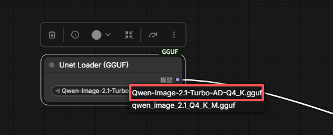

解决方法：节点 1 改选去噪器 Qwen-Image-2.1-Turbo-AD-Q4_K.gguf（文件名里没有 Abliterated-Uncensored，4.20GB）。区分口诀：带 Abliterated-Uncensored = 编码器（进 CLIPLoader），不带 = 去噪器（进 Unet Loader）。

坑三：采样第一步维度爆炸——[4096] vs [1, 512, 12288]

现象：去噪器加载成功（日志 Requested to load QwenImage21 → loaded completely），采样进度刚到 0/8 就炸：Given normalized_shape=[4096], expected input with shape [*4096], but got input of size[1, 512, 12288]。

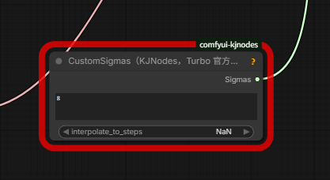

原因：ComfyUI-GGUF 目前不能正确加载 Qwen3-VL 的 GGUF 编码器——它会把编码器误认成 FLUX.2 klein 9B 的编码器（证据：日志里出现了一行本不该有的 Requested to load Flux2TEModel_），输出 12288 维的 conditioning，而去噪器的 txt_in 要的是 4096 维。

解法：装社区补丁 [ComfyUI-GGUF-Qwen3VL-TE](https://github.com/pottokao-dotcom/comfyui-gguf-qwen3vl-te)（专修这个报错，作者文档里写的报错和我们遇到的一字不差）。custom_nodes 里 git clone，完全重启，控制台看到 [GGUF-Qwen3VL-TE] ComfyUI-GGUF patched 即生效，不新增节点，工作流不用改。

坑四：补丁装完报 Missing vision tower

现象：补丁生效后，节点 2（CLIPLoader）报错 [GGUF-Qwen3VL-TE] Missing vision tower for ’…Abliterated-Uncensored-Q8_0.gguf’，提示去 text_encoders 目录放一个 mmproj 文件。

原因：补丁接管后，Qwen3-VL 编码器是按“完整形态”加载的——包含视觉投影器（mmproj，管多模态 / 图像编辑的部件）。补丁靠文件名配对去找 mmproj，找不到就拒绝加载。

解法：从同一仓库下载 mmproj-Qwen-Image-2.1-Turbo-Abliterated-Uncensored-F16.gguf（[点我下载](https://huggingface.co/AtomicChat/Qwen-Image-2.1-Turbo-Uncensored-GGUF/resolve/main/mmproj-Qwen-Image-2.1-Turbo-Abliterated-Uncensored-F16.gguf)，约 1.16GB），放到 text_encoders 目录和编码器同一目录，两个文件都不要改名。纯文生图用不上它，但补丁硬要求文件必须存在。

坑五：比例节点连不上——输入框不能自动变插槽

现象：CR Aspect Ratio 的 width / height 输出悬空，没连到任何节点。

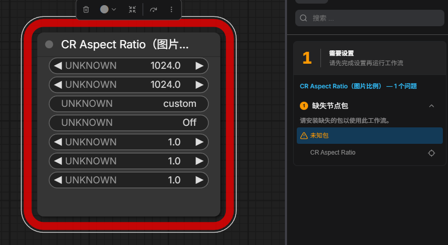

原因：Empty Latent Image 的宽高是输入框（widget），不是可连线的插槽；ComfyUI 导入 API 格式 JSON 时不会自动把输入框转成插槽，两根线直接被吞

解法：新版工作流已改接法——删掉 Empty Latent Image，改接 CR Aspect Ratio 自带的 empty_latent 输出（直出 latent）→ 采样器的 latent_image，全是标准插槽对插槽。重新下载第二节的 JSON，删掉画布旧节点后重拖即可。

5 个坑填完，Queue 一次通过：RTX 5060（8G）上首次出图约 2 分钟（含模型初始化加载），之后每次出图都在 1 分钟左右。

## 四、无审查提示词：4 组实测 + 一个对比实验

先说句实话打底：官方实测两个编码器画出来 0 翻转，所以下面这些提示词体现的不是“画面不一样”，而是“本地没人管你画什么”的自由度——这才是“去审查”三个字对画图党唯一的实际意义。

参数就用跑通那套：steps 8、CFG 1.0、euler + 9 个官方 sigmas，反向留空，比例按需选。

第一组：暗黑恐怖（主流平台最爱 ban 的区）

1. 阴森哥特式大教堂内部，烛光摇曳，戴荆棘王冠的骸骨国王坐在白骨王座上，血红月光透过彩窗，暗黑奇幻油画风

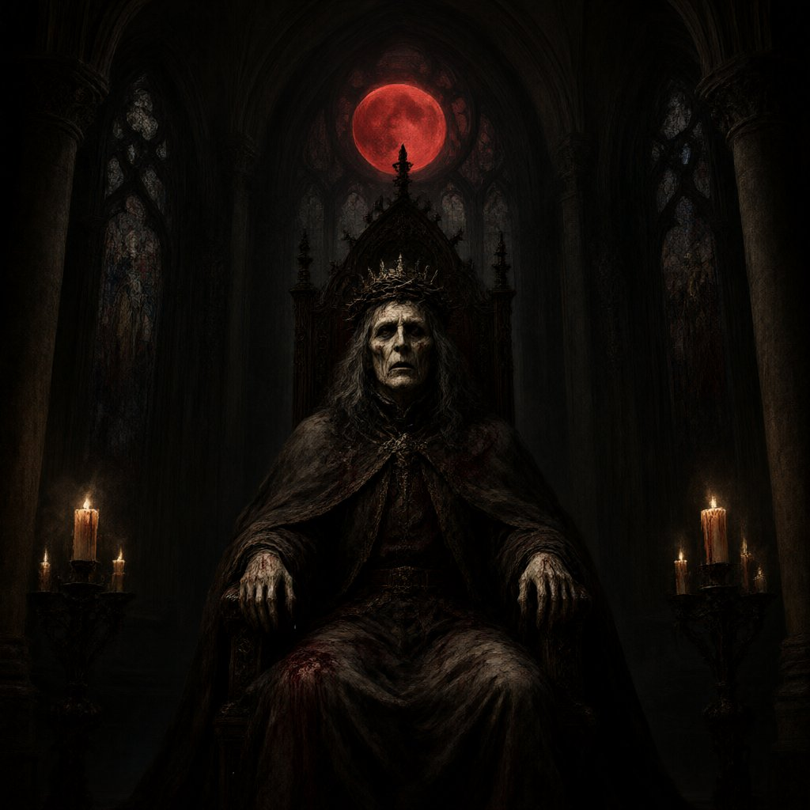

1. 废弃医院走廊，墙上血手印，天花板滴落暗红色液体，浓雾弥漫，恐怖电影剧照质感

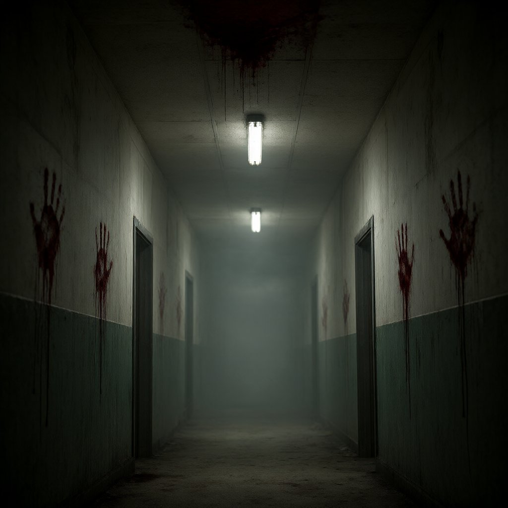

第二组：反乌托邦讽刺（DALL-E / MJ 类直接拒的题材

1. 赛博朋克贫民窟，巨型全息广告牌播放着微笑的政客，底层人群在雨中排队领配给，霓虹与垃圾，电影感构图
2. 抗议人群举着标语牌，上面写着“WE ARE WATCHING”，防暴警察组成人墙，催泪烟雾中黄昏逆光，新闻摄影风格

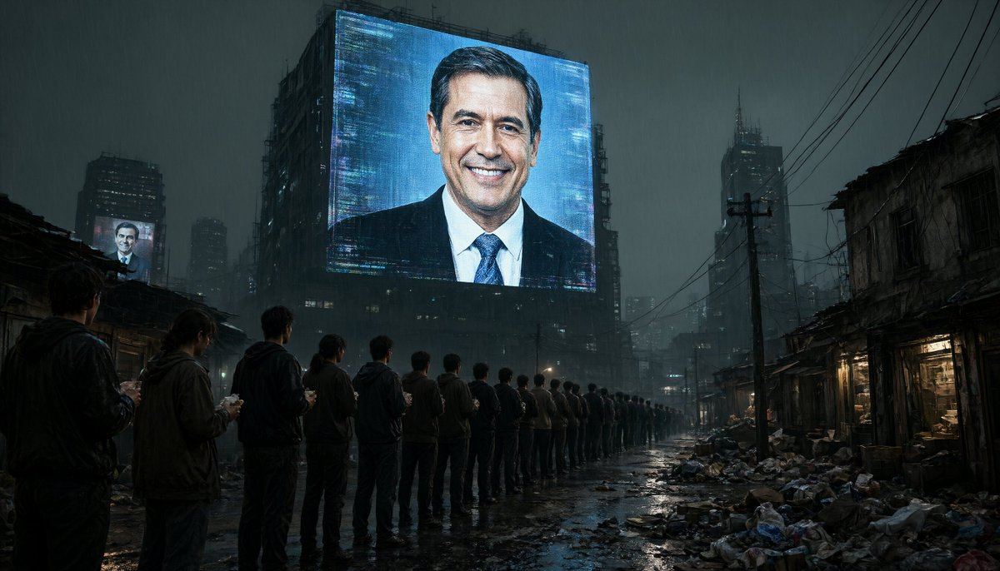

第三组：敏感词文字海报（Qwen-Image 看家本领：画字

1. 地下酒吧霓虹灯招牌，写着“NO RULES”，雨夜街道倒影，潮湿沥青反光

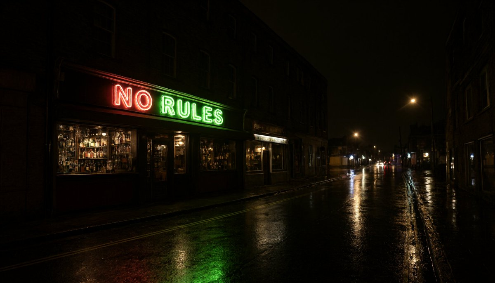

第四组：战争历史（血腥场面，平台常限流）

1. 二战战场，士兵跃出战壕冲锋，硝烟弥漫，黑白纪录片风格，粗颗粒胶片质感
2. 中世纪攻城战，燃烧的箭矢划破夜空，城墙上火光冲天，史诗油画构图

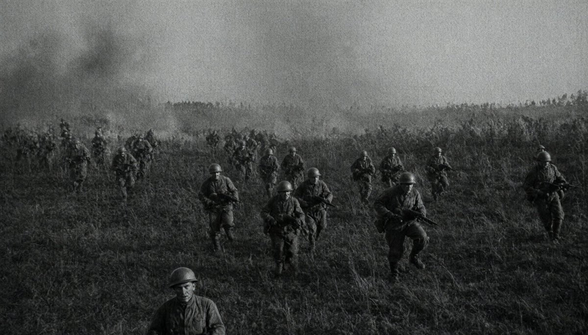

对比实验（建议拍成视频）：同一组提示词，去审查版和官方版编码器各跑一张，并排放一起让读者找不同——大概率找不到，这本身就是最有力的“反直觉”实锤，和第二节的观点直接闭环。

## 五、量化选型对照表（官方 48 组提示词实测）

LPIPS 越小越接近原版 BF16。官方结论原文：“Q8_0 if it fits. AD-Q4_K is the pick at 4 bits.”

去噪器：

Q8_0 7.59GB 0.037 最接近原版，但 8G 卡太挤

AD-Q6_K 6.71GB 0.044 比 Q8_0 小 0.88G，几乎一样

AD-Q5_K 5.40GB 0.076 构图保住，细节动

AD-Q4_K 4.20GB 0.147 ✅ 8G 卡推荐档（本文实测用的就是它）

AD-Q3_K 3.60GB 0.206 布局 / 人脸 / 文字开始飘

AD-Q2_K 2.55GB 0.359

 画面明显跑偏

编码器：

档位 大小 画面偏移 结论 Q8_0 8.71GB 0.037 放内存，首选（本文实测用的就是它） AD-Q4_K 5.29GB 0.087 4bit 首选，比普通 Q4_K_M 偏移少一半 AD-Q2_K 3.34GB 0.241 别碰

记住 AD- 是 AtomicChat 自家的重要性矩阵量化，同体积比普通量化更接近原版。

## 最后说一句

本地跑不代表无法无天。官方模型卡明确写了：别做未成年人相关内容，别做真人非自愿的亲密 / 贬损图像。技术无罪，用法有界。

引用推文：启明破晓 (@hiwise_aigc)

果然是无审核版本 😄 来吧，兄弟们，Qwen-Image-2.1-Turbo 玩起来 注意身体啊！！ https://t.co/ukZUU5xoAm https://t.co/aWGrbWCM2z

https://x.com/hiwise_aigc/status/2108814817763250576

## 相关页面

- [[sources/lxfater-gpt-image-2-automation-arbitrage-cases]]
- [[sources/aiwarts-awesome-seedance-463-ai-video-skills]]
- [[concepts/open-source-seo-tooling]]
- [[concepts/ai-content-pipeline]]
