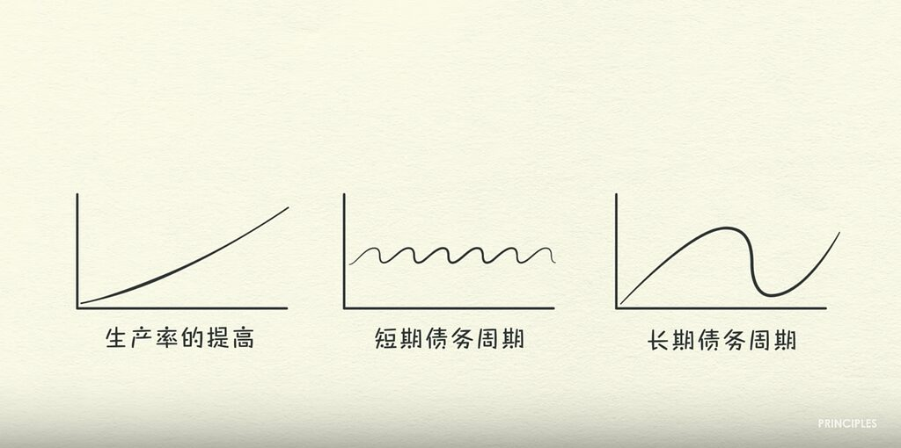
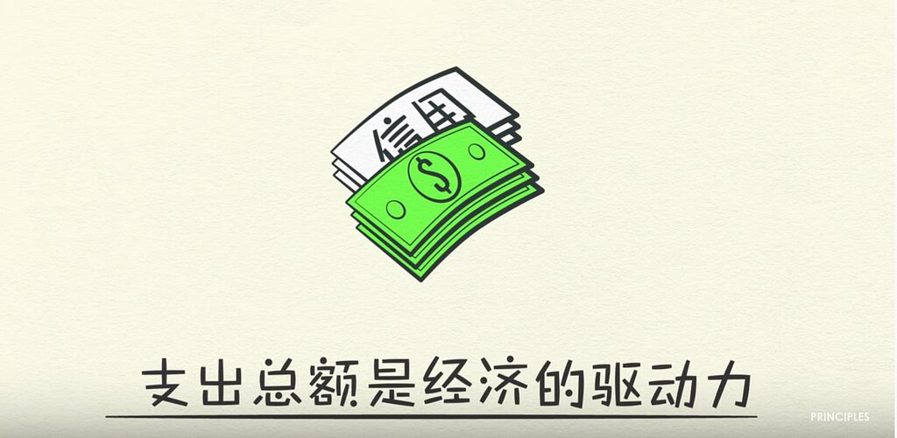
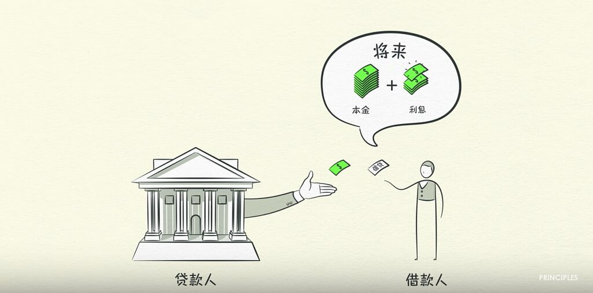
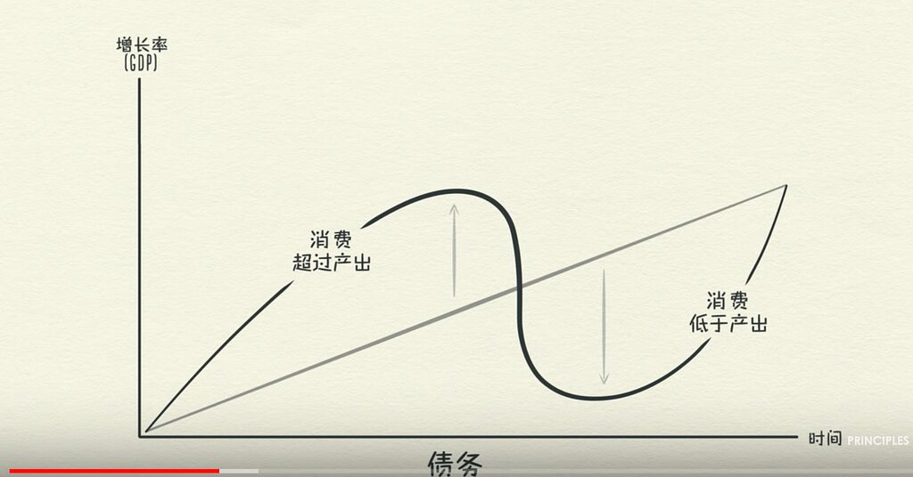
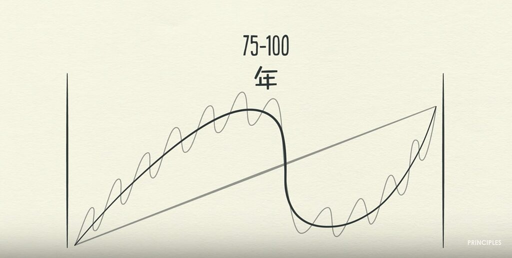
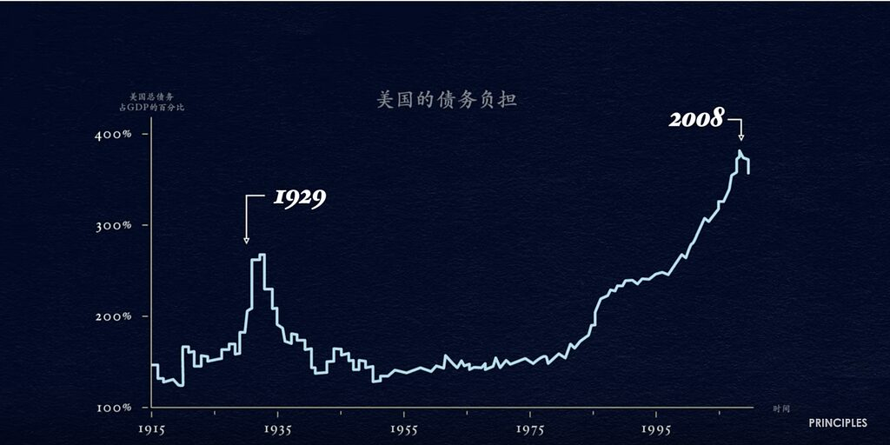
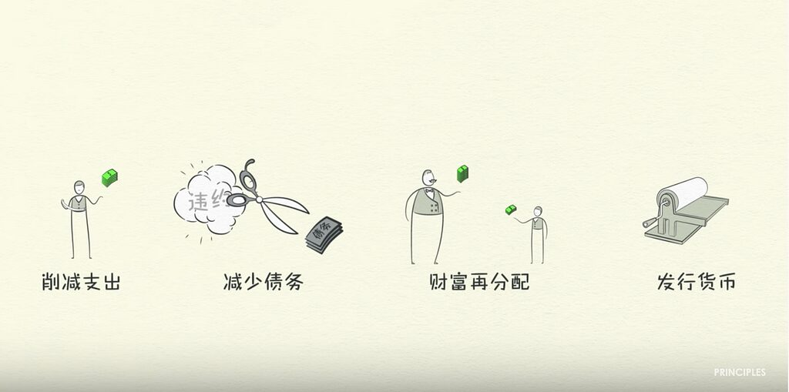
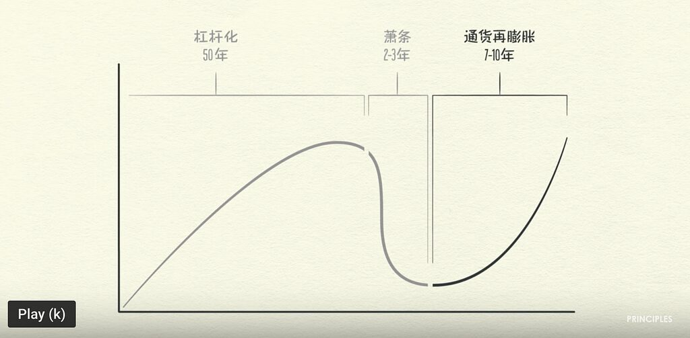

# 经济机器是怎样运行的：Ray Dalio 的交易、信贷与债务周期模型

> Ray Dalio 将宏观经济压缩为无数交易的总和，并用生产率增长、短期债务周期和长期债务周期三股力量解释繁荣、衰退、去杠杆化及政策应对。

<!-- more -->

原始模型：Ray Dalio  
图文整理：Rongrong Wang  
Medium 发布日期：2020-04-03

## 模型总览



该模型认为，经济看似复杂，但可以从三个主要动力理解：

1. **生产率增长**：决定长期生活水平。
2. **短期债务周期**：通常被描述为约 5 至 8 年的扩张与衰退。
3. **长期债务周期**：债务负担跨越多个短周期累积，最终进入去杠杆化。

## 交易是最小单元

一笔交易中，买方使用货币或信用，向卖方交换商品、服务或金融资产。模型把宏观经济定义为所有市场中全部交易的总和：

```text
支出总额 = 货币支出 + 信用支出
价格 = 支出总额 / 销量
```



个人、企业、银行和政府都参与交易。中央政府通过征税和支出影响经济；中央银行则通过利率、货币和信贷条件发挥作用。

## 信贷如何创造周期

信贷产生时，同时出现两笔对应记录：它是贷款人的资产，也是借款人的负债。借款人偿还本金和利息后，这组资产与负债才消失。



信贷之所以关键，是因为它允许当前支出超过当前收入：

```text
借贷增加
  -> 支出增加
  -> 他人收入增加
  -> 信用度与抵押能力提高
  -> 可获得更多信贷
  -> 新一轮支出
```

但借债本质上是提前消费。未来偿债时，支出必须低于收入，因此每次借贷都会把一部分未来需求移到今天，并形成周期。

信贷并非天然有害。若借款用于提高生产率并产生足以覆盖债务的收入，可视为生产性信贷；若只支持超过偿还能力的消费，则会增加脆弱性。

## 短期债务周期



短期周期的典型因果链是：

1. 信贷容易获得，借贷和支出增加。
2. 支出增速超过商品与服务供给增速，形成通胀。
3. 央行提高利率，借贷减少，现有债务的偿付成本上升。
4. 支出和收入下降，经济进入衰退。
5. 通胀压力缓解后，央行降低利率，借贷与支出恢复。

在该模型中，利率是调节短期信贷周期的重要工具。

## 长期债务周期



多个短期周期之后，债务和经济活动的高点往往高于上一轮。繁荣期的收入增长和资产升值提高了抵押物价值，使贷款人愿意继续放贷；借来的资金进一步推高资产价格，形成正反馈。

当偿债成本增长快于收入时，借款人被迫削减支出。支出是他人的收入，因此收入随之下降，信用度恶化，信贷收缩，资产被抛售，长期周期开始逆转。



## 去杠杆化

长期债务顶部之后，模型描述的去杠杆化链条为：

```text
削减支出
  -> 收入下降
  -> 信用恶化
  -> 信贷减少
  -> 资产价格下跌
  -> 抵押物价值下降
  -> 进一步削减借贷与支出
```

它与普通衰退的区别在于：利率已接近下限，单纯降息难以继续刺激借贷。

模型提出四类减轻债务负担的手段：

1. 个人、企业和政府削减支出。
2. 通过违约、减记、降息或延长期限重组债务。
3. 通过税收和财政支出重新分配财富。
4. 中央银行创造货币并购买金融资产或政府债券。



这些工具分别带来通缩或通胀压力。紧缩和债务减记通常压低支出、收入和资产价格；货币创造与财政支出则试图补偿消失的信贷和需求。

## 和谐去杠杆化

所谓“和谐去杠杆化”，是让债务相对收入下降，同时维持温和的正增长和可控通胀。关键不是无限创造货币，而是让收入增长快于债务利息增长，并在紧缩、重组、再分配和货币创造之间取得平衡。



若货币投放只是抵消信用收缩，模型认为未必造成高通胀；若投放远超消失的信贷和实际供给能力，则可能导致货币贬值与恶性通胀。

## 三条经验法则

1. 不要让债务增速长期超过收入增速。
2. 不要让收入增速长期超过生产率增速。
3. 尽一切努力提高生产率，因为生产率决定长期生活水平。

## 模型边界

这是一套强调交易、信用和资产负债表反馈的解释模型，不是完整的宏观经济学理论，也不代表所有学派的共识。

- 作者在原文导语中明确表示，对长期债务周期的成因和量化宽松的真实有效性仍有疑问。
- “5 至 8 年”和“75 至 100 年”等周期长度是模型中的经验概括，不是稳定自然常数。
- 模型弱化了供给冲击、人口结构、技术扩散、国际收支、制度差异和预期形成等因素。
- 文中引用的美国货币、信贷和政策规模是视频制作时期的数据，不能当作当前统计值。
- 该模型适合建立第一张因果地图，不适合直接作为投资择时或政策预测工具。

## 权威来源

- [Principles by Ray Dalio 官方 YouTube 频道](https://www.youtube.com/@principlesbyraydalio)
- [How The Economic Machine Works 官方播放列表](https://www.youtube.com/playlist?list=PLykIL_1_MFWmS82OuK8CBCow_QHUJuBes)
- [桥水中国：经济机器是怎样运行的](https://bridgewater.cn/philosophy/economic-machine/)

归档时已移除 Medium 追踪像素和购买推广链接，并从 30 张原图中保留、压缩 8 张关键模型图。
