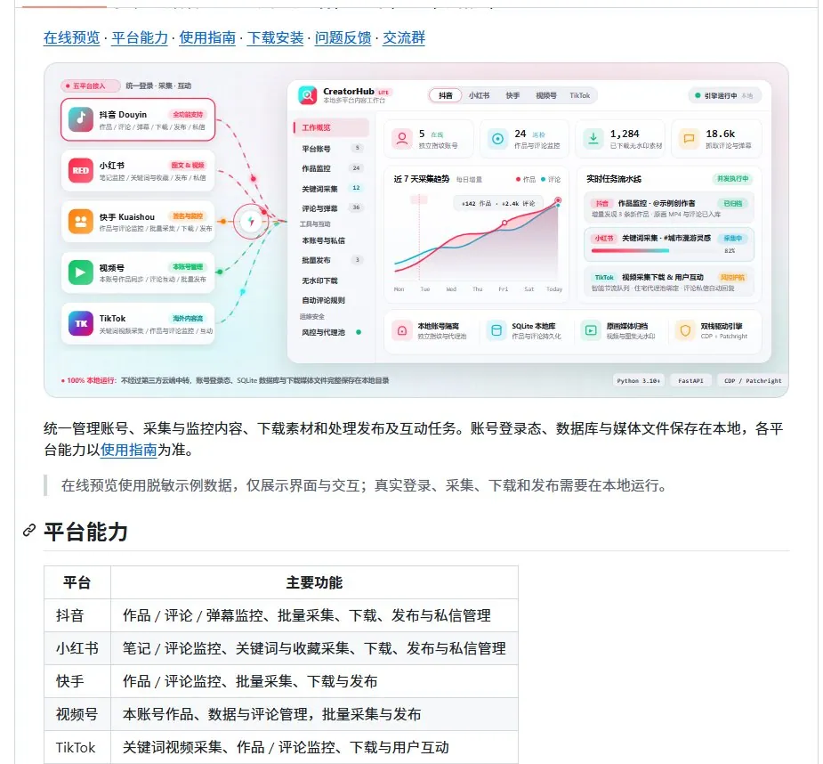

# LanfAI（@Huahuazo）：CreatorHub——把抖音、小红书、快手、视频号收进同一个 Web 后台

> 多平台内容运营后台 CreatorHub 开源：账号、作品、评论、采集与发布统一收进同一个 Web 后台打理，避免同时铺抖音/小红书/快手/视频号时账号一多就抓瞎；支持账号动态监控与关键词批量采集作品评论、跨平台转发与多账号归拢管理、评论与消息统一处理，并内置操作风控以免手太勤招来平台限制。

<!-- more -->

同时铺抖音、小红书、快手、视频号，账号一多是不是就容易抓瞎？

CreatorHub 索性把好几个平台全收进了同一个 Web 后台，账号、作品、评论、采集连同发布，统统拢到一处打理。

① 账号一有动静它就盯着，关键词也能批量薅作品和评论

② 内容下得动，抖音那边画质还能挑，小红书的图集、视频也照单全收

③ 跨平台转发、多账号归拢着管，全都撑得住

④ 评论有人盯着、消息有人递着，一并给揉了进去

⑤ 操作风控也配上了，免得手太勤招来限制

🔗 https://t.co/vtFV60Bhe5

## 相关页面

- [[sources/indie-hub-xiaohongshu-workbench]]
- [[sources/kongge-space-10-skills-daily-explosive-wechat-article-system]]
- [[concepts/selfmedia-compound-model]]
- [[concepts/open-source-seo-tooling]]
