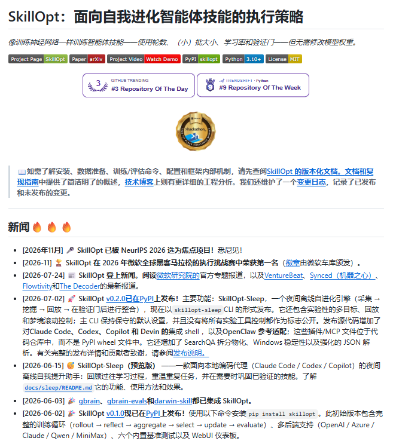

# 花花：微软开源 SkillOpt——让 Agent Skill 自己跑、自己评、自己改

> 微软开源 SkillOpt，把训练模型那套优化思路挪到 Agent Skill 上：Agent 先把任务跑一遍，优化器看着结果和执行轨迹自动改 Skill 指令。① 从成功/失败轨迹里挑出具体改进点；② 新版本分数没超过基准就直接打回；③ 不绑死某个模型，优化后的 Skill 还能迁走；④ 主打自动优化，减少手动调 Prompt 的反复试错。技能从「人工调教」变成自己跑、自己评、自己改。附 GitHub 仓库 microsoft/SkillOpt 与 1 张配图。

<!-- more -->

AI Agent 的 Skill 现在也能自己“迭代升级”了

微软开源的 SkillOpt，把训练模型那套优化思路挪到了 Agent Skill 上：Agent 先把任务跑一遍，优化器看着结果和执行轨迹，自动改 Skill 指令。

1. 成功/失败轨迹里挑出具体改进点
2. 新版本分数没超过基准就直接打回
3. 不绑死某个模型，优化后的 Skill 还能迁走
4. 主打自动优化，手动调 Prompt 的反复试错能少很多
   说白了，Agent 的技能从“人工调教”，变成自己跑、自己评、自己改。
   🔗https://github.com/microsoft/SkillOpt

## 相关页面

- [[patterns/error-notebook-pattern]]
- [[patterns/progressive-disclosure]]
- [[sources/hwchase-knowledge-factory]]
