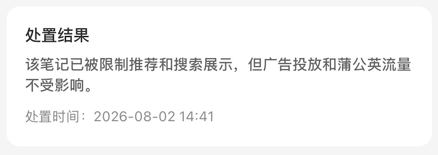
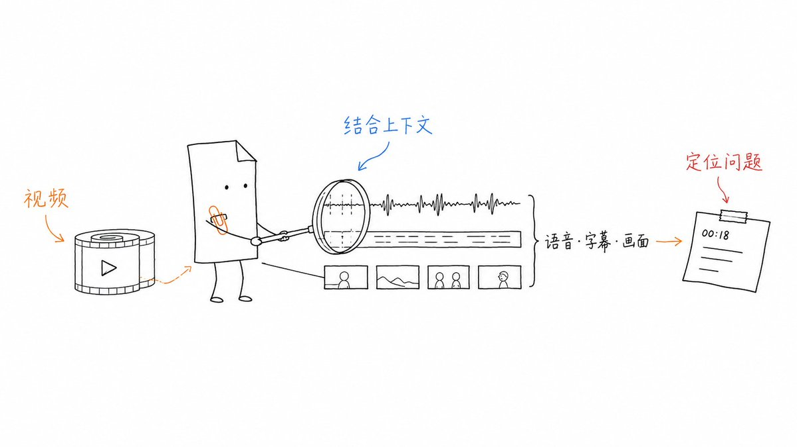
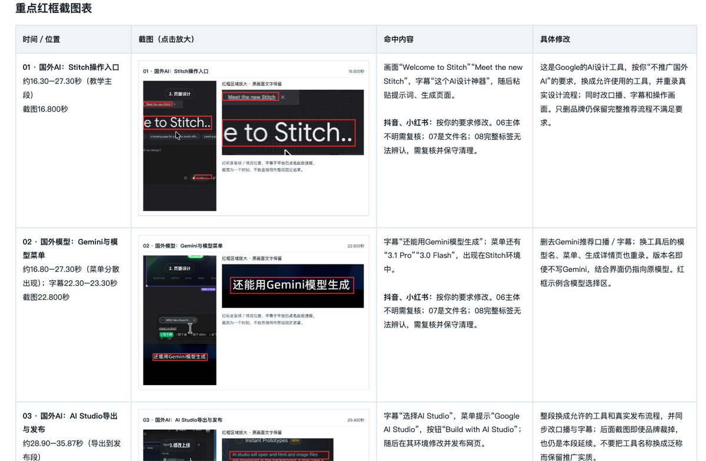
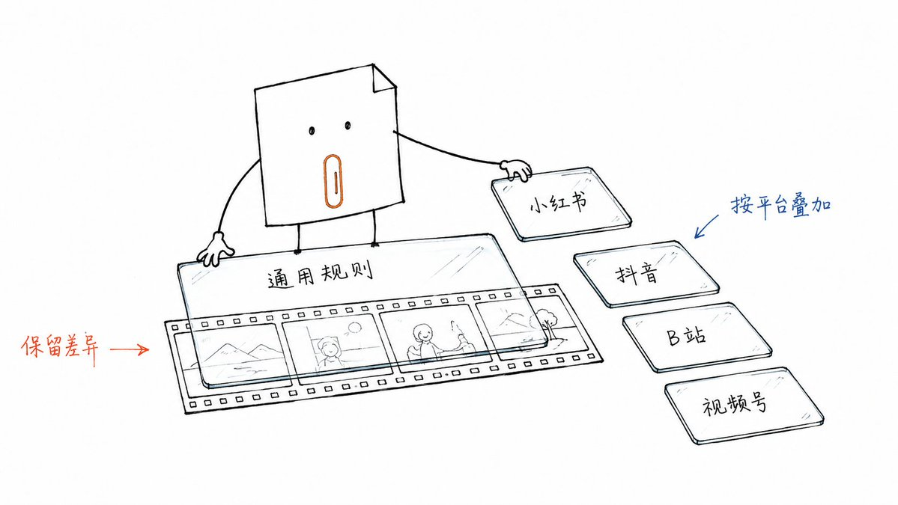
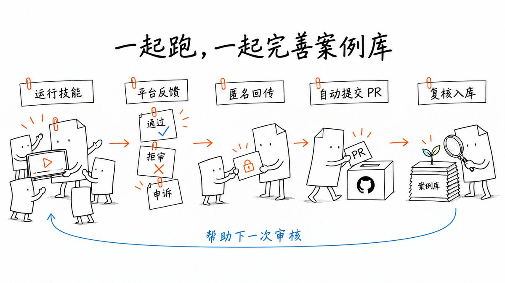

# 为了让大家不再「卡审」，我做了「过审」Skill...

做过自媒体的人，应该都被「审核」困扰过，辛辛苦苦做的视频，最后却被卡审限流。。。

更可气的是！！平台并不会告诉你，卡审的点是什么。只能自己辛苦反复推测到底哪里出了问题。。。

作为一个全网 40 万粉的 AI 博主，在过去的一年时间里，我几乎每个月都会有视频被莫名卡审限流，真的是烦不胜烦。。。。

所以，我做了一个叫「过审」的 skill，最初只是为了自己用。但现在我发现，只有大家共同提 PR，才能够做好这个 skill...

## 一、怎么用

把[「过审」](https://github.com/huangbai-AI/guoshen)安装到 Codex/CC，把视频文案和成片一起丢进对话，告诉它准备发到哪个平台。比如：

> 用 /guoshen 检查这条视频在小红书、抖音、B 站、视频号的发布风险，标出原文、时间点、依据和改法。

它会一起检查语音、字幕和画面，给一个这样清晰的修改建议表

内部用了一段时间，发视频之前，都会先过一遍这个 Skill，调整完了再发布。边用边改这个 Skill，现在卡审的几率已经大大下降了。

## 二、咋做的

第一步，把各个平台公开的审核规定整理进去。

比如小红书的社区规范，以及抖音、B 站、视频号的相关规定。通用要求放在一起，平台差异分别保留，同时记录来源和核实日期，让判断有据可查。

第二步，根据我自己的实践经验，不断迭代。

之后我每次发布遇到问题，就发给这个项目。

这些经验会帮助我们补充检查项、调整判断依据。

比如说，小红书和抖音会卡一切疑似 URL 的地址，但是 B 站不会。小红书会卡字节系的品牌 logo。。。

这就是平台不会讲，我自己总结出来的。

## 三、一起提 PR

但现在，我发现有一个问题：平台的规则是会变的。

比如 Codex 和 Claude Code，之前还是全网推，但最近 2 个月 Codex 的安装教程就会封杀了。

所以，希望大家一起提 PR，把真实反馈带回来。

每次如果卡审，你可以回到使用 skill 的对话里，把结果发给助手：

> 这是上次视频的实际平台反馈，请整理成案例，确认后提交到 guoshen 的 case 部分

助手会整理记录，在你确认内容并授权公开后，自动向仓库提交 PR。这个过程需要可用的 GitHub 登录与提交环境；我们复核合并后，案例就能帮助下一次审核。

欢迎来用，多多提 PR。祝大家条条过审，爆款多多！

[项目地址：huangbai-AI/guoshen](https://github.com/huangbai-AI/guoshen)

> 说明：本文为作者自建工具的开源介绍，仓库地址保留用于溯源；正文未涉及任何付费课程、社群或代运营服务。

## 相关页面

- [[patterns/wechat-image-post-account-sop]] — 微信贴图号起号 SOP
- [[patterns/content-arbitrage-pattern]] — 跨境内容搬运套利 Pattern
- [[sources/story-studio-video-account-pipeline]] — Story Studio 短视频流水线
- [[sources/xaiwind-jianying-skill-guide]] — 剪映 + jianying-editor-skill 使用指南

