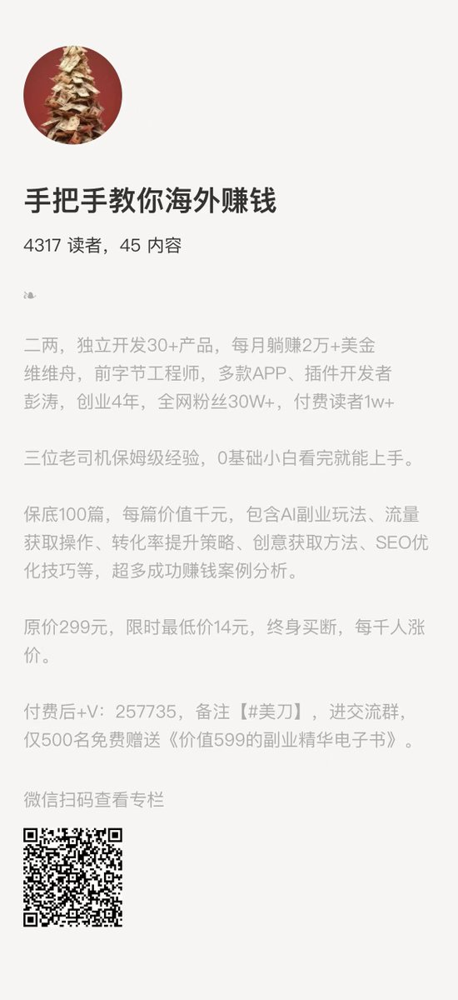
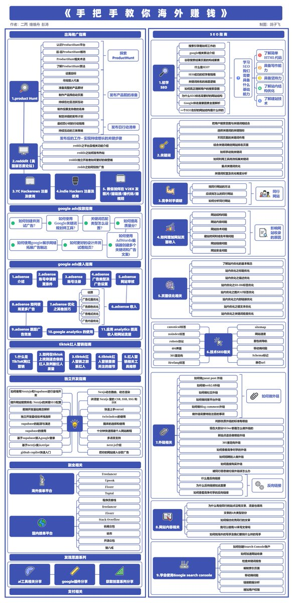

# 《出海赚钱》实战思维导图：产品构思、流量获取与技术栈

> 一张把出海赚钱拆成三段的实战思维导图：**① 产品构思逻辑**（Product Hunt & Reddit & Google 关键词挖掘）→ **② 流量获取途径**（SEO & 社媒起号 & 海外接单平台）→ **③ 产品搭建技术栈**（Next.js、Supabase、Stripe、Vercel）。这是出海赛道的经典三分法，也是最早把这套流程讲清楚的中文材料之一。

<!-- more -->

*图 1：《出海赚钱》小册的实战思维导图。*

*图 2：思维导图细节。*

---

## 三段式框架

| 阶段 | 内容 |
|---|---|
| **① 产品构思逻辑** | Product Hunt & Reddit & Google 关键词挖掘 |
| **② 流量获取途径** | SEO & 社媒起号 & 海外接单平台 |
| **③ 产品搭建技术栈** | Next.js、Supabase、Stripe、Vercel |

---

## 这套框架为什么值得单独归档

它是这批文章里**最早（2024-08）**的一份结构性材料，比 2026 年的多数实践帖早两年。三年后再看，这三段几乎没有被推翻——后来所有文章都是在往这三格里填细节：

| 2024 年的框架 | 2026 年的细化版本 |
|---|---|
| ① **Google 关键词挖掘** | [[concepts/gefei-seo-keywords]]（9 渠道 + 7 步筛选）、[[sources/wavborn-keyword-screening-playbook]]（Trends 比值法 + 前十占位检查） |
| ① **Product Hunt & Reddit** | [[sources/sitin-overseas-toolchain]]（需求挖掘五个源）、[[sources/yaohongan-geo-five-actions-guide]]（Reddit 是 AI 引用主力来源） |
| ② **SEO** | [[sources/jiang-yunhe-first-100-usd-new-word-playbook]]（GSC 数据驱动迭代）、[[sources/bozhou-overseas-path-warning]]（迎合 Google 算法） |
| ② **社媒起号** | [[sources/chuhaiqu-social-distribution-playbook]]（X/YouTube/短视频三线分发）、[[sources/harries-steele-efficiency-vs-profit]]（但平台流量是「人肉电池」） |
| ③ **技术栈** | [[sources/sitin-overseas-toolchain]]（GitHub + Vercel + Supabase + Stripe 全套） |

> **唯一被修订的一条**：② 中的「社媒起号」在 2026 年的实践里权重下降——[[sources/benben-musk-hustle-vs-own-product]] 指出平台流量「滚动 90 天也没有长尾效应」，而 [[sources/yaohongan-geo-five-actions-guide]] 指出第三方平台的**真实提及**反而成了 GEO 的关键。

---

## 相关页面

- [[sources/sitin-overseas-toolchain]] — sitin：一个人独立跑完出海项目的完整工具链
- [[sources/bozhou-overseas-path-warning]] — 泊舟：出海路径警示公告与变现门槛
- [[sources/wavborn-keyword-screening-playbook]] — wavborn：选词三板斧与 72 组词验证率
- [[concepts/gefei-seo-keywords]] — 哥飞 SEO 关键词方法论
- [[sources/jiang-yunhe-first-100-usd-new-word-playbook]] — 蒋云何：副业出海小白首日破百刀，5 天破千刀
- [[sources/chuhaiqu-social-distribution-playbook]] — 出海去孵化器：X / YouTube / 短视频三线分发
- [[sources/yaohongan-geo-five-actions-guide]] — 虹安：GEO 五个动作
- [[concepts/overseas-tool-stack]] — 出海工具栈全景：56 个实战工具按 7 大方向分类
