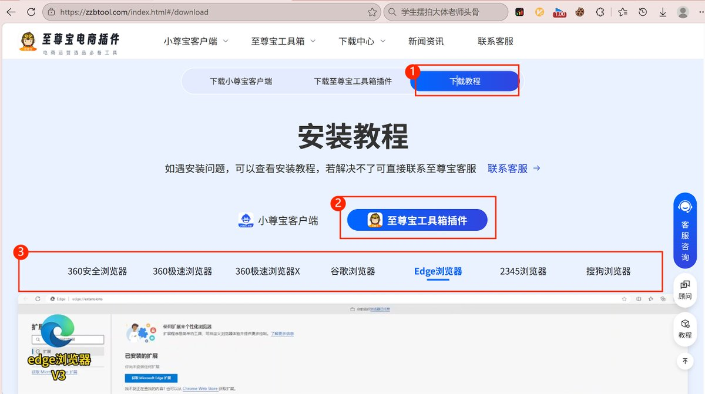
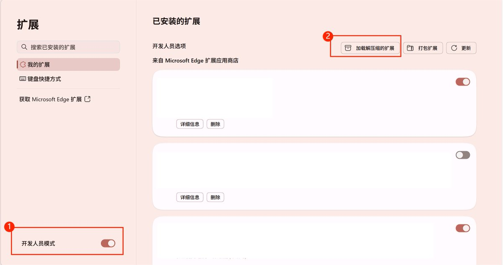
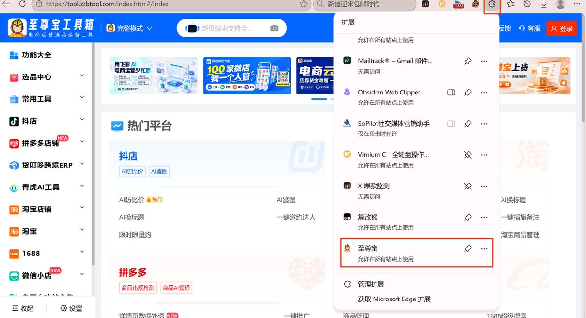

# Hytidel（@HytidelLegend）：小红书电商保姆级教程（6）——运营进阶、提效工具与利润十倍放大

> 小红书无货源与店群运营进阶手册：至尊宝以图搜图与买家秀扒取、剪映批量生成带货视频去重、多退货地址与运费宝开通、千帆自动化客服话术库、晒单有礼与差评申诉、1688 无痕发货供应商沟通，以及通过低粉爆文自复制、源头人设与数字虚拟资料十倍放大利润。

<!-- more -->

上节课讲了「笔记制作（下）」。

引用推文：Hytidel 聊商业（文章更多干货） (@HytidelLegend)

小红书电商教程继续连载 今天讲带货笔记的制作之，live 图、科普类图文、视频混剪 https://t.co/Sx5Bb4eZPu

https://x.com/HytidelLegend/status/2115062396285059435

今天讲「运营进阶与提效工具」。

本篇涵盖：至尊宝以图搜图插件、剪映一键出 10 条带货视频、多退货地址与运费宝、自动回复与客服话术库、晒单有礼与评价运营、发货售后与供应商沟通、十倍放大利润（爆单运营 / 开新号 / 做人设 / 搭团队 / 虚拟资料）、进阶开店（个体店升级 / 保证金 / 微信收款）。

## 一、至尊宝插件：以图搜图神器

做无货源，经常遇到这种情况：在小红书看到一款好品，却下载不到它的商品详情图；或者在别的平台看到好品，想把它扒回千帆店。至尊宝插件就是干这个的——上传一张图，一键在多平台搜同款，把主图、详情图、评论（买家秀 + 文案）整包下载下来。

## 1.1 在浏览器安装至尊宝插件

1. 百度搜索「至尊宝电商插件」，第一个结果一般就是官网，点进去[至尊宝找货助手-免费辅助浏览器插件，至尊宝店群工具(温州紫风科技电子商务有限公司)](https://zzbtool.com/index.html#/download)。（官网主页有「观看安装教程」可随时回看）

1. 点击下载插件，下载完在文件夹里解压到当前目录。
2. 打开浏览器右上角「三个点」→「扩展程序」→「管理扩展程序」→ 打开右上角「开发者模式」。

1. 把解压好的文件夹直接拖进浏览器窗口，插件就装好了。
2. 检查：点扩展程序小图标，至尊宝出现在列表里、能打开工具箱主页，就代表安装成功。

## 1.2 用全网搜图找同款、扒详情图

1. 点扩展图标打开至尊宝 → 登录账号（没有就先注册）；进入「选品中心」→「全网搜图」。
2. 点击「上传图片」，选你已经保存好的那张商品图。
3. 在「不一致更多搜图平台」里勾选要搜的平台（抖音 / 拼多多 / 1688 / 淘宝等常用几个即可），点「保存配置」。
4. 点「一键多平台搜图」，就会列出各平台同款。尽量挑销量高的下载。
5. 点进某个同款 →「下载」，把主图和详情图批量勾选（有视频也一并勾）下载；下载下来是压缩包，解压后就能上传到自己的千帆店。
6. 评论区也能扒：点「评论」，可批量勾选「有买家秀 / 有图片 / 有视频 / 有追加」的评论下载——买家秀可以直接当笔记素材，评论文案可以改一改当你的笔记文案。

提示：拼多多出不来通常是账号权重不够，权重起来后会正常。平时多攒几个平台的同款来源，比只盯一个平台稳。

## 二、剪映一键带货视频

前面讲过素材怎么找、怎么去字幕。这节讲怎么用剪映 App 把素材快速批量做成带货视频，下班集中一小时就能出 5~10 条，第二天只管发布。

## 2.1 先备好素材

- 提前找好 10 个左右的视频素材，另外拍 3 个可以加「画中画」去重的实拍，存进相册。
- 素材尽量找没字幕的；带字幕的先用去字幕手法处理掉（去字幕方法见前期课程）。
- 素材数量不低于 8 个，多一些更利于去重。

## 2.2 用「营销视频」生成雏形

1. 打开剪映 App →「营销视频」→ 添加你备好的素材（≥8 个）→ 下一步。
2. 视频文案有两种做法：直接粘贴你觉得合适的文案；或选「AI 写文案」——输入产品名称（如「秦冠粉面苹果」）、产品卖点（粉面甜、适合老人小孩、可挖泥吃、热量低）、适用人群，优惠活动没有就不填。
3. 尺寸选 9:16，带货视频时长 15~30 秒即可，点「生成视频」。

## 2.3 逐条去重与精修

生成的视频不能直接导出发布（用的是别人素材），每条都要去重：

- 换字幕：点中间字幕，改成更合适的文案，确认后画面会重新匹配。
- 换音色：常用「广西表哥」「台湾男生」「东北老铁」等。
- 删掉原音频，画面不合适就「替换」成你自己的素材。
- 调画质：字体换成「新青年体」、样式用黑白，亮度 / 对比度 / 饱和度 / 锐化各调一点，点「全局应用」。
- 加画中画：新增 3 个，音量调 0，不透明度调到 1~3（几乎看不出），裁剪掉多余部分。
- 贴纸去重：加 4 个左右不明显的小贴纸，拖到四角、只露一点点，别放中间挡观感。
- 可再加特效、滤镜。

## 2.4 导出与节奏

- 导出选 1080P（2K / 4K 也行，一般 1080P 足够）。
- 熟悉后几分钟就能做一条；集中一小时做 5~10 条，第二天发布，每天不低于 5 条笔记。

## 三、多退货地址与运费宝

出单爆单后运营压力上来，这两件事能省掉大量来回扯皮的成本。

## 3.1 把退货地址设回国内

别把退货地址设到国外——小红书规则下，地址在国外的回款周期可能拉长到 30 天，回款压力变大。老老实实填国内地址。

## 3.2 按商品设置多地址退货

无货源每个品的上游供应商不同，退货地址也应该对应不同商家：

1. 千帆 →【订单】→【物流工具】→ 新建一个地址（填你商家那边的退货地址，地址跟商家要去；商家不愿给，就等出一单货到了问客服要）。
2. 在列表最右边点「多地址退货」→ 创建策略（策略名按品写，如「水果退货」）。
3. 选刚加的退货地址 → 添加对应商品 → 创建。之后客户退款，后台会自动推送这个退货地址，货直接退给上家，省掉你中转。

## 3.3 运费宝要不要开、怎么开

运费宝会影响用户决策（尤其服装这种退货率 30%~40% 的类目，用户会先看有没有运费宝）。

- 入口：千帆 →【售后】→【运费宝】→ 阅读同意 → 开通。预估费用按你店的退货率、纠纷率评估（如 0.12 元 / 单，每家店不同）。
- 好处：提升店铺转化率、提升流量、降低纠纷率。
- 建议：服装 / 女鞋 / 女包等高退货率品类最好开；水果 / 零食 / 家居等本身退货率低的，开不开都行。不必所有店都开。

## 四、自动回复与客服话术库

主动来咨询的用户下单意愿高、转化好，但消息可能只在商家版 App 弹（从店铺发起的咨询，个人版看不到）。小红书要求客服回复率 80% 以上，越早回越好。先把千帆商家版（小红书千帆 App）下好。

## 4.1 用自动化工具做智能客服

千帆 →【客服】→ 右边「自动化工具」：

- 欢迎语：工作时间 / 非工作时间分别设置（如「你好，在的哦，请问看中本店哪个宝贝了呢？」）。
- 自动回复问题设置：开一段时间店、收集到用户常问的 30~50 个问题后，逐条新增「问题 + 固定话术」。
- 关键词自动回复：给问题关联关键词（如「发货」），用户问到就自动回。
- 商品卡片自动回复：用户从某篇笔记 / 商品引流进来，自动推送该商品卡片和设定话术，可加图片回复。
- 跟单助手：自动催付、自动催单、核对订单信息、发货提醒。

## 4.2 电脑客服端 + 话术库

常在电脑前，可以下载客服端（客服界面里有「下载客服端」），登录后能同步收消息，状态分在线 / 忙碌 / 离线（不同状态自动回不同话术）。

话术库很好用：支持单个添加，或直接导入 Excel（填「类目 + 快捷编码 + 话术内容」，编码自己能看懂就行，如从 01 往下）。常用几类：

- 01 欢迎语：「亲亲你好，有什么是我可以帮你介绍的吗？」
- 02 结束语：「感谢亲的支持，拍好的商品会在 48 小时之内发货哟。」
- 03 砍价：「亲亲不好意思，我们店铺是小本生意，利润很低，不能够再优惠了哟。」

导入后，遇到对应场景点一下编码就自动填入对话框，直接发送。等出单、爆单、客服量大了再做这套快捷回复，别一上来就折腾。

## 4.3 常用客服与促单话术参考

以下话术按自己品类改着用：

- 尺码：「本店标注的都是标准码，也可把身高体重告诉我帮您选最合适的。」
- 色差：「实物拍摄，光线和屏幕可能有细微差别，已尽量降到最低，请谅解。」
- 质量：「发货前都有检查，也可看下店铺商品评价，都是买家的肯定。」
- 发货时间：「一般每天 2 点半前支付的当天发出，之后次日发，尽量尽快安排。」
- 物流：「默认韵达，一般 3~5 天到；节假日、偏远地区可能延迟。」
- 议价：「本店已是低价促销，利润薄，实在没法再优惠，请谅解。」
- 结束语：「感谢光顾，尽快安排发货，记得给我们评价哦，方便您下次回购。」

促单话术：利用「怕错过」（「这款最畅销经常断货，现在只剩几个了」）、利用「想早点拿到」（「快递员再过 10 分钟来取，现在拍下马上寄」）、拿不定主意时用「二选其一」（「要第 2 款还是第 6 款？红色还是蓝色？」）、断货时「巧妙反问」引导到其他颜色、高意向时「积极推荐」并附推荐理由。核心就一句：给用户「为什么在你这买、为什么现在买」的理由。

## 五、晒单有礼与评价运营

## 5.1 晒单有礼是什么、有什么用

相当于拼多多的好评返现：用户在你店买完并确认收货，参加活动就能拿到你设置的优惠券。三个好处：笔记本身带公域流量（优质商单笔记还有官方扶持）；变相发券提高复购；晒单笔记显示在商品详情页，利于转化。

## 5.2 创建晒单有礼活动

1. 千帆（商家管理后台）→ 左侧【营销】→【晒单有礼】→【新建】。
2. 填活动名称、时间（如 5.15~6.30）、商品范围（全店或部分）。
3. 权益配置——优惠券类型两种：
   - 红包：用户在小红书任意店都能用，费用你要自己承担。设参与次数上限（如 3 次）、金额（如 5 元）、发行总量（如 1 万）。
   - 商家券：只能在你店用。可使用时间分绝对时间 / 相对时间；满减门槛有「无门槛」和「满额减」（如满 10 减 5）；发行总量设多一点（如 1 万件）。
1. 点提交。

## 5.3 邀请用户晒单

给用户发话术（老师会在群里发模板，自己改）：「这里还有一份你的晒单福利待领取——买过任意商品、收到后拍照 / 录视频分享心得、发笔记 @ 我们店铺、等审核通过联系客服领礼」。用户发布路径：订单 → 找到订单 → 晒单有礼 → 发布晒单笔记 → 开心收下优惠券。

## 5.4 差评处理

平台会考核负反馈率（评价 / 售后 / 投诉 / 咨询里的负向反馈），看 30 天内数据，过高会限流。差评双方都不能直接删，必须向官方申诉、由官方删。

- 差评用户未匿名：尽量联系上本人（客服私信 / 短信 / 电话），态度友好，一般建议直接退全款——主动发起售后，用户点同意即可。截图用户回复「同意」的聊天记录，到千帆 PC 端 →【商品】→【评价管理】→ 申诉评价。同一评价最多申诉 2 次，审核 1~5 个工作日。沟通话术参考：「看到您 x 月 x 日购买的不太满意，我是店长，很抱歉处理晚了，已给您开售后通道，您申请【仅退款】我全额退，若可以能否申请删除差评？回【同意】我去申请。」
- 差评用户匿名 / 疑似同行：找不到人，就在差评下公开回复（如「很多人买了都不错，这款……如果您不喜欢可直接联系客服，本店宗旨客户第一」），让后续意向客户觉得是这人个人原因、不是产品问题。
- 平时多引导新下单用户好评，把好评数拉起来，稀释负反馈率。

## 六、发货、售后与供应商沟通

## 6.1 出单后怎么下单发货

1. 千帆 App → 待发货 → 去发货 → 点「小眼睛」复制用户收货信息。
2. 去 1688 下单，先和供应商客服确认好三件事，确保是无痕发货：① 是否用普通快递面单（普通 / 菜鸟可以，拼多多 / 抖音 / 淘宝等平台面单不行）；② 面单上有没有 1688 或店铺名；③ 放不放卡片（带 1688 信息的卡片绝对不行，纯产品卡片没事）。这三问务必确认，否则被平台判无货源会限流甚至封店。
3. 供应商发货后，复制快递单号 → 千帆 App 待发货 → 去发货 → 填物流单号（系统一般自动识别快递公司）发货。

## 6.2 已发货仅退款怎么处理

- 未签收（运输中）：先快递拦截，拦截成功再同意仅退款；没拦到让用户拒收，退回后退款。话术：「物流还在路上，确定不要我帮您拦截，不一定成功，没拦到麻烦拒收，退回后处理退款。」
- 未签收（派送中 / 驿站）：告知用户拒签后退款；没拒签等快递员找回商品再同意。
- 已签收：先问商品有什么不满意，任何问题都支持退货退款（不支持仅退款不退货）。话术：「看到已签收申请了仅退款，是有什么不满意吗？不喜欢小店支持退货退款包运费，不支持仅退款不退货哦~」

## 6.3 生鲜水果类售后话术

- 坏果：让用户把坏果 + 快递单号拍在同一张照片，核实后退款 / 赔偿（如赔 10 元）。话术：「果子发货前新鲜采摘，运输难免磕碰，坏果都包赔，麻烦拆开检查把坏果拍照，核实后安排售后。」
- 不熟：说明发的是 8 成熟减少损坏，放放变橘更软糯。话术：「为减少损坏发 8 成熟，果面发青是成熟度不高，放放再吃更软糯多汁。」
- 转寄：转寄影响新鲜度、不提供坏果包赔，还会产生额外费用，建议不要转寄。

## 6.4 订单加密与批量发货

小红书订单加密，平台每天给一定解密额度查看用户收货信息，单少够用；用完可在千帆后台【店铺】→【隐私保护】→【提额申请】（理由如「用了不支持小红书面单的快递」，半小时审核）。单多可一次申请 14 天无限额度。

- 批量下载待发货订单：订单 → 订单管理 → 待发货 → 勾选 → 全部导出。
- 批量发货：电脑端千帆 → 订单 → 发货工具 → 下载发货模板（填订单号 / 快递编码 / 快递单号）→ 上传。
- 单量大且稳定：直接让供应商合作打单。给供应商开子账号（店铺 → 子账号管理 → 新建岗位「打单助理」、只授权「发货管理」；再新建子账号绑定供应商手机号），供应商用子账号开通电子面单打单。只授权发货管理，别给别的权限，避免供应商看到你店铺销售额等信息。

## 6.5 与供应商沟通

找靠谱商家、谈无痕发货的话术前面 6.1 已讲（三问确认）。平时多对比几家，量大了你就是甲方，商家都顺着你；长期合作的每月抽检一次质量，变差就换供应商，这些都能谈。

## 七、十倍放大利润：爆单运营、开新号、人设、团队、虚拟资料

这一节是出单几十单之后才需要细看的。小红书目前仍是国内少数还有红利的电商平台，靠内容就能起盘，更适合普通人。想放大利润，几个关键动作：

## 7.1 爆单之后怎么运营

- 选品占 50%+，封面和标题决定点不点得进。先优化封面标题，再谈运营。
- 低粉爆文是最佳选品方向：粉丝几百、收藏 > 1000、近期一周内发布、没挂车但评论区大量「怎么买 / 多少钱」。粉丝越少越说明是选品选得好。
- 极致利用低粉爆文：保留它最吸睛的封面，后面的视频 / 图片素材替换成你的对标内容混剪，提高原创度；标题也可微调。
- 出单后运营：爆款重复发，封面不变、只换后面素材，耗尽流量再换封面、再换品；换品要「投其所好」——卖小胸显大内衣出单了，就继续卖同卖点的聚拢内衣；卖零食出单了，就继续卖同类零食，别乱换。
- 评论区助攻：500 小眼睛以上就能用小号带 3~5 条评论，2000 以上带 7~10 条（小号别同 IP、别太集中）。把用户可能问的疑虑（酸不酸、皮薄不薄、165 能穿吗）在评论区自己打造出来并本人回复，打消购买顾虑。
- 出单后买回实拍：既查质量，又提高作品原创度（自己拍不用混剪也不违规）。量大了每月抽检，防止厂家偷换原料。
- 定价尾数：21 不如卖 19，32 不如卖 29，40 不如卖 39，前面数字能低就低。
- 正在爆的笔记别编辑，编辑流量会停；当天小眼睛 5000+ 先不发黄新笔记，让它自己跑，第二天再发（换素材顺序、封面先不动）。
- 测品节奏：一个品发 ≥5 条「不同笔记形式」测试（不是同文案发 5 遍），3 天一个品，没出单 / 没爆就换；笔记间隔一小时发，中午 / 下午 / 晚上发更好，别凌晨发。

## 7.2 同步开新号，自己抄自己

你每天在抄同行，同行也在抄你。精力够就开新号，把你账号里卖爆的品原样复制过去——两个、三个号一起赚。与其让别人抄，不如自己先抄自己。

## 7.3 做人设，拔高天花板

不想开多店，就做一个有人设的号，信任强、转化高、能走得更远：

- 平替同源：用大牌质量、低价卖（如「玉龙茶平替」「蕉下平替 59」「脸基尼 19」），甚至做一个专门平替同源的号，左右对比同款不同价。
- 卖货人设：不露脸也行，账号定位「每天挖变美 / 变好用的小东西」给大家推荐（如「瘦瘦版」），用户觉得跟着你买省时间。
- 源头工厂：用 AI 头像打造「广西奶奶果园」这类原产地人设，置顶一封增信任的笔记（如「奶奶致粉丝的一封信」），哪怕不到 1000 粉也能卖几千单。
- 微瑕：打「微瑕」标签半价处理（真丝枕套、陶瓷碗、瑜伽垫都可用），让用户有捡便宜感。
- 滞销卖惨 / 助农：「救救孩子卖不动」「产地滞销」，或反过来「爆单了发货发不过来」致歉信，都能拉信任促单。
- 引流微信：公域粉丝不是真粉丝，沉淀到微信朋友圈才能每天触达。但小红书严禁引流，建议爆单后或卖高客单价（几千几万）才做，先把笔记发够、出单再说，别一上来就引流被判违规。

## 7.4 从单干到团队

跑通 0~1、月纯利润到 2 万左右，就可以着手开工作室招人：

- 先算 ROI：成本包括蓝 V 年审 600、全品类营业执照 350、每店保证金 1000、员工薪资社保、房租水电、平台抽成（店铺受益 1 万抽 0.7% 微信付款）、货源损耗等。但业务稳定前别细算，越算越不敢做；稳定后（如月营业额 6 万、利润近半）再精细化。
- 招人：不招亲戚挚友（学会了容易退）；新人前期只打下手（客服、剪辑、上品），选品自己来，防新人直接对接供应商；按「能帮你赚 1 万纯利」的预期招，别指望一来就顶你 2 万。
- 薪酬与考核：结合项目属性、公司现状、当地情况建立优势（如当地同行底薪 2500，你开 3000~3500 就变成你选人）；运营考核流量、客服考核业绩（三分钟内回复、下班带手机回），按转化给提成；激励分物质（周达成现金奖）和精神（公开表扬、积分换假 / 钱 / 晋升），阶梯式、因人而异。
- 防单干：女性优先做客服、男性更适合运营；核心货源握自己或自己人手里；不断提高入局门槛（实拍、直播）；利益捆绑（年终分成约 5%、优秀者培养成合伙人占 40%、或做管理层拿提成）。

## 7.5 虚拟资料（免费加餐）

虚拟产品 = 无实物、无物流，数字 / 电子形式交易，0 成本、可自动发货、一份反复卖。小红书搜索流量占 65%、精准且长尾强，适合做。

- 赛道：K12 初高中、各类考试（考研 / 考公 / 四六级 / 教资等）、教务资料、软件类（PS/PR 代装、清理 C 盘）、服务类（代做、AI 代写）、设计制作（PPT / 简历 / 插画）。选不准就选 K12 初高中资料。
- 选品：关键词搜笔记看数据（赞 > 500、评论区大量「求资料」）、看小红书销量是否 < 淘宝销量、看是否符合当下时间线；定价参考同行，近乎 0 成本。版权是红线：带出版社名字的电子书、名师机构网课慎碰，主攻弱版权资料；拿不准可上裁决文书网 wenshu.court.gov.cn 查版权方是否常起诉、判赔多少。
- 做笔记：常见类型大字报 / 资源拼图 / 打印图 / 实拍图。SEO 做法——标题用长尾词 A/B/C 组合成 20 字内通顺句，文案穿插长尾词，标签直接 #长尾词（不管浏览量）。批量制作就换文字顺序 / 颜色 / 位置降重，爆款笔记一比一还原会再爆。
- 上架与发货：上架类目走【个性定制 / 设计服务 / DIY】→【数字商品】；自动发货用千帆搜「阿奇索」自动发货，商品设置加链接，助手需装在 Windows 的 C 盘。
- 天花板：搜索流量来得慢、出单要耐心；缺 1v1 销售，50 元以上产品难冲动消费；单号几千利润正常，最好 3 个账号一起做。特别说明：虚拟资料只是免费加餐，没有配套陪跑服务，且要先学完前面的小红书带货课。

## 八、进阶开店：个体店升级、保证金、微信收款

## 8.1 个人店升级个体店

个人店功能有限，想卖个体店才能卖的品类就升级：登录商家管理后台 →【店铺】→【店铺设置】→【店铺升级】→【去升级】→ 身份验证（升级原因自己写，如「想卖个体店才能卖的产品」）→ 升级条件校验（四个条件都「已满足」再下一步，未满足联系商家客服）→ 选「个体店」→ 补充主体信息（营业执照经营者 / 法人须与原个人店实名经营者同一人）→ 补充类目（须与营业执照相关）→ 签协议提交。

## 8.2 类目保证金注意

保证金按类目不同，查入口在小红书规则中心。水果赛道特别留意：开通时别勾选车厘子、樱桃、葡萄、提子、桃子、李子、榴莲这几个三级品类，否则保证金要 5000 以上；不勾只要 1000。露营类目个体 / 普通企业店都是 1000；滑雪类个人 / 个体 1000、普通企业店 5000。以平台最新通知为准。

## 8.3 开通微信 / 支付宝收款

登录千帆后台 → 首页【资金】→【微信帐户 / 支付宝帐户】→ 立即开通 → 填店铺个人信息、店铺信息（商户简称填店铺名、主营类目选相近的，没有就选「零售批发 / 生活娱乐 / 其他」）、账户信息（须与开店人一致）→ 保存。开通后需用微信扫码签约，记得回去点【账户资金】完成签约，否则收不了款。

## 最后

如果你之前没接触过电商，最好先从闲鱼开始，因为门槛低、上手快、容错率高，熟悉后再做小红书电商。

我之前写的《闲鱼电商保姆级教程》：

引用推文：Hytidel 聊商业（文章更多干货） (@HytidelLegend)

闲鱼搞钱保姆级教程（新手速成版） 我在这里免费讲的内容别人卖 1~3k 的陪跑！ https://t.co/Mlo2IOFzh9

https://x.com/HytidelLegend/status/2086034016281747894

## 关于作者

Hytidel | 03 年创业者 & 商业操盘手 & 声乐爱好者 | 商业战略咨询 & AI 赋能学习/教育/科研 & 企业 AI 转型

## 相关页面

- [[sources/missle8z-information-arbitrage-8-business-models]]
- [[concepts/selfmedia-compound-model]]
- [[concepts/b2c-conversion]]
