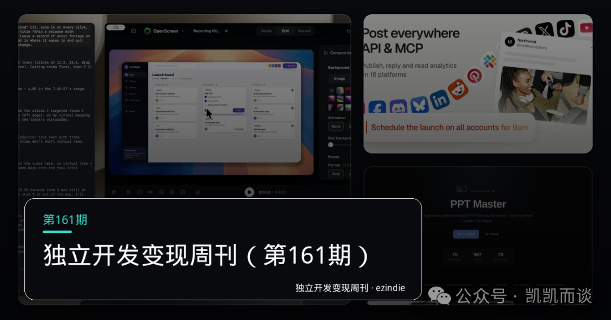
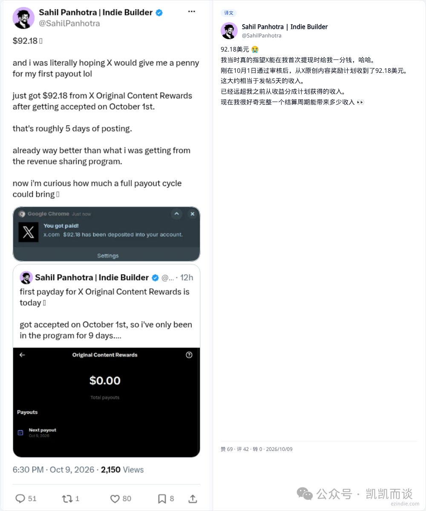
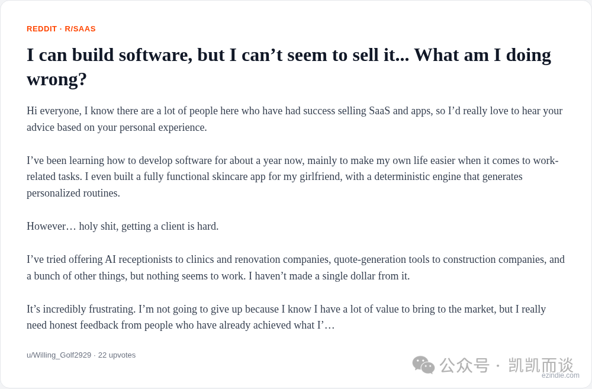
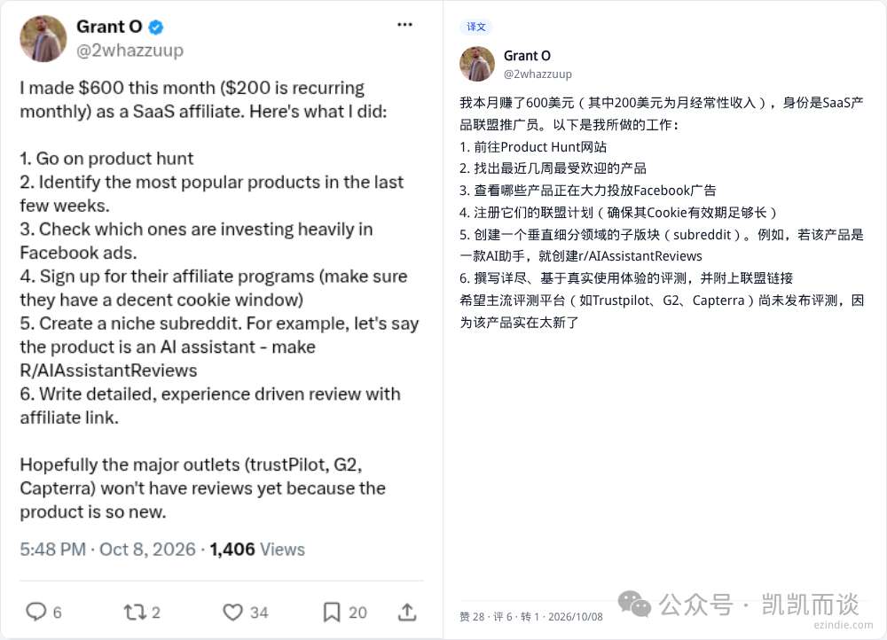
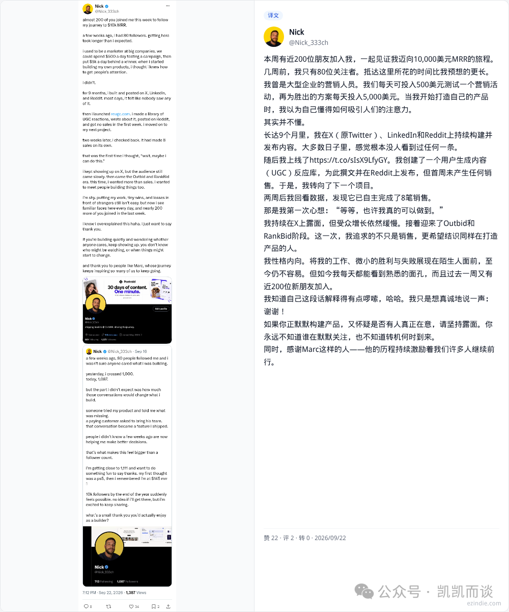
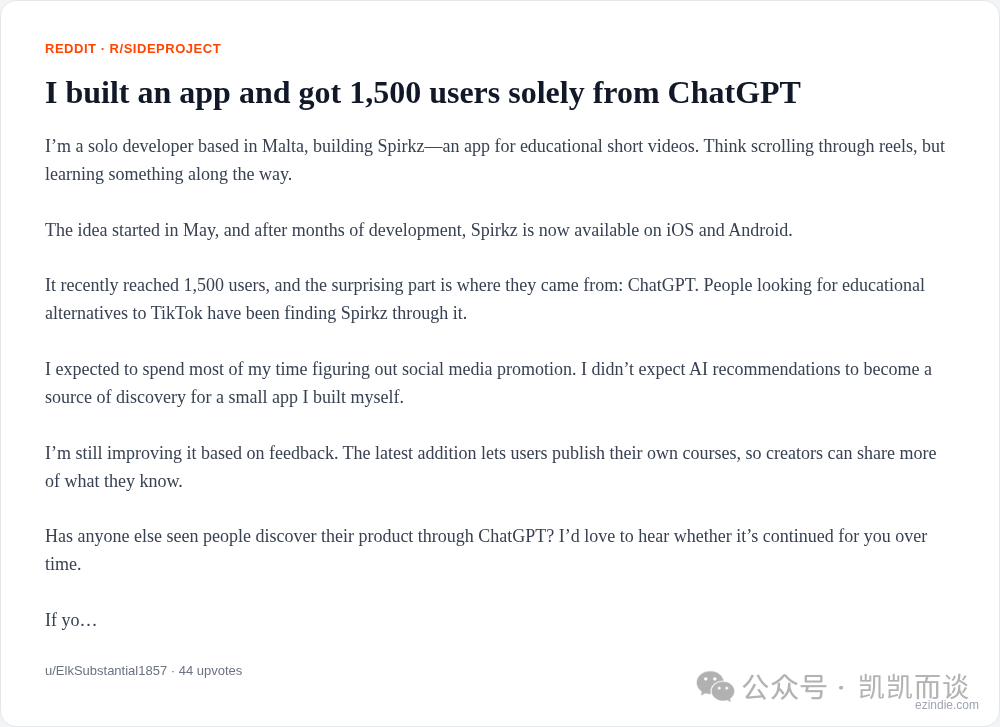
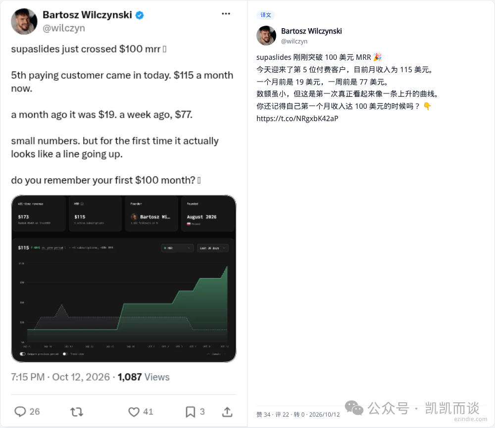
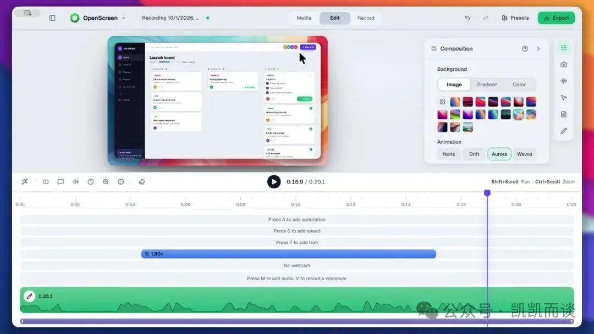
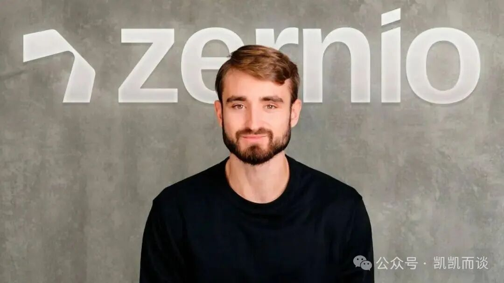
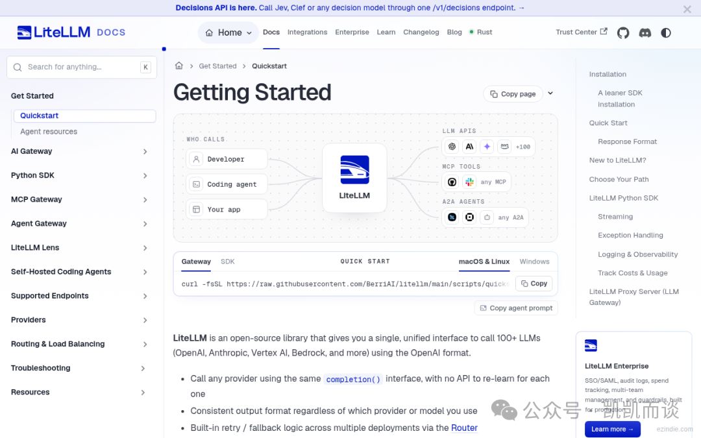

# 独立开发变现周刊（第161期）：从内容奖励到 AI 原生获客的 10 个案例

> 本期整理 10 个独立开发与 AI 产品案例，覆盖内容变现、销售验证、联盟营销、冷启动、LLM 推荐、视频营销和开源基础设施。

<!-- more -->

## 1. X 原创内容奖励

文章引用一位创作者首周获得 92.18 美元的案例，并将收益路径概括为三步：发布原创内容、获得 X 付费用户在首页信息流中的合格曝光、按周期结算。文中提到官方通常每两周结算一次，最低付款金额为 30 美元；非美国创作者需要关联 Stripe 并完成身份验证。

这里真正值得记录的是收益机制的约束：原创内容和合格曝光比单纯浏览量更重要，搬运或轻微改写不能替代持续创作。

来源：<https://x.com/SahilPanhotra/status/2108626214516912331>

## 2. 能造不能卖：5 款工具零收入

一位开发者有较强的产品实现能力，一年里做了个性化护肤 App、AI 接待员和报价生成工具，却没有获得收入。问题不在技术，而在于同时服务多个行业，缺少聚焦、行业认知和清晰的价值表达。

可复用的破局动作有三组：

- 收缩到拥有不公平优势的细分场景，优先选择自己熟悉或能持续接触的人群。
- 访谈 15 到 20 位真实用户，只问问题发生时的具体代价，不急着展示产品。
- 当至少 3 人重复描述同一损失时，先用人工或半自动方式交付结果，并收取小额预付款。

早期应该追踪每周有效对话数和付费意愿，而不是代码行数、功能数量或泛化反馈。对装修等决策链较短的行业，可以用结果导向的冷邮件切入，例如把“报价延迟导致丢单”转化成“当天发出报价”的明确承诺。

来源：<https://www.reddit.com/r/SaaS/comments/1wz2wp2/i_can_build_software_but_i_cant_seem_to_sell_it/>

## 3. SaaS 联盟营销

本期将一个月收入 600 美元、MRR 约 200 美元的联盟营销案例归纳为“流量洼地 + 信任基建”。它体现了 build in public 的一个常见路径：先在具体渠道持续提供有用内容，建立信任，再将匹配的 SaaS 产品放进用户已经存在的决策场景。

来源：<https://x.com/2whazzuup/status/2108253256220639588>

## 4. UGC 反应库的冷启动

UGC 反应库上线两周后自动成交 8 单，开发者的关注者从 0 增长到 200。这个案例没有依赖夸张的增长曲线，而是说明产品可能在公开发布后延迟产生效果：内容、产品和用户需求之间需要时间累积，不能用短期无人问津直接判断产品失败。

来源：<https://x.com/Nick_333ch/status/2102476131983327381>

## 5. Spirkz：来自 ChatGPT 推荐的 1,500 名用户

Spirkz 是一款教育类短视频 App，采用类似信息流的“边刷边学”体验，覆盖 iOS 和 Android。文章记录其获得约 1,500 名用户，主要来源于 ChatGPT 在用户搜索 TikTok 替代品或教育类短视频时的推荐。

这个案例提示了一条新的冷启动路径：产品官网和应用商店页面不仅要面向传统搜索引擎优化，也要让产品定位、目标人群和核心能力能够被 LLM 准确理解和引用。现阶段不能仅凭单个案例断言 ChatGPT 推荐具有稳定可复制性，但“AI 原生发现”值得作为独立渠道持续观察。

来源：<https://www.reddit.com/r/SideProject/comments/1x3bb2q/i_built_an_app_and_got_1500_users_solely_from/>

## 6. SupaSlides：5 名付费用户带来 100 美元 MRR

SupaSlides 用极简产品、清晰定价和公开迭代获得了 5 名付费用户，达到 100 美元 MRR。对早期产品而言，少量真实付费比大量试用或赠阅更能证明价值假设；100 美元 MRR 不是规模化结果，但足以作为下一轮访谈、定价和渠道实验的可信信号。

来源：<https://x.com/wilczyn/status/2109724542184673541>

## 7. OpenScreen 2：录制即完成演示视频

OpenScreen 2 面向开发者和独立创作者制作产品演示视频，支持录制，并由 AI 自动完成剪辑、字幕和高亮片段提取。它的定位不是通用视频编辑器，而是“录即编”的窄工作流，降低 MVP 发布时制作 Demo 视频的成本。

来源：<https://www.producthunt.com/products/openscreen-2>

## 8. Zernio：面向 AI Agent 的营销基础设施

Zernio 将用户行为追踪、转化归因、实验框架和自动化营销工作流组合成面向 AI Agent 与独立产品团队的营销基础设施。它位于传统营销云和开发者原生工具之间，强调可编程接口与低代码配置。

这个方向反映出 AI 产品正在补齐“增长层”：当 Agent 能够生成和执行任务后，仍需要标准化的用户行为、实验和转化反馈，才能形成可优化的产品闭环。

来源：<https://www.producthunt.com/products/zernio>

## 9. LiteLLM：统一调用多家模型服务

LiteLLM 为多个大模型服务提供统一的 OpenAI 兼容调用方式，并提供成本追踪、请求守卫、负载均衡和日志能力。它解决的是服务商接口碎片化问题：产品团队可以将模型路由、监控和成本控制集中在一个抽象层，而不必为每个平台重复编写适配逻辑。

来源：<https://github.com/BerriAI/litellm>

## 10. ppt-master：生成原生 PowerPoint

ppt-master 将文档或主题转换为具备原生形状、过渡动画、图表、表格和 speaker notes 音频 narration 的 PowerPoint 文件，并支持自定义 `.pptx` 模板。它强调可编辑的原生交付，而不是只把 Markdown 或图片包装成幻灯片。

这个案例的价值在于，它把 AI 办公工具的竞争重点从“能不能生成”推进到“生成结果能否进入真实生产流程”：格式可编辑、结构可修改、模板可复用，才更接近用户愿意长期采用的交付物。

来源：<https://github.com/hugohe3/ppt-master>

## 本期共性

本期 10 个案例可以压缩成四条可复用判断：

1. **先验证价值，再扩展产品**：真实付费、小额预付款和有效对话，比功能数量更接近 PMF。
2. **把渠道当成产品的一部分**：X 原创内容、联盟营销、UGC 内容和 LLM 推荐，都是需要持续建设的分发系统。
3. **窄定位胜过大而全**：OpenScreen 2、Zernio 和 SupaSlides 都从一个清晰工作流或人群切入。
4. **基础设施的价值在于减少重复劳动**：LiteLLM 统一模型接口，ppt-master 统一可编辑演示交付，解决的是长期工程摩擦。

## 来源说明

本文根据微信公众号文章整理，保留原文中的案例、数字和外部来源链接，删除原文末尾的点赞、关注和知识星球推广内容。外部案例数据属于原文转述，未在本次采集中独立核验。
